

  <picture>
    <source media="(prefers-color-scheme: dark)" srcset="docs/brand/wordmark-dark.png">
    
  </picture>

  
  
  
   
  
  
  
  
   
  
  
  

## 🚨 Project Status Notice

> [!IMPORTANT]
> - AULA Toolkit is in **early development** (version 0.x). Expect rough edges.
> - It is an **unofficial** project and is **not affiliated with AULA**. Product names and images belong to their owners.
> - Only some devices have been tested on real hardware; see [Compatibility](#compatibility).

#### Other language versions of this README file:
[Türkçe](README_tr-TR.md) · [Русский](README_ru-RU.md) · [简体中文](README_zh-CN.md) · [Українська](README_uk-UA.md) · [Tiếng Việt](README_vi-VN.md) · [Português (Brasil)](README_pt-BR.md) · [Español](README_es-ES.md) · [Deutsch](README_de-DE.md) · [Français](README_fr-FR.md)

---

AULA Toolkit is a Windows desktop app that controls AULA keyboards and mice from one place, in the spirit of Logitech G HUB. It replaces the separate driver that AULA ships for every model.

It runs no background services, keeps no telemetry and only talks to the internet to check GitHub for updates. Changes are written to the device the moment you make them and are stored in the device's own memory, so they keep working on other computers and over Bluetooth.

# Screenshots

### Home and device overview
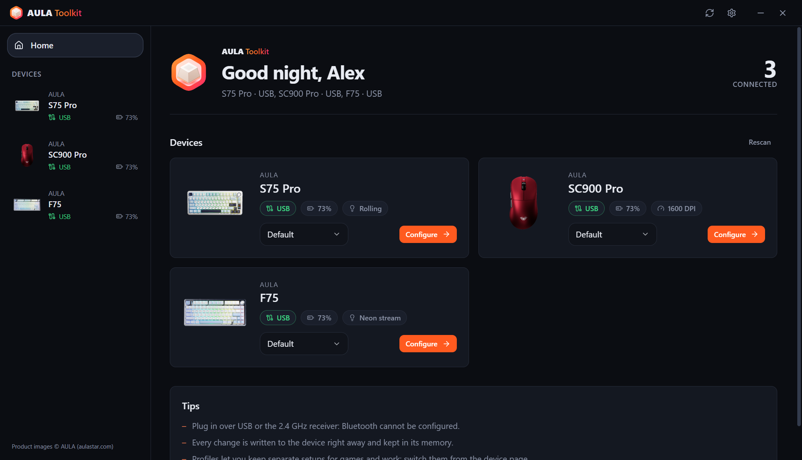 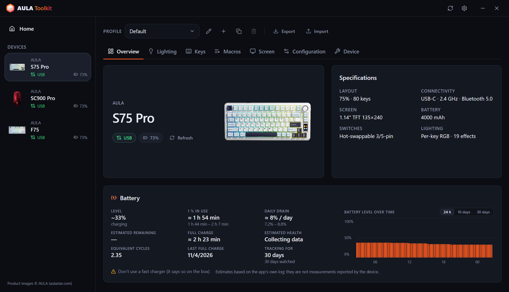

### Keyboards
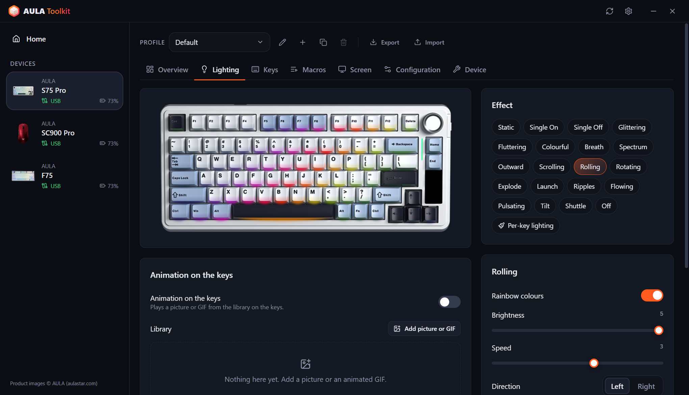 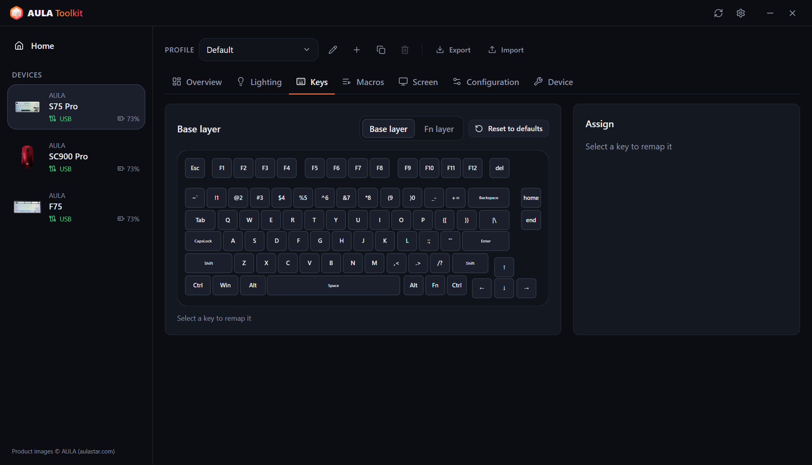
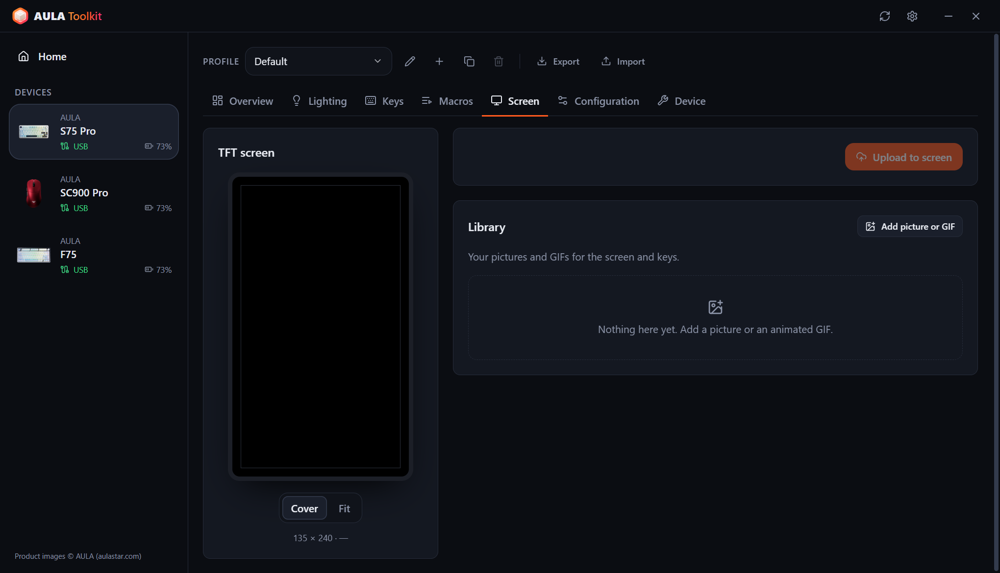 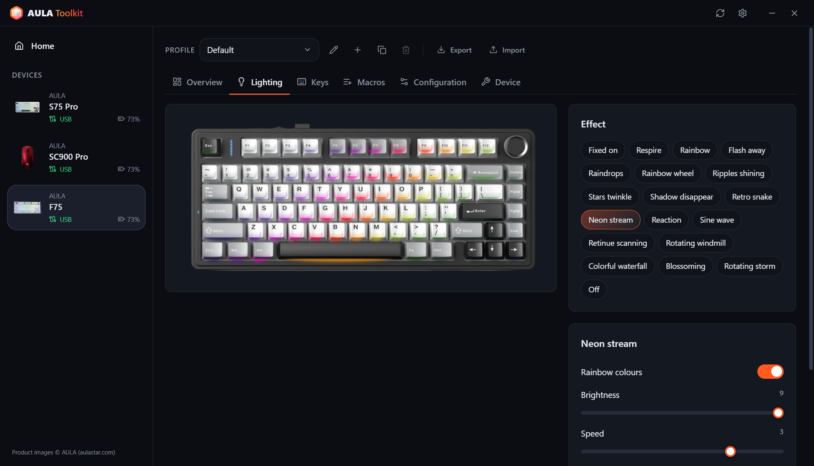

### Mice
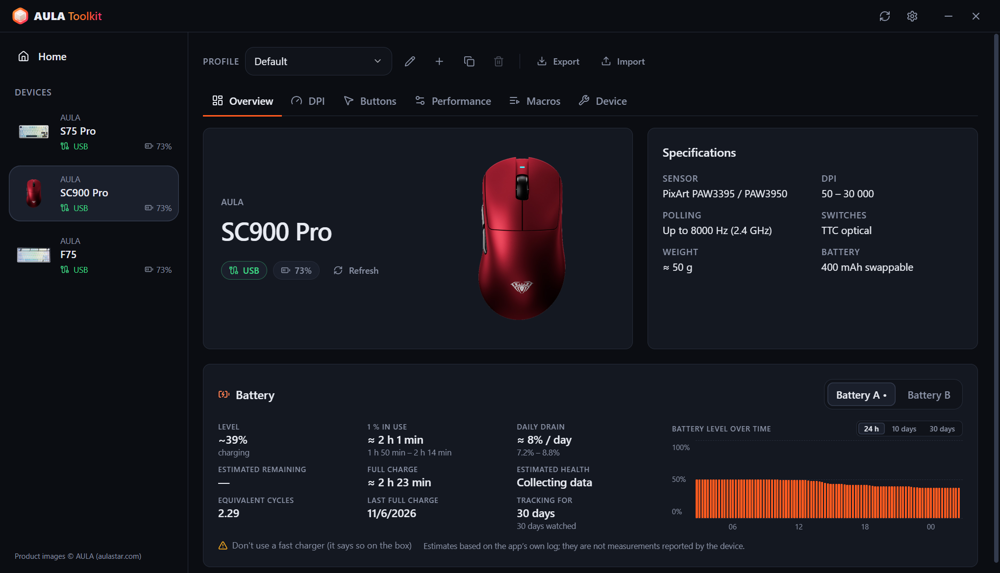 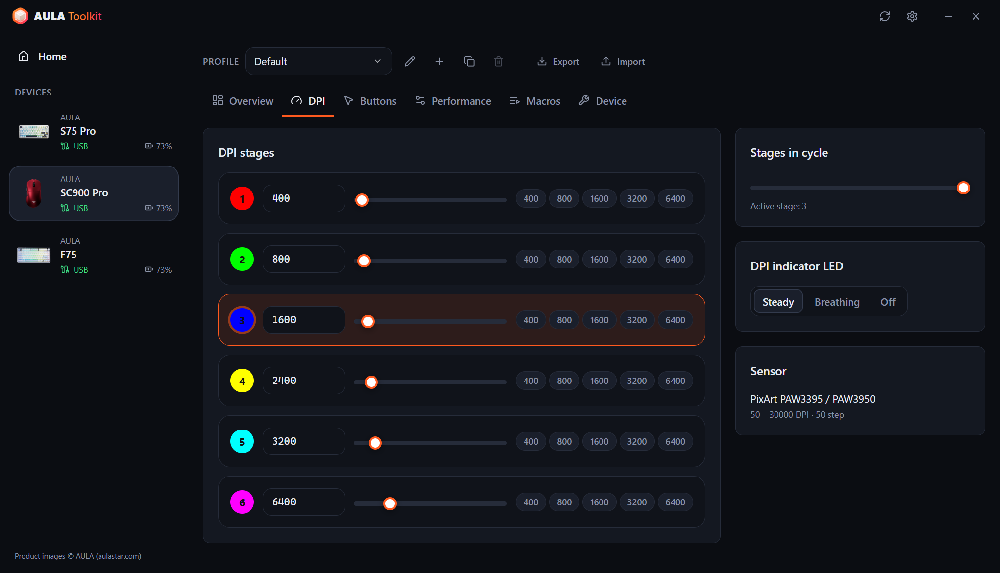
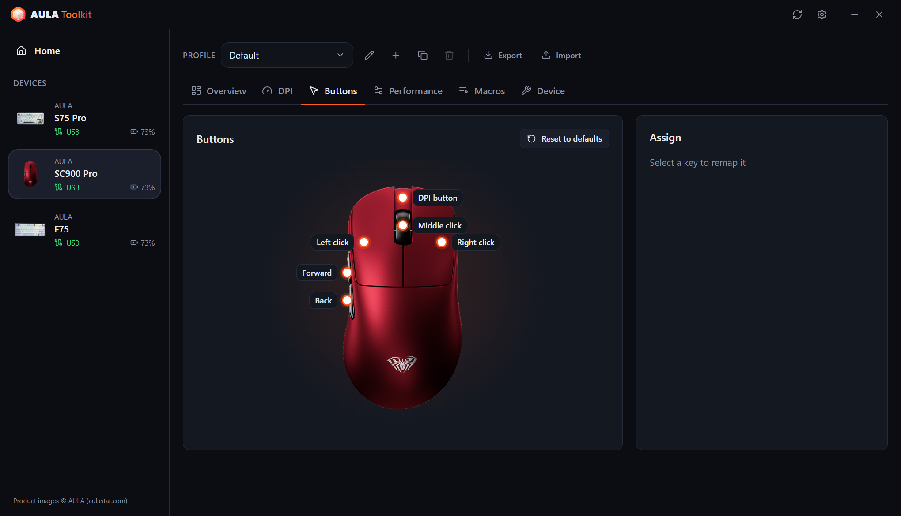 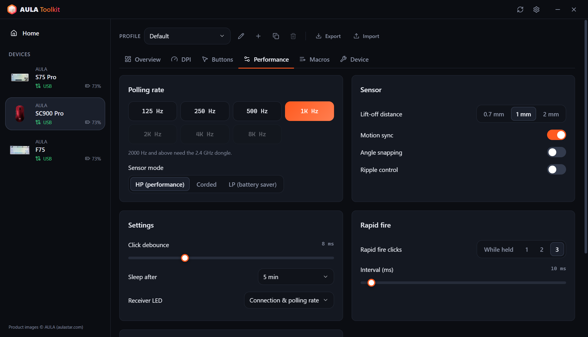

### Tray summary and on-screen display
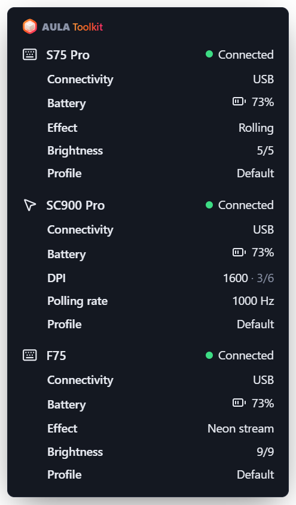 &nbsp; 

### Settings
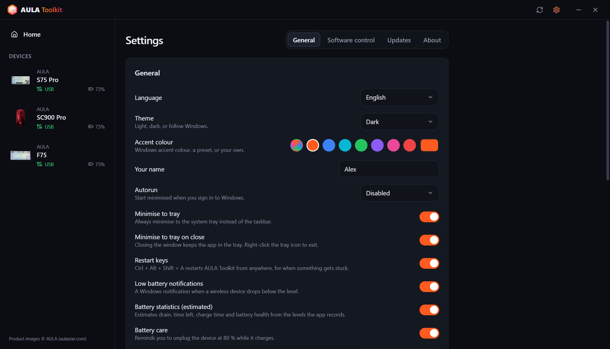 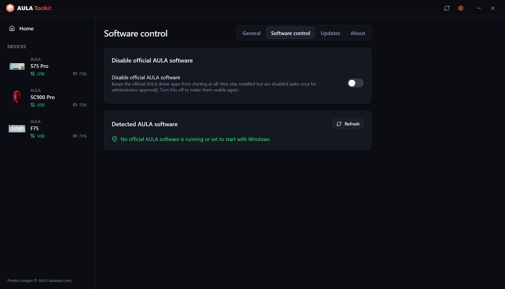
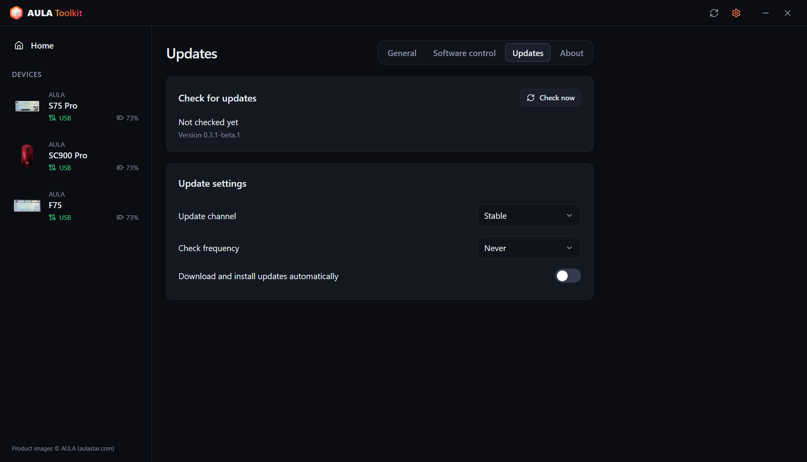 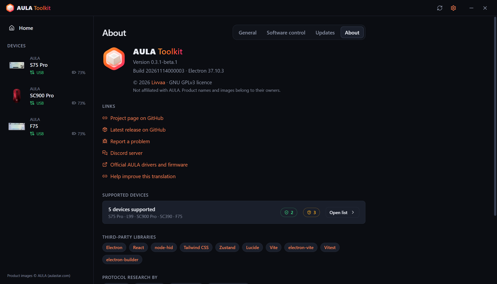
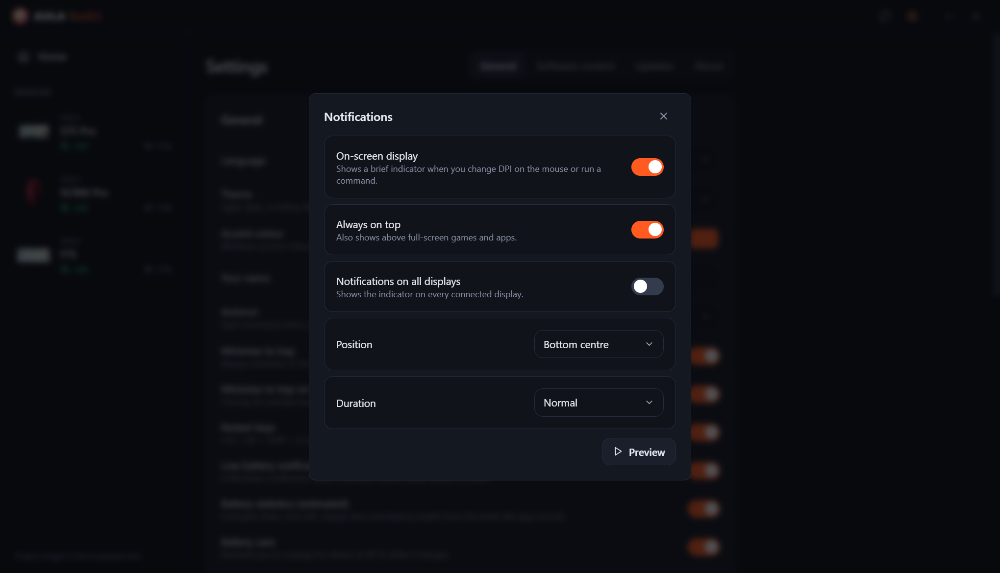 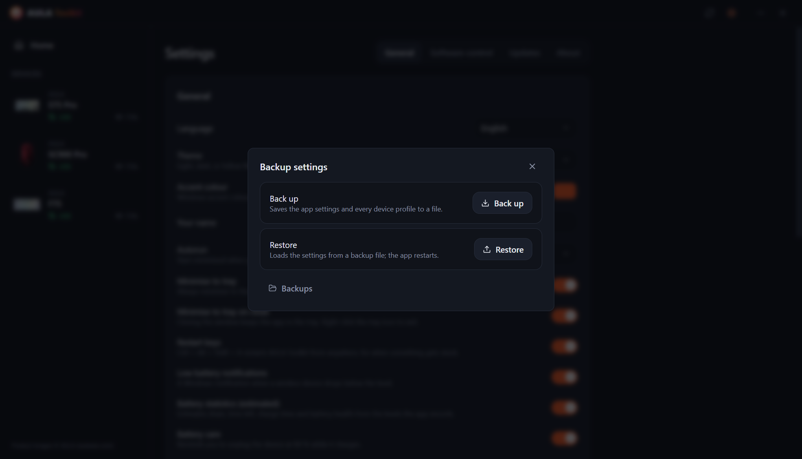

---

# Table of Contents
  - [Disclaimer](#disclaimer)
  - [Download](#download)
  - [Compatibility](#compatibility)
  - [Features](#features)
  - [Credits](#credits)
  - [FAQ](#faq)
  - [Arguments](#arguments)
  - [How to collect logs?](#how-to-collect-logs)
  - [Contribution](#contribution)
  - [License](#license)

## Disclaimer

**The tool comes with no warranty. Use at your own risk.**

AULA Toolkit talks to your devices with protocols that were reverse-engineered from the official drivers. Please read this file before reporting problems — it answers the most common questions.

## Download

Two builds are published with every release:
* **Installer** — installs for the current user only, so no administrator rights are needed.
* **Portable** — a single `.exe` that runs without installing.

#### Updating

AULA Toolkit can update itself. Configure it in **Settings → Updates**:
* **Channel** — **Stable** or **Beta** releases.
* **Check frequency** — from every hour to monthly, or never.
* **Download and install updates automatically** — updates download in the background and install quietly while you are away from the PC (or when you close the app). You can also install them right away.

Installing a new version over an existing one keeps your settings, profiles and macros.

#### Next steps

AULA Toolkit works best when it runs in the tray. In **Settings → General**:
1. Set **Autorun** to *Enabled* (or *Enabled (delayed)* to start 30 seconds after sign-in). AULA Toolkit starts through a Windows scheduled task, so it also starts on battery power; the task is checked every time the app starts and recreated if it was removed.
2. Turn on **Minimise to tray on close**.
3. In **Settings → Software control**, turn on **Disable official AULA software** so the AULA drivers do not fight AULA Toolkit over the same device.

> [!WARNING]
> If you close AULA Toolkit completely, features that need it running stop: the on-screen display, battery notifications, the tray summary, the music rhythm and animations on the keys, and the `aula` command. Settings already written to your devices keep working.

## Compatibility

| Device | Connection | Status |
|---|---|---|
| **AULA S75 Pro** | USB, 2.4 GHz receiver, Bluetooth (status and battery) | ✅ Tested on hardware |
| **AULA L99** | USB, 2.4 GHz receiver, Bluetooth (status and battery) | 🧪 Beta, being tested by users |
| **AULA SC900 Pro** | USB, 2.4 GHz receiver, Bluetooth (status and battery) | ✅ Tested on hardware |
| **AULA SC900** (other versions that use the SC900 Pro driver) | USB, 2.4 GHz receiver | ⚠️ Recognised, not yet tested on hardware |
| **AULA SC390** | USB | 🧪 Beta, being tested by users |
| **AULA F75** | USB, 2.4 GHz receiver | ⚠️ Recognised, not yet tested on hardware |

Beta devices are supported from USB captures of the official driver that their owners sent in. Some features are still missing; see the table below.

AULA sells the same mouse in several colours under one USB ID, so AULA Toolkit cannot tell them apart. Pick your colour during device setup or in the device's **Device** tab.

Your AULA device is not on the list? It may still use one of the protocols above — see [Can you add support for my AULA device?](#can-you-add-support-for-my-aula-device).

#### What works over which connection

**Keyboards**

| Feature | S75 Pro · USB | S75 Pro · 2.4 GHz | L99 · USB | L99 · 2.4 GHz | F75 · USB / 2.4 GHz |
|---|:---:|:---:|:---:|:---:|:---:|
| Lighting effects | ✅ | ✅ | ✅ | ✅ | ✅ |
| Per-key lighting | ✅ | ✅ | ✅ | ✅ | — |
| Music rhythm and animation on the keys (streamed from the PC) | ✅ | — | ✅ | — | — |
| Lights off while the monitor is off | ✅ | ✅ | — | — | — |
| Live keyboard view, knob / Fn changes followed | ✅ | — | — | — | — |
| Key mapping, Fn layer, macros | ✅ | ✅ | ✅ | ✅ | ✅ |
| Keyboard settings (Win lock, sleep, debounce) | ✅ | ✅ | ✅ | ✅ | ✅ |
| Screen | ✅ TFT | — | Coming | — | — |
| Clock (synced on connect) | ✅ | ✅ | ✅ | ✅ | — |
| Side light bar | ✅ | ✅ | — | — | — |
| Battery level | — | ✅ | — | ✅ | — |
| Settings read back when connecting | — | — | — | — | ✅ |

**Mice**

| Feature | SC900 Pro · USB / 2.4 GHz | SC390 · USB |
|---|:---:|:---:|
| DPI stages and DPI indicator | ✅ | Coming |
| Polling rate | ✅ up to 8000 Hz | ✅ up to 1000 Hz (cable and receiver) |
| Sensor (lift-off distance, ripple control and more) | ✅ | ✅ |
| Buttons and macros | ✅ | Coming |
| Sleep time | ✅ | Coming |
| Battery level | ✅ | — |
| Settings read back when connecting | ✅ | ✅ |
| On-screen display for the DPI button | ✅ | — |

> [!NOTE]
> Devices can only be configured over **USB** or the **2.4 GHz receiver**. Over Bluetooth the device does not expose its configuration interface — the official AULA software has the same limitation. Settings you saved earlier keep working over Bluetooth, and AULA Toolkit still shows the device as connected there, with the battery level Windows reports.

### AULA's software

Running the official AULA driver and AULA Toolkit at the same time makes both talk to the same device, which can undo changes or cause read errors. AULA Toolkit shows a warning band at the bottom of the window when it detects an official AULA program. **Settings → Software control → Disable official AULA software** keeps them from starting at all: they stay installed, but their programs are disabled (Windows asks once for administrator approval) and their autostart entries are parked. Turning the option off makes them usable again, and uninstalling AULA Toolkit restores them too.

## Features

The app allows you to:

- Configure every supported device from one window, with changes applied instantly.
- Never overwrite what is already on a device by itself: the mouse's settings are read back when it connects, and on the S75 Pro the effect, colour and brightness you change with the knob or Fn keys are picked up live and saved to your profile.
- Keep several **profiles** per device and export or import them as files.
- See a live **on-screen display** when you press the DPI button on the mouse or run a command.
- Play **music rhythm** bars and **animations (GIF)** on the keys of the S75 Pro, streamed from the PC.
- Turn the keyboard lighting **off while the monitor is off**, and back on when it wakes.
- Restart the app from anywhere with **Ctrl + Alt + Shift + A** when something gets stuck.
- Get a detailed **tray summary** of every connected device by hovering the tray icon.
- Receive **low-battery notifications**, a **battery care** reminder at 80 % while charging and, if you like, view **battery statistics**.
- Disable the official AULA software without uninstalling it.
- Control devices from the **command line** with `aula`.
- Use it in **10 languages**: English, Türkçe, Русский, 简体中文, Українська, Tiếng Việt, Português (Brasil), Español, Deutsch and Français.
- Pick a **light, dark or system theme** and an accent colour.

### Keyboards

* **Lighting** — every hardware effect with colour, brightness, speed and direction, plus a preview drawn on a photo of your keyboard.
* **Live view** (S75 Pro, USB) — the keyboard picture shows what the LEDs show right now. When you change the effect with the knob or the Fn keys, the app recognises it within a few seconds, selects it and shows it on screen. The keyboard does not report its effect, so this works from the LED colours: effects that stay dark until you press a key look the same while idle, and very quick turns can skip an effect in between.
* **Per-key lighting** (S75 Pro) — paint keys one by one or fill the whole board.
* **While music plays** — bars on the keys follow the sound playing on the PC (12 colour schemes, amplitude and background, as in the official driver), or the keyboard switches to an effect you pick. The bars need the USB cable; on the receiver the effect is used.
* **Animation on the keys** (S75 Pro, USB) — plays a picture or GIF from your library on the keys, at about 20 frames a second.
* **Display off** (S75 Pro) — the keys and the side bar go dark while the monitor is off.
* **Key mapping** — remap keys on the base layer and the Fn layer to keys, mouse buttons, media keys, shortcuts or macros.
* **Macros** — record keystrokes with real timing and edit them afterwards.
* **TFT screen** (S75 Pro, USB) — upload a picture or an animated GIF from your library. Drag the preview to choose the visible part; long GIFs are fitted to the screen's 141 frames without changing their pace. The clock is synced every time the keyboard connects.
* **Configuration** — lock the Windows key, Alt+F4 and Alt+Tab, set sleep time and key response time.
* **Reset** — restore the keyboard's defaults or do a full factory reset.

### Mice

* **DPI** — up to six stages, the active stage, the number of stages in the cycle and the DPI indicator LED.
* **Polling rate** — up to 8000 Hz. Rates above 1000 Hz need the 2.4 GHz receiver. On the SC390 the cable and the receiver have separate rates.
* **Sensor** — lift-off distance, motion sync, angle snapping, ripple control and sensor mode. On the SC390: lift-off distance, Ultra Low Delay, Ultra Low Power, Ripple Control and Move WakeUp.
* **Buttons** — remap any button except left click, including rapid fire and macros.
* **Timing** — click debounce and sleep time.
* **Battery** — level and charging state. The SC900 Pro's two batteries (and any extra ones you add) are tracked separately.

### On-screen display

When you change the DPI with the mouse's own button, a small indicator appears on the screen with the new value and the active stage. On the S75 Pro (USB) it also shows the new effect, colour or brightness when you change them on the keyboard, and it confirms changes made with the `aula` command. Screen uploads, the 80 % reminder and restarts show up there too. In **Settings → Notifications** you can turn it off, choose its position and duration, keep it above full-screen games, or show it on every display.

### Backups

**Settings → Backup settings** saves the app settings and every device profile to a single file, and restores them from one later, for example after reinstalling Windows.

### Battery statistics

**Settings → General → Battery statistics** (on by default) shows a battery card in each device's overview:

* **Level** — the current level, or the last one with how long ago it was read. On the cable without a reading, an estimate and then 99+.
* **1 % in use** — how long 1 % lasts while the device is in use on the receiver.
* **Daily drain** and **time left** — over calendar time, including the hours it sleeps or the app is closed.
* **Full charge** and **health** — from how fast the battery charges in the middle of its range.
* **Equivalent cycles**, **last full charge** and a chart with three views: the last 24 hours, battery used per day over 10 days, and the level over 30 days. Hover the chart for exact values; charging is shown in green.

Figures are shown with a range, once enough has been recorded. Levels are recorded over USB, the 2.4 GHz receiver and Bluetooth (read from Windows). **Battery care**, on by default with the statistics, reminds you at 80 % while charging to unplug the device.

> [!NOTE]
> AULA devices only report their battery percentage. Every figure above is an **estimate** calculated from the levels AULA Toolkit records.

> [!WARNING]
> Don't use a fast charger, the boxes say so too.

### CLI

You can control AULA Toolkit from the command line. The command is called `aula` and is installed in `resources\bin` inside the install folder (by default `%LOCALAPPDATA%\Programs\AULA Toolkit\resources\bin\aula.cmd`). The installed app adds that folder to your user `PATH` by itself, so `aula` works in any new terminal; uninstalling removes it again. The portable build does not change `PATH`. **Settings → General → Command line** shows the exact path with a copy button.

The command talks to the running app. If AULA Toolkit is not running, `aula` starts it in the tray first. It does not need administrator rights.

Commands

* `aula status` — list connected devices (add `--json` for machine-readable output)
* `aula profile list` — list the profiles of a device
* `aula profile set <name>` — switch to a profile
* `aula dpi` — show the mouse's DPI stages
* `aula dpi stage <n>` — activate DPI stage `<n>` (1-based)
* `aula dpi <value>` — set the active stage to `<value>` DPI
* `aula polling <hz>` — set the mouse polling rate
* `aula light list` — list the keyboard's effects
* `aula light <effect> [--color #rrggbb] [--brightness n] [--speed n]` — set the keyboard effect
* `aula brightness <n>` — set the keyboard lighting brightness
* `aula osd on|off` — turn the on-screen display on or off
* `aula show` / `aula hide` — show or hide the window
* `aula version` — print the app version

When more than one device of a kind is connected, pick one with `-d <id>`, for example `aula profile list -d sc900`. The command exits with code `0` on success and `1` on failure, so it can be used in scripts.

## Credits

AULA Toolkit is created and maintained by **Livvaa** ([GitHub](https://github.com/Livvaa)).

Special thanks to the projects whose public reverse-engineering work made this possible:
* [open-aula](https://github.com/paulcoding810/open-aula) — AULA keyboard protocols.
* [AulaSofwareLinux](https://github.com/thought-train/AulaSofwareLinux) — the protocol used by the AULA F75 family.
* [IncottHIDApp](https://github.com/romkazor/IncottHIDApp) and [OpenMouse](https://github.com/OpenMouse-Project/mouse-protocol) — the PixArt 8K mouse protocol.

All protocol details were cross-checked against the official AULA drivers. Product images © AULA ([aulastar.com](https://www.aulastar.com)).

### Third-party libraries

* **Electron** ([electron/electron](https://github.com/electron/electron))
* **React** ([facebook/react](https://github.com/facebook/react))
* **node-hid** ([node-hid/node-hid](https://github.com/node-hid/node-hid))
* **Tailwind CSS** ([tailwindlabs/tailwindcss](https://github.com/tailwindlabs/tailwindcss))
* **Zustand** ([pmndrs/zustand](https://github.com/pmndrs/zustand))
* **Lucide** ([lucide-icons/lucide](https://github.com/lucide-icons/lucide))
* **electron-vite** ([alex8088/electron-vite](https://github.com/alex8088/electron-vite)), **Vite** ([vitejs/vite](https://github.com/vitejs/vite)) and **Vitest** ([vitest-dev/vitest](https://github.com/vitest-dev/vitest))
* **electron-builder** and **electron-updater** ([electron-userland/electron-builder](https://github.com/electron-userland/electron-builder))

### Translations

The interface is available in 10 languages. Not all translations have been reviewed by native speakers yet. If you spot a mistake, please open a pull request — each language is a single file in [`src/shared/locales`](src/shared/locales).

## FAQ

#### Can AULA Toolkit damage my device?

AULA Toolkit never touches the firmware. It only sends the same configuration commands as the official driver (lighting, keys, macros, DPI and so on), checked against USB captures of that driver. If something looks wrong, the device's reset in the **Device** tab or the official software brings back the defaults.

#### Why can't I change settings over Bluetooth?

Over Bluetooth the keyboard and mouse only appear to Windows as a standard keyboard and mouse. The configuration interface that USB and the 2.4 GHz receiver provide does not exist there, so neither AULA Toolkit nor the official software can change settings. Connect with the cable or the receiver, make your changes, and switch back to Bluetooth — the settings stay on the device. Over Bluetooth AULA Toolkit shows the connection and the battery level that Windows reports.

#### Why doesn't my keyboard show a battery level?

The S75 Pro reports its battery level over the 2.4 GHz receiver, and Windows reports it over Bluetooth. Over USB it is charging and the firmware reports no level: AULA Toolkit shows an estimate from the measured charge speed, then 99+.

#### Why are battery cycles and health only estimates?

AULA devices have no battery chip that counts cycles or measures wear. They only report a percentage, so AULA Toolkit estimates everything else from when that percentage changes. Health comes from how fast the battery charges, so it needs several charges over a month or more.

#### Can AULA Toolkit read the picture on the S75 Pro screen or the firmware version?

No. The keyboard firmware can receive a picture but has no command to send it back, and none of the supported devices report their firmware version. The official software cannot do this either.

#### Why does Windows warn me when I run the installer?

The installers are not code-signed yet, so Windows SmartScreen shows a warning for an unknown publisher. AULA Toolkit is open source and you can build it yourself from this repository. Choose **More info → Run anyway** to continue.

#### My mouse is a different colour than the picture.

AULA uses the same USB ID for every colour of a model. Choose your colour in the device's **Device** tab.

#### Can you add support for my AULA device?

Possibly. Most AULA keyboards and mice reuse one of the protocol families AULA Toolkit already speaks. See [Contribution](#contribution) for what to include in a request.

## Arguments

* `--hidden` — start minimised to the tray. Used by *Autorun*.
* `--delayed` — wait 30 seconds before connecting to devices. *Autorun → Enabled (delayed)* now waits in the scheduled task instead.

## How to collect logs?

Logs help a lot with any problem. **Always** attach them to your issues.

#### Method 1: Diagnostics bundle (recommended)
1. Open **AULA Toolkit**.
2. Go to **Settings → About**.
3. Click **Save diagnostics bundle**. It saves the device status and the communication log into one file you can attach to your issue.

#### Method 2: Log files
1. Reproduce the problem.
2. Open `Run` (Win+R), type `"%APPDATA%\AULA Toolkit\logs"` and press OK.
3. Attach the newest `hid-<date>.log` file.

You can also watch the log live in **Settings → General → Advanced**.

## Contribution

Feedback is very welcome, so please don't hesitate to report issues. Pull requests are welcome too. Please read the [contributing guide](CONTRIBUTING.md) first.

Questions, ideas or just want to chat? Join the [Discord server](https://discord.gg/u9FbaJGtCe).

#### Device support

Support for more AULA devices needs testers. When you open a request, please include:

1. The full model name (for example *AULA F87 Pro*).
2. The USB IDs, found in **Device Manager → your device → Details → Hardware Ids** (for example `VID_0C45&PID_800A`).
3. Which connection you used (USB or 2.4 GHz).
4. A diagnostics bundle (see [How to collect logs?](#how-to-collect-logs)).
5. If you can: a USB capture of the official driver. Install [Wireshark](https://www.wireshark.org/download.html) with USBPcap, close AULA Toolkit, start capturing, change one setting at a time in the official driver and write down the order. Attach the `.pcapng` file zipped. This is how the L99 and SC390 were added.

## License

Copyright (C) 2026 Livvaa

AULA Toolkit is free software: you can redistribute it and/or modify it under the terms of the
GNU General Public License as published by the Free Software Foundation, either version 3 of the
License, or (at your option) any later version. See [LICENSE](LICENSE) for the full text.

This program is distributed in the hope that it will be useful, but WITHOUT ANY WARRANTY; without even
the implied warranty of MERCHANTABILITY or FITNESS FOR A PARTICULAR PURPOSE.

AULA Toolkit is not affiliated with AULA. Product names and images belong to their owners.
