

  <picture>
    <source media="(prefers-color-scheme: dark)" srcset="docs/brand/wordmark-dark.png">
    
  </picture>

  
  
  
   
  
  
  
  
   
  
  
  

## 🚨 Hinweis zum Projektstatus

> [!IMPORTANT]
> - AULA Toolkit befindet sich in der **frühen Entwicklung** (Version 0.x). Rechne mit Ecken und Kanten.
> - Es ist ein **inoffizielles** Projekt und **steht in keiner Verbindung zu AULA**. Produktnamen und -bilder gehören ihren Inhabern.
> - Nur einige Geräte wurden auf echter Hardware getestet; siehe [Kompatibilität](#kompatibilität).

#### Diese README in anderen Sprachen:
[English](README.md) · [Türkçe](README_tr-TR.md) · [Русский](README_ru-RU.md) · [简体中文](README_zh-CN.md) · [Українська](README_uk-UA.md) · [Tiếng Việt](README_vi-VN.md) · [Português (Brasil)](README_pt-BR.md) · [Español](README_es-ES.md) · [Français](README_fr-FR.md)

---

AULA Toolkit ist eine Windows-Desktop-App, mit der du AULA-Tastaturen und -Mäuse an einem Ort steuerst, im Stil von Logitech G HUB. Sie ersetzt die separaten Treiber, die AULA für jedes Modell mitliefert.

Sie startet keine Hintergrunddienste, sammelt keine Telemetrie und geht nur ins Internet, um auf GitHub nach Updates zu suchen. Änderungen werden sofort auf das Gerät geschrieben und in dessen eigenem Speicher abgelegt. Sie funktionieren also auch an anderen Computern und über Bluetooth.

# Screenshots

### Startseite und Geräteübersicht
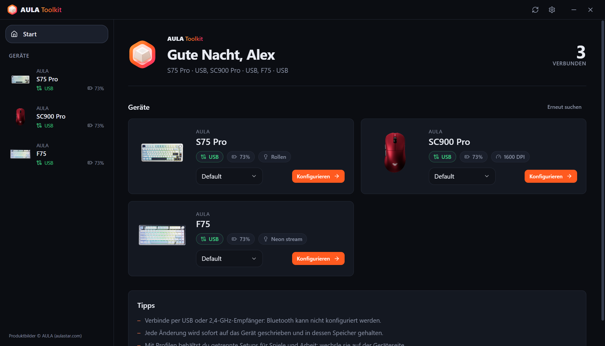 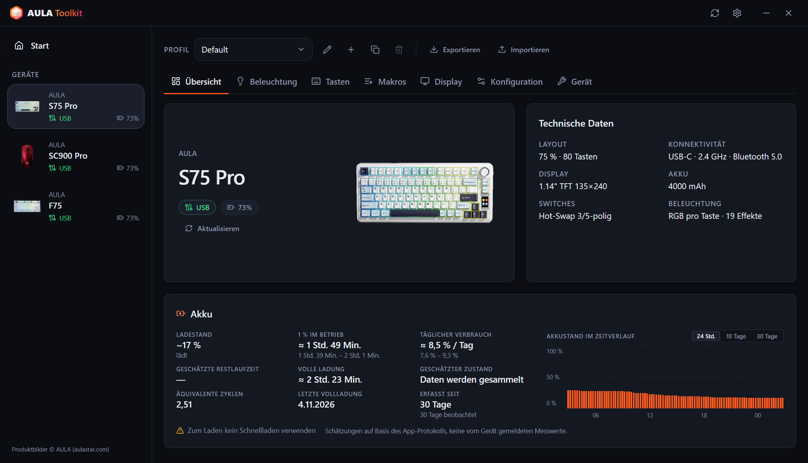

### Tastaturen
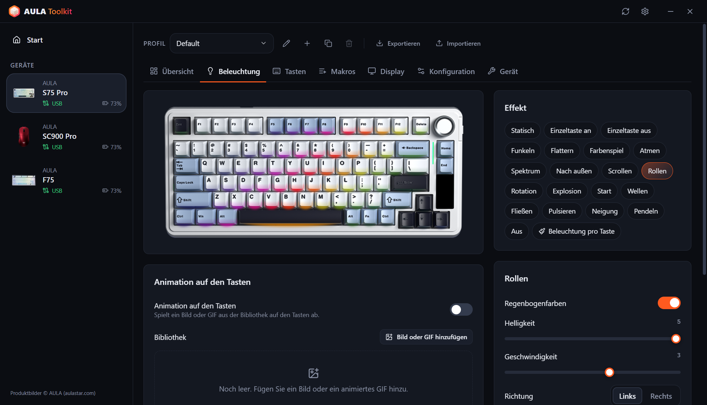 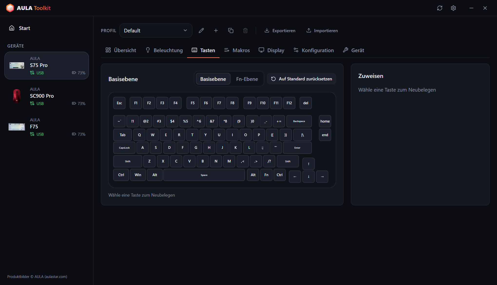
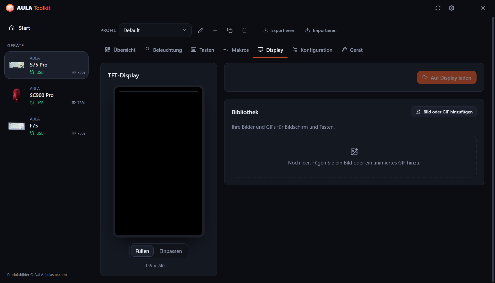 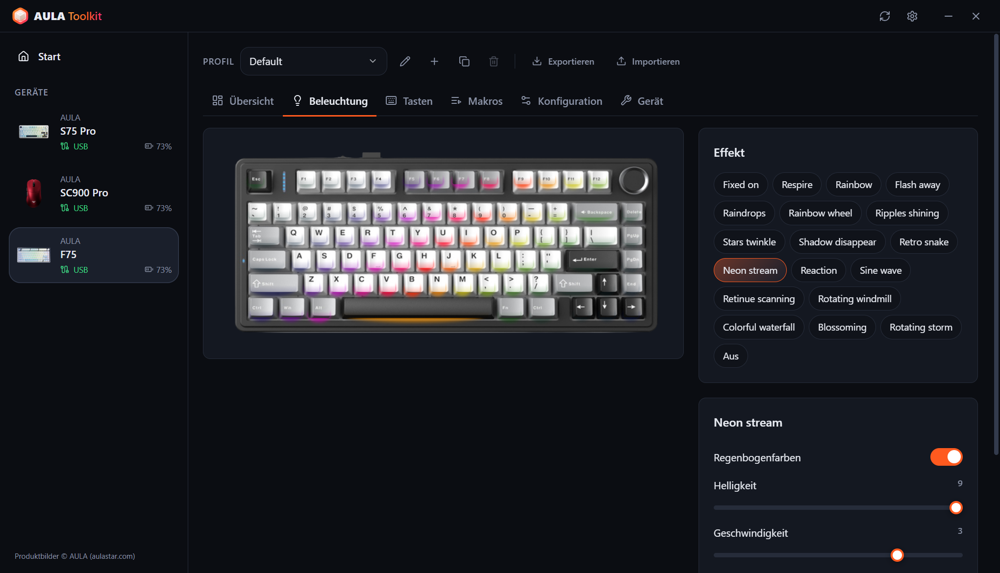

### Mäuse
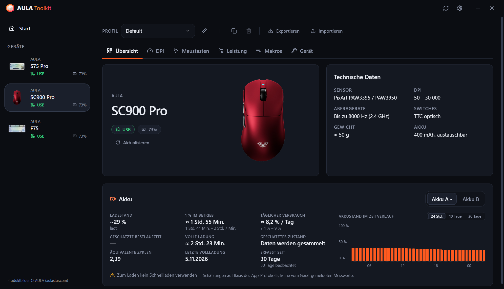 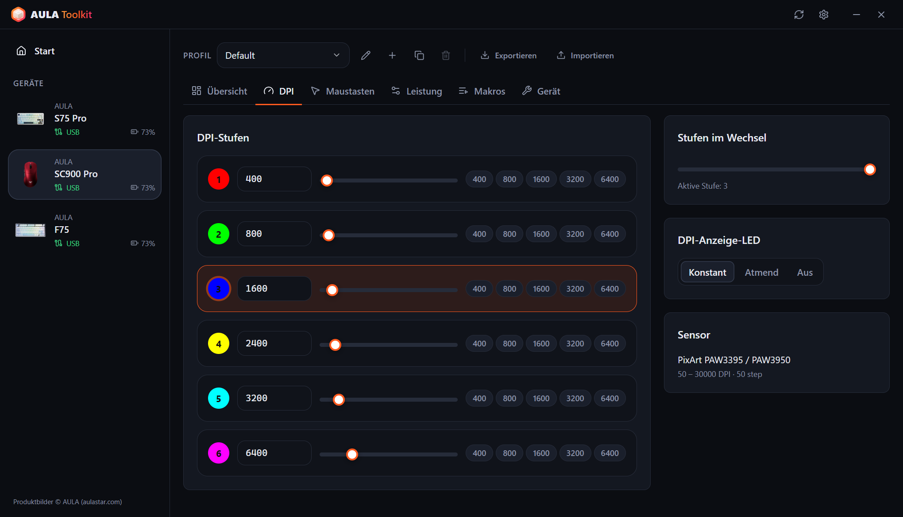
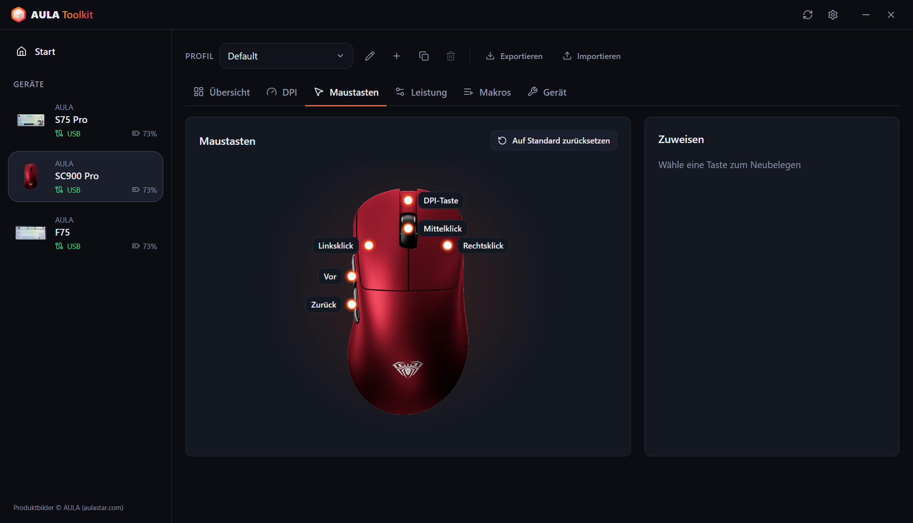 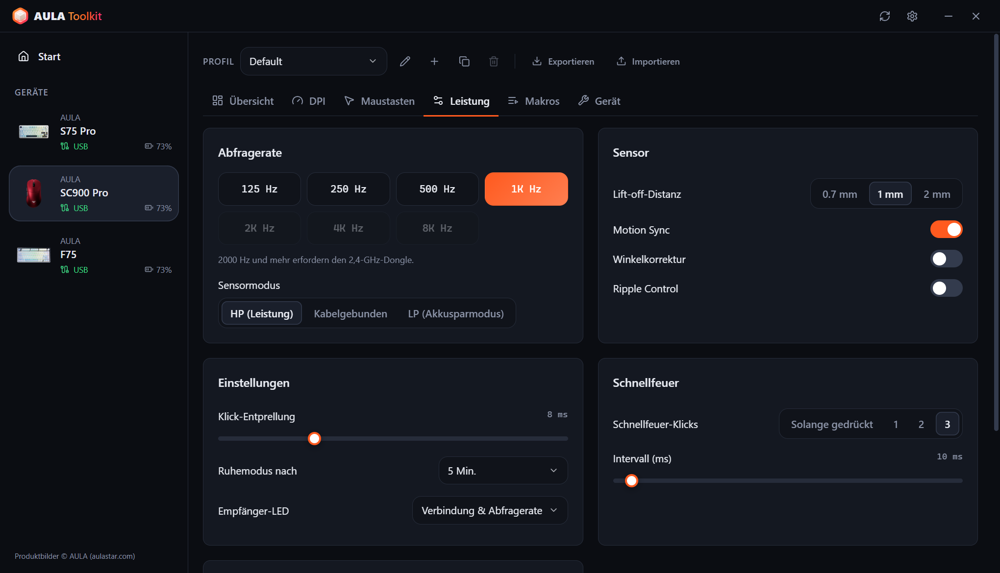

### Übersicht im Infobereich und Bildschirmanzeige
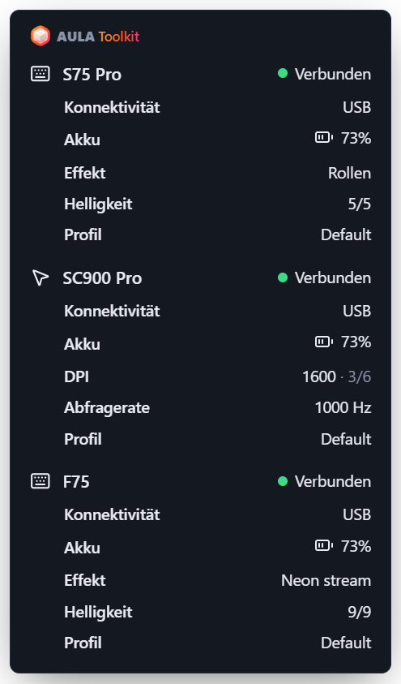 &nbsp; 

### Einstellungen
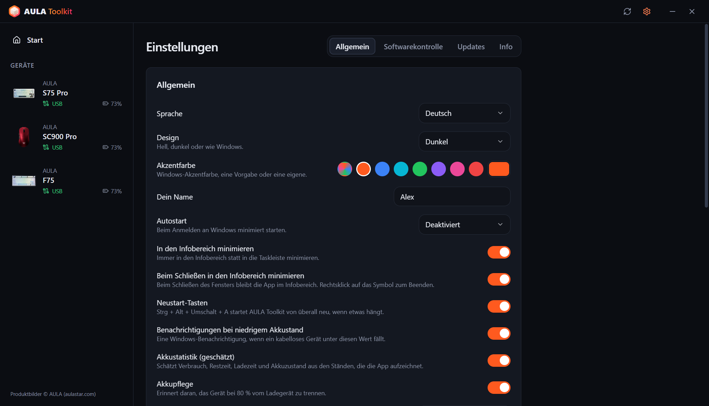 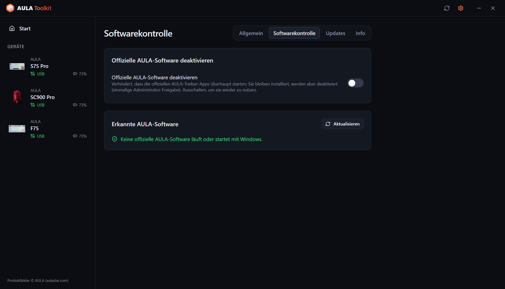
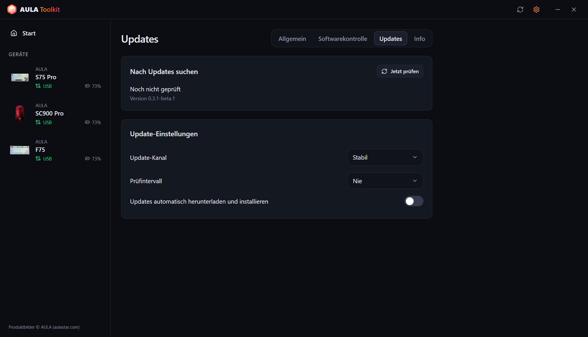 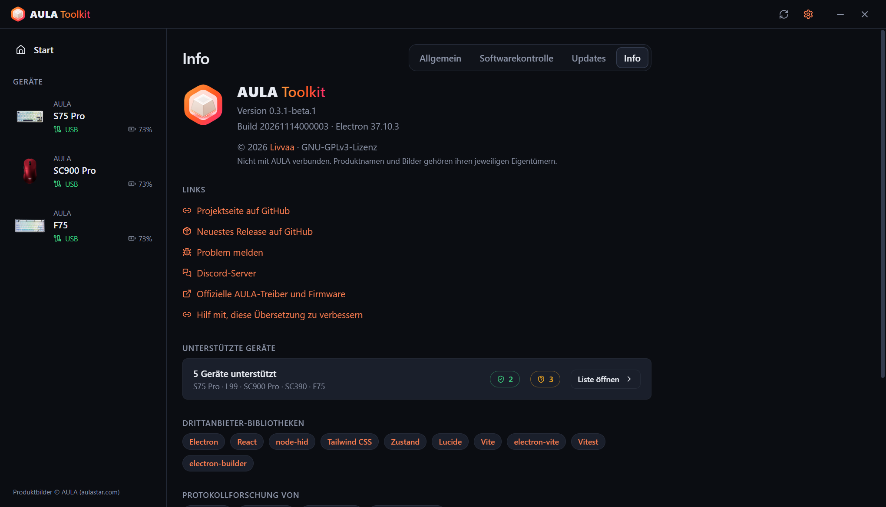
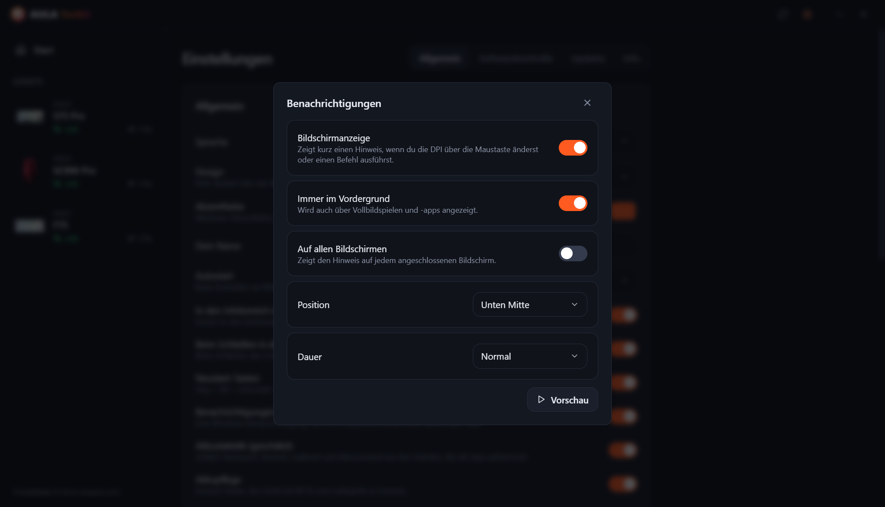 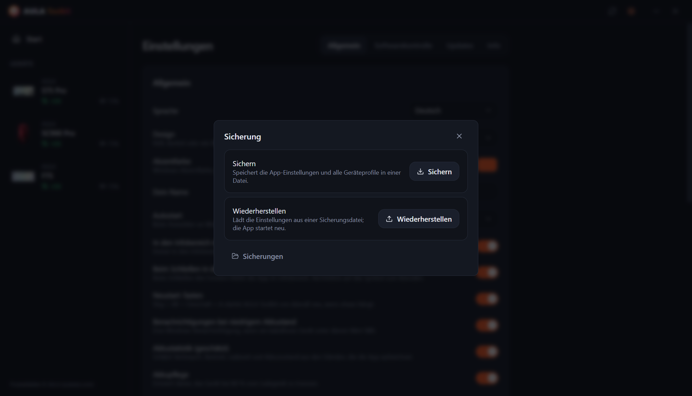

---

# Inhaltsverzeichnis
  - [Haftungsausschluss](#haftungsausschluss)
  - [Download](#download)
  - [Kompatibilität](#kompatibilität)
  - [Funktionen](#funktionen)
  - [Danksagungen](#danksagungen)
  - [FAQ](#faq)
  - [Argumente](#argumente)
  - [Wie sammle ich Logs?](#wie-sammle-ich-logs)
  - [Mitwirken](#mitwirken)
  - [Lizenz](#lizenz)

## Haftungsausschluss

**Das Tool kommt ohne jede Garantie. Die Nutzung erfolgt auf eigenes Risiko.**

AULA Toolkit spricht mit deinen Geräten über Protokolle, die aus den offiziellen Treibern rekonstruiert (Reverse Engineering) wurden. Bitte lies diese Datei, bevor du Probleme meldest – sie beantwortet die häufigsten Fragen.

## Download

Mit jeder Version werden zwei Builds veröffentlicht:
* **Installer** – installiert nur für den aktuellen Benutzer, daher sind keine Administratorrechte nötig.
* **Portable** – eine einzelne `.exe`, die ohne Installation läuft.

#### Aktualisieren

AULA Toolkit kann sich selbst aktualisieren. Das stellst du unter **Einstellungen → Updates** ein:
* **Update-Kanal** – **Stabil**- oder **Beta**-Versionen.
* **Prüfintervall** – von stündlich bis monatlich, oder nie.
* **Updates automatisch herunterladen und installieren** – Updates werden im Hintergrund geladen und still installiert, während du nicht am PC bist (oder wenn du die App schließt). Du kannst sie auch sofort installieren.

Wenn du eine neue Version über eine bestehende installierst, bleiben deine Einstellungen, Profile und Makros erhalten.

#### Nächste Schritte

AULA Toolkit funktioniert am besten, wenn es im Infobereich läuft. Unter **Einstellungen → Allgemein**:
1. Stelle **Autostart** auf *Aktiviert* (oder *Aktiviert (verzögert)*, um 30 Sekunden nach der Anmeldung zu starten). AULA Toolkit startet über eine geplante Windows-Aufgabe und daher auch im Akkubetrieb. Die Aufgabe wird bei jedem Start der App geprüft und neu angelegt, falls sie entfernt wurde.
2. Schalte **Beim Schließen in den Infobereich minimieren** ein.
3. Schalte unter **Einstellungen → Softwarekontrolle** die Option **Offizielle AULA-Software deaktivieren** ein, damit sich die AULA-Treiber und AULA Toolkit nicht um dasselbe Gerät streiten.

> [!WARNING]
> Wenn du AULA Toolkit ganz beendest, funktionieren die Funktionen nicht mehr, die die laufende App brauchen: die Bildschirmanzeige, Akku-Benachrichtigungen, die Übersicht im Infobereich, der Musikrhythmus und die Animationen auf den Tasten sowie der Befehl `aula`. Einstellungen, die schon auf deine Geräte geschrieben wurden, funktionieren weiter.

## Kompatibilität

| Gerät | Verbindung | Status |
|---|---|---|
| **AULA S75 Pro** | USB, 2,4-GHz-Empfänger, Bluetooth (Status und Akku) | ✅ Auf Hardware getestet |
| **AULA L99** | USB, 2,4-GHz-Empfänger, Bluetooth (Status und Akku) | 🧪 Beta, wird von Nutzern getestet |
| **AULA SC900 Pro** | USB, 2,4-GHz-Empfänger, Bluetooth (Status und Akku) | ✅ Auf Hardware getestet |
| **AULA SC900** (andere Versionen, die den SC900-Pro-Treiber nutzen) | USB, 2,4-GHz-Empfänger | ⚠️ Erkannt, noch nicht auf Hardware getestet |
| **AULA SC390** | USB | 🧪 Beta, wird von Nutzern getestet |
| **AULA F75** | USB, 2,4-GHz-Empfänger | ⚠️ Erkannt, noch nicht auf Hardware getestet |

Beta-Geräte werden anhand von USB-Mitschnitten des offiziellen Treibers unterstützt, die ihre Besitzer eingeschickt haben. Einige Funktionen fehlen noch; siehe die Tabelle unten.

AULA verkauft dieselbe Maus in mehreren Farben unter einer USB-ID, daher kann AULA Toolkit sie nicht unterscheiden. Wähle deine Farbe bei der Geräteeinrichtung oder im Tab **Gerät** des Geräts.

Dein AULA-Gerät steht nicht auf der Liste? Vielleicht nutzt es trotzdem eines der Protokolle oben – siehe [Kannst du Unterstützung für mein AULA-Gerät hinzufügen?](#kannst-du-unterstützung-für-mein-aula-gerät-hinzufügen).

#### Was über welche Verbindung funktioniert

**Tastaturen**

| Funktion | S75 Pro · USB | S75 Pro · 2,4 GHz | L99 · USB | L99 · 2,4 GHz | F75 · USB / 2,4 GHz |
|---|:---:|:---:|:---:|:---:|:---:|
| Lichteffekte | ✅ | ✅ | ✅ | ✅ | ✅ |
| Beleuchtung pro Taste | ✅ | ✅ | ✅ | ✅ | — |
| Musikrhythmus und Animation auf den Tasten (vom PC gestreamt) | ✅ | — | ✅ | — | — |
| Licht aus, solange der Monitor aus ist | ✅ | ✅ | — | — | — |
| Live-Ansicht der Tastatur, Änderungen per Drehknopf / Fn werden übernommen | ✅ | — | — | — | — |
| Tastenbelegung, Fn-Ebene, Makros | ✅ | ✅ | ✅ | ✅ | ✅ |
| Tastatureinstellungen (Win-Sperre, Ruhezustand, Entprellung) | ✅ | ✅ | ✅ | ✅ | ✅ |
| Display | ✅ TFT | — | Folgt | — | — |
| Uhr (beim Verbinden synchronisiert) | ✅ | ✅ | ✅ | ✅ | — |
| Seitliche Lichtleiste | ✅ | ✅ | — | — | — |
| Akkustand | — | ✅ | — | ✅ | — |
| Einstellungen werden beim Verbinden ausgelesen | — | — | — | — | ✅ |

**Mäuse**

| Funktion | SC900 Pro · USB / 2,4 GHz | SC390 · USB |
|---|:---:|:---:|
| DPI-Stufen und DPI-Anzeige | ✅ | Folgt |
| Abfragerate | ✅ bis 8000 Hz | ✅ bis 1000 Hz (Kabel und Empfänger) |
| Sensor (Lift-off-Distanz, Ripple Control und mehr) | ✅ | ✅ |
| Tasten und Makros | ✅ | Folgt |
| Ruhezeit | ✅ | Folgt |
| Akkustand | ✅ | — |
| Einstellungen werden beim Verbinden ausgelesen | ✅ | ✅ |
| Bildschirmanzeige für die DPI-Taste | ✅ | — |

> [!NOTE]
> Geräte lassen sich nur über **USB** oder den **2,4-GHz-Empfänger** konfigurieren. Über Bluetooth stellt das Gerät seine Konfigurationsschnittstelle nicht bereit – die offizielle AULA-Software hat dieselbe Einschränkung. Früher gespeicherte Einstellungen funktionieren über Bluetooth weiter, und AULA Toolkit zeigt das Gerät dort trotzdem als verbunden an, mit dem Akkustand, den Windows meldet.

### Die Software von AULA

Wenn der offizielle AULA-Treiber und AULA Toolkit gleichzeitig laufen, sprechen beide mit demselben Gerät. Das kann Änderungen rückgängig machen oder Lesefehler verursachen. AULA Toolkit zeigt unten im Fenster einen Warnhinweis, wenn es ein offizielles AULA-Programm erkennt. **Einstellungen → Softwarekontrolle → Offizielle AULA-Software deaktivieren** verhindert, dass sie überhaupt starten: Sie bleiben installiert, aber ihre Programme werden deaktiviert (Windows fragt einmal nach Administratorrechten) und ihre Autostart-Einträge werden geparkt. Schaltest du die Option aus, sind sie wieder nutzbar. Auch beim Deinstallieren von AULA Toolkit werden sie wiederhergestellt.

## Funktionen

Mit der App kannst du:

- Jedes unterstützte Gerät in einem Fenster konfigurieren, Änderungen werden sofort übernommen.
- Nie überschreiben, was schon auf einem Gerät gespeichert ist: Die Einstellungen der Maus werden beim Verbinden ausgelesen, und beim S75 Pro werden Effekt, Farbe und Helligkeit, die du mit dem Drehknopf oder den Fn-Tasten änderst, live erkannt und in deinem Profil gespeichert.
- Mehrere **Profile** pro Gerät anlegen und sie als Dateien exportieren oder importieren.
- Eine live **Bildschirmanzeige** sehen, wenn du die DPI-Taste der Maus drückst oder einen Befehl ausführst.
- **Musikrhythmus**-Balken und **Animationen (GIF)** auf den Tasten des S75 Pro abspielen, vom PC gestreamt.
- Die Tastaturbeleuchtung **ausschalten, solange der Monitor aus ist**, und wieder einschalten, wenn er aufwacht.
- Die App von überall mit **Strg + Alt + Umschalt + A** neu starten, wenn etwas hängt.
- Eine ausführliche **Übersicht im Infobereich** über alle verbundenen Geräte sehen, wenn du mit der Maus über das Symbol fährst.
- **Benachrichtigungen bei niedrigem Akkustand** und beim Laden eine **Akkupflege**-Erinnerung bei 80 % erhalten und, wenn du möchtest, eine **Akkustatistik** ansehen.
- Die offizielle AULA-Software deaktivieren, ohne sie zu deinstallieren.
- Geräte über die **Befehlszeile** mit `aula` steuern.
- Die App in **10 Sprachen** nutzen: English, Türkçe, Русский, 简体中文, Українська, Tiếng Việt, Português (Brasil), Español, Deutsch und Français.
- Ein **helles, dunkles oder System-Design** und eine Akzentfarbe wählen.

### Tastaturen

* **Beleuchtung** – jeder Hardware-Effekt mit Farbe, Helligkeit, Geschwindigkeit und Richtung, dazu eine Vorschau auf einem Foto deiner Tastatur.
* **Live-Ansicht** (S75 Pro, USB) – das Tastaturbild zeigt, was die LEDs gerade zeigen. Wenn du den Effekt mit dem Drehknopf oder den Fn-Tasten änderst, erkennt die App ihn innerhalb weniger Sekunden, wählt ihn aus und zeigt ihn an. Die Tastatur meldet ihren Effekt nicht, deshalb funktioniert das über die LED-Farben: Effekte, die dunkel bleiben, bis du eine Taste drückst, sehen im Leerlauf gleich aus, und sehr schnelles Drehen kann einen Effekt dazwischen überspringen.
* **Beleuchtung pro Taste** (S75 Pro) – Tasten einzeln einfärben oder die ganze Tastatur füllen.
* **Während Musik läuft** – Balken auf den Tasten folgen dem Ton, der am PC läuft (12 Farbschemata, Amplitude und Hintergrund, wie im offiziellen Treiber), oder die Tastatur wechselt zu einem Effekt deiner Wahl. Die Balken brauchen das USB-Kabel; über den Empfänger wird der Effekt verwendet.
* **Animation auf den Tasten** (S75 Pro, USB) – spielt ein Bild oder GIF aus deiner Bibliothek auf den Tasten ab, mit etwa 20 Bildern pro Sekunde.
* **Display aus** (S75 Pro) – Tasten und Seitenleiste gehen aus, solange der Monitor aus ist.
* **Tastenbelegung** – Tasten auf der Grundebene und der Fn-Ebene neu belegen: mit Tasten, Maustasten, Medientasten, Tastenkombinationen oder Makros.
* **Makros** – Tastenanschläge mit echtem Timing aufnehmen und danach bearbeiten.
* **TFT-Display** (S75 Pro, USB) – ein Bild oder animiertes GIF aus deiner Bibliothek hochladen. Zieh die Vorschau, um den sichtbaren Ausschnitt zu wählen; lange GIFs werden an die 141 Frames des Displays angepasst, ohne ihr Tempo zu ändern. Die Uhr wird bei jeder Verbindung der Tastatur synchronisiert.
* **Konfiguration** – Windows-Taste, Alt+F4 und Alt+Tab sperren, Ruhezeit und Tastenreaktionszeit einstellen.
* **Zurücksetzen** – die Standardwerte der Tastatur wiederherstellen oder einen vollständigen Werksreset machen.

### Mäuse

* **DPI** – bis zu sechs Stufen, die aktive Stufe, die Anzahl der Stufen im Zyklus und die DPI-Anzeige-LED.
* **Abfragerate** – bis zu 8000 Hz. Raten über 1000 Hz brauchen den 2,4-GHz-Empfänger. Bei der SC390 haben Kabel und Empfänger getrennte Raten.
* **Sensor** – Lift-off-Distanz, Motion Sync, Winkelkorrektur, Ripple Control und Sensormodus. Bei der SC390: Lift-off-Distanz, Ultra-niedrige Latenz, Ultra-Stromsparen, Ripple-Kontrolle und Aufwachen bei Bewegung.
* **Maustasten** – jede Taste außer dem Linksklick neu belegen, inklusive Schnellfeuer und Makros.
* **Timing** – Klick-Entprellung und Ruhezeit.
* **Akku** – Ladestand und Ladezustand. Die zwei Akkus der SC900 Pro (und alle weiteren, die du hinzufügst) werden getrennt erfasst.

### Bildschirmanzeige

Wenn du die DPI mit der Taste an der Maus änderst, erscheint eine kleine Anzeige auf dem Bildschirm mit dem neuen Wert und der aktiven Stufe. Beim S75 Pro (USB) zeigt sie auch den neuen Effekt, die Farbe oder die Helligkeit, wenn du sie an der Tastatur änderst, und sie bestätigt Änderungen über den Befehl `aula`. Uploads aufs Display, die 80-%-Erinnerung und Neustarts erscheinen dort ebenfalls. Unter **Einstellungen → Benachrichtigungen** kannst du sie ausschalten, Position und Dauer wählen, sie über Vollbildspielen halten oder auf allen Bildschirmen anzeigen.

### Sicherungen

**Einstellungen → Sicherung** speichert die App-Einstellungen und alle Geräteprofile in einer einzigen Datei und stellt sie später daraus wieder her, zum Beispiel nach einer Neuinstallation von Windows.

### Akkustatistik

**Einstellungen → Allgemein → Akkustatistik** (standardmäßig an) zeigt in der Übersicht jedes Geräts eine Akku-Karte:

* **Ladestand** – der aktuelle Stand, oder der letzte mit dem Zeitpunkt, wann er gelesen wurde. Am Kabel ohne Messwert erst eine Schätzung, dann 99+.
* **1 % im Betrieb** – wie lange 1 % hält, während das Gerät über den Empfänger benutzt wird.
* **Täglicher Verbrauch** und **Geschätzte Restlaufzeit** – über die Kalenderzeit, einschließlich der Stunden, in denen es schläft oder die App geschlossen ist.
* **Volle Ladung** und **Geschätzter Zustand** – daraus, wie schnell der Akku in der Mitte seines Bereichs lädt.
* **Äquivalente Zyklen**, **Letzte Vollladung** und ein Diagramm mit drei Ansichten: die letzten 24 Stunden, der Akkuverbrauch pro Tag über 10 Tage und der Ladestand über 30 Tage. Fahr mit der Maus über das Diagramm für genaue Werte; Laden wird grün dargestellt.

Die Werte werden mit einer Spanne angezeigt, sobald genug aufgezeichnet wurde. Ladestände werden über USB, den 2,4-GHz-Empfänger und Bluetooth (von Windows gelesen) aufgezeichnet. **Akkupflege** ist zusammen mit der Statistik standardmäßig an und erinnert dich beim Laden bei 80 % daran, das Gerät abzustecken.

> [!NOTE]
> AULA-Geräte melden nur ihren Akkustand in Prozent. Alle Werte oben sind **Schätzungen**, die aus den von AULA Toolkit aufgezeichneten Ladeständen berechnet werden.

> [!WARNING]
> Benutze kein Schnellladegerät, das steht auch auf den Verpackungen.

### CLI

Du kannst AULA Toolkit über die Befehlszeile steuern. Der Befehl heißt `aula` und wird in `resources\bin` im Installationsordner installiert (standardmäßig `%LOCALAPPDATA%\Programs\AULA Toolkit\resources\bin\aula.cmd`). Die installierte App fügt diesen Ordner selbst zu deinem Benutzer-`PATH` hinzu, sodass `aula` in jedem neuen Terminal funktioniert; beim Deinstallieren wird er wieder entfernt. Die portable Version ändert `PATH` nicht. **Einstellungen → Allgemein → Befehlszeile** zeigt den genauen Pfad mit einer Schaltfläche zum Kopieren.

Der Befehl spricht mit der laufenden App. Läuft AULA Toolkit nicht, startet `aula` es zuerst im Infobereich. Administratorrechte sind nicht nötig.

Befehle

* `aula status` – verbundene Geräte auflisten (mit `--json` für maschinenlesbare Ausgabe)
* `aula profile list` – die Profile eines Geräts auflisten
* `aula profile set <name>` – zu einem Profil wechseln
* `aula dpi` – die DPI-Stufen der Maus anzeigen
* `aula dpi stage <n>` – DPI-Stufe `<n>` aktivieren (ab 1 gezählt)
* `aula dpi <value>` – die aktive Stufe auf `<value>` DPI setzen
* `aula polling <hz>` – die Abfragerate der Maus setzen
* `aula light list` – die Effekte der Tastatur auflisten
* `aula light <effect> [--color #rrggbb] [--brightness n] [--speed n]` – den Tastatureffekt setzen
* `aula brightness <n>` – die Helligkeit der Tastaturbeleuchtung setzen
* `aula osd on|off` – die Bildschirmanzeige ein- oder ausschalten
* `aula show` / `aula hide` – das Fenster anzeigen oder ausblenden
* `aula version` – die App-Version ausgeben

Sind mehrere Geräte derselben Art verbunden, wählst du eines mit `-d <id>` aus, zum Beispiel `aula profile list -d sc900`. Der Befehl endet bei Erfolg mit Code `0` und bei einem Fehler mit `1`, daher kannst du ihn in Skripten verwenden.

## Danksagungen

AULA Toolkit wird von **Livvaa** ([GitHub](https://github.com/Livvaa)) entwickelt und gepflegt.

Besonderer Dank an die Projekte, deren öffentliche Reverse-Engineering-Arbeit das möglich gemacht hat:
* [open-aula](https://github.com/paulcoding810/open-aula) – Protokolle der AULA-Tastaturen.
* [AulaSofwareLinux](https://github.com/thought-train/AulaSofwareLinux) – das Protokoll der AULA-F75-Familie.
* [IncottHIDApp](https://github.com/romkazor/IncottHIDApp) und [OpenMouse](https://github.com/OpenMouse-Project/mouse-protocol) – das PixArt-8K-Mausprotokoll.

Alle Protokolldetails wurden mit den offiziellen AULA-Treibern abgeglichen. Produktbilder © AULA ([aulastar.com](https://www.aulastar.com)).

### Bibliotheken von Drittanbietern

* **Electron** ([electron/electron](https://github.com/electron/electron))
* **React** ([facebook/react](https://github.com/facebook/react))
* **node-hid** ([node-hid/node-hid](https://github.com/node-hid/node-hid))
* **Tailwind CSS** ([tailwindlabs/tailwindcss](https://github.com/tailwindlabs/tailwindcss))
* **Zustand** ([pmndrs/zustand](https://github.com/pmndrs/zustand))
* **Lucide** ([lucide-icons/lucide](https://github.com/lucide-icons/lucide))
* **electron-vite** ([alex8088/electron-vite](https://github.com/alex8088/electron-vite)), **Vite** ([vitejs/vite](https://github.com/vitejs/vite)) und **Vitest** ([vitest-dev/vitest](https://github.com/vitest-dev/vitest))
* **electron-builder** und **electron-updater** ([electron-userland/electron-builder](https://github.com/electron-userland/electron-builder))

### Übersetzungen

Die Oberfläche gibt es in 10 Sprachen. Noch nicht alle Übersetzungen wurden von Muttersprachlern geprüft. Wenn dir ein Fehler auffällt, öffne bitte einen Pull Request – jede Sprache ist eine einzelne Datei in [`src/shared/locales`](src/shared/locales).

## FAQ

#### Kann AULA Toolkit mein Gerät beschädigen?

AULA Toolkit rührt die Firmware nie an. Es sendet nur dieselben Konfigurationsbefehle wie der offizielle Treiber (Beleuchtung, Tasten, Makros, DPI usw.), abgeglichen mit USB-Mitschnitten dieses Treibers. Wenn etwas nicht stimmt, bringt das Zurücksetzen im Tab **Gerät** oder die offizielle Software die Standardwerte zurück.

#### Warum kann ich über Bluetooth keine Einstellungen ändern?

Über Bluetooth erscheinen Tastatur und Maus für Windows nur als normale Tastatur und Maus. Die Konfigurationsschnittstelle, die USB und der 2,4-GHz-Empfänger bieten, gibt es dort nicht. Deshalb können weder AULA Toolkit noch die offizielle Software Einstellungen ändern. Verbinde das Gerät per Kabel oder Empfänger, nimm deine Änderungen vor und wechsle zurück zu Bluetooth – die Einstellungen bleiben auf dem Gerät. Über Bluetooth zeigt AULA Toolkit die Verbindung und den Akkustand, den Windows meldet.

#### Warum zeigt meine Tastatur keinen Akkustand?

Das S75 Pro meldet seinen Akkustand über den 2,4-GHz-Empfänger, und über Bluetooth meldet ihn Windows. Über USB wird es geladen und die Firmware meldet keinen Stand: AULA Toolkit zeigt eine Schätzung aus der gemessenen Ladegeschwindigkeit, dann 99+.

#### Warum sind Akkuzyklen und Akkuzustand nur Schätzungen?

AULA-Geräte haben keinen Akku-Chip, der Zyklen zählt oder den Verschleiß misst. Sie melden nur einen Prozentwert, daher schätzt AULA Toolkit alles andere daraus, wann sich dieser Wert ändert. Der Zustand ergibt sich daraus, wie schnell der Akku lädt. Dafür braucht es mehrere Ladevorgänge über einen Monat oder länger.

#### Kann AULA Toolkit das Bild auf dem Display des S75 Pro oder die Firmware-Version auslesen?

Nein. Die Firmware der Tastatur kann ein Bild empfangen, hat aber keinen Befehl, um es zurückzuschicken, und keines der unterstützten Geräte meldet seine Firmware-Version. Die offizielle Software kann das auch nicht.

#### Warum warnt mich Windows, wenn ich den Installer starte?

Die Installer sind noch nicht code-signiert, daher zeigt Windows SmartScreen eine Warnung wegen eines unbekannten Herausgebers. AULA Toolkit ist Open Source, und du kannst es selbst aus diesem Repository bauen. Wähle **Weitere Informationen → Trotzdem ausführen**, um fortzufahren.

#### Meine Maus hat eine andere Farbe als auf dem Bild.

AULA nutzt für jede Farbe eines Modells dieselbe USB-ID. Wähle deine Farbe im Tab **Gerät** des Geräts.

#### Kannst du Unterstützung für mein AULA-Gerät hinzufügen?

Möglicherweise. Die meisten AULA-Tastaturen und -Mäuse nutzen eine der Protokollfamilien, die AULA Toolkit schon spricht. Unter [Mitwirken](#mitwirken) steht, was in eine Anfrage gehört.

## Argumente

* `--hidden` – minimiert im Infobereich starten. Wird von *Autostart* verwendet.
* `--delayed` – 30 Sekunden warten, bevor die Verbindung zu den Geräten aufgebaut wird. *Autostart → Aktiviert (verzögert)* wartet jetzt stattdessen in der geplanten Aufgabe.

## Wie sammle ich Logs?

Logs helfen bei jedem Problem sehr. Häng sie **immer** an deine Issues an.

#### Methode 1: Diagnosepaket (empfohlen)
1. Öffne **AULA Toolkit**.
2. Geh zu **Einstellungen → Info**.
3. Klicke auf **Diagnosepaket speichern**. Es speichert den Gerätestatus und das Kommunikationsprotokoll in einer Datei, die du an dein Issue anhängen kannst.

#### Methode 2: Logdateien
1. Reproduziere das Problem.
2. Öffne `Ausführen` (Win+R), gib `"%APPDATA%\AULA Toolkit\logs"` ein und drücke OK.
3. Häng die neueste Datei `hid-<date>.log` an.

Du kannst das Log auch live unter **Einstellungen → Allgemein → Erweitert** verfolgen.

## Mitwirken

Feedback ist sehr willkommen, melde Probleme also gern. Pull Requests sind ebenfalls willkommen. Bitte lies vorher den [Leitfaden für Beiträge](CONTRIBUTING.md).

Fragen, Ideen oder einfach Lust zu plaudern? Komm auf den [Discord-Server](https://discord.gg/u9FbaJGtCe).

#### Geräteunterstützung

Für die Unterstützung weiterer AULA-Geräte braucht es Tester. Wenn du eine Anfrage öffnest, gib bitte Folgendes an:

1. Den vollständigen Modellnamen (zum Beispiel *AULA F87 Pro*).
2. Die USB-IDs, zu finden unter **Geräte-Manager → dein Gerät → Details → Hardware-IDs** (zum Beispiel `VID_0C45&PID_800A`).
3. Welche Verbindung du genutzt hast (USB oder 2,4 GHz).
4. Ein Diagnosepaket (siehe [Wie sammle ich Logs?](#wie-sammle-ich-logs)).
5. Wenn möglich: einen USB-Mitschnitt des offiziellen Treibers. Installiere [Wireshark](https://www.wireshark.org/download.html) mit USBPcap, beende AULA Toolkit, starte die Aufzeichnung, ändere im offiziellen Treiber jeweils eine Einstellung nach der anderen und notiere die Reihenfolge. Häng die `.pcapng`-Datei gezippt an. So wurden die L99 und die SC390 hinzugefügt.

## Lizenz

Copyright (C) 2026 Livvaa

AULA Toolkit ist freie Software: Du kannst sie unter den Bedingungen der GNU General Public License,
wie von der Free Software Foundation veröffentlicht, weitergeben und/oder verändern, entweder gemäß
Version 3 der Lizenz oder (nach deiner Wahl) jeder späteren Version. Den vollständigen Text findest du in [LICENSE](LICENSE).

Dieses Programm wird in der Hoffnung verteilt, dass es nützlich ist, aber OHNE JEDE GEWÄHRLEISTUNG; sogar
ohne die implizite Gewährleistung der MARKTREIFE oder der EIGNUNG FÜR EINEN BESTIMMTEN ZWECK.

AULA Toolkit steht in keiner Verbindung zu AULA. Produktnamen und -bilder gehören ihren Inhabern.
