

  <picture>
    <source media="(prefers-color-scheme: dark)" srcset="docs/brand/wordmark-dark.png">
    
  </picture>

  
  
  
   
  
  
  
  
   
  
  
  

## 🚨 Aviso sobre el estado del proyecto

> [!IMPORTANT]
> - AULA Toolkit está en **fase temprana de desarrollo** (versión 0.x). Puede tener detalles sin pulir.
> - Es un proyecto **no oficial** y **no está afiliado a AULA**. Los nombres e imágenes de productos pertenecen a sus propietarios.
> - Solo algunos dispositivos se han probado en hardware real; consulta [Compatibilidad](#compatibilidad).

#### Otras versiones de este archivo README en otros idiomas:
[English](README.md) · [Türkçe](README_tr-TR.md) · [Русский](README_ru-RU.md) · [简体中文](README_zh-CN.md) · [Українська](README_uk-UA.md) · [Tiếng Việt](README_vi-VN.md) · [Português (Brasil)](README_pt-BR.md) · [Deutsch](README_de-DE.md) · [Français](README_fr-FR.md)

---

AULA Toolkit es una aplicación de escritorio para Windows que controla teclados y ratones AULA desde un solo lugar, al estilo de Logitech G HUB. Sustituye al driver independiente que AULA distribuye para cada modelo.

No ejecuta servicios en segundo plano, no recopila telemetría y solo se conecta a internet para buscar actualizaciones en GitHub. Los cambios se escriben en el dispositivo en el momento en que los haces y se guardan en la memoria del propio dispositivo, así que siguen funcionando en otros ordenadores y por Bluetooth.

# Capturas de pantalla

### Inicio y resumen del dispositivo
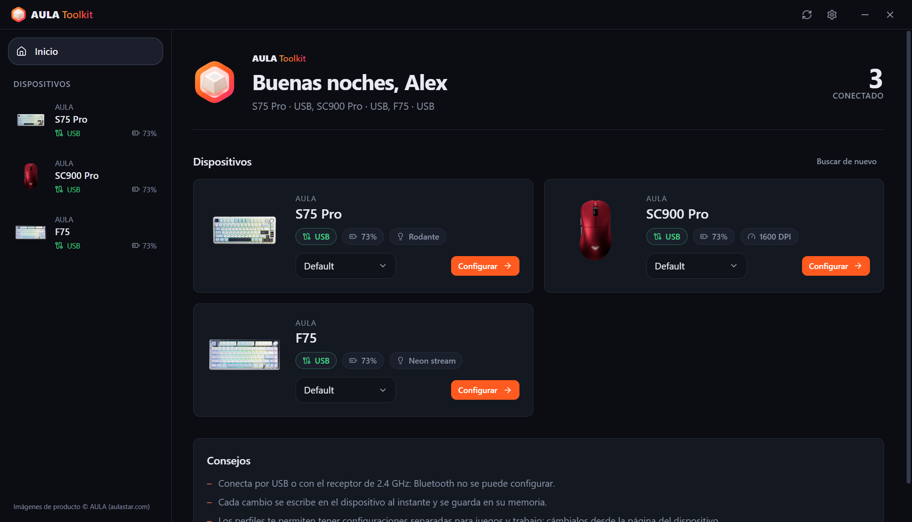 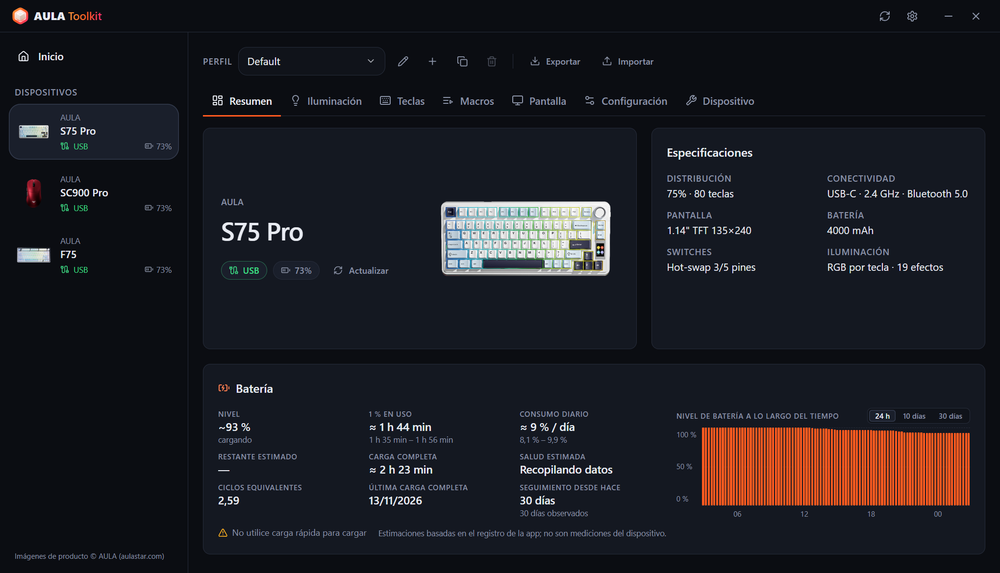

### Teclados
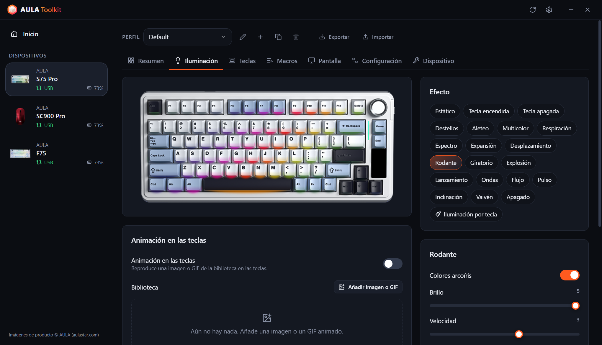 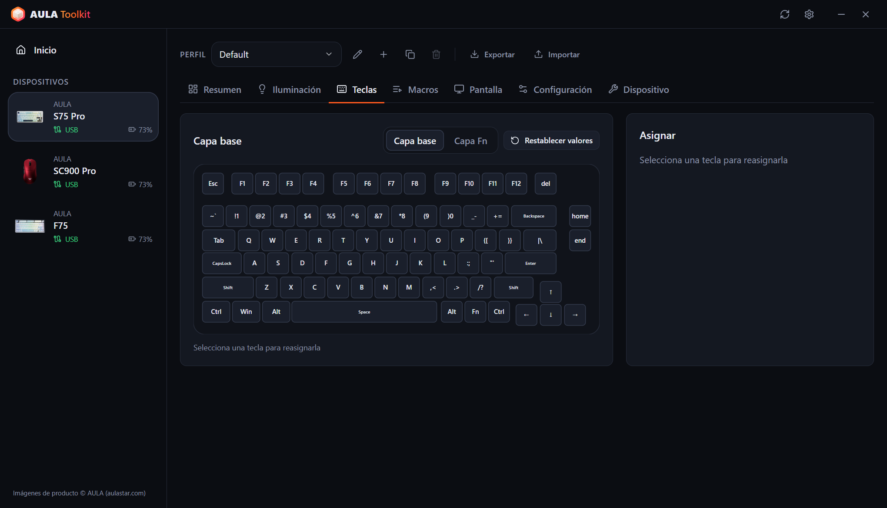
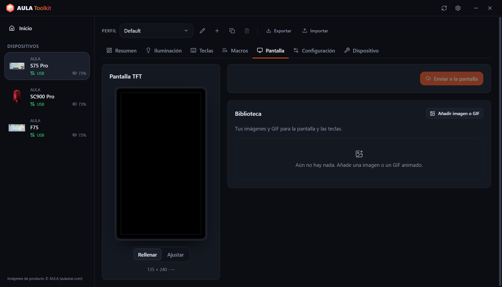 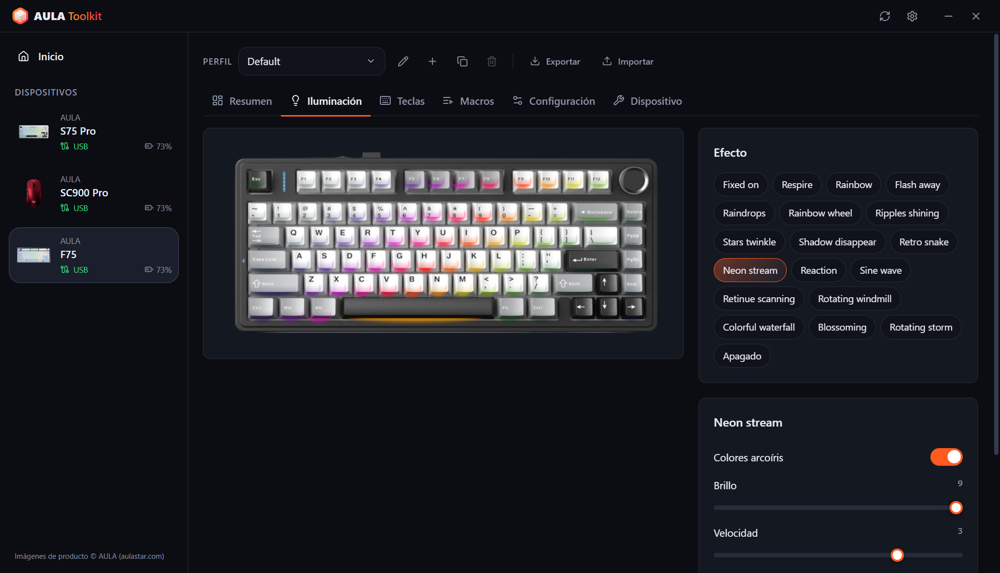

### Ratones
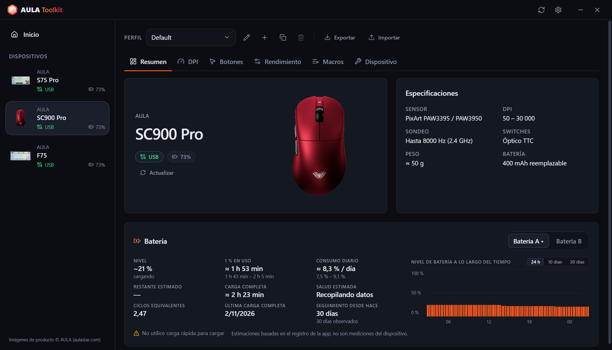 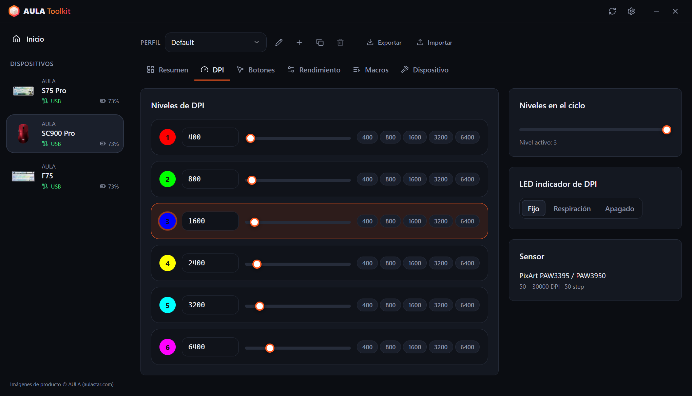
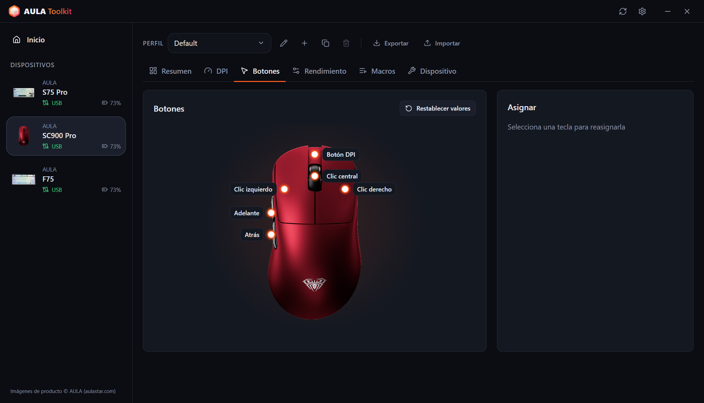 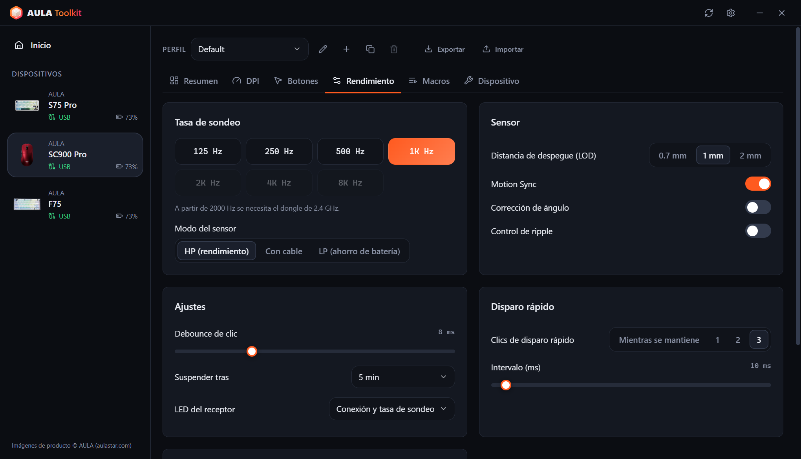

### Resumen en la bandeja e indicador en pantalla
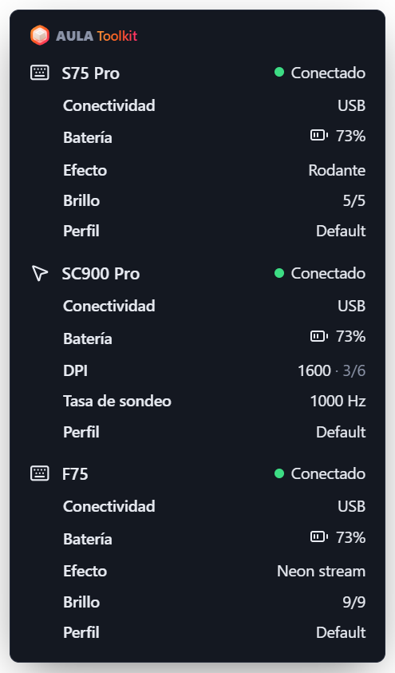 &nbsp; 

### Ajustes
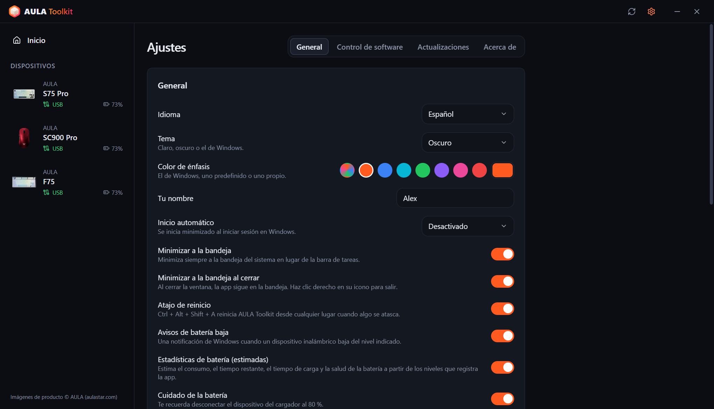 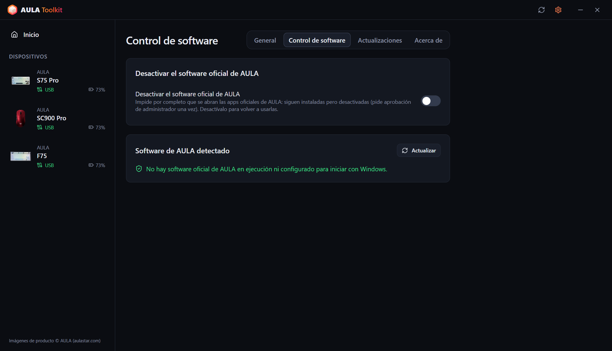
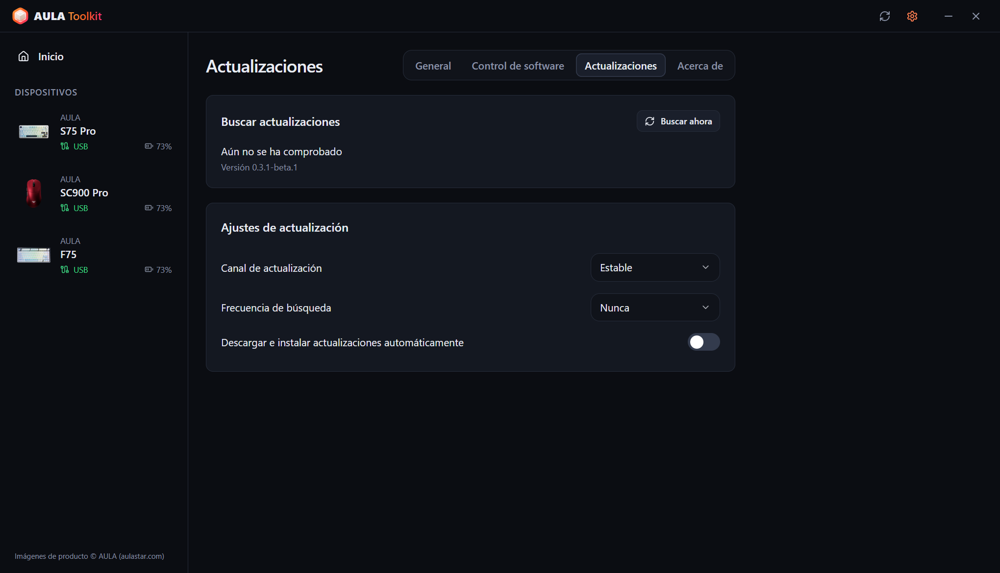 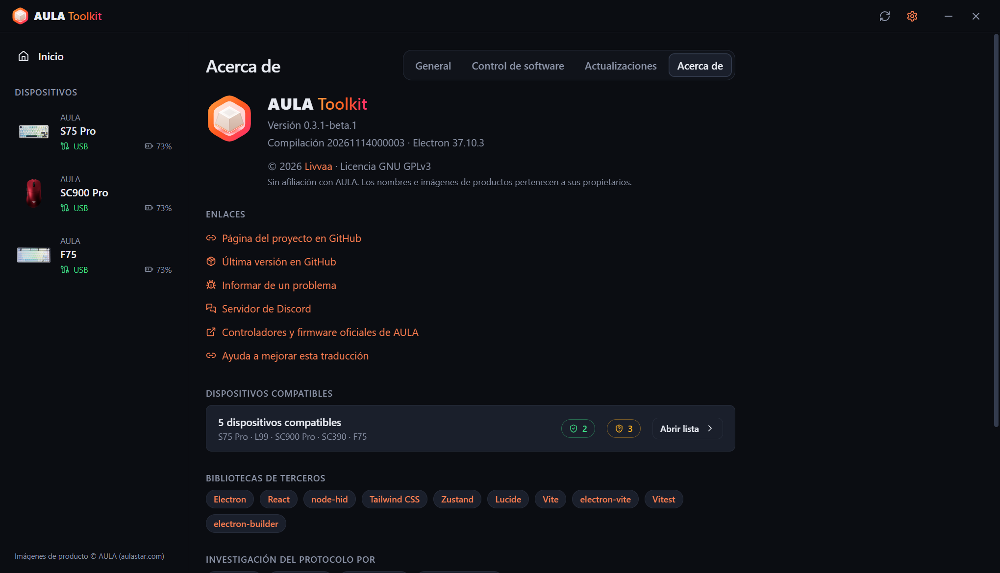
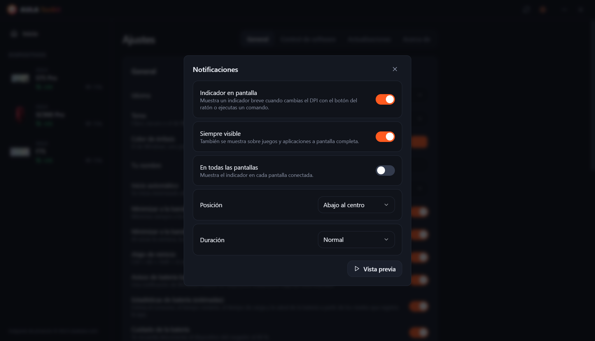 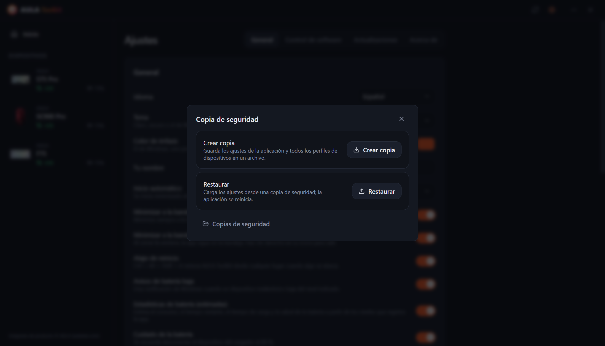

---

# Índice
  - [Aviso legal](#aviso-legal)
  - [Descarga](#descarga)
  - [Compatibilidad](#compatibilidad)
  - [Funciones](#funciones)
  - [Créditos](#créditos)
  - [Preguntas frecuentes](#preguntas-frecuentes)
  - [Argumentos](#argumentos)
  - [¿Cómo recopilar los registros?](#cómo-recopilar-los-registros)
  - [Contribuir](#contribuir)
  - [Licencia](#licencia)

## Aviso legal

**La herramienta no ofrece ninguna garantía. Úsala bajo tu propia responsabilidad.**

AULA Toolkit se comunica con tus dispositivos mediante protocolos obtenidos por ingeniería inversa de los drivers oficiales. Lee este archivo antes de informar de problemas: responde a las preguntas más habituales.

## Descarga

Cada versión se publica en dos builds:
* **Instalador**: se instala solo para el usuario actual, así que no necesita permisos de administrador.
* **Portable**: un único `.exe` que funciona sin instalar.

#### Actualizaciones

AULA Toolkit puede actualizarse solo. Configúralo en **Ajustes → Actualizaciones**:
* **Canal de actualización**: versiones **Estable** o **Beta**.
* **Frecuencia de búsqueda**: desde cada hora hasta una vez al mes, o nunca.
* **Descargar e instalar actualizaciones automáticamente**: las actualizaciones se descargan en segundo plano y se instalan en silencio mientras no estás en el PC (o cuando cierras la aplicación). También puedes instalarlas en el momento.

Instalar una versión nueva encima de una existente conserva tus ajustes, perfiles y macros.

#### Siguientes pasos

AULA Toolkit funciona mejor cuando se ejecuta en la bandeja. En **Ajustes → General**:
1. Pon **Inicio automático** en *Activado* (o *Activado (con retraso)* para que arranque 30 segundos después de iniciar sesión). AULA Toolkit arranca mediante una tarea programada de Windows, así que también se inicia cuando el equipo funciona con batería; la tarea se comprueba cada vez que se abre la aplicación y se vuelve a crear si se ha eliminado.
2. Activa **Minimizar a la bandeja al cerrar**.
3. En **Ajustes → Control de software**, activa **Desactivar el software oficial de AULA** para que los drivers de AULA no se peleen con AULA Toolkit por el mismo dispositivo.

> [!WARNING]
> Si cierras AULA Toolkit por completo, dejan de funcionar las funciones que necesitan que esté abierto: el indicador en pantalla, los avisos de batería, el resumen en la bandeja, el ritmo musical y las animaciones en las teclas, y el comando `aula`. Los ajustes que ya se escribieron en tus dispositivos siguen funcionando.

## Compatibilidad

| Dispositivo | Conexión | Estado |
|---|---|---|
| **AULA S75 Pro** | USB, receptor de 2.4 GHz, Bluetooth (estado y batería) | ✅ Probado en hardware |
| **AULA L99** | USB, receptor de 2.4 GHz, Bluetooth (estado y batería) | 🧪 Beta, en pruebas por usuarios |
| **AULA SC900 Pro** | USB, receptor de 2.4 GHz, Bluetooth (estado y batería) | ✅ Probado en hardware |
| **AULA SC900** (otras versiones que usan el driver del SC900 Pro) | USB, receptor de 2.4 GHz | ⚠️ Reconocido, aún no probado en hardware |
| **AULA SC390** | USB | 🧪 Beta, en pruebas por usuarios |
| **AULA F75** | USB, receptor de 2.4 GHz | ⚠️ Reconocido, aún no probado en hardware |

Los dispositivos beta se admiten a partir de capturas USB del driver oficial que enviaron sus propietarios. Todavía faltan algunas funciones; consulta la tabla de abajo.

AULA vende el mismo ratón en varios colores con un único ID USB, así que AULA Toolkit no puede distinguirlos. Elige tu color durante la configuración del dispositivo o en su pestaña **Dispositivo**.

¿Tu dispositivo AULA no está en la lista? Puede que use uno de los protocolos anteriores; consulta [¿Puedes añadir soporte para mi dispositivo AULA?](#puedes-añadir-soporte-para-mi-dispositivo-aula).

#### Qué funciona con cada conexión

**Teclados**

| Función | S75 Pro · USB | S75 Pro · 2.4 GHz | L99 · USB | L99 · 2.4 GHz | F75 · USB / 2.4 GHz |
|---|:---:|:---:|:---:|:---:|:---:|
| Efectos de iluminación | ✅ | ✅ | ✅ | ✅ | ✅ |
| Iluminación por tecla | ✅ | ✅ | ✅ | ✅ | — |
| Ritmo musical y animación en las teclas (enviados desde el PC) | ✅ | — | ✅ | — | — |
| Luces apagadas mientras el monitor está apagado | ✅ | ✅ | — | — | — |
| Vista en directo del teclado, sigue los cambios de la rueda / Fn | ✅ | — | — | — | — |
| Asignación de teclas, capa Fn, macros | ✅ | ✅ | ✅ | ✅ | ✅ |
| Ajustes del teclado (bloqueo de Win, reposo, debounce) | ✅ | ✅ | ✅ | ✅ | ✅ |
| Pantalla | ✅ TFT | — | Próximamente | — | — |
| Reloj (sincronizado al conectar) | ✅ | ✅ | ✅ | ✅ | — |
| Barra de luz lateral | ✅ | ✅ | — | — | — |
| Nivel de batería | — | ✅ | — | ✅ | — |
| Ajustes leídos al conectar | — | — | — | — | ✅ |

**Ratones**

| Función | SC900 Pro · USB / 2.4 GHz | SC390 · USB |
|---|:---:|:---:|
| Niveles de DPI e indicador de DPI | ✅ | Próximamente |
| Tasa de sondeo | ✅ hasta 8000 Hz | ✅ hasta 1000 Hz (cable y receptor) |
| Sensor (distancia de despegue, control de ripple y más) | ✅ | ✅ |
| Botones y macros | ✅ | Próximamente |
| Tiempo de reposo | ✅ | Próximamente |
| Nivel de batería | ✅ | — |
| Ajustes leídos al conectar | ✅ | ✅ |
| Indicador en pantalla para el botón de DPI | ✅ | — |

> [!NOTE]
> Los dispositivos solo se pueden configurar por **USB** o con el **receptor de 2.4 GHz**. Por Bluetooth el dispositivo no expone su interfaz de configuración; el software oficial de AULA tiene la misma limitación. Los ajustes que guardaste antes siguen funcionando por Bluetooth, y AULA Toolkit sigue mostrando el dispositivo como conectado, con el nivel de batería que informa Windows.

### El software de AULA

Si ejecutas el driver oficial de AULA y AULA Toolkit a la vez, los dos se comunican con el mismo dispositivo, lo que puede deshacer cambios o provocar errores de lectura. AULA Toolkit muestra una franja de aviso en la parte inferior de la ventana cuando detecta un programa oficial de AULA. **Ajustes → Control de software → Desactivar el software oficial de AULA** impide por completo que se inicien: siguen instalados, pero sus programas quedan desactivados (Windows pide aprobación de administrador una vez) y sus entradas de inicio automático se dejan apartadas. Al desactivar la opción vuelven a funcionar, y desinstalar AULA Toolkit también los restaura.

## Funciones

La aplicación te permite:

- Configurar todos los dispositivos compatibles desde una sola ventana, con los cambios aplicados al instante.
- No sobrescribir nunca por su cuenta lo que ya hay en un dispositivo: los ajustes del ratón se leen cuando se conecta, y en el S75 Pro el efecto, el color y el brillo que cambias con la rueda o las teclas Fn se detectan en directo y se guardan en tu perfil.
- Tener varios **perfiles** por dispositivo y exportarlos o importarlos como archivos.
- Ver un **indicador en pantalla** en directo cuando pulsas el botón de DPI del ratón o ejecutas un comando.
- Mostrar barras de **ritmo musical** y **animaciones (GIF)** en las teclas del S75 Pro, enviadas desde el PC.
- **Apagar** la iluminación del teclado **mientras el monitor está apagado**, y volver a encenderla cuando se activa.
- Reiniciar la aplicación desde cualquier sitio con **Ctrl + Alt + Shift + A** cuando algo se quede bloqueado.
- Ver un **resumen en la bandeja** detallado de todos los dispositivos conectados al pasar el ratón por el icono de la bandeja.
- Recibir **avisos de batería baja**, un recordatorio de **cuidado de la batería** al 80 % mientras carga y, si quieres, ver **estadísticas de batería**.
- Desactivar el software oficial de AULA sin desinstalarlo.
- Controlar los dispositivos desde la **línea de comandos** con `aula`.
- Usarla en **10 idiomas**: English, Türkçe, Русский, 简体中文, Українська, Tiếng Việt, Português (Brasil), Español, Deutsch y Français.
- Elegir un **tema claro, oscuro o del sistema** y un color de énfasis.

### Teclados

* **Iluminación**: todos los efectos del hardware con color, brillo, velocidad y dirección, además de una vista previa dibujada sobre una foto de tu teclado.
* **Vista en directo** (S75 Pro, USB): la imagen del teclado muestra lo que muestran los LED en ese momento. Cuando cambias el efecto con la rueda o las teclas Fn, la aplicación lo reconoce en pocos segundos, lo selecciona y lo muestra en pantalla. El teclado no informa de su efecto, así que esto funciona a partir de los colores de los LED: los efectos que se quedan a oscuras hasta que pulsas una tecla se ven iguales en reposo, y los giros muy rápidos pueden saltarse un efecto intermedio.
* **Iluminación por tecla** (S75 Pro): pinta las teclas una a una o rellena todo el teclado.
* **Mientras suena música**: unas barras en las teclas siguen el sonido que se reproduce en el PC (12 esquemas de color, amplitud y fondo, como en el driver oficial), o el teclado cambia a un efecto que elijas. Las barras necesitan el cable USB; con el receptor se usa el efecto.
* **Animación en las teclas** (S75 Pro, USB): reproduce una imagen o un GIF de tu biblioteca en las teclas, a unos 20 fotogramas por segundo.
* **Pantalla apagada** (S75 Pro): las teclas y la barra lateral se apagan mientras el monitor está apagado.
* **Asignación de teclas**: reasigna las teclas de la capa base y de la capa Fn a teclas, botones del ratón, teclas multimedia, atajos o macros.
* **Macros**: graba pulsaciones con los tiempos reales y edítalas después.
* **Pantalla TFT** (S75 Pro, USB): sube una imagen o un GIF animado de tu biblioteca. Arrastra la vista previa para elegir la parte visible; los GIF largos se ajustan a los 141 fotogramas de la pantalla sin cambiar su ritmo. El reloj se sincroniza cada vez que se conecta el teclado.
* **Configuración**: bloquea la tecla Windows, Alt+F4 y Alt+Tab, y ajusta el tiempo de reposo y el tiempo de respuesta de las teclas.
* **Restablecer**: restaura los valores predeterminados del teclado o haz un restablecimiento de fábrica completo.

### Ratones

* **DPI**: hasta seis niveles, el nivel activo, el número de niveles del ciclo y el LED indicador de DPI.
* **Tasa de sondeo**: hasta 8000 Hz. Las tasas por encima de 1000 Hz necesitan el receptor de 2.4 GHz. En el SC390 el cable y el receptor tienen tasas separadas.
* **Sensor**: distancia de despegue, Motion Sync, corrección de ángulo, control de ripple y modo del sensor. En el SC390: distancia de levantamiento, Latencia ultrabaja, Consumo ultrabajo, Control de ondulación y Despertar al mover.
* **Botones**: reasigna cualquier botón excepto el clic izquierdo, incluidos el disparo rápido y las macros.
* **Tiempos**: debounce de clic y tiempo de reposo.
* **Batería**: nivel y estado de carga. Las dos baterías del SC900 Pro (y las adicionales que añadas) se registran por separado.

### Indicador en pantalla

Cuando cambias el DPI con el propio botón del ratón, aparece en la pantalla un pequeño indicador con el nuevo valor y el nivel activo. En el S75 Pro (USB) también muestra el nuevo efecto, color o brillo cuando los cambias en el teclado, y confirma los cambios hechos con el comando `aula`. Las subidas a la pantalla, el recordatorio del 80 % y los reinicios también aparecen ahí. En **Ajustes → Notificaciones** puedes desactivarlo, elegir su posición y duración, mantenerlo por encima de juegos a pantalla completa o mostrarlo en todas las pantallas.

### Copias de seguridad

**Ajustes → Copia de seguridad** guarda los ajustes de la aplicación y todos los perfiles de los dispositivos en un único archivo, y los restaura desde él más adelante, por ejemplo después de reinstalar Windows.

### Estadísticas de batería

**Ajustes → General → Estadísticas de batería** (activado por defecto) muestra una tarjeta de batería en el resumen de cada dispositivo:

* **Nivel**: el nivel actual, o el último junto con cuánto hace que se leyó. Con cable y sin lectura, una estimación y después 99+.
* **1 % en uso**: cuánto dura un 1 % mientras el dispositivo se usa con el receptor.
* **Consumo diario** y **tiempo restante**: en tiempo de calendario, incluidas las horas en que está en reposo o la aplicación está cerrada.
* **Carga completa** y **salud**: según lo rápido que carga la batería en la parte media de su rango.
* **Ciclos equivalentes**, **última carga completa** y un gráfico con tres vistas: las últimas 24 horas, la batería usada por día durante 10 días y el nivel durante 30 días. Pasa el ratón por el gráfico para ver los valores exactos; la carga se muestra en verde.

Las cifras se muestran con un rango cuando se han registrado suficientes datos. Los niveles se registran por USB, con el receptor de 2.4 GHz y por Bluetooth (leídos desde Windows). **Cuidado de la batería**, activado por defecto junto con las estadísticas, te recuerda al 80 % mientras carga que desconectes el dispositivo.

> [!NOTE]
> Los dispositivos AULA solo informan del porcentaje de batería. Todas las cifras anteriores son **estimaciones** calculadas a partir de los niveles que registra AULA Toolkit.

> [!WARNING]
> No uses un cargador rápido; las cajas también lo indican.

### CLI

Puedes controlar AULA Toolkit desde la línea de comandos. El comando se llama `aula` y se instala en `resources\bin` dentro de la carpeta de instalación (por defecto `%LOCALAPPDATA%\Programs\AULA Toolkit\resources\bin\aula.cmd`). La aplicación instalada añade esa carpeta al `PATH` de tu usuario por sí sola, así que `aula` funciona en cualquier terminal nueva; al desinstalarla se quita de nuevo. La build portable no cambia el `PATH`. **Ajustes → General → Línea de comandos** muestra la ruta exacta con un botón para copiarla.

El comando se comunica con la aplicación en ejecución. Si AULA Toolkit no está abierto, `aula` lo inicia primero en la bandeja. No necesita permisos de administrador.

Comandos

* `aula status`: lista los dispositivos conectados (añade `--json` para una salida legible por máquina)
* `aula profile list`: lista los perfiles de un dispositivo
* `aula profile set <name>`: cambia a un perfil
* `aula dpi`: muestra los niveles de DPI del ratón
* `aula dpi stage <n>`: activa el nivel de DPI `<n>` (empezando en 1)
* `aula dpi <value>`: pone el nivel activo en `<value>` DPI
* `aula polling <hz>`: ajusta la tasa de sondeo del ratón
* `aula light list`: lista los efectos del teclado
* `aula light <effect> [--color #rrggbb] [--brightness n] [--speed n]`: ajusta el efecto del teclado
* `aula brightness <n>`: ajusta el brillo de la iluminación del teclado
* `aula osd on|off`: activa o desactiva el indicador en pantalla
* `aula show` / `aula hide`: muestra u oculta la ventana
* `aula version`: muestra la versión de la aplicación

Cuando hay más de un dispositivo del mismo tipo conectado, elige uno con `-d <id>`, por ejemplo `aula profile list -d sc900`. El comando termina con el código `0` si todo va bien y `1` si falla, así que se puede usar en scripts.

## Créditos

AULA Toolkit lo crea y mantiene **Livvaa** ([GitHub](https://github.com/Livvaa)).

Gracias especialmente a los proyectos cuyo trabajo público de ingeniería inversa lo hizo posible:
* [open-aula](https://github.com/paulcoding810/open-aula): protocolos de los teclados AULA.
* [AulaSofwareLinux](https://github.com/thought-train/AulaSofwareLinux): el protocolo que usa la familia AULA F75.
* [IncottHIDApp](https://github.com/romkazor/IncottHIDApp) y [OpenMouse](https://github.com/OpenMouse-Project/mouse-protocol): el protocolo de ratón PixArt 8K.

Todos los detalles de los protocolos se han contrastado con los drivers oficiales de AULA. Imágenes de productos © AULA ([aulastar.com](https://www.aulastar.com)).

### Bibliotecas de terceros

* **Electron** ([electron/electron](https://github.com/electron/electron))
* **React** ([facebook/react](https://github.com/facebook/react))
* **node-hid** ([node-hid/node-hid](https://github.com/node-hid/node-hid))
* **Tailwind CSS** ([tailwindlabs/tailwindcss](https://github.com/tailwindlabs/tailwindcss))
* **Zustand** ([pmndrs/zustand](https://github.com/pmndrs/zustand))
* **Lucide** ([lucide-icons/lucide](https://github.com/lucide-icons/lucide))
* **electron-vite** ([alex8088/electron-vite](https://github.com/alex8088/electron-vite)), **Vite** ([vitejs/vite](https://github.com/vitejs/vite)) y **Vitest** ([vitest-dev/vitest](https://github.com/vitest-dev/vitest))
* **electron-builder** y **electron-updater** ([electron-userland/electron-builder](https://github.com/electron-userland/electron-builder))

### Traducciones

La interfaz está disponible en 10 idiomas. No todas las traducciones han sido revisadas todavía por hablantes nativos. Si ves un error, abre un pull request: cada idioma es un único archivo en [`src/shared/locales`](src/shared/locales).

## Preguntas frecuentes

#### ¿Puede AULA Toolkit dañar mi dispositivo?

AULA Toolkit nunca toca el firmware. Solo envía los mismos comandos de configuración que el driver oficial (iluminación, teclas, macros, DPI, etc.), contrastados con capturas USB de ese driver. Si algo no se ve bien, el restablecimiento del dispositivo en la pestaña **Dispositivo** o el software oficial devuelven los valores predeterminados.

#### ¿Por qué no puedo cambiar los ajustes por Bluetooth?

Por Bluetooth, el teclado y el ratón solo aparecen en Windows como un teclado y un ratón estándar. La interfaz de configuración que ofrecen el USB y el receptor de 2.4 GHz no existe ahí, así que ni AULA Toolkit ni el software oficial pueden cambiar los ajustes. Conéctate con el cable o el receptor, haz tus cambios y vuelve a Bluetooth: los ajustes se quedan en el dispositivo. Por Bluetooth, AULA Toolkit muestra la conexión y el nivel de batería que informa Windows.

#### ¿Por qué mi teclado no muestra el nivel de batería?

El S75 Pro informa de su nivel de batería con el receptor de 2.4 GHz, y Windows lo informa por Bluetooth. Por USB se está cargando y el firmware no informa de ningún nivel: AULA Toolkit muestra una estimación a partir de la velocidad de carga medida y después 99+.

#### ¿Por qué los ciclos y la salud de la batería son solo estimaciones?

Los dispositivos AULA no tienen un chip de batería que cuente ciclos o mida el desgaste. Solo informan de un porcentaje, así que AULA Toolkit estima todo lo demás a partir de cuándo cambia ese porcentaje. La salud se calcula según lo rápido que carga la batería, así que necesita varias cargas a lo largo de un mes o más.

#### ¿Puede AULA Toolkit leer la imagen de la pantalla del S75 Pro o la versión del firmware?

No. El firmware del teclado puede recibir una imagen, pero no tiene ningún comando para devolverla, y ninguno de los dispositivos compatibles informa de su versión de firmware. El software oficial tampoco puede hacerlo.

#### ¿Por qué Windows me muestra un aviso al ejecutar el instalador?

Los instaladores todavía no están firmados, así que Windows SmartScreen muestra un aviso de editor desconocido. AULA Toolkit es de código abierto y puedes compilarlo tú mismo desde este repositorio. Elige **Más información → Ejecutar de todas formas** para continuar.

#### Mi ratón es de otro color que el de la imagen.

AULA usa el mismo ID USB para todos los colores de un modelo. Elige tu color en la pestaña **Dispositivo** del dispositivo.

#### ¿Puedes añadir soporte para mi dispositivo AULA?

Es posible. La mayoría de los teclados y ratones AULA reutilizan una de las familias de protocolos que AULA Toolkit ya conoce. Consulta en [Contribuir](#contribuir) qué incluir en una solicitud.

## Argumentos

* `--hidden`: inicia minimizado en la bandeja. Lo usa *Inicio automático*.
* `--delayed`: espera 30 segundos antes de conectarse a los dispositivos. *Inicio automático → Activado (con retraso)* ahora espera en la tarea programada.

## ¿Cómo recopilar los registros?

Los registros ayudan mucho con cualquier problema. Adjúntalos **siempre** a tus issues.

#### Método 1: Paquete de diagnóstico (recomendado)
1. Abre **AULA Toolkit**.
2. Ve a **Ajustes → Acerca de**.
3. Haz clic en **Guardar paquete de diagnóstico**. Guarda el estado del dispositivo y el registro de comunicación en un único archivo que puedes adjuntar a tu issue.

#### Método 2: Archivos de registro
1. Reproduce el problema.
2. Abre `Ejecutar` (Win+R), escribe `"%APPDATA%\AULA Toolkit\logs"` y pulsa Aceptar.
3. Adjunta el archivo `hid-<date>.log` más reciente.

También puedes ver el registro en directo en **Ajustes → General → Avanzado**.

## Contribuir

Los comentarios son muy bienvenidos, así que no dudes en informar de problemas. Los pull requests también son bienvenidos. Lee antes la [guía de contribución](CONTRIBUTING.md).

¿Tienes preguntas, ideas o solo quieres charlar? Únete al [servidor de Discord](https://discord.gg/u9FbaJGtCe).

#### Soporte de dispositivos

Para dar soporte a más dispositivos AULA hacen falta testers. Cuando abras una solicitud, incluye:

1. El nombre completo del modelo (por ejemplo *AULA F87 Pro*).
2. Los ID USB, que están en **Administrador de dispositivos → tu dispositivo → Detalles → Id. de hardware** (por ejemplo `VID_0C45&PID_800A`).
3. Qué conexión usaste (USB o 2.4 GHz).
4. Un paquete de diagnóstico (consulta [¿Cómo recopilar los registros?](#cómo-recopilar-los-registros)).
5. Si puedes: una captura USB del driver oficial. Instala [Wireshark](https://www.wireshark.org/download.html) con USBPcap, cierra AULA Toolkit, empieza a capturar, cambia un ajuste cada vez en el driver oficial y anota el orden. Adjunta el archivo `.pcapng` comprimido en zip. Así se añadieron el L99 y el SC390.

## Licencia

Copyright (C) 2026 Livvaa

AULA Toolkit es software libre: puedes redistribuirlo y/o modificarlo según los términos de la
GNU General Public License publicada por la Free Software Foundation, ya sea la versión 3 de la
licencia o (a tu elección) cualquier versión posterior. Consulta [LICENSE](LICENSE) para ver el texto completo.

Este programa se distribuye con la esperanza de que sea útil, pero SIN NINGUNA GARANTÍA; ni siquiera
la garantía implícita de COMERCIABILIDAD o IDONEIDAD PARA UN PROPÓSITO PARTICULAR.

AULA Toolkit no está afiliado a AULA. Los nombres e imágenes de productos pertenecen a sus propietarios.
