

  <picture>
    <source media="(prefers-color-scheme: dark)" srcset="docs/brand/wordmark-dark.png">
    
  </picture>

  
  
  
   
  
  
  
  
   
  
  
  

## 🚨 Avis sur l’état du projet

> [!IMPORTANT]
> - AULA Toolkit est en **début de développement** (version 0.x). Attends-toi à quelques imperfections.
> - C’est un projet **non officiel**, **non affilié à AULA**. Les noms et images des produits appartiennent à leurs propriétaires.
> - Seuls certains appareils ont été testés sur du vrai matériel ; voir [Compatibilité](#compatibilité).

#### Autres versions linguistiques de ce fichier README :
[English](README.md) · [Türkçe](README_tr-TR.md) · [Русский](README_ru-RU.md) · [简体中文](README_zh-CN.md) · [Українська](README_uk-UA.md) · [Tiếng Việt](README_vi-VN.md) · [Português (Brasil)](README_pt-BR.md) · [Español](README_es-ES.md) · [Deutsch](README_de-DE.md)

---

AULA Toolkit est une application de bureau Windows qui contrôle les claviers et souris AULA depuis un seul endroit, dans l’esprit de Logitech G HUB. Elle remplace le pilote séparé qu’AULA fournit pour chaque modèle.

Elle ne fait tourner aucun service en arrière-plan, ne collecte aucune télémétrie et ne se connecte à internet que pour chercher des mises à jour sur GitHub. Les modifications sont écrites sur l’appareil dès que tu les fais et stockées dans sa propre mémoire, elles continuent donc de fonctionner sur d’autres ordinateurs et en Bluetooth.

# Captures d’écran

### Accueil et aperçu de l’appareil
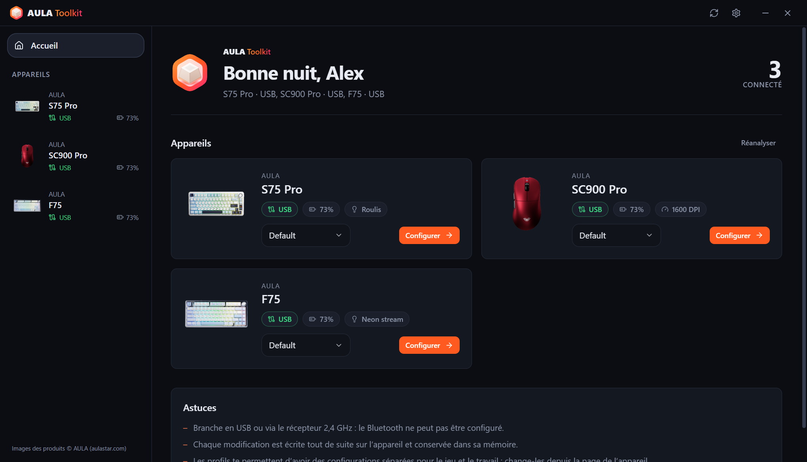 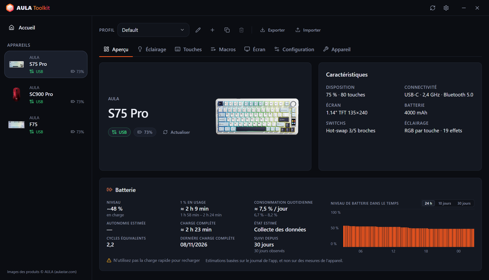

### Claviers
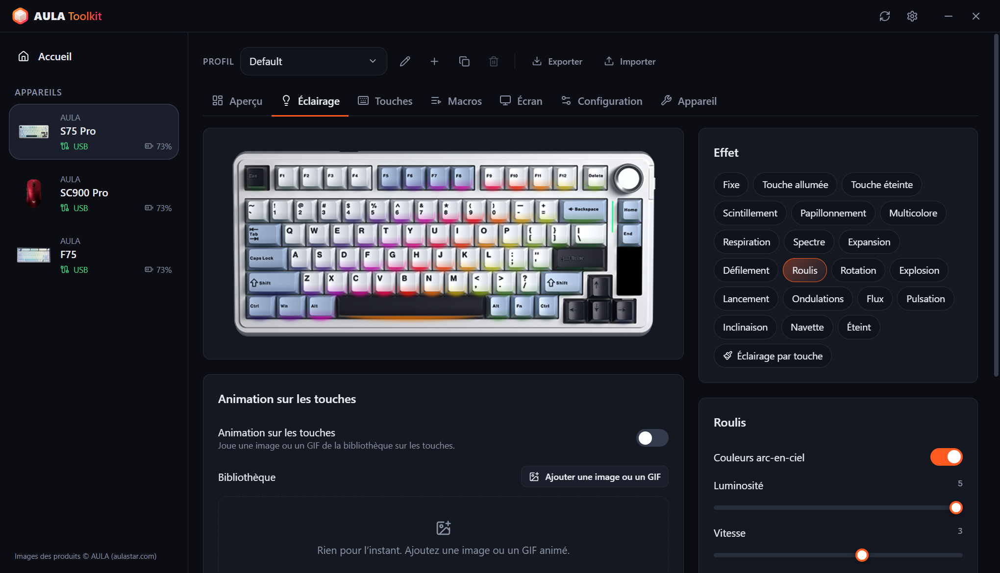 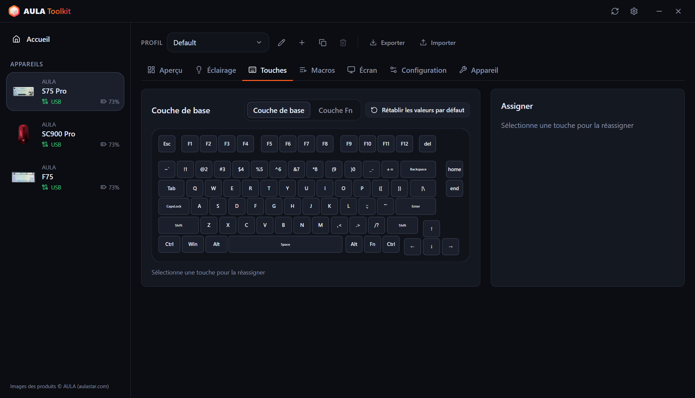
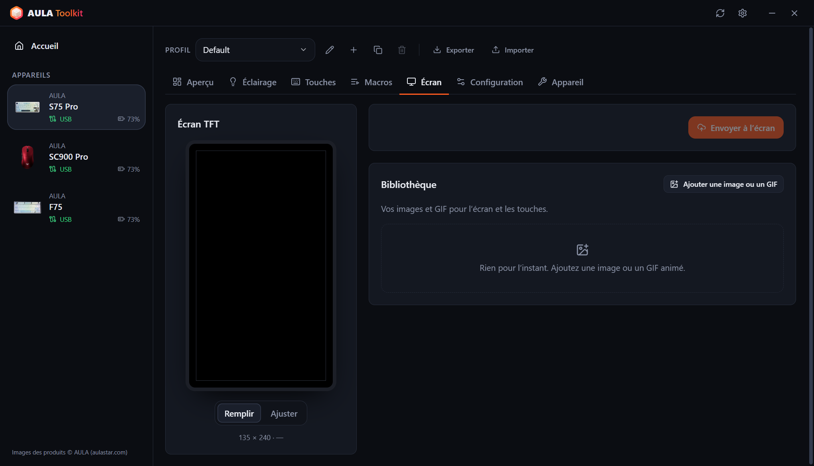 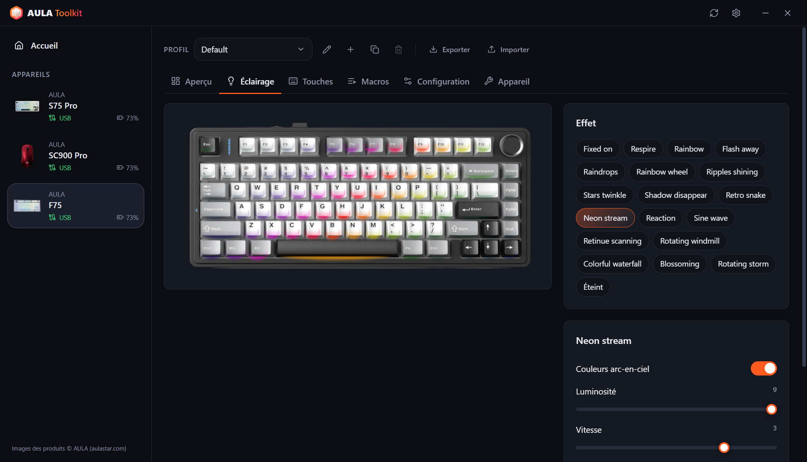

### Souris
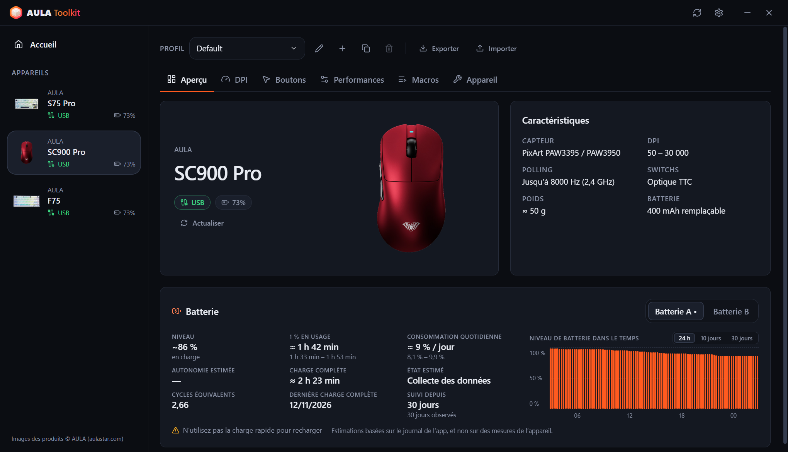 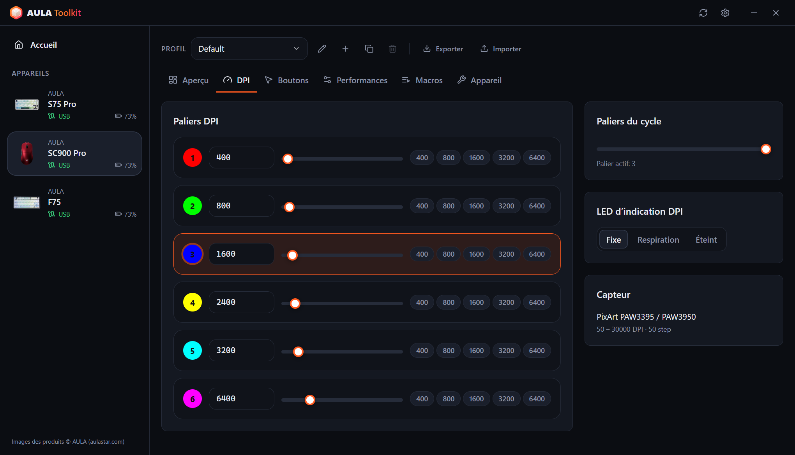
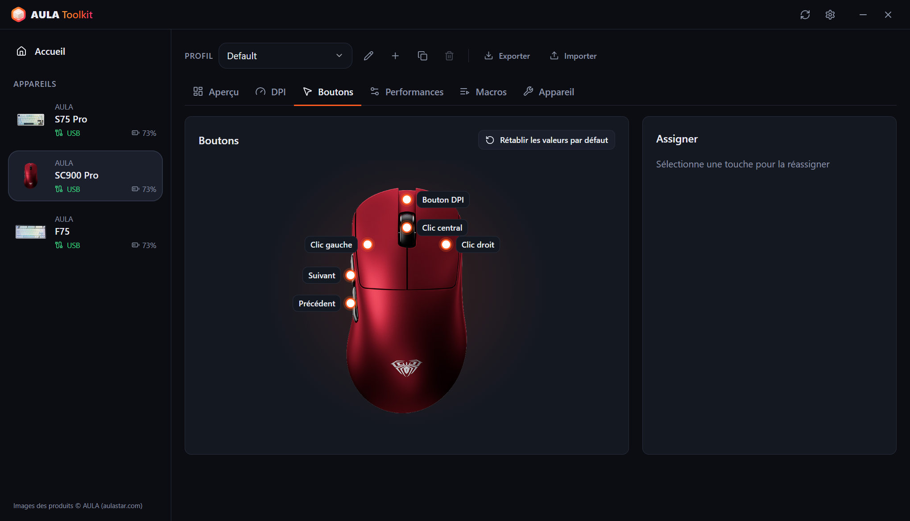 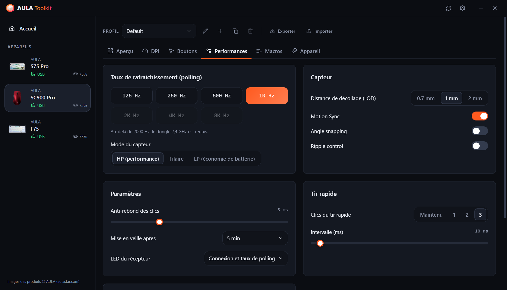

### Résumé dans la zone de notification et affichage à l’écran
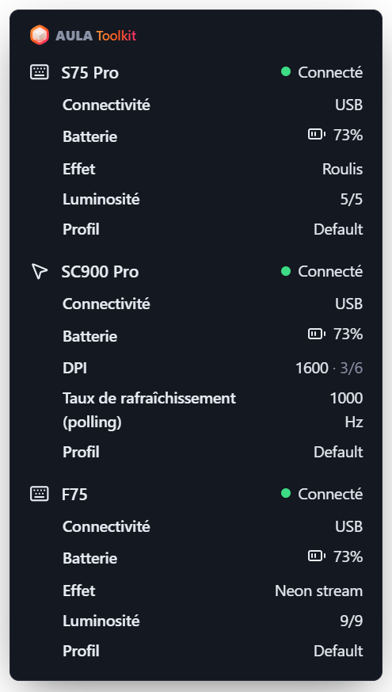 &nbsp; 

### Paramètres
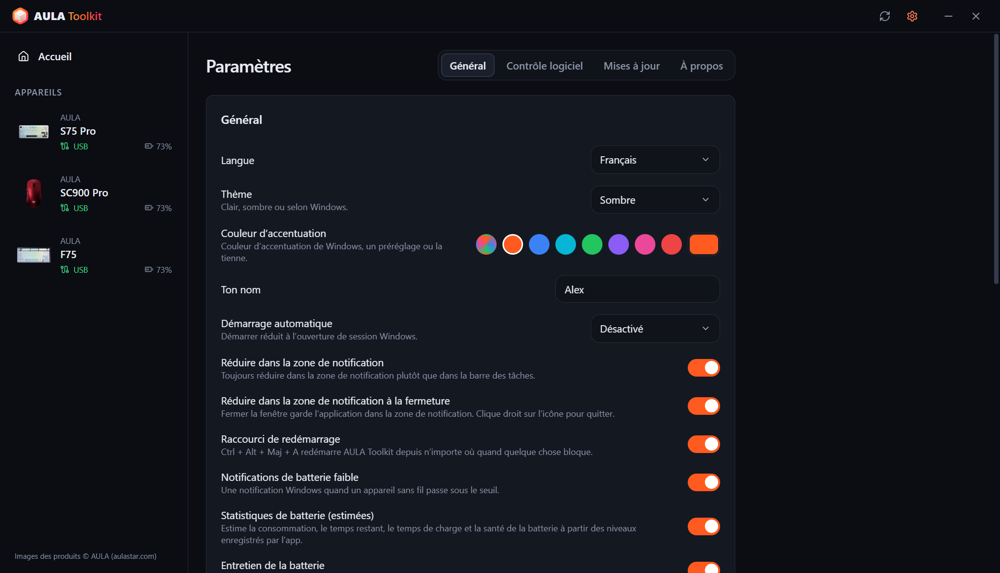 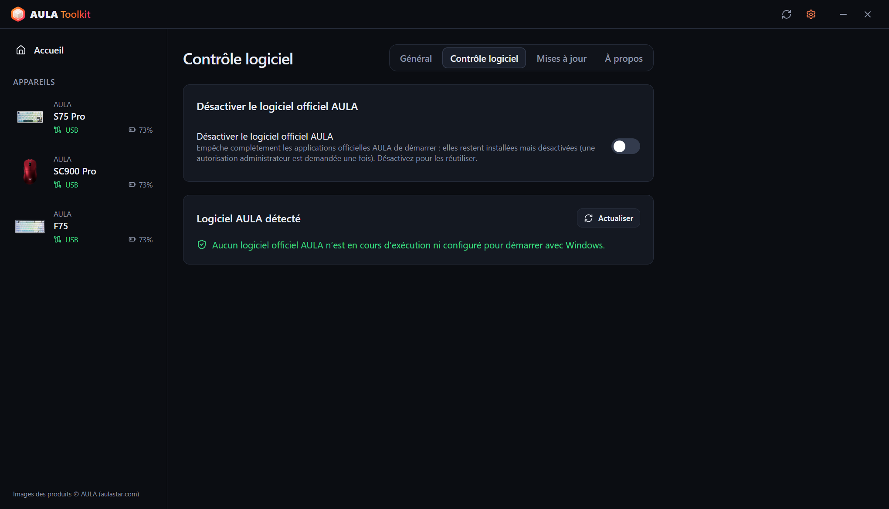
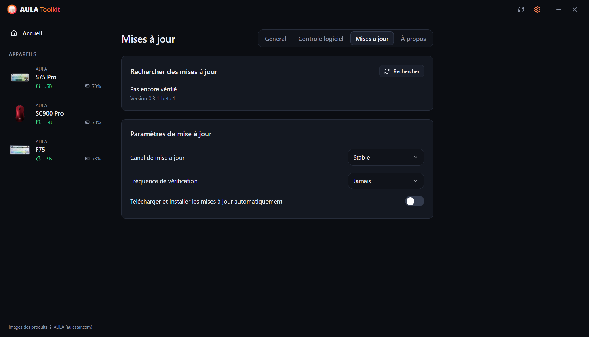 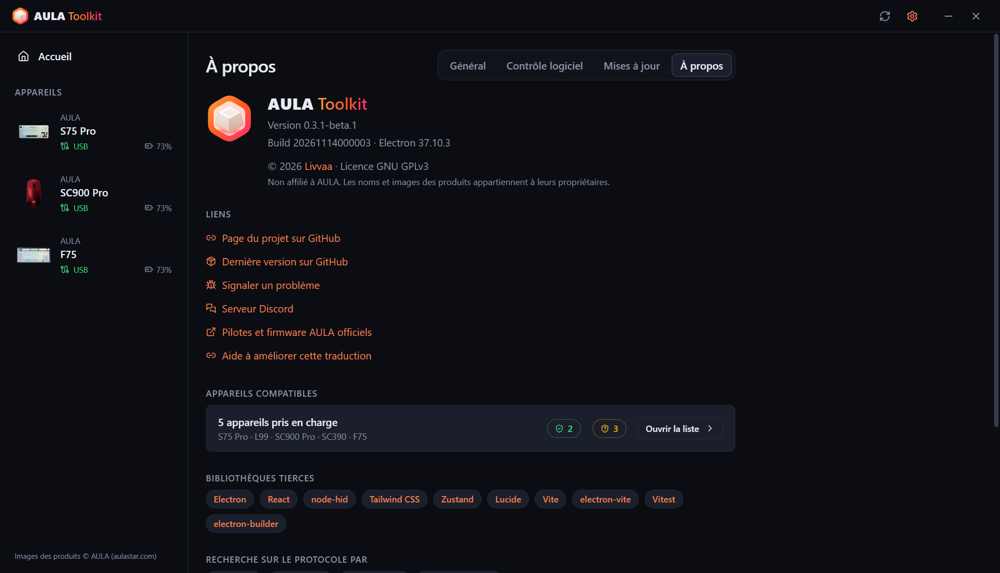
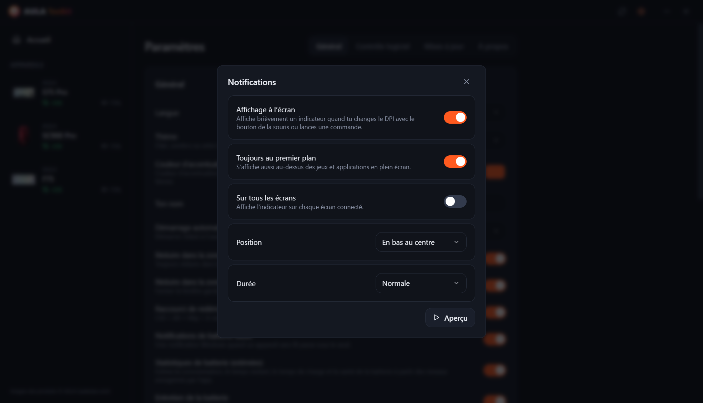 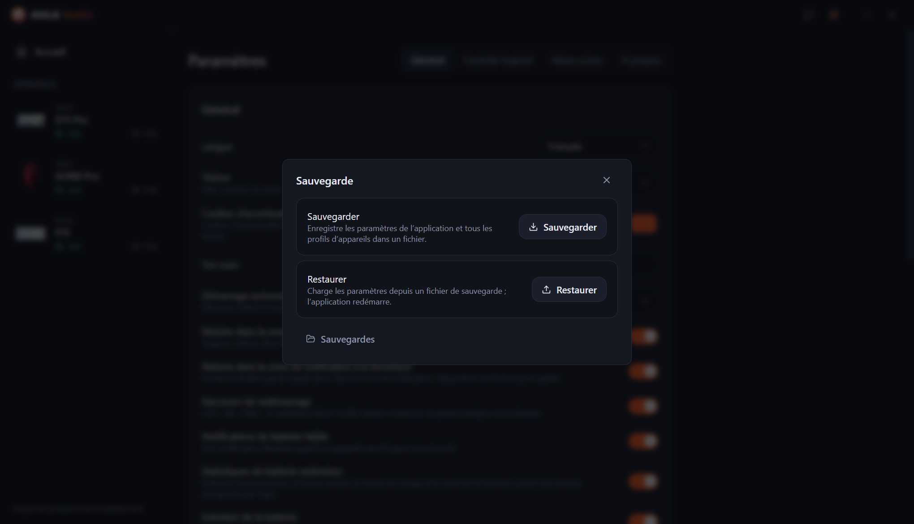

---

# Table des matières
  - [Avertissement](#avertissement)
  - [Téléchargement](#téléchargement)
  - [Compatibilité](#compatibilité)
  - [Fonctionnalités](#fonctionnalités)
  - [Crédits](#crédits)
  - [FAQ](#faq)
  - [Arguments](#arguments)
  - [Comment récupérer les journaux ?](#comment-récupérer-les-journaux-)
  - [Contribuer](#contribuer)
  - [Licence](#licence)

## Avertissement

**L’outil est fourni sans aucune garantie. Utilise-le à tes risques et périls.**

AULA Toolkit communique avec tes appareils grâce à des protocoles obtenus par rétro-ingénierie des pilotes officiels. Lis ce fichier avant de signaler un problème : il répond aux questions les plus courantes.

## Téléchargement

Chaque version est publiée en deux builds :
* **Installateur** — s’installe uniquement pour l’utilisateur actuel, aucun droit administrateur n’est donc nécessaire.
* **Portable** — un seul `.exe` qui se lance sans installation.

#### Mises à jour

AULA Toolkit peut se mettre à jour tout seul. Configure-le dans **Paramètres → Mises à jour** :
* **Canal de mise à jour** — versions **Stable** ou **Beta**.
* **Fréquence de vérification** — de toutes les heures à une fois par mois, ou jamais.
* **Télécharger et installer les mises à jour automatiquement** — les mises à jour se téléchargent en arrière-plan et s’installent discrètement pendant que tu n’es pas devant le PC (ou quand tu fermes l’application). Tu peux aussi les installer tout de suite.

Installer une nouvelle version par-dessus une version existante conserve tes paramètres, profils et macros.

#### Étapes suivantes

AULA Toolkit fonctionne mieux quand il tourne dans la zone de notification. Dans **Paramètres → Général** :
1. Règle **Démarrage automatique** sur *Activé* (ou *Activé (différé)* pour démarrer 30 secondes après la connexion à la session). AULA Toolkit démarre via une tâche planifiée Windows, il démarre donc aussi sur batterie ; la tâche est vérifiée à chaque lancement de l’application et recréée si elle a été supprimée.
2. Active **Réduire dans la zone de notification à la fermeture**.
3. Dans **Paramètres → Contrôle logiciel**, active **Désactiver le logiciel officiel AULA** pour que les pilotes AULA n’entrent pas en conflit avec AULA Toolkit sur le même appareil.

> [!WARNING]
> Si tu fermes complètement AULA Toolkit, les fonctions qui ont besoin qu’il tourne s’arrêtent : l’affichage à l’écran, les notifications de batterie, le résumé dans la zone de notification, le rythme musical et les animations sur les touches, et la commande `aula`. Les paramètres déjà écrits sur tes appareils continuent de fonctionner.

## Compatibilité

| Appareil | Connexion | État |
|---|---|---|
| **AULA S75 Pro** | USB, récepteur 2,4 GHz, Bluetooth (état et batterie) | ✅ Testé sur le matériel |
| **AULA L99** | USB, récepteur 2,4 GHz, Bluetooth (état et batterie) | 🧪 Bêta, en test par les utilisateurs |
| **AULA SC900 Pro** | USB, récepteur 2,4 GHz, Bluetooth (état et batterie) | ✅ Testé sur le matériel |
| **AULA SC900** (autres versions qui utilisent le pilote du SC900 Pro) | USB, récepteur 2,4 GHz | ⚠️ Reconnu, pas encore testé sur le matériel |
| **AULA SC390** | USB | 🧪 Bêta, en test par les utilisateurs |
| **AULA F75** | USB, récepteur 2,4 GHz | ⚠️ Reconnu, pas encore testé sur le matériel |

Les appareils en bêta sont pris en charge à partir de captures USB du pilote officiel envoyées par leurs propriétaires. Certaines fonctions manquent encore ; voir le tableau ci-dessous.

AULA vend la même souris en plusieurs couleurs sous un seul identifiant USB, AULA Toolkit ne peut donc pas les distinguer. Choisis ta couleur pendant la configuration de l’appareil ou dans son onglet **Appareil**.

Ton appareil AULA n’est pas dans la liste ? Il utilise peut-être l’un des protocoles ci-dessus — voir [Pouvez-vous ajouter la prise en charge de mon appareil AULA ?](#pouvez-vous-ajouter-la-prise-en-charge-de-mon-appareil-aula-).

#### Ce qui fonctionne selon la connexion

**Claviers**

| Fonction | S75 Pro · USB | S75 Pro · 2,4 GHz | L99 · USB | L99 · 2,4 GHz | F75 · USB / 2,4 GHz |
|---|:---:|:---:|:---:|:---:|:---:|
| Effets d’éclairage | ✅ | ✅ | ✅ | ✅ | ✅ |
| Éclairage par touche | ✅ | ✅ | ✅ | ✅ | — |
| Rythme musical et animation sur les touches (envoyés depuis le PC) | ✅ | — | ✅ | — | — |
| Lumières éteintes quand le moniteur est éteint | ✅ | ✅ | — | — | — |
| Vue en direct du clavier, suit les changements faits à la molette / Fn | ✅ | — | — | — | — |
| Réaffectation des touches, couche Fn, macros | ✅ | ✅ | ✅ | ✅ | ✅ |
| Paramètres du clavier (verrouillage Win, veille, anti-rebond) | ✅ | ✅ | ✅ | ✅ | ✅ |
| Écran | ✅ TFT | — | Bientôt | — | — |
| Horloge (synchronisée à la connexion) | ✅ | ✅ | ✅ | ✅ | — |
| Barre lumineuse latérale | ✅ | ✅ | — | — | — |
| Niveau de batterie | — | ✅ | — | ✅ | — |
| Paramètres relus à la connexion | — | — | — | — | ✅ |

**Souris**

| Fonction | SC900 Pro · USB / 2,4 GHz | SC390 · USB |
|---|:---:|:---:|
| Paliers DPI et indicateur DPI | ✅ | Bientôt |
| Taux de rafraîchissement (polling) | ✅ jusqu’à 8000 Hz | ✅ jusqu’à 1000 Hz (câble et récepteur) |
| Capteur (distance de décollage, ripple control et plus) | ✅ | ✅ |
| Boutons et macros | ✅ | Bientôt |
| Délai de mise en veille | ✅ | Bientôt |
| Niveau de batterie | ✅ | — |
| Paramètres relus à la connexion | ✅ | ✅ |
| Affichage à l’écran pour le bouton DPI | ✅ | — |

> [!NOTE]
> Les appareils ne peuvent être configurés qu’en **USB** ou via le **récepteur 2,4 GHz**. En Bluetooth, l’appareil n’expose pas son interface de configuration — le logiciel officiel AULA a la même limite. Les paramètres enregistrés auparavant continuent de fonctionner en Bluetooth, et AULA Toolkit affiche toujours l’appareil comme connecté, avec le niveau de batterie indiqué par Windows.

### Le logiciel d’AULA

Faire tourner le pilote officiel AULA et AULA Toolkit en même temps les fait communiquer tous les deux avec le même appareil, ce qui peut annuler des modifications ou provoquer des erreurs de lecture. AULA Toolkit affiche un bandeau d’avertissement en bas de la fenêtre quand il détecte un programme officiel AULA. **Paramètres → Contrôle logiciel → Désactiver le logiciel officiel AULA** les empêche complètement de démarrer : ils restent installés, mais leurs programmes sont désactivés (Windows demande une fois l’autorisation administrateur) et leurs entrées de démarrage automatique sont mises de côté. Désactiver l’option les rend de nouveau utilisables, et désinstaller AULA Toolkit les restaure aussi.

## Fonctionnalités

L’application te permet de :

- Configurer tous les appareils pris en charge depuis une seule fenêtre, avec des modifications appliquées instantanément.
- Ne jamais écraser de lui-même ce qui est déjà sur un appareil : les paramètres de la souris sont relus quand elle se connecte, et sur le S75 Pro l’effet, la couleur et la luminosité que tu changes avec la molette ou les touches Fn sont détectés en direct et enregistrés dans ton profil.
- Garder plusieurs **profils** par appareil et les exporter ou les importer sous forme de fichiers.
- Voir un **affichage à l’écran** en direct quand tu appuies sur le bouton DPI de la souris ou lances une commande.
- Afficher des barres de **rythme musical** et des **animations (GIF)** sur les touches du S75 Pro, envoyées depuis le PC.
- **Éteindre** l’éclairage du clavier **quand le moniteur est éteint**, et le rallumer à son réveil.
- Redémarrer l’application depuis n’importe où avec **Ctrl + Alt + Shift + A** quand quelque chose est bloqué.
- Obtenir un **résumé** détaillé de chaque appareil connecté **dans la zone de notification** en survolant son icône.
- Recevoir des **notifications de batterie faible**, un rappel d’**entretien de la batterie** à 80 % pendant la charge et, si tu le souhaites, voir des **statistiques de batterie**.
- Désactiver le logiciel officiel AULA sans le désinstaller.
- Contrôler les appareils en **ligne de commande** avec `aula`.
- L’utiliser en **10 langues** : English, Türkçe, Русский, 简体中文, Українська, Tiếng Việt, Português (Brasil), Español, Deutsch et Français.
- Choisir un **thème clair, sombre ou système** et une couleur d’accentuation.

### Claviers

* **Éclairage** — tous les effets matériels avec couleur, luminosité, vitesse et direction, plus un aperçu dessiné sur une photo de ton clavier.
* **Vue en direct** (S75 Pro, USB) — l’image du clavier montre ce qu’affichent les LED à cet instant. Quand tu changes l’effet avec la molette ou les touches Fn, l’application le reconnaît en quelques secondes, le sélectionne et l’affiche à l’écran. Le clavier n’indique pas son effet, cela fonctionne donc à partir des couleurs des LED : les effets qui restent éteints jusqu’à ce que tu appuies sur une touche se ressemblent au repos, et des rotations très rapides peuvent sauter un effet intermédiaire.
* **Éclairage par touche** (S75 Pro) — peins les touches une par une ou remplis tout le clavier.
* **Pendant la musique** — des barres sur les touches suivent le son joué sur le PC (12 palettes de couleurs, amplitude et fond, comme dans le pilote officiel), ou le clavier passe à un effet de ton choix. Les barres nécessitent le câble USB ; avec le récepteur, c’est l’effet qui est utilisé.
* **Animation sur les touches** (S75 Pro, USB) — joue une image ou un GIF de ta bibliothèque sur les touches, à environ 20 images par seconde.
* **Écran éteint** (S75 Pro) — les touches et la barre latérale s’éteignent quand le moniteur est éteint.
* **Réaffectation des touches** — réaffecte les touches de la couche de base et de la couche Fn à des touches, des boutons de souris, des touches multimédias, des raccourcis ou des macros.
* **Macros** — enregistre des frappes avec leur timing réel et modifie-les ensuite.
* **Écran TFT** (S75 Pro, USB) — envoie une image ou un GIF animé de ta bibliothèque. Fais glisser l’aperçu pour choisir la partie visible ; les GIF longs sont adaptés aux 141 images de l’écran sans changer leur rythme. L’horloge est synchronisée à chaque connexion du clavier.
* **Configuration** — verrouille la touche Windows, Alt+F4 et Alt+Tab, règle le délai de mise en veille et le temps de réponse des touches.
* **Réinitialisation** — rétablis les valeurs par défaut du clavier ou fais une réinitialisation d’usine complète.

### Souris

* **DPI** — jusqu’à six paliers, le palier actif, le nombre de paliers dans le cycle et la LED indicatrice DPI.
* **Taux de rafraîchissement (polling)** — jusqu’à 8000 Hz. Les taux au-delà de 1000 Hz nécessitent le récepteur 2,4 GHz. Sur la SC390, le câble et le récepteur ont des taux séparés.
* **Capteur** — distance de décollage, Motion Sync, angle snapping, ripple control et mode du capteur. Sur la SC390 : distance de levée, Latence ultra-faible, Consommation ultra-faible, Contrôle d’ondulation et Réveil au mouvement.
* **Boutons** — réaffecte n’importe quel bouton sauf le clic gauche, y compris le tir rapide et les macros.
* **Délais** — anti-rebond des clics et délai de mise en veille.
* **Batterie** — niveau et état de charge. Les deux batteries de la SC900 Pro (et celles que tu ajoutes) sont suivies séparément.

### Affichage à l’écran

Quand tu changes le DPI avec le bouton de la souris, un petit indicateur apparaît à l’écran avec la nouvelle valeur et le palier actif. Sur le S75 Pro (USB), il affiche aussi le nouvel effet, la nouvelle couleur ou la nouvelle luminosité quand tu les changes sur le clavier, et il confirme les modifications faites avec la commande `aula`. Les envois vers l’écran, le rappel des 80 % et les redémarrages y apparaissent aussi. Dans **Paramètres → Notifications**, tu peux le désactiver, choisir sa position et sa durée, le garder au-dessus des jeux en plein écran ou l’afficher sur tous les écrans.

### Sauvegardes

**Paramètres → Sauvegarde** enregistre les paramètres de l’application et tous les profils d’appareils dans un seul fichier, et les restaure plus tard à partir de celui-ci, par exemple après une réinstallation de Windows.

### Statistiques de batterie

**Paramètres → Général → Statistiques de batterie** (activé par défaut) affiche une carte batterie dans l’aperçu de chaque appareil :

* **Niveau** — le niveau actuel, ou le dernier avec l’ancienneté de la lecture. Sur câble sans lecture, une estimation puis 99+.
* **1 % en usage** — combien de temps dure 1 % quand l’appareil est utilisé sur le récepteur.
* **Consommation quotidienne** et **autonomie restante** — en temps calendaire, y compris les heures où il est en veille ou où l’application est fermée.
* **Charge complète** et **état** — d’après la vitesse de charge de la batterie au milieu de sa plage.
* **Cycles équivalents**, **dernière charge complète** et un graphique avec trois vues : les dernières 24 heures, la batterie utilisée par jour sur 10 jours et le niveau sur 30 jours. Survole le graphique pour voir les valeurs exactes ; la charge est affichée en vert.

Les chiffres sont affichés avec une fourchette, une fois que suffisamment de données ont été enregistrées. Les niveaux sont enregistrés en USB, via le récepteur 2,4 GHz et en Bluetooth (lus depuis Windows). L’**Entretien de la batterie**, activé par défaut avec les statistiques, te rappelle à 80 % pendant la charge de débrancher l’appareil.

> [!NOTE]
> Les appareils AULA n’indiquent que leur pourcentage de batterie. Tous les chiffres ci-dessus sont des **estimations** calculées à partir des niveaux enregistrés par AULA Toolkit.

> [!WARNING]
> N’utilise pas de chargeur rapide, les boîtes le disent aussi.

### CLI

Tu peux contrôler AULA Toolkit en ligne de commande. La commande s’appelle `aula` et est installée dans `resources\bin` à l’intérieur du dossier d’installation (par défaut `%LOCALAPPDATA%\Programs\AULA Toolkit\resources\bin\aula.cmd`). L’application installée ajoute elle-même ce dossier au `PATH` de ton utilisateur, `aula` fonctionne donc dans tout nouveau terminal ; la désinstallation le retire. La build portable ne modifie pas le `PATH`. **Paramètres → Général → Ligne de commande** affiche le chemin exact avec un bouton pour le copier.

La commande communique avec l’application en cours d’exécution. Si AULA Toolkit n’est pas lancé, `aula` le démarre d’abord dans la zone de notification. Elle ne nécessite pas de droits administrateur.

Commandes

* `aula status` — liste les appareils connectés (ajoute `--json` pour une sortie lisible par une machine)
* `aula profile list` — liste les profils d’un appareil
* `aula profile set <name>` — passe à un profil
* `aula dpi` — affiche les paliers DPI de la souris
* `aula dpi stage <n>` — active le palier DPI `<n>` (à partir de 1)
* `aula dpi <value>` — règle le palier actif sur `<value>` DPI
* `aula polling <hz>` — règle le taux de rafraîchissement de la souris
* `aula light list` — liste les effets du clavier
* `aula light <effect> [--color #rrggbb] [--brightness n] [--speed n]` — règle l’effet du clavier
* `aula brightness <n>` — règle la luminosité de l’éclairage du clavier
* `aula osd on|off` — active ou désactive l’affichage à l’écran
* `aula show` / `aula hide` — affiche ou masque la fenêtre
* `aula version` — affiche la version de l’application

Quand plusieurs appareils du même type sont connectés, choisis-en un avec `-d <id>`, par exemple `aula profile list -d sc900`. La commande se termine avec le code `0` en cas de succès et `1` en cas d’échec, elle peut donc être utilisée dans des scripts.

## Crédits

AULA Toolkit est créé et maintenu par **Livvaa** ([GitHub](https://github.com/Livvaa)).

Un grand merci aux projets dont le travail public de rétro-ingénierie a rendu cela possible :
* [open-aula](https://github.com/paulcoding810/open-aula) — protocoles des claviers AULA.
* [AulaSofwareLinux](https://github.com/thought-train/AulaSofwareLinux) — le protocole utilisé par la famille AULA F75.
* [IncottHIDApp](https://github.com/romkazor/IncottHIDApp) et [OpenMouse](https://github.com/OpenMouse-Project/mouse-protocol) — le protocole de souris PixArt 8K.

Tous les détails des protocoles ont été vérifiés avec les pilotes officiels AULA. Images des produits © AULA ([aulastar.com](https://www.aulastar.com)).

### Bibliothèques tierces

* **Electron** ([electron/electron](https://github.com/electron/electron))
* **React** ([facebook/react](https://github.com/facebook/react))
* **node-hid** ([node-hid/node-hid](https://github.com/node-hid/node-hid))
* **Tailwind CSS** ([tailwindlabs/tailwindcss](https://github.com/tailwindlabs/tailwindcss))
* **Zustand** ([pmndrs/zustand](https://github.com/pmndrs/zustand))
* **Lucide** ([lucide-icons/lucide](https://github.com/lucide-icons/lucide))
* **electron-vite** ([alex8088/electron-vite](https://github.com/alex8088/electron-vite)), **Vite** ([vitejs/vite](https://github.com/vitejs/vite)) et **Vitest** ([vitest-dev/vitest](https://github.com/vitest-dev/vitest))
* **electron-builder** et **electron-updater** ([electron-userland/electron-builder](https://github.com/electron-userland/electron-builder))

### Traductions

L’interface est disponible en 10 langues. Toutes les traductions n’ont pas encore été relues par des locuteurs natifs. Si tu repères une erreur, ouvre une pull request — chaque langue est un seul fichier dans [`src/shared/locales`](src/shared/locales).

## FAQ

#### AULA Toolkit peut-il endommager mon appareil ?

AULA Toolkit ne touche jamais au firmware. Il envoie uniquement les mêmes commandes de configuration que le pilote officiel (éclairage, touches, macros, DPI, etc.), vérifiées avec des captures USB de ce pilote. Si quelque chose semble anormal, la réinitialisation de l’appareil dans l’onglet **Appareil** ou le logiciel officiel rétablit les valeurs par défaut.

#### Pourquoi je ne peux pas modifier les paramètres en Bluetooth ?

En Bluetooth, le clavier et la souris apparaissent dans Windows comme un clavier et une souris standard. L’interface de configuration fournie par l’USB et le récepteur 2,4 GHz n’existe pas dans ce mode, donc ni AULA Toolkit ni le logiciel officiel ne peuvent modifier les paramètres. Connecte-toi avec le câble ou le récepteur, fais tes modifications, puis repasse en Bluetooth — les paramètres restent sur l’appareil. En Bluetooth, AULA Toolkit affiche la connexion et le niveau de batterie indiqué par Windows.

#### Pourquoi mon clavier n’affiche-t-il pas de niveau de batterie ?

Le S75 Pro indique son niveau de batterie via le récepteur 2,4 GHz, et Windows l’indique en Bluetooth. En USB, il est en charge et le firmware n’indique aucun niveau : AULA Toolkit affiche une estimation à partir de la vitesse de charge mesurée, puis 99+.

#### Pourquoi les cycles et l’état de la batterie ne sont-ils que des estimations ?

Les appareils AULA n’ont pas de puce de batterie qui compte les cycles ou mesure l’usure. Ils n’indiquent qu’un pourcentage, AULA Toolkit estime donc tout le reste à partir des moments où ce pourcentage change. L’état vient de la vitesse de charge de la batterie, il faut donc plusieurs charges sur un mois ou plus.

#### AULA Toolkit peut-il lire l’image de l’écran du S75 Pro ou la version du firmware ?

Non. Le firmware du clavier peut recevoir une image mais n’a aucune commande pour la renvoyer, et aucun des appareils pris en charge n’indique sa version de firmware. Le logiciel officiel ne peut pas le faire non plus.

#### Pourquoi Windows affiche-t-il un avertissement quand je lance l’installateur ?

Les installateurs ne sont pas encore signés, Windows SmartScreen affiche donc un avertissement pour un éditeur inconnu. AULA Toolkit est open source et tu peux le compiler toi-même à partir de ce dépôt. Choisis **Informations complémentaires → Exécuter quand même** pour continuer.

#### Ma souris n’a pas la même couleur que sur l’image.

AULA utilise le même identifiant USB pour toutes les couleurs d’un modèle. Choisis ta couleur dans l’onglet **Appareil** de l’appareil.

#### Pouvez-vous ajouter la prise en charge de mon appareil AULA ?

Peut-être. La plupart des claviers et souris AULA réutilisent l’une des familles de protocoles qu’AULA Toolkit connaît déjà. Voir [Contribuer](#contribuer) pour savoir quoi inclure dans une demande.

## Arguments

* `--hidden` — démarre réduit dans la zone de notification. Utilisé par le *Démarrage automatique*.
* `--delayed` — attend 30 secondes avant de se connecter aux appareils. *Démarrage automatique → Activé (différé)* attend désormais dans la tâche planifiée.

## Comment récupérer les journaux ?

Les journaux aident beaucoup pour n’importe quel problème. Joins-les **toujours** à tes issues.

#### Méthode 1 : pack de diagnostic (recommandé)
1. Ouvre **AULA Toolkit**.
2. Va dans **Paramètres → À propos**.
3. Clique sur **Enregistrer le pack de diagnostic**. Il enregistre l’état de l’appareil et le journal de communication dans un seul fichier que tu peux joindre à ton issue.

#### Méthode 2 : fichiers journaux
1. Reproduis le problème.
2. Ouvre `Exécuter` (Win+R), tape `"%APPDATA%\AULA Toolkit\logs"` et appuie sur OK.
3. Joins le fichier `hid-<date>.log` le plus récent.

Tu peux aussi suivre le journal en direct dans **Paramètres → Général → Avancé**.

## Contribuer

Les retours sont les bienvenus, n’hésite donc pas à signaler des problèmes. Les pull requests sont aussi les bienvenues. Lis d’abord le [guide de contribution](CONTRIBUTING.md).

Des questions, des idées ou simplement envie de discuter ? Rejoins le [serveur Discord](https://discord.gg/u9FbaJGtCe).

#### Prise en charge des appareils

La prise en charge de nouveaux appareils AULA a besoin de testeurs. Quand tu ouvres une demande, inclus :

1. Le nom complet du modèle (par exemple *AULA F87 Pro*).
2. Les identifiants USB, dans **Gestionnaire de périphériques → ton appareil → Détails → ID du matériel** (par exemple `VID_0C45&PID_800A`).
3. La connexion utilisée (USB ou 2,4 GHz).
4. Un pack de diagnostic (voir [Comment récupérer les journaux ?](#comment-récupérer-les-journaux-)).
5. Si possible : une capture USB du pilote officiel. Installe [Wireshark](https://www.wireshark.org/download.html) avec USBPcap, ferme AULA Toolkit, lance la capture, modifie un seul paramètre à la fois dans le pilote officiel et note l’ordre. Joins le fichier `.pcapng` compressé en zip. C’est ainsi que le L99 et la SC390 ont été ajoutés.

## Licence

Copyright (C) 2026 Livvaa

AULA Toolkit est un logiciel libre : tu peux le redistribuer et/ou le modifier selon les termes de la
GNU General Public License telle que publiée par la Free Software Foundation, soit la version 3 de la
licence, soit (à ton choix) toute version ultérieure. Voir [LICENSE](LICENSE) pour le texte complet.

Ce programme est distribué dans l’espoir qu’il sera utile, mais SANS AUCUNE GARANTIE ; sans même
la garantie implicite de QUALITÉ MARCHANDE ou d’ADÉQUATION À UN USAGE PARTICULIER.

AULA Toolkit n’est pas affilié à AULA. Les noms et images des produits appartiennent à leurs propriétaires.
