

  <picture>
    <source media="(prefers-color-scheme: dark)" srcset="docs/brand/wordmark-dark.png">
    
  </picture>

  
  
  
   
  
  
  
  
   
  
  
  

## 🚨 Aviso sobre o estado do projeto

> [!IMPORTANT]
> - O AULA Toolkit está em **desenvolvimento inicial** (versão 0.x). Espere algumas arestas.
> - É um projeto **não oficial** e **não tem afiliação com a AULA**. Nomes e imagens de produtos pertencem aos seus donos.
> - Só alguns dispositivos foram testados em hardware real; veja [Compatibilidade](#compatibilidade).

#### Outras versões deste arquivo README em outros idiomas:
[English](README.md) · [Türkçe](README_tr-TR.md) · [Русский](README_ru-RU.md) · [简体中文](README_zh-CN.md) · [Українська](README_uk-UA.md) · [Tiếng Việt](README_vi-VN.md) · [Español](README_es-ES.md) · [Deutsch](README_de-DE.md) · [Français](README_fr-FR.md)

---

O AULA Toolkit é um app para desktop do Windows que controla teclados e mouses AULA em um só lugar, no estilo do Logitech G HUB. Ele substitui o driver separado que a AULA distribui para cada modelo.

Ele não roda serviços em segundo plano, não coleta telemetria e só se conecta à internet para procurar atualizações no GitHub. As alterações são gravadas no dispositivo no momento em que você as faz e ficam guardadas na memória do próprio dispositivo, então continuam funcionando em outros computadores e pelo Bluetooth.

# Capturas de tela

### Início e visão geral do dispositivo
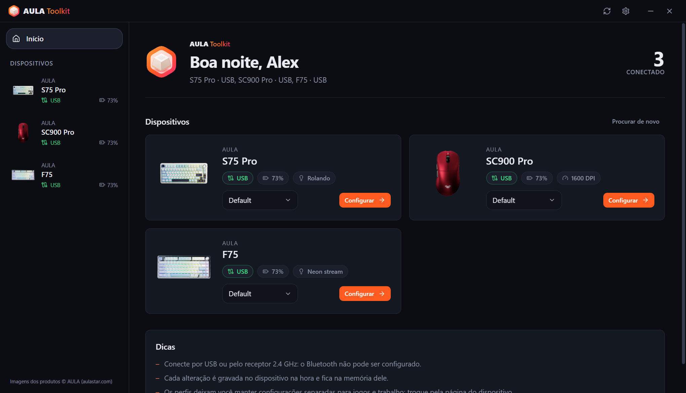 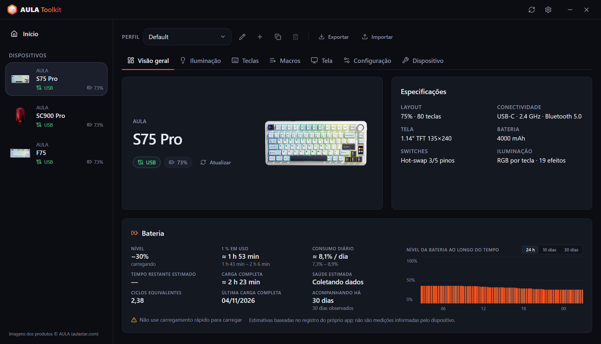

### Teclados
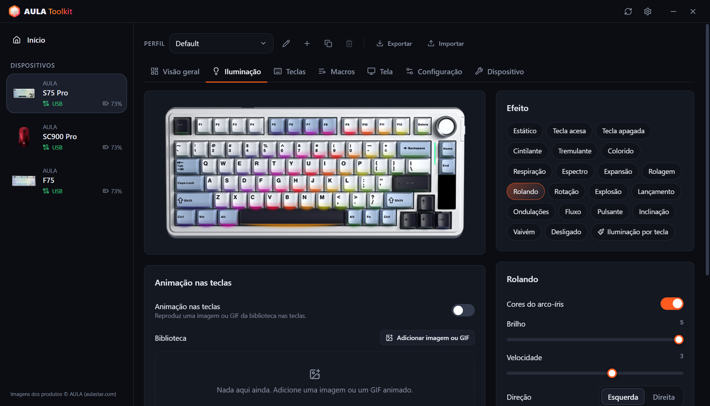 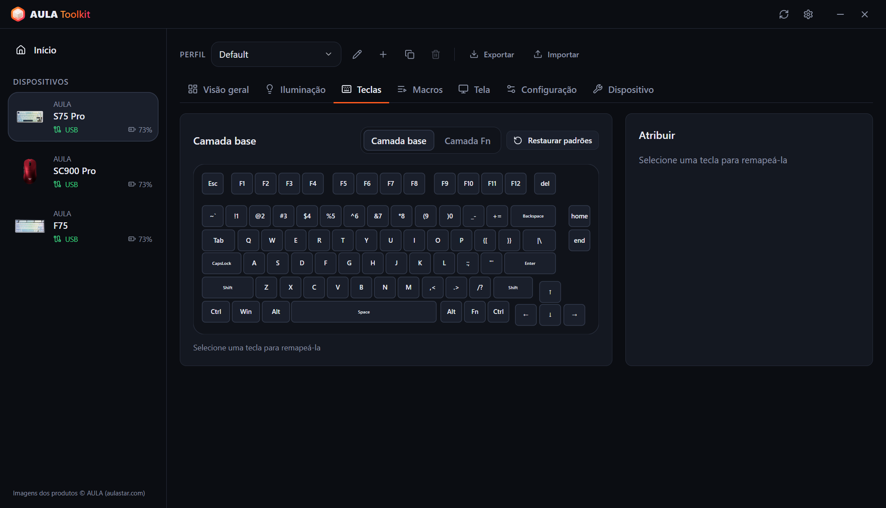
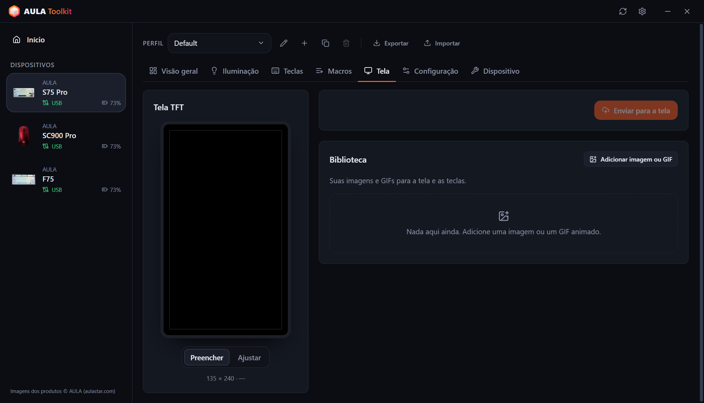 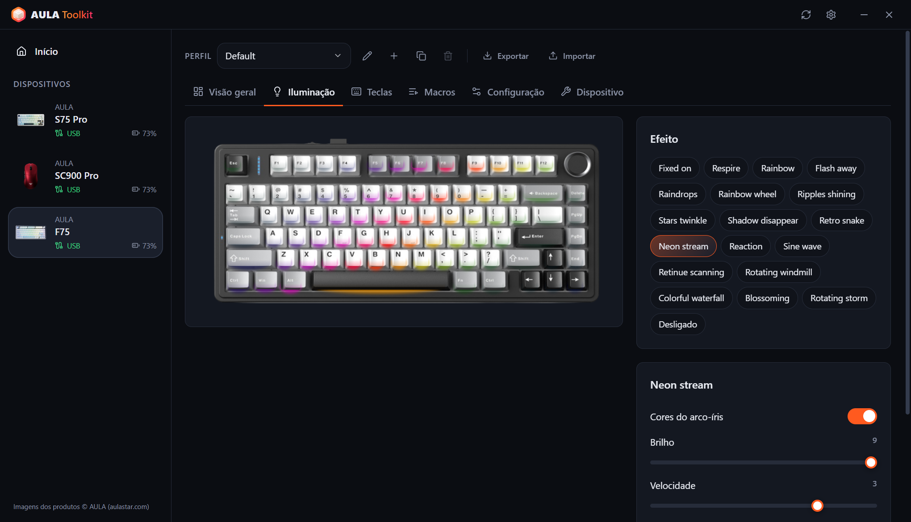

### Mouses
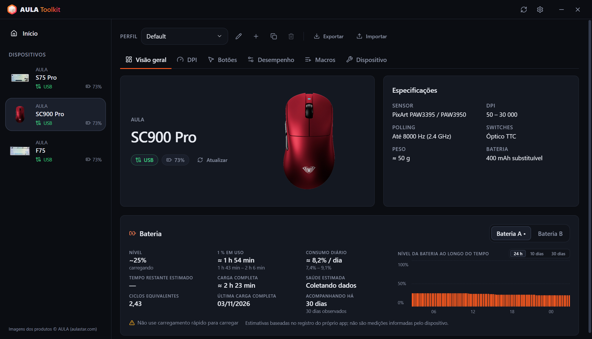 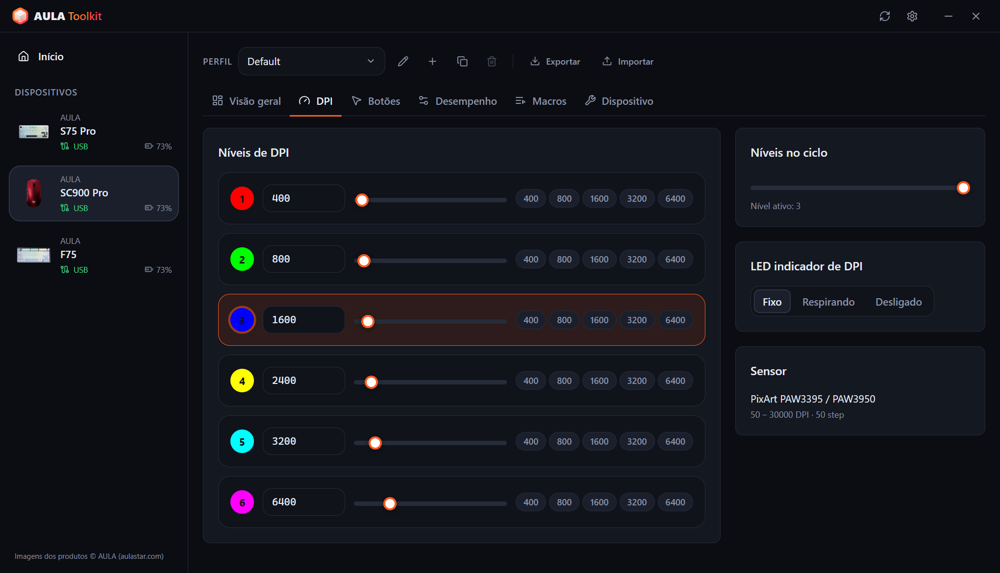
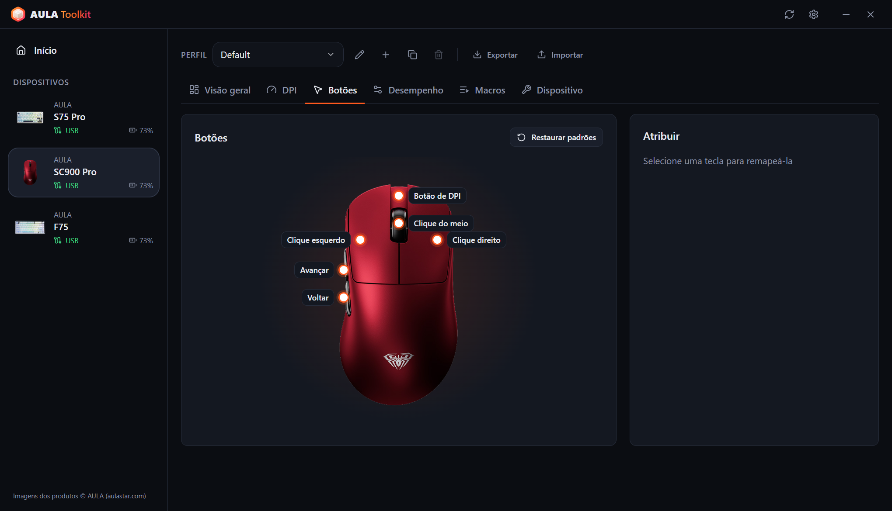 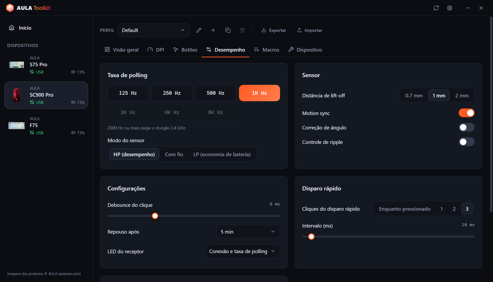

### Resumo na bandeja e indicador na tela
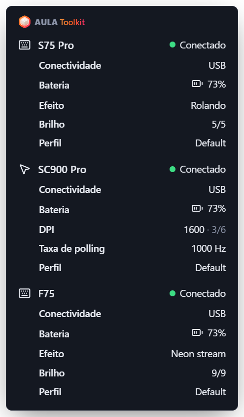 &nbsp; 

### Configurações
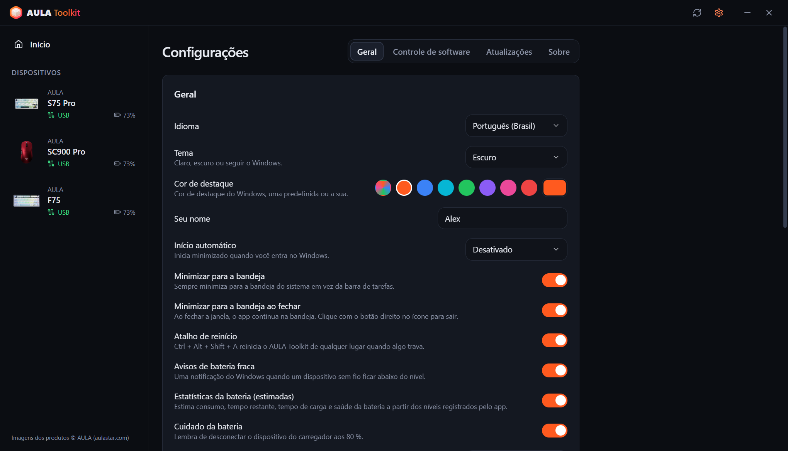 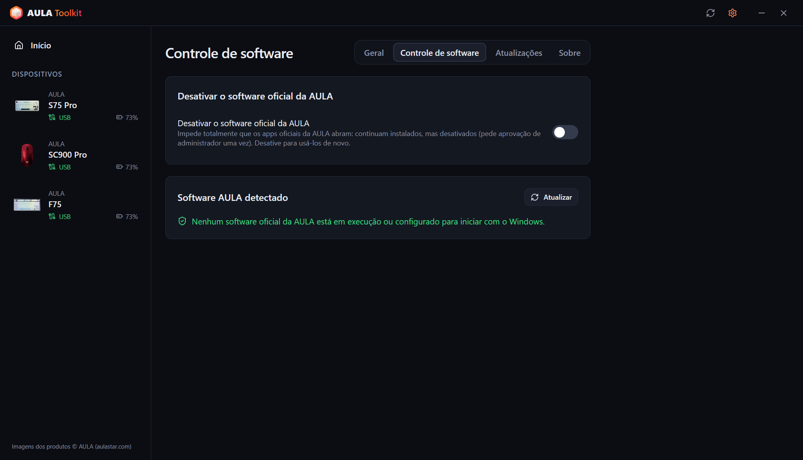
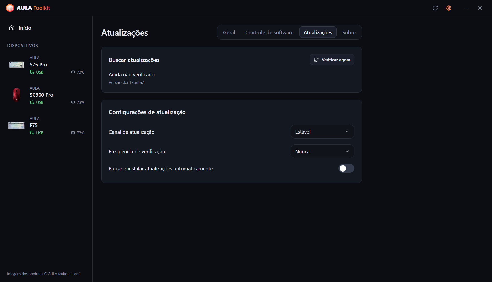 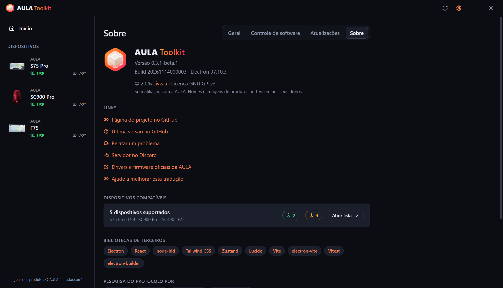
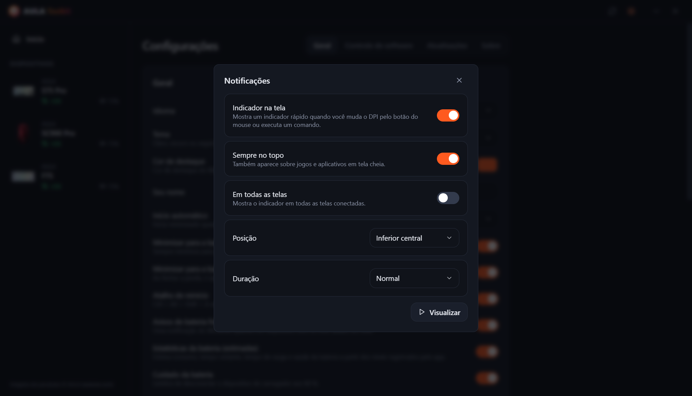 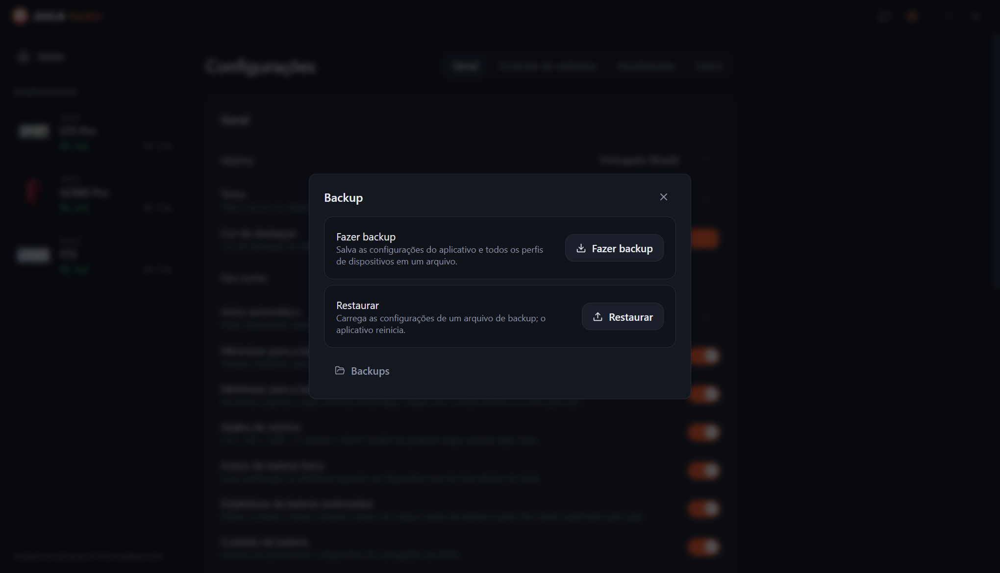

---

# Índice
  - [Aviso legal](#aviso-legal)
  - [Download](#download)
  - [Compatibilidade](#compatibilidade)
  - [Recursos](#recursos)
  - [Créditos](#créditos)
  - [Perguntas frequentes](#perguntas-frequentes)
  - [Argumentos](#argumentos)
  - [Como coletar os logs?](#como-coletar-os-logs)
  - [Contribuição](#contribuição)
  - [Licença](#licença)

## Aviso legal

**A ferramenta não oferece nenhuma garantia. Use por sua conta e risco.**

O AULA Toolkit se comunica com seus dispositivos usando protocolos obtidos por engenharia reversa dos drivers oficiais. Leia este arquivo antes de relatar problemas — ele responde às dúvidas mais comuns.

## Download

Cada versão é publicada em duas builds:
* **Instalador** — instala só para o usuário atual, então não precisa de direitos de administrador.
* **Portátil** — um único `.exe` que roda sem instalar.

#### Atualização

O AULA Toolkit pode se atualizar sozinho. Configure isso em **Configurações → Atualizações**:
* **Canal de atualização** — versões **Estável** ou **Beta**.
* **Frequência de verificação** — de a cada hora até mensal, ou nunca.
* **Baixar e instalar atualizações automaticamente** — as atualizações são baixadas em segundo plano e instaladas silenciosamente enquanto você está longe do PC (ou quando você fecha o app). Você também pode instalá-las na hora.

Instalar uma versão nova por cima de uma existente mantém suas configurações, perfis e macros.

#### Próximos passos

O AULA Toolkit funciona melhor quando fica rodando na bandeja. Em **Configurações → Geral**:
1. Defina **Início automático** como *Ativado* (ou *Ativado (com atraso)* para iniciar 30 segundos depois do login). O AULA Toolkit inicia por uma tarefa agendada do Windows, então ele também inicia quando o PC está na bateria; a tarefa é verificada sempre que o app inicia e recriada se tiver sido removida.
2. Ative **Minimizar para a bandeja ao fechar**.
3. Em **Configurações → Controle de software**, ative **Desativar o software oficial da AULA** para que os drivers da AULA não briguem com o AULA Toolkit pelo mesmo dispositivo.

> [!WARNING]
> Se você fechar o AULA Toolkit por completo, os recursos que precisam dele rodando param: o indicador na tela, os avisos de bateria, o resumo na bandeja, o ritmo da música e as animações nas teclas, e o comando `aula`. As configurações já gravadas nos dispositivos continuam funcionando.

## Compatibilidade

| Dispositivo | Conexão | Status |
|---|---|---|
| **AULA S75 Pro** | USB, receptor 2.4 GHz, Bluetooth (status e bateria) | ✅ Testado em hardware |
| **AULA L99** | USB, receptor 2.4 GHz, Bluetooth (status e bateria) | 🧪 Beta, em testes pelos usuários |
| **AULA SC900 Pro** | USB, receptor 2.4 GHz, Bluetooth (status e bateria) | ✅ Testado em hardware |
| **AULA SC900** (outras versões que usam o driver do SC900 Pro) | USB, receptor 2.4 GHz | ⚠️ Reconhecido, ainda não testado em hardware |
| **AULA SC390** | USB | 🧪 Beta, em testes pelos usuários |
| **AULA F75** | USB, receptor 2.4 GHz | ⚠️ Reconhecido, ainda não testado em hardware |

Os dispositivos beta são suportados a partir de capturas USB do driver oficial enviadas pelos donos. Alguns recursos ainda faltam; veja a tabela abaixo.

A AULA vende o mesmo mouse em várias cores com um único ID USB, então o AULA Toolkit não consegue diferenciá-las. Escolha sua cor durante a configuração do dispositivo ou na aba **Dispositivo** dele.

Seu dispositivo AULA não está na lista? Ele ainda pode usar um dos protocolos acima — veja [Você pode adicionar suporte para o meu dispositivo AULA?](#você-pode-adicionar-suporte-para-o-meu-dispositivo-aula).

#### O que funciona em cada conexão

**Teclados**

| Recurso | S75 Pro · USB | S75 Pro · 2.4 GHz | L99 · USB | L99 · 2.4 GHz | F75 · USB / 2.4 GHz |
|---|:---:|:---:|:---:|:---:|:---:|
| Efeitos de iluminação | ✅ | ✅ | ✅ | ✅ | ✅ |
| Iluminação por tecla | ✅ | ✅ | ✅ | ✅ | — |
| Ritmo da música e animação nas teclas (transmitidos pelo PC) | ✅ | — | ✅ | — | — |
| Luzes apagadas enquanto o monitor está desligado | ✅ | ✅ | — | — | — |
| Visualização ao vivo do teclado, acompanha mudanças pelo botão giratório / Fn | ✅ | — | — | — | — |
| Mapeamento de teclas, camada Fn, macros | ✅ | ✅ | ✅ | ✅ | ✅ |
| Configurações do teclado (bloqueio do Win, repouso, debounce) | ✅ | ✅ | ✅ | ✅ | ✅ |
| Tela | ✅ TFT | — | Em breve | — | — |
| Relógio (sincronizado ao conectar) | ✅ | ✅ | ✅ | ✅ | — |
| Barra de luz lateral | ✅ | ✅ | — | — | — |
| Nível da bateria | — | ✅ | — | ✅ | — |
| Configurações lidas ao conectar | — | — | — | — | ✅ |

**Mouses**

| Recurso | SC900 Pro · USB / 2.4 GHz | SC390 · USB |
|---|:---:|:---:|
| Estágios de DPI e indicador de DPI | ✅ | Em breve |
| Taxa de polling | ✅ até 8000 Hz | ✅ até 1000 Hz (cabo e receptor) |
| Sensor (distância de lift-off, controle de ripple e mais) | ✅ | ✅ |
| Botões e macros | ✅ | Em breve |
| Tempo de repouso | ✅ | Em breve |
| Nível da bateria | ✅ | — |
| Configurações lidas ao conectar | ✅ | ✅ |
| Indicador na tela para o botão de DPI | ✅ | — |

> [!NOTE]
> Os dispositivos só podem ser configurados por **USB** ou pelo **receptor 2.4 GHz**. Pelo Bluetooth o dispositivo não expõe sua interface de configuração — o software oficial da AULA tem a mesma limitação. As configurações que você salvou antes continuam funcionando pelo Bluetooth, e o AULA Toolkit ainda mostra o dispositivo como conectado ali, com o nível de bateria informado pelo Windows.

### O software da AULA

Rodar o driver oficial da AULA e o AULA Toolkit ao mesmo tempo faz os dois conversarem com o mesmo dispositivo, o que pode desfazer alterações ou causar erros de leitura. O AULA Toolkit mostra uma faixa de aviso na parte de baixo da janela quando detecta um programa oficial da AULA. **Configurações → Controle de software → Desativar o software oficial da AULA** impede totalmente que eles iniciem: continuam instalados, mas os programas ficam desativados (o Windows pede aprovação de administrador uma vez) e as entradas de inicialização automática são guardadas de lado. Desativar a opção deixa eles utilizáveis de novo, e desinstalar o AULA Toolkit também os restaura.

## Recursos

O app permite:

- Configurar todos os dispositivos suportados em uma só janela, com as alterações aplicadas na hora.
- Nunca sobrescrever por conta própria o que já está no dispositivo: as configurações do mouse são lidas quando ele conecta, e no S75 Pro o efeito, a cor e o brilho que você muda pelo botão giratório ou pelas teclas Fn são captados ao vivo e salvos no seu perfil.
- Manter vários **perfis** por dispositivo e exportá-los ou importá-los como arquivos.
- Ver um **indicador na tela** ao vivo quando você aperta o botão de DPI do mouse ou executa um comando.
- Mostrar barras de **ritmo da música** e **animações (GIF)** nas teclas do S75 Pro, transmitidas pelo PC.
- **Apagar** a iluminação do teclado **enquanto o monitor está desligado**, e acender de novo quando ele volta.
- Reiniciar o app de qualquer lugar com **Ctrl + Alt + Shift + A** quando algo travar.
- Ver um **resumo na bandeja** detalhado de todos os dispositivos conectados passando o mouse sobre o ícone da bandeja.
- Receber **avisos de bateria fraca**, um lembrete de **cuidado da bateria** aos 80 % durante a carga e, se quiser, ver **estatísticas da bateria**.
- Desativar o software oficial da AULA sem desinstalá-lo.
- Controlar os dispositivos pela **linha de comando** com `aula`.
- Usar o app em **10 idiomas**: English, Türkçe, Русский, 简体中文, Українська, Tiếng Việt, Português (Brasil), Español, Deutsch e Français.
- Escolher um **tema claro, escuro ou do sistema** e uma cor de destaque.

### Teclados

* **Iluminação** — todos os efeitos do hardware com cor, brilho, velocidade e direção, além de uma prévia desenhada sobre uma foto do seu teclado.
* **Visualização ao vivo** (S75 Pro, USB) — a imagem do teclado mostra o que os LEDs estão mostrando agora. Quando você muda o efeito pelo botão giratório ou pelas teclas Fn, o app reconhece em poucos segundos, seleciona o efeito e mostra na tela. O teclado não informa qual efeito está ativo, então isso funciona a partir das cores dos LEDs: efeitos que ficam apagados até você apertar uma tecla parecem iguais quando parados, e giros muito rápidos podem pular um efeito no meio.
* **Iluminação por tecla** (S75 Pro) — pinte as teclas uma a uma ou preencha o teclado inteiro.
* **Enquanto toca música** — barras nas teclas acompanham o som que toca no PC (12 esquemas de cores, amplitude e fundo, como no driver oficial), ou o teclado muda para um efeito que você escolher. As barras precisam do cabo USB; no receptor é usado o efeito.
* **Animação nas teclas** (S75 Pro, USB) — reproduz uma imagem ou GIF da sua biblioteca nas teclas, a cerca de 20 quadros por segundo.
* **Tela desligada** (S75 Pro) — as teclas e a barra lateral apagam enquanto o monitor está desligado.
* **Mapeamento de teclas** — remapeie as teclas da camada base e da camada Fn para teclas, botões do mouse, teclas de mídia, atalhos ou macros.
* **Macros** — grave sequências de teclas com o tempo real e edite depois.
* **Tela TFT** (S75 Pro, USB) — envie uma imagem ou um GIF animado da sua biblioteca. Arraste a prévia para escolher a parte visível; GIFs longos são ajustados aos 141 quadros da tela sem mudar o ritmo. O relógio é sincronizado toda vez que o teclado conecta.
* **Configuração** — bloqueie a tecla Windows, Alt+F4 e Alt+Tab, defina o tempo de repouso e o tempo de resposta das teclas.
* **Redefinir** — restaure os padrões do teclado ou faça uma redefinição completa de fábrica.

### Mouses

* **DPI** — até seis estágios, o estágio ativo, o número de estágios no ciclo e o LED indicador de DPI.
* **Taxa de polling** — até 8000 Hz. Taxas acima de 1000 Hz precisam do receptor 2.4 GHz. No SC390 o cabo e o receptor têm taxas separadas.
* **Sensor** — distância de lift-off, motion sync, correção de ângulo, controle de ripple e modo do sensor. No SC390: distância de levantamento, Latência ultrabaixa, Consumo ultrabaixo, Controle de ondulação e Acordar ao mover.
* **Botões** — remapeie qualquer botão exceto o clique esquerdo, incluindo disparo rápido e macros.
* **Tempo** — debounce do clique e tempo de repouso.
* **Bateria** — nível e estado de carga. As duas baterias do SC900 Pro (e as extras que você adicionar) são acompanhadas separadamente.

### Indicador na tela

Quando você muda o DPI pelo próprio botão do mouse, um pequeno indicador aparece na tela com o novo valor e o estágio ativo. No S75 Pro (USB) ele também mostra o novo efeito, cor ou brilho quando você os muda no teclado, e confirma alterações feitas com o comando `aula`. Envios para a tela, o lembrete dos 80 % e reinícios também aparecem ali. Em **Configurações → Notificações** você pode desativá-lo, escolher a posição e a duração, mantê-lo acima de jogos em tela cheia ou mostrá-lo em todas as telas.

### Backups

**Configurações → Backup** salva as configurações do app e todos os perfis de dispositivo em um único arquivo, e restaura tudo a partir dele depois, por exemplo depois de reinstalar o Windows.

### Estatísticas da bateria

**Configurações → Geral → Estatísticas da bateria** (ativado por padrão) mostra um cartão de bateria na visão geral de cada dispositivo:

* **Nível** — o nível atual, ou o último com há quanto tempo foi lido. No cabo sem leitura, uma estimativa e depois 99+.
* **1 % em uso** — quanto tempo 1 % dura enquanto o dispositivo está em uso no receptor.
* **Consumo diário** e **tempo restante** — no tempo de calendário, incluindo as horas em que ele está em repouso ou o app está fechado.
* **Carga completa** e **saúde** — a partir da velocidade com que a bateria carrega no meio da faixa.
* **Ciclos equivalentes**, **última carga completa** e um gráfico com três visualizações: as últimas 24 horas, a bateria usada por dia em 10 dias e o nível em 30 dias. Passe o mouse sobre o gráfico para ver os valores exatos; a carga aparece em verde.

Os números são mostrados com uma faixa, depois que dados suficientes forem registrados. Os níveis são registrados por USB, pelo receptor 2.4 GHz e pelo Bluetooth (lidos do Windows). O **Cuidado da bateria**, ativado por padrão junto com as estatísticas, lembra você de desconectar o dispositivo aos 80 % durante a carga.

> [!NOTE]
> Os dispositivos AULA só informam a porcentagem da bateria. Todos os números acima são **estimativas** calculadas a partir dos níveis que o AULA Toolkit registra.

> [!WARNING]
> Não use carregador rápido, as caixas também dizem isso.

### CLI

Você pode controlar o AULA Toolkit pela linha de comando. O comando se chama `aula` e fica instalado em `resources\bin` dentro da pasta de instalação (por padrão `%LOCALAPPDATA%\Programs\AULA Toolkit\resources\bin\aula.cmd`). O app instalado adiciona essa pasta ao `PATH` do seu usuário sozinho, então `aula` funciona em qualquer terminal novo; desinstalar remove de novo. A build portátil não altera o `PATH`. **Configurações → Geral → Linha de comando** mostra o caminho exato com um botão de copiar.

O comando conversa com o app em execução. Se o AULA Toolkit não estiver rodando, `aula` primeiro o inicia na bandeja. Não precisa de direitos de administrador.

Comandos

* `aula status` — lista os dispositivos conectados (adicione `--json` para uma saída legível por máquina)
* `aula profile list` — lista os perfis de um dispositivo
* `aula profile set <name>` — muda para um perfil
* `aula dpi` — mostra os estágios de DPI do mouse
* `aula dpi stage <n>` — ativa o estágio de DPI `<n>` (começando em 1)
* `aula dpi <value>` — define o estágio ativo para `<value>` DPI
* `aula polling <hz>` — define a taxa de polling do mouse
* `aula light list` — lista os efeitos do teclado
* `aula light <effect> [--color #rrggbb] [--brightness n] [--speed n]` — define o efeito do teclado
* `aula brightness <n>` — define o brilho da iluminação do teclado
* `aula osd on|off` — liga ou desliga o indicador na tela
* `aula show` / `aula hide` — mostra ou esconde a janela
* `aula version` — mostra a versão do app

Quando mais de um dispositivo do mesmo tipo estiver conectado, escolha um com `-d <id>`, por exemplo `aula profile list -d sc900`. O comando sai com código `0` em caso de sucesso e `1` em caso de falha, então pode ser usado em scripts.

## Créditos

O AULA Toolkit é criado e mantido por **Livvaa** ([GitHub](https://github.com/Livvaa)).

Agradecimentos especiais aos projetos cujo trabalho público de engenharia reversa tornou isso possível:
* [open-aula](https://github.com/paulcoding810/open-aula) — protocolos dos teclados AULA.
* [AulaSofwareLinux](https://github.com/thought-train/AulaSofwareLinux) — o protocolo usado pela família AULA F75.
* [IncottHIDApp](https://github.com/romkazor/IncottHIDApp) e [OpenMouse](https://github.com/OpenMouse-Project/mouse-protocol) — o protocolo de mouse PixArt 8K.

Todos os detalhes dos protocolos foram conferidos com os drivers oficiais da AULA. Imagens de produtos © AULA ([aulastar.com](https://www.aulastar.com)).

### Bibliotecas de terceiros

* **Electron** ([electron/electron](https://github.com/electron/electron))
* **React** ([facebook/react](https://github.com/facebook/react))
* **node-hid** ([node-hid/node-hid](https://github.com/node-hid/node-hid))
* **Tailwind CSS** ([tailwindlabs/tailwindcss](https://github.com/tailwindlabs/tailwindcss))
* **Zustand** ([pmndrs/zustand](https://github.com/pmndrs/zustand))
* **Lucide** ([lucide-icons/lucide](https://github.com/lucide-icons/lucide))
* **electron-vite** ([alex8088/electron-vite](https://github.com/alex8088/electron-vite)), **Vite** ([vitejs/vite](https://github.com/vitejs/vite)) e **Vitest** ([vitest-dev/vitest](https://github.com/vitest-dev/vitest))
* **electron-builder** e **electron-updater** ([electron-userland/electron-builder](https://github.com/electron-userland/electron-builder))

### Traduções

A interface está disponível em 10 idiomas. Nem todas as traduções foram revisadas por falantes nativos ainda. Se você encontrar um erro, abra um pull request — cada idioma é um único arquivo em [`src/shared/locales`](src/shared/locales).

## Perguntas frequentes

#### O AULA Toolkit pode danificar meu dispositivo?

O AULA Toolkit nunca mexe no firmware. Ele só envia os mesmos comandos de configuração que o driver oficial (iluminação, teclas, macros, DPI e assim por diante), conferidos com capturas USB desse driver. Se algo parecer errado, a redefinição do dispositivo na aba **Dispositivo** ou o software oficial restauram os padrões.

#### Por que não consigo mudar as configurações pelo Bluetooth?

Pelo Bluetooth, o teclado e o mouse aparecem para o Windows só como um teclado e um mouse comuns. A interface de configuração que o USB e o receptor 2.4 GHz oferecem não existe ali, então nem o AULA Toolkit nem o software oficial conseguem mudar as configurações. Conecte pelo cabo ou pelo receptor, faça suas alterações e volte para o Bluetooth — as configurações ficam no dispositivo. Pelo Bluetooth, o AULA Toolkit mostra a conexão e o nível de bateria informado pelo Windows.

#### Por que meu teclado não mostra o nível da bateria?

O S75 Pro informa o nível da bateria pelo receptor 2.4 GHz, e o Windows informa pelo Bluetooth. Pelo USB ele está carregando e o firmware não informa nenhum nível: o AULA Toolkit mostra uma estimativa a partir da velocidade de carga medida, e depois 99+.

#### Por que os ciclos e a saúde da bateria são só estimativas?

Os dispositivos AULA não têm um chip de bateria que conte ciclos ou meça o desgaste. Eles só informam uma porcentagem, então o AULA Toolkit estima todo o resto a partir dos momentos em que essa porcentagem muda. A saúde vem da velocidade com que a bateria carrega, então precisa de várias cargas ao longo de um mês ou mais.

#### O AULA Toolkit consegue ler a imagem da tela do S75 Pro ou a versão do firmware?

Não. O firmware do teclado consegue receber uma imagem, mas não tem nenhum comando para devolvê-la, e nenhum dos dispositivos suportados informa a versão do firmware. O software oficial também não consegue fazer isso.

#### Por que o Windows mostra um aviso quando executo o instalador?

Os instaladores ainda não têm assinatura de código, então o Windows SmartScreen mostra um aviso de editor desconhecido. O AULA Toolkit é open source e você pode compilá-lo a partir deste repositório. Escolha **Mais informações → Executar assim mesmo** para continuar.

#### Meu mouse é de uma cor diferente da imagem.

A AULA usa o mesmo ID USB para todas as cores de um modelo. Escolha sua cor na aba **Dispositivo** do dispositivo.

#### Você pode adicionar suporte para o meu dispositivo AULA?

Talvez. A maioria dos teclados e mouses AULA reutiliza uma das famílias de protocolos que o AULA Toolkit já conhece. Veja em [Contribuição](#contribuição) o que incluir em um pedido.

## Argumentos

* `--hidden` — inicia minimizado na bandeja. Usado pelo *Início automático*.
* `--delayed` — espera 30 segundos antes de conectar aos dispositivos. *Início automático → Ativado (com atraso)* agora espera na tarefa agendada.

## Como coletar os logs?

Os logs ajudam muito em qualquer problema. Anexe-os **sempre** às suas issues.

#### Método 1: Pacote de diagnóstico (recomendado)
1. Abra o **AULA Toolkit**.
2. Vá em **Configurações → Sobre**.
3. Clique em **Salvar pacote de diagnóstico**. Ele salva o status do dispositivo e o log de comunicação em um único arquivo que você pode anexar à sua issue.

#### Método 2: Arquivos de log
1. Reproduza o problema.
2. Abra o `Executar` (Win+R), digite `"%APPDATA%\AULA Toolkit\logs"` e clique em OK.
3. Anexe o arquivo `hid-<date>.log` mais recente.

Você também pode acompanhar o log ao vivo em **Configurações → Geral → Avançado**.

## Contribuição

Feedback é muito bem-vindo, então não hesite em relatar problemas. Pull requests também são bem-vindos. Leia antes o [guia de contribuição](CONTRIBUTING.md).

Dúvidas, ideias ou só quer bater papo? Entre no [servidor do Discord](https://discord.gg/u9FbaJGtCe).

#### Suporte a dispositivos

O suporte a mais dispositivos AULA precisa de testadores. Quando você abrir um pedido, inclua:

1. O nome completo do modelo (por exemplo *AULA F87 Pro*).
2. Os IDs USB, que ficam em **Gerenciador de Dispositivos → seu dispositivo → Detalhes → IDs de hardware** (por exemplo `VID_0C45&PID_800A`).
3. Qual conexão você usou (USB ou 2.4 GHz).
4. Um pacote de diagnóstico (veja [Como coletar os logs?](#como-coletar-os-logs)).
5. Se puder: uma captura USB do driver oficial. Instale o [Wireshark](https://www.wireshark.org/download.html) com o USBPcap, feche o AULA Toolkit, comece a captura, mude uma configuração por vez no driver oficial e anote a ordem. Anexe o arquivo `.pcapng` compactado em zip. Foi assim que o L99 e o SC390 foram adicionados.

## Licença

Copyright (C) 2026 Livvaa

O AULA Toolkit é software livre: você pode redistribuí-lo e/ou modificá-lo sob os termos da
GNU General Public License, conforme publicada pela Free Software Foundation, na versão 3 da
licença ou (a seu critério) em qualquer versão posterior. Veja o [LICENSE](LICENSE) para o texto completo.

Este programa é distribuído na esperança de que seja útil, mas SEM NENHUMA GARANTIA; sem mesmo
a garantia implícita de COMERCIALIZAÇÃO ou ADEQUAÇÃO A UM PROPÓSITO ESPECÍFICO.

O AULA Toolkit não tem afiliação com a AULA. Nomes e imagens de produtos pertencem aos seus donos.
