

  <picture>
    <source media="(prefers-color-scheme: dark)" srcset="docs/brand/wordmark-dark.png">
    
  </picture>

  
  
  
   
  
  
  
  
   
  
  
  

## 🚨 Статус проекта

> [!IMPORTANT]
> - AULA Toolkit находится на **ранней стадии разработки** (версия 0.x). Возможны шероховатости.
> - Это **неофициальный** проект, **не связанный с AULA**. Названия продуктов и изображения принадлежат их владельцам.
> - На реальном оборудовании проверены только некоторые устройства; см. [Совместимость](#совместимость).

#### Этот README на других языках:
[English](README.md) · [Türkçe](README_tr-TR.md) · [简体中文](README_zh-CN.md) · [Українська](README_uk-UA.md) · [Tiếng Việt](README_vi-VN.md) · [Português (Brasil)](README_pt-BR.md) · [Español](README_es-ES.md) · [Deutsch](README_de-DE.md) · [Français](README_fr-FR.md)

---

AULA Toolkit — это приложение для Windows, которое управляет клавиатурами и мышами AULA из одного места, в духе Logitech G HUB. Оно заменяет отдельный драйвер, который AULA выпускает для каждой модели.

Оно не запускает фоновых служб, не собирает телеметрию и выходит в интернет только для проверки обновлений на GitHub. Изменения записываются в устройство сразу, как только вы их делаете, и хранятся в памяти самого устройства, поэтому работают и на других компьютерах, и через Bluetooth.

# Скриншоты

### Главная и обзор устройства
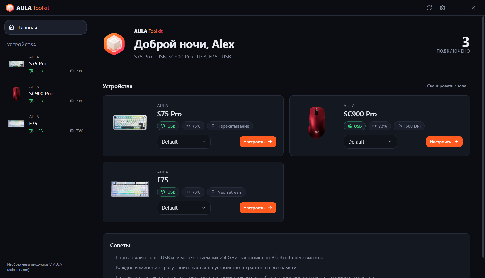 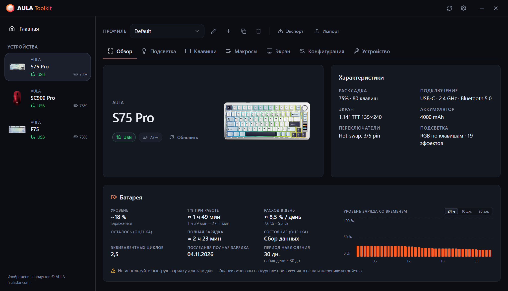

### Клавиатуры
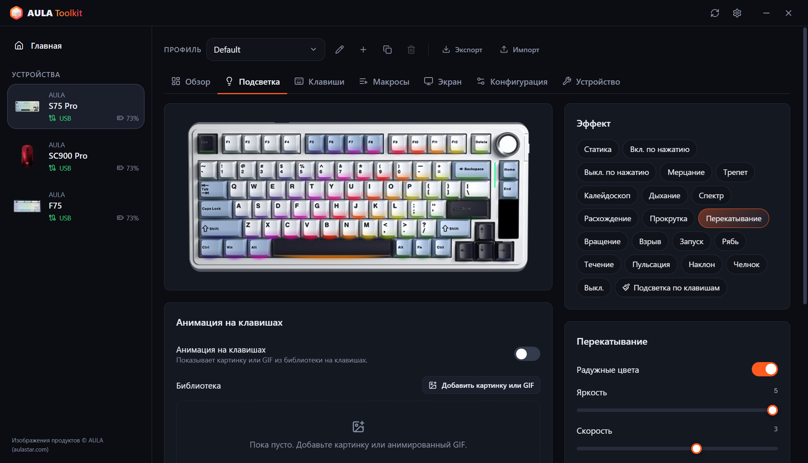 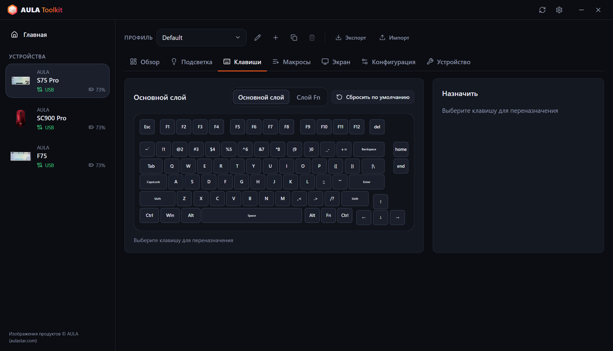
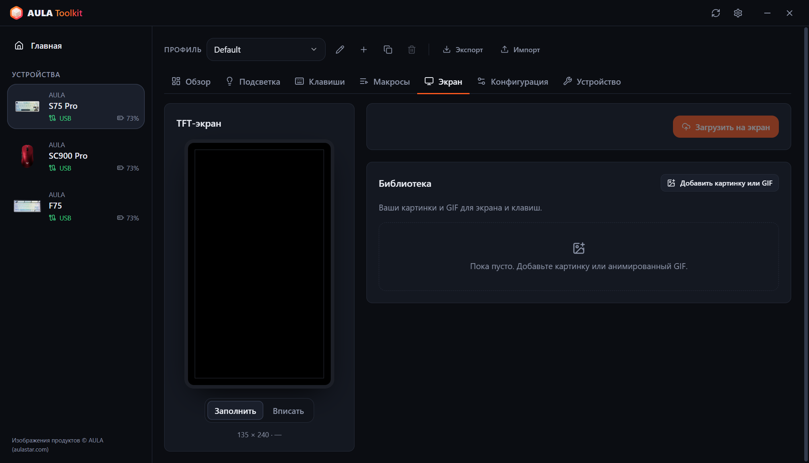 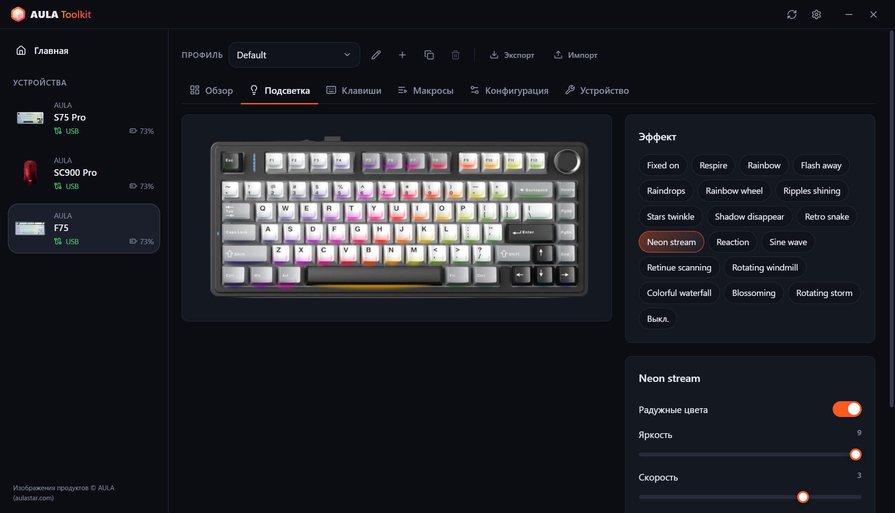

### Мыши
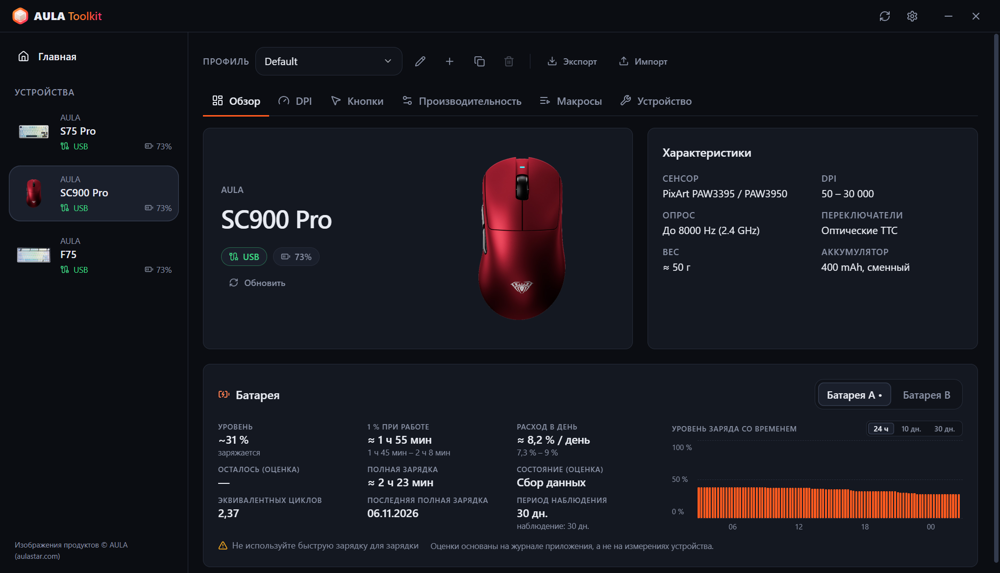 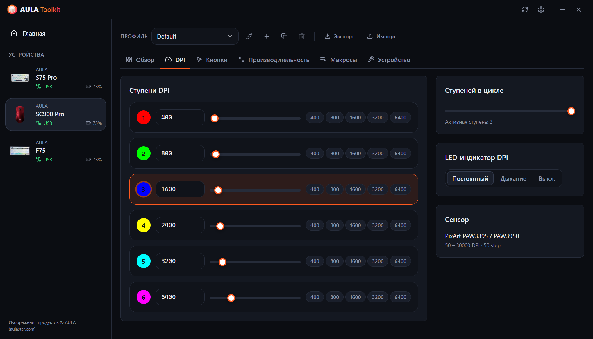
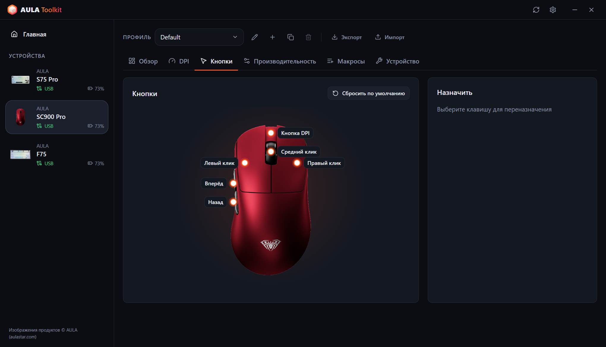 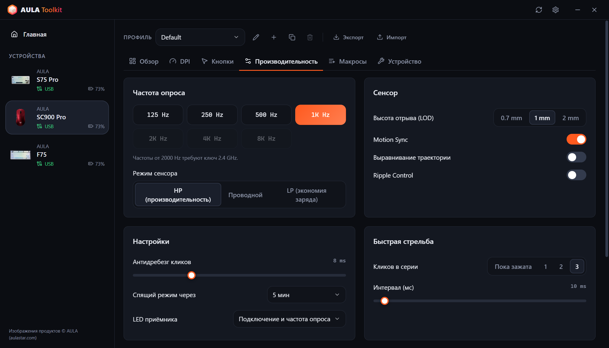

### Сводка в трее и экранный индикатор
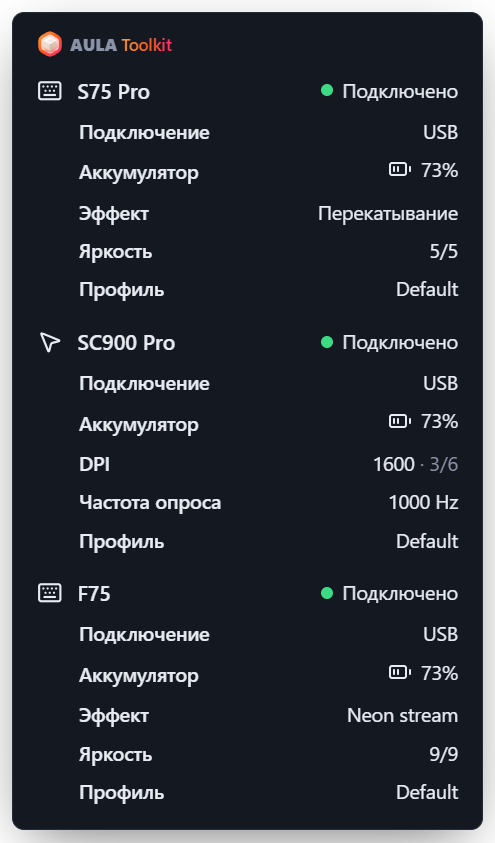 &nbsp; 

### Настройки
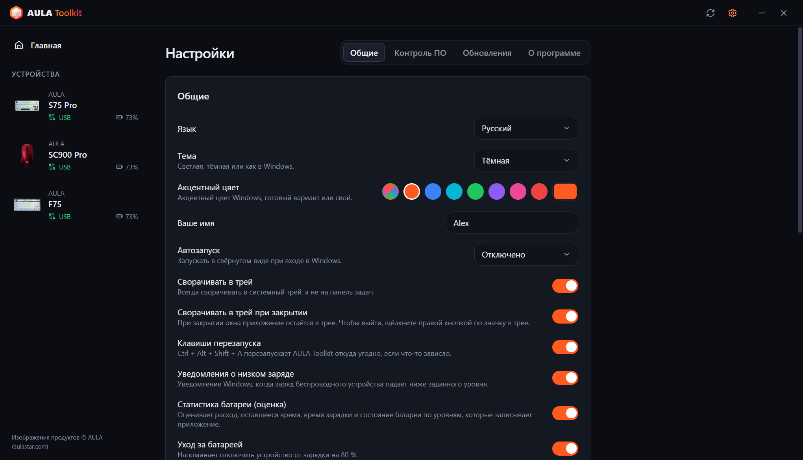 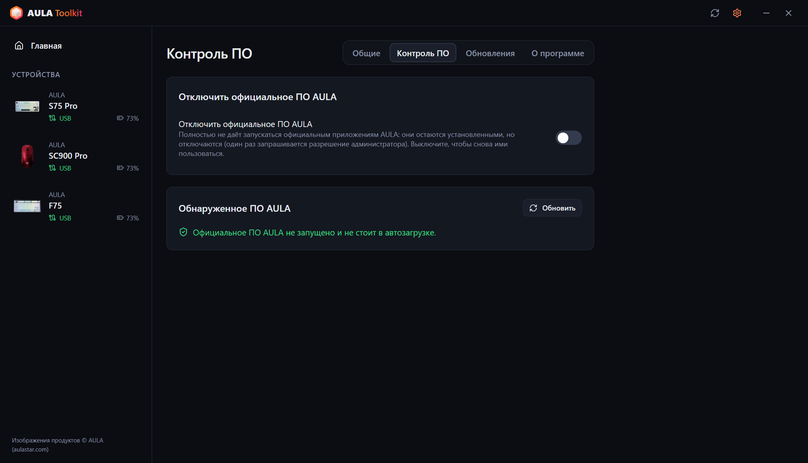
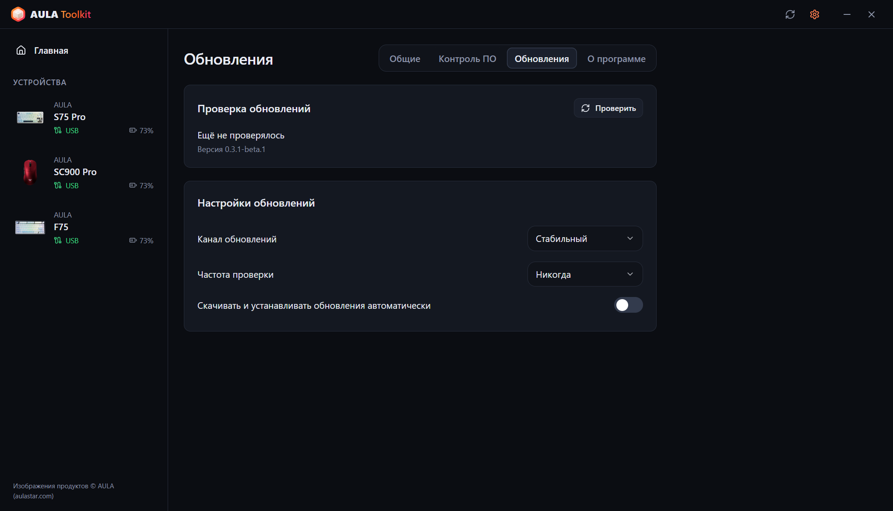 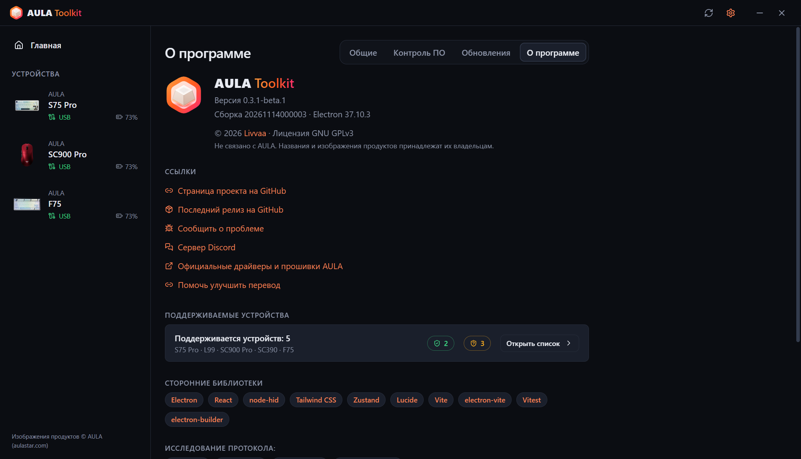
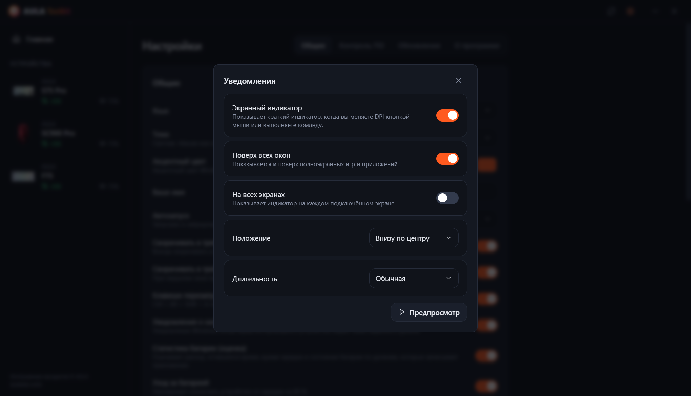 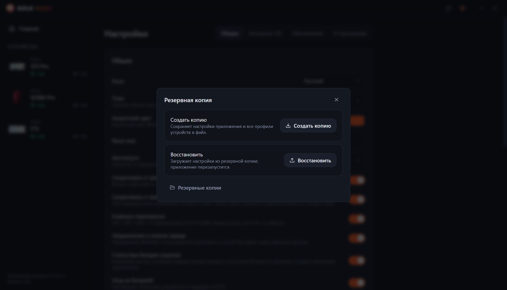

---

# Содержание
  - [Отказ от ответственности](#отказ-от-ответственности)
  - [Скачать](#скачать)
  - [Совместимость](#совместимость)
  - [Возможности](#возможности)
  - [Благодарности](#благодарности)
  - [Вопросы и ответы](#вопросы-и-ответы)
  - [Аргументы запуска](#аргументы-запуска)
  - [Как собрать журналы?](#как-собрать-журналы)
  - [Участие в разработке](#участие-в-разработке)
  - [Лицензия](#лицензия)

## Отказ от ответственности

**Программа предоставляется без каких-либо гарантий. Используйте на свой страх и риск.**

AULA Toolkit общается с вашими устройствами по протоколам, восстановленным методом обратной разработки из официальных драйверов. Пожалуйста, прочитайте этот файл, прежде чем сообщать о проблеме: в нём есть ответы на самые частые вопросы.

## Скачать

В каждом выпуске публикуются две сборки:
* **Установщик** — устанавливает программу только для текущего пользователя, поэтому права администратора не нужны.
* **Портативная** — один `.exe`, который работает без установки.

#### Обновление

AULA Toolkit умеет обновляться сам. Это настраивается в **Настройки → Обновления**:
* **Канал обновлений** — выпуски **Стабильный** или **Бета**.
* **Частота проверки** — от каждого часа до раза в месяц, или никогда.
* **Скачивать и устанавливать обновления автоматически** — обновления скачиваются в фоне и тихо устанавливаются, пока вы отошли от компьютера (или когда вы закрываете приложение). Можно также установить их сразу.

При установке новой версии поверх старой ваши настройки, профили и макросы сохраняются.

#### Что дальше

AULA Toolkit лучше всего работает, когда он запущен в трее. В **Настройки → Общие**:
1. В пункте **Автозапуск** выберите *Включено* (или *Включено (с задержкой)*, чтобы запуск происходил через 30 секунд после входа в систему). AULA Toolkit запускается через задачу планировщика Windows, поэтому он стартует и при работе от батареи; задача проверяется при каждом запуске приложения и создаётся заново, если её удалили.
2. Включите **Сворачивать в трей при закрытии**.
3. В **Настройки → Контроль ПО** включите **Отключить официальное ПО AULA**, чтобы драйверы AULA не боролись с AULA Toolkit за одно и то же устройство.

> [!WARNING]
> Если полностью закрыть AULA Toolkit, перестанут работать функции, которым нужно запущенное приложение: экранный индикатор, уведомления о батарее, сводка в трее, музыкальный ритм и анимации на клавишах, а также команда `aula`. Настройки, уже записанные в устройства, продолжат работать.

## Совместимость

| Устройство | Подключение | Статус |
|---|---|---|
| **AULA S75 Pro** | USB, приёмник 2,4 ГГц, Bluetooth (статус и батарея) | ✅ Проверено на оборудовании |
| **AULA L99** | USB, приёмник 2,4 ГГц, Bluetooth (статус и батарея) | 🧪 Бета, тестируется пользователями |
| **AULA SC900 Pro** | USB, приёмник 2,4 ГГц, Bluetooth (статус и батарея) | ✅ Проверено на оборудовании |
| **AULA SC900** (другие версии, использующие драйвер SC900 Pro) | USB, приёмник 2,4 ГГц | ⚠️ Распознаётся, ещё не проверено на оборудовании |
| **AULA SC390** | USB | 🧪 Бета, тестируется пользователями |
| **AULA F75** | USB, приёмник 2,4 ГГц | ⚠️ Распознаётся, ещё не проверено на оборудовании |

Бета-устройства поддерживаются по USB-дампам официального драйвера, которые прислали их владельцы. Некоторых функций пока нет; см. таблицу ниже.

AULA продаёт одну и ту же мышь в нескольких цветах под одним USB ID, поэтому AULA Toolkit не может их различить. Выберите свой цвет при настройке устройства или на вкладке **Устройство**.

Вашего устройства AULA нет в списке? Возможно, оно всё равно использует один из протоколов выше — см. [Можно ли добавить поддержку моего устройства AULA?](#можно-ли-добавить-поддержку-моего-устройства-aula).

#### Что работает при каком подключении

**Клавиатуры**

| Функция | S75 Pro · USB | S75 Pro · 2,4 ГГц | L99 · USB | L99 · 2,4 ГГц | F75 · USB / 2,4 ГГц |
|---|:---:|:---:|:---:|:---:|:---:|
| Эффекты подсветки | ✅ | ✅ | ✅ | ✅ | ✅ |
| Подсветка по клавишам | ✅ | ✅ | ✅ | ✅ | — |
| Музыкальный ритм и анимация на клавишах (передаются с ПК) | ✅ | — | ✅ | — | — |
| Подсветка гаснет, пока монитор выключен | ✅ | ✅ | — | — | — |
| Живой вид клавиатуры, отслеживание изменений с ручки / Fn | ✅ | — | — | — | — |
| Переназначение клавиш, слой Fn, макросы | ✅ | ✅ | ✅ | ✅ | ✅ |
| Настройки клавиатуры (блокировка Win, сон, антидребезг) | ✅ | ✅ | ✅ | ✅ | ✅ |
| Экран | ✅ TFT | — | Скоро | — | — |
| Часы (синхронизируются при подключении) | ✅ | ✅ | ✅ | ✅ | — |
| Боковая световая полоса | ✅ | ✅ | — | — | — |
| Уровень заряда | — | ✅ | — | ✅ | — |
| Чтение настроек при подключении | — | — | — | — | ✅ |

**Мыши**

| Функция | SC900 Pro · USB / 2,4 ГГц | SC390 · USB |
|---|:---:|:---:|
| Уровни DPI и индикатор DPI | ✅ | Скоро |
| Частота опроса | ✅ до 8000 Гц | ✅ до 1000 Гц (кабель и приёмник) |
| Сенсор (высота отрыва, Ripple Control и другое) | ✅ | ✅ |
| Кнопки и макросы | ✅ | Скоро |
| Время до сна | ✅ | Скоро |
| Уровень заряда | ✅ | — |
| Чтение настроек при подключении | ✅ | ✅ |
| Экранный индикатор для кнопки DPI | ✅ | — |

> [!NOTE]
> Настраивать устройства можно только через **USB** или **приёмник 2,4 ГГц**. По Bluetooth устройство не открывает интерфейс настройки — у официального ПО AULA то же ограничение. Сохранённые ранее настройки продолжают работать по Bluetooth, а AULA Toolkit и там показывает устройство как подключённое, с уровнем заряда, который сообщает Windows.

### ПО AULA

Если одновременно запустить официальный драйвер AULA и AULA Toolkit, оба будут общаться с одним и тем же устройством, а это может отменять изменения или вызывать ошибки чтения. Когда AULA Toolkit находит официальную программу AULA, внизу окна появляется предупреждающая полоса. **Настройки → Контроль ПО → Отключить официальное ПО AULA** не даёт им запускаться вообще: они остаются установленными, но их программы отключаются (Windows один раз запросит подтверждение администратора), а записи автозапуска убираются в сторону. Если выключить этот параметр, ими снова можно пользоваться; удаление AULA Toolkit тоже их восстанавливает.

## Возможности

Приложение позволяет:

- Настраивать любое поддерживаемое устройство из одного окна, изменения применяются сразу.
- Никогда не перезаписывать сами по себе то, что уже есть на устройстве: настройки мыши считываются при подключении, а на S75 Pro эффект, цвет и яркость, которые вы меняете ручкой или клавишами Fn, подхватываются на лету и сохраняются в профиль.
- Хранить несколько **профилей** для каждого устройства и экспортировать или импортировать их в виде файлов.
- Видеть живой **экранный индикатор**, когда вы нажимаете кнопку DPI на мыши или выполняете команду.
- Запускать полосы **музыкального ритма** и **анимации (GIF)** на клавишах S75 Pro, передаваемые с ПК.
- **Выключать подсветку клавиатуры, пока монитор выключен**, и снова включать её, когда он просыпается.
- Перезапускать приложение откуда угодно сочетанием **Ctrl + Alt + Shift + A**, если что-то зависло.
- Получать подробную **сводку в трее** по каждому подключённому устройству, наведя курсор на значок в трее.
- Получать **уведомления о низком заряде**, напоминание **ухода за батареей** на 80 % во время зарядки и, по желанию, смотреть **статистику батареи**.
- Отключать официальное ПО AULA, не удаляя его.
- Управлять устройствами из **командной строки** с помощью `aula`.
- Пользоваться им на **10 языках**: English, Türkçe, Русский, 简体中文, Українська, Tiếng Việt, Português (Brasil), Español, Deutsch и Français.
- Выбирать **светлую, тёмную или системную тему** и акцентный цвет.

### Клавиатуры

* **Подсветка** — все аппаратные эффекты с цветом, яркостью, скоростью и направлением, плюс предпросмотр на фотографии вашей клавиатуры.
* **Живой вид** (S75 Pro, USB) — изображение клавиатуры показывает то, что сейчас показывают светодиоды. Когда вы меняете эффект ручкой или клавишами Fn, приложение распознаёт его за несколько секунд, выбирает и показывает на экране. Клавиатура не сообщает свой эффект, поэтому это работает по цветам светодиодов: эффекты, которые остаются тёмными до нажатия клавиши, в простое выглядят одинаково, а при очень быстром вращении промежуточный эффект может быть пропущен.
* **Подсветка по клавишам** (S75 Pro) — раскрашивайте клавиши по одной или заливайте всю клавиатуру.
* **Во время музыки** — полосы на клавишах следуют за звуком, который играет на ПК (12 цветовых схем, амплитуда и фон, как в официальном драйвере), или клавиатура переключается на выбранный вами эффект. Для полос нужен USB-кабель; на приёмнике используется эффект.
* **Анимация на клавишах** (S75 Pro, USB) — проигрывает картинку или GIF из вашей библиотеки на клавишах, примерно 20 кадров в секунду.
* **Выключение вместе с экраном** (S75 Pro) — клавиши и боковая полоса гаснут, пока монитор выключен.
* **Переназначение клавиш** — назначайте клавишам основного слоя и слоя Fn клавиши, кнопки мыши, медиаклавиши, сочетания клавиш или макросы.
* **Макросы** — записывайте нажатия с реальными задержками и редактируйте их потом.
* **TFT-экран** (S75 Pro, USB) — загружайте картинку или анимированный GIF из библиотеки. Перетащите предпросмотр, чтобы выбрать видимую часть; длинные GIF подгоняются под 141 кадр экрана без изменения темпа. Часы синхронизируются при каждом подключении клавиатуры.
* **Конфигурация** — блокировка клавиши Windows, Alt+F4 и Alt+Tab, время до сна и время отклика клавиш.
* **Сброс** — восстановление настроек клавиатуры по умолчанию или полный сброс к заводским настройкам.

### Мыши

* **DPI** — до шести уровней, активный уровень, число уровней в цикле и LED-индикатор DPI.
* **Частота опроса** — до 8000 Гц. Частоты выше 1000 Гц требуют приёмника 2,4 ГГц. У SC390 кабель и приёмник имеют отдельные частоты.
* **Сенсор** — высота отрыва, Motion Sync, выравнивание траектории, Ripple Control и режим сенсора. На SC390: высота отрыва, Сверхнизкая задержка, Сверхнизкое потребление, Контроль ряби и Пробуждение движением.
* **Кнопки** — переназначение любой кнопки, кроме левой, включая быструю стрельбу и макросы.
* **Тайминги** — антидребезг кликов и время до сна.
* **Аккумулятор** — уровень заряда и состояние зарядки. Две батареи SC900 Pro (и любые дополнительные, которые вы добавите) учитываются отдельно.

### Экранный индикатор

Когда вы меняете DPI собственной кнопкой мыши, на экране появляется небольшой индикатор с новым значением и активным уровнем. На S75 Pro (USB) он также показывает новый эффект, цвет или яркость, когда вы меняете их на клавиатуре, и подтверждает изменения, сделанные командой `aula`. Там же появляются загрузки на экран, напоминание о 80 % и перезапуски. В **Настройки → Уведомления** его можно выключить, выбрать положение и длительность, держать поверх полноэкранных игр или показывать на всех дисплеях.

### Резервные копии

**Настройки → Резервная копия** сохраняет настройки приложения и все профили устройств в один файл и позже восстанавливает их из него, например после переустановки Windows.

### Статистика батареи

**Настройки → Общие → Статистика батареи** (включено по умолчанию) показывает карточку батареи в обзоре каждого устройства:

* **Уровень** — текущий уровень или последний известный с указанием, как давно он был считан. На кабеле без показаний — оценка, а затем 99+.
* **1 % при работе** — сколько длится 1 %, пока устройство используется через приёмник.
* **Расход в день** и **Осталось** — по календарному времени, включая часы, когда устройство спит или приложение закрыто.
* **Полная зарядка** и **Состояние** — по тому, как быстро батарея заряжается в середине диапазона.
* **Эквивалентных циклов**, **Последняя полная зарядка** и график с тремя видами: последние 24 часа, расход батареи по дням за 10 дней и уровень за 30 дней. Наведите курсор на график, чтобы увидеть точные значения; зарядка показана зелёным.

Показатели выводятся с диапазоном, как только накоплено достаточно данных. Уровни записываются через USB, приёмник 2,4 ГГц и Bluetooth (считываются из Windows). **Уход за батареей**, включённый по умолчанию вместе со статистикой, напоминает на 80 % во время зарядки отключить устройство.

> [!NOTE]
> Устройства AULA сообщают только процент заряда. Все показатели выше — это **оценки**, рассчитанные по уровням, которые записывает AULA Toolkit.

> [!WARNING]
> Не используйте быструю зарядку, на коробках об этом тоже написано.

### CLI

AULA Toolkit можно управлять из командной строки. Команда называется `aula` и устанавливается в `resources\bin` внутри папки установки (по умолчанию `%LOCALAPPDATA%\Programs\AULA Toolkit\resources\bin\aula.cmd`). Установленное приложение само добавляет эту папку в пользовательский `PATH`, поэтому `aula` работает в любом новом терминале; при удалении она убирается обратно. Портативная сборка `PATH` не меняет. **Настройки → Общие → Командная строка** показывает точный путь с кнопкой копирования.

Команда обращается к запущенному приложению. Если AULA Toolkit не запущен, `aula` сначала запускает его в трее. Права администратора не нужны.

Команды

* `aula status` — список подключённых устройств (добавьте `--json` для машиночитаемого вывода)
* `aula profile list` — список профилей устройства
* `aula profile set <name>` — переключиться на профиль
* `aula dpi` — показать уровни DPI мыши
* `aula dpi stage <n>` — включить уровень DPI `<n>` (нумерация с 1)
* `aula dpi <value>` — установить для активного уровня `<value>` DPI
* `aula polling <hz>` — установить частоту опроса мыши
* `aula light list` — список эффектов клавиатуры
* `aula light <effect> [--color #rrggbb] [--brightness n] [--speed n]` — установить эффект клавиатуры
* `aula brightness <n>` — установить яркость подсветки клавиатуры
* `aula osd on|off` — включить или выключить экранный индикатор
* `aula show` / `aula hide` — показать или скрыть окно
* `aula version` — вывести версию приложения

Если подключено несколько устройств одного типа, выберите нужное с помощью `-d <id>`, например `aula profile list -d sc900`. Команда завершается с кодом `0` при успехе и `1` при ошибке, поэтому её можно использовать в скриптах.

## Благодарности

AULA Toolkit создаёт и поддерживает **Livvaa** ([GitHub](https://github.com/Livvaa)).

Отдельное спасибо проектам, чья открытая работа по обратной разработке сделала это возможным:
* [open-aula](https://github.com/paulcoding810/open-aula) — протоколы клавиатур AULA.
* [AulaSofwareLinux](https://github.com/thought-train/AulaSofwareLinux) — протокол семейства AULA F75.
* [IncottHIDApp](https://github.com/romkazor/IncottHIDApp) и [OpenMouse](https://github.com/OpenMouse-Project/mouse-protocol) — протокол мышей PixArt 8K.

Все детали протоколов сверены с официальными драйверами AULA. Изображения продуктов © AULA ([aulastar.com](https://www.aulastar.com)).

### Сторонние библиотеки

* **Electron** ([electron/electron](https://github.com/electron/electron))
* **React** ([facebook/react](https://github.com/facebook/react))
* **node-hid** ([node-hid/node-hid](https://github.com/node-hid/node-hid))
* **Tailwind CSS** ([tailwindlabs/tailwindcss](https://github.com/tailwindlabs/tailwindcss))
* **Zustand** ([pmndrs/zustand](https://github.com/pmndrs/zustand))
* **Lucide** ([lucide-icons/lucide](https://github.com/lucide-icons/lucide))
* **electron-vite** ([alex8088/electron-vite](https://github.com/alex8088/electron-vite)), **Vite** ([vitejs/vite](https://github.com/vitejs/vite)) и **Vitest** ([vitest-dev/vitest](https://github.com/vitest-dev/vitest))
* **electron-builder** и **electron-updater** ([electron-userland/electron-builder](https://github.com/electron-userland/electron-builder))

### Переводы

Интерфейс доступен на 10 языках. Не все переводы пока проверены носителями языка. Если вы заметили ошибку, откройте, пожалуйста, pull request — каждый язык находится в одном файле в [`src/shared/locales`](src/shared/locales).

## Вопросы и ответы

#### Может ли AULA Toolkit повредить моё устройство?

AULA Toolkit никогда не трогает прошивку. Он отправляет только те же команды настройки, что и официальный драйвер (подсветка, клавиши, макросы, DPI и так далее), сверенные с USB-дампами этого драйвера. Если что-то выглядит неправильно, сброс на вкладке **Устройство** или официальное ПО вернут настройки по умолчанию.

#### Почему нельзя менять настройки через Bluetooth?

По Bluetooth клавиатура и мышь видны Windows только как стандартные клавиатура и мышь. Интерфейса настройки, который есть при подключении по USB и через приёмник 2,4 ГГц, там нет, поэтому ни AULA Toolkit, ни официальное ПО не могут менять настройки. Подключитесь кабелем или через приёмник, внесите изменения и вернитесь на Bluetooth — настройки останутся на устройстве. По Bluetooth AULA Toolkit показывает подключение и уровень заряда, который сообщает Windows.

#### Почему клавиатура не показывает уровень заряда?

S75 Pro сообщает уровень заряда через приёмник 2,4 ГГц, а по Bluetooth его сообщает Windows. По USB клавиатура заряжается, и прошивка уровень не сообщает: AULA Toolkit показывает оценку по измеренной скорости зарядки, а затем 99+.

#### Почему циклы и состояние батареи — только оценки?

В устройствах AULA нет чипа батареи, который считал бы циклы или измерял износ. Они сообщают только процент, поэтому всё остальное AULA Toolkit оценивает по тому, когда этот процент меняется. Состояние вычисляется по скорости зарядки, поэтому для него нужно несколько зарядок в течение месяца или дольше.

#### Может ли AULA Toolkit прочитать картинку на экране S75 Pro или версию прошивки?

Нет. Прошивка клавиатуры может принять картинку, но у неё нет команды, чтобы отправить её обратно, и ни одно из поддерживаемых устройств не сообщает версию прошивки. Официальное ПО этого тоже не умеет.

#### Почему Windows предупреждает меня при запуске установщика?

Установщики пока не подписаны цифровой подписью, поэтому Windows SmartScreen показывает предупреждение о неизвестном издателе. AULA Toolkit — проект с открытым исходным кодом, и вы можете собрать его сами из этого репозитория. Чтобы продолжить, выберите **Подробнее → Выполнить в любом случае**.

#### Моя мышь другого цвета, чем на картинке.

AULA использует один и тот же USB ID для всех цветов модели. Выберите свой цвет на вкладке **Устройство**.

#### Можно ли добавить поддержку моего устройства AULA?

Возможно. Большинство клавиатур и мышей AULA используют одно из семейств протоколов, которые AULA Toolkit уже поддерживает. Что указать в запросе, см. в разделе [Участие в разработке](#участие-в-разработке).

## Аргументы запуска

* `--hidden` — запуск свёрнутым в трей. Его использует *Автозапуск*.
* `--delayed` — подождать 30 секунд перед подключением к устройствам. *Автозапуск → Включено (с задержкой)* теперь вместо этого ждёт в задаче планировщика.

## Как собрать журналы?

Журналы очень помогают при любой проблеме. **Всегда** прикладывайте их к своим issue.

#### Способ 1: пакет диагностики (рекомендуется)
1. Откройте **AULA Toolkit**.
2. Перейдите в **Настройки → О программе**.
3. Нажмите **Сохранить пакет диагностики**. Состояние устройств и журнал обмена сохранятся в один файл, который можно приложить к issue.

#### Способ 2: файлы журналов
1. Воспроизведите проблему.
2. Откройте окно `Выполнить` (Win+R), введите `"%APPDATA%\AULA Toolkit\logs"` и нажмите OK.
3. Приложите самый новый файл `hid-<date>.log`.

Журнал также можно смотреть в реальном времени в **Настройки → Общие → Дополнительно**.

## Участие в разработке

Отзывы очень приветствуются, поэтому не стесняйтесь сообщать о проблемах. Pull request'ы тоже приветствуются. Пожалуйста, сначала прочитайте [руководство для участников](CONTRIBUTING.md).

Есть вопросы, идеи или просто хотите пообщаться? Заходите на [сервер Discord](https://discord.gg/u9FbaJGtCe).

#### Поддержка устройств

Для поддержки новых устройств AULA нужны тестировщики. Открывая запрос, пожалуйста, укажите:

1. Полное название модели (например, *AULA F87 Pro*).
2. USB ID, которые находятся в **Диспетчер устройств → ваше устройство → Сведения → ИД оборудования** (например, `VID_0C45&PID_800A`).
3. Какое подключение вы использовали (USB или 2,4 ГГц).
4. Пакет диагностики (см. [Как собрать журналы?](#как-собрать-журналы)).
5. Если можете: USB-дамп официального драйвера. Установите [Wireshark](https://www.wireshark.org/download.html) с USBPcap, закройте AULA Toolkit, начните запись, меняйте в официальном драйвере по одной настройке за раз и записывайте порядок. Приложите файл `.pcapng` в zip-архиве. Именно так были добавлены L99 и SC390.

## Лицензия

Copyright (C) 2026 Livvaa

AULA Toolkit — свободное программное обеспечение: вы можете распространять и/или изменять его на условиях
GNU General Public License в том виде, в каком она опубликована Free Software Foundation, — версии 3
лицензии или (по вашему выбору) любой более поздней версии. Полный текст см. в [LICENSE](LICENSE).

Эта программа распространяется в надежде, что она будет полезной, но БЕЗ КАКИХ-ЛИБО ГАРАНТИЙ; даже без
подразумеваемой гарантии ТОВАРНОЙ ПРИГОДНОСТИ или ПРИГОДНОСТИ ДЛЯ ОПРЕДЕЛЁННОЙ ЦЕЛИ.

AULA Toolkit не связан с AULA. Названия продуктов и изображения принадлежат их владельцам.
