

  <picture>
    <source media="(prefers-color-scheme: dark)" srcset="docs/brand/wordmark-dark.png">
    
  </picture>

  
  
  
   
  
  
  
  
   
  
  
  

## 🚨 Proje Durumu

> [!IMPORTANT]
> - AULA Toolkit **erken geliştirme aşamasında** (0.x sürümü). Bazı pürüzler olabilir.
> - **Resmi olmayan** bir projedir ve **AULA ile bağlantılı değildir**. Ürün adları ve görselleri sahiplerine aittir.
> - Cihazların yalnızca bir kısmı gerçek donanımda test edildi; [Uyumluluk](#uyumluluk) bölümüne bak.

#### Bu README dosyasının diğer dillerdeki sürümleri:
[English](README.md) · [Русский](README_ru-RU.md) · [简体中文](README_zh-CN.md) · [Українська](README_uk-UA.md) · [Tiếng Việt](README_vi-VN.md) · [Português (Brasil)](README_pt-BR.md) · [Español](README_es-ES.md) · [Deutsch](README_de-DE.md) · [Français](README_fr-FR.md)

---

AULA Toolkit, AULA klavye ve farelerini tek bir yerden yöneten bir Windows masaüstü uygulamasıdır; Logitech G HUB anlayışıyla yapıldı. AULA'nın her model için ayrı ayrı yayınladığı sürücünün yerini alır.

Arka planda hiçbir hizmet çalıştırmaz, telemetri toplamaz ve internete yalnızca GitHub'da güncelleme var mı diye bakmak için bağlanır. Yaptığın değişiklikler anında cihaza yazılır ve cihazın kendi belleğinde saklanır; böylece başka bilgisayarlarda ve Bluetooth üzerinden de çalışmaya devam eder.

# Ekran Görüntüleri

### Ana sayfa ve cihaz genel bakışı
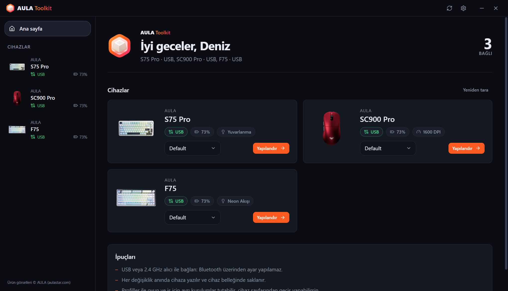 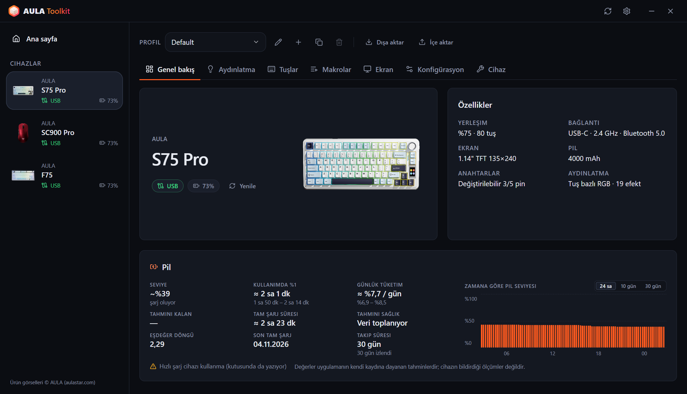

### Klavyeler
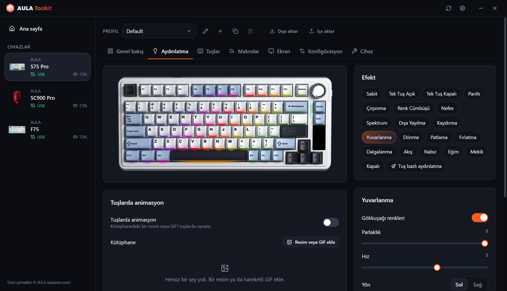 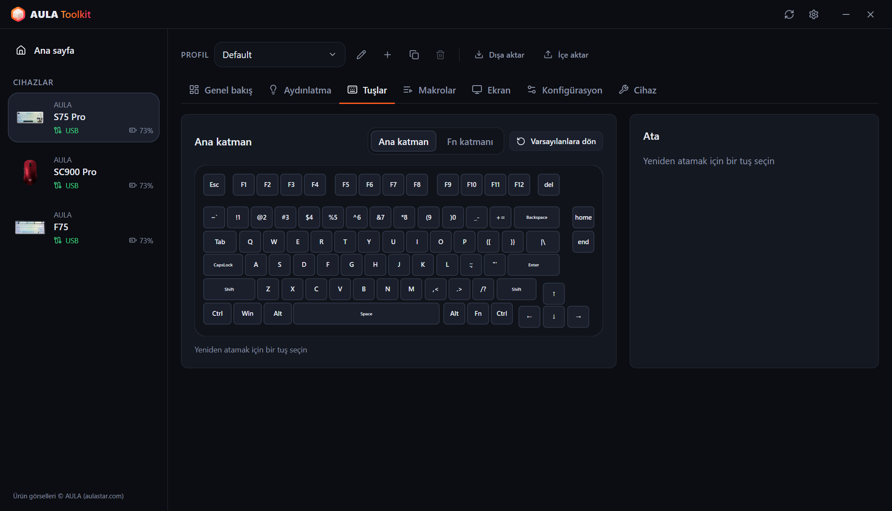
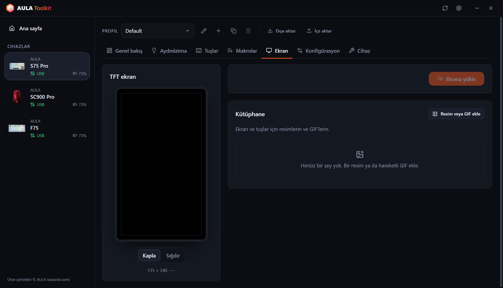 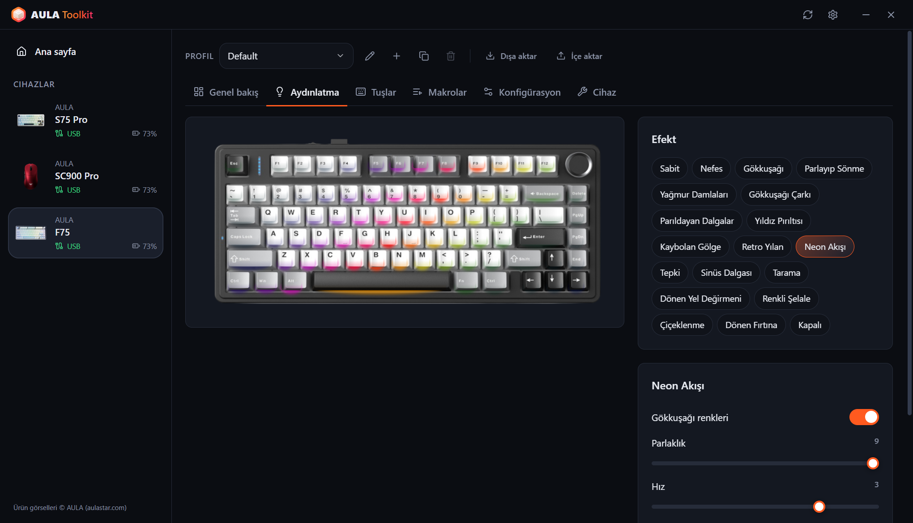

### Fareler
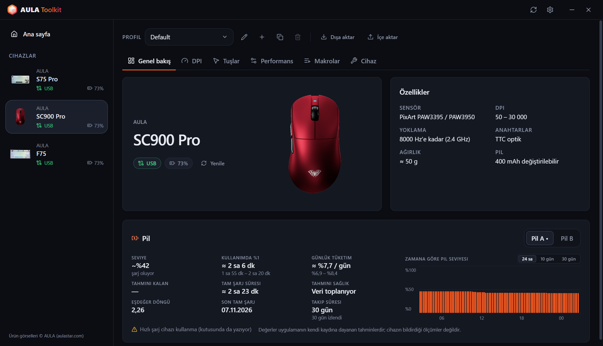 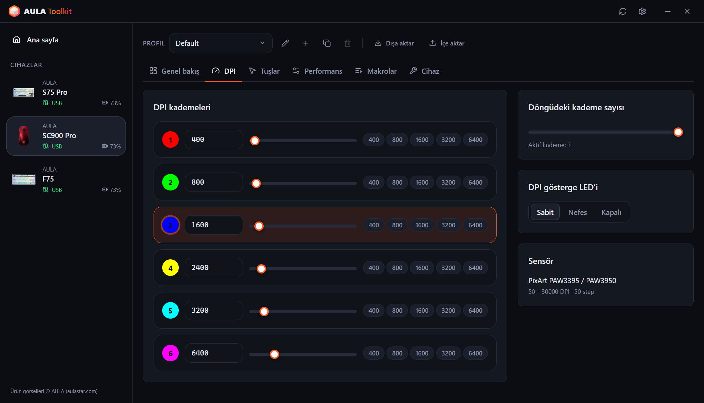
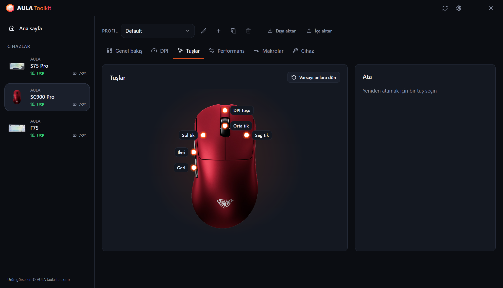 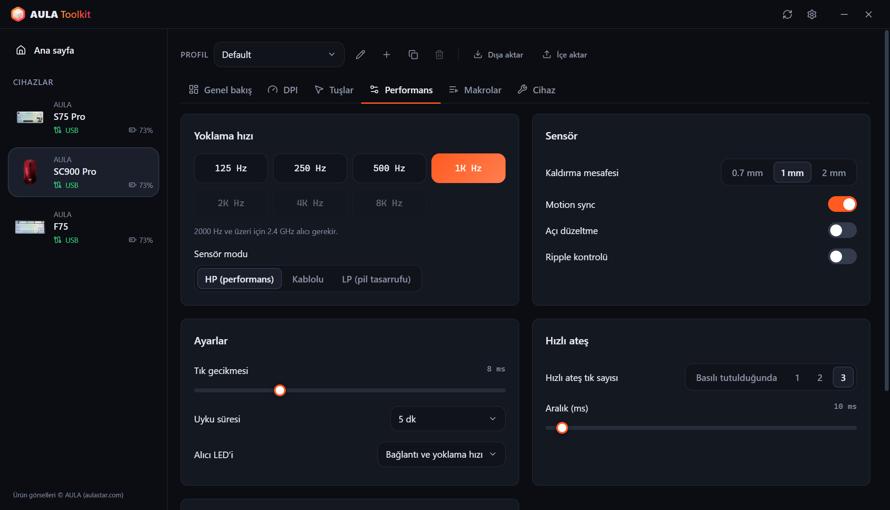

### Tepsi özeti ve ekran göstergesi
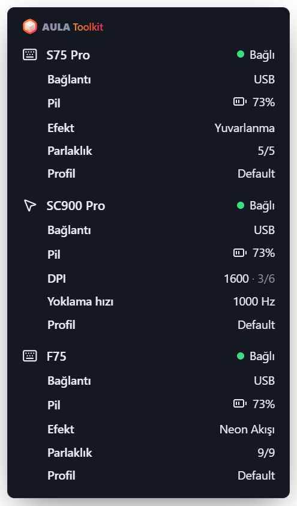 &nbsp; 

### Ayarlar
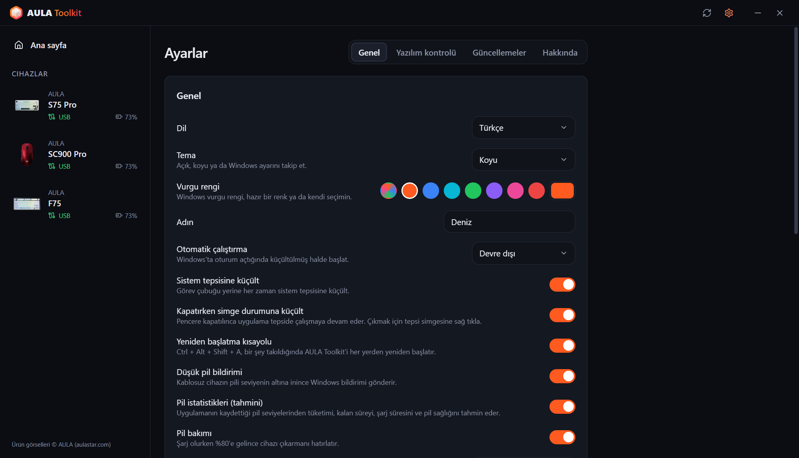 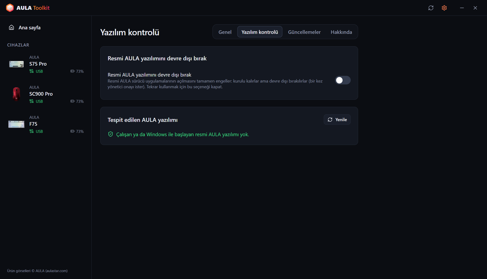
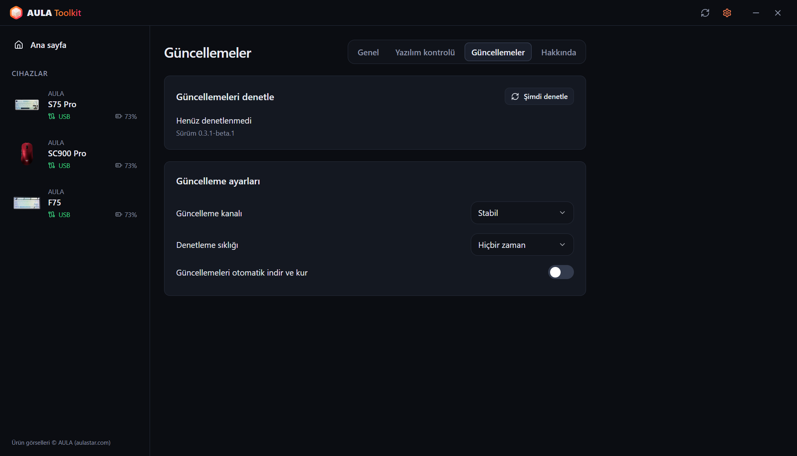 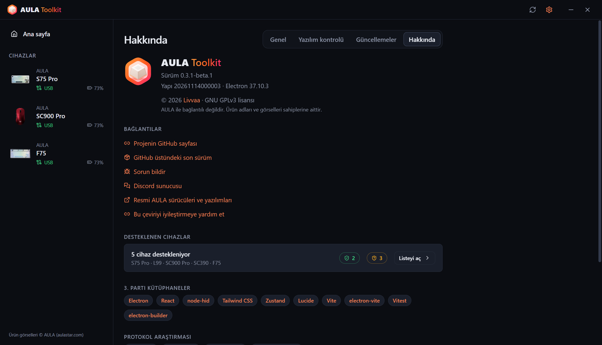
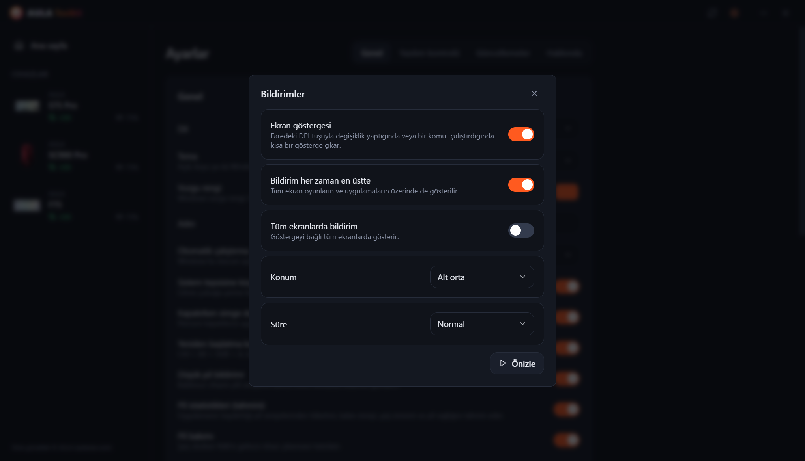 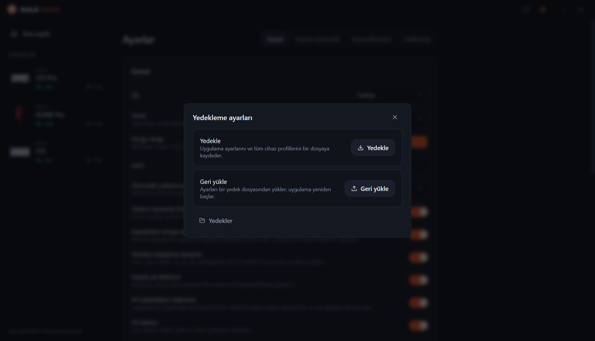

---

# İçindekiler
  - [Sorumluluk Reddi](#sorumluluk-reddi)
  - [İndirme](#i̇ndirme)
  - [Uyumluluk](#uyumluluk)
  - [Özellikler](#özellikler)
  - [Teşekkürler](#teşekkürler)
  - [SSS](#sss)
  - [Argümanlar](#argümanlar)
  - [Günlükler nasıl toplanır?](#günlükler-nasıl-toplanır)
  - [Katkıda Bulunma](#katkıda-bulunma)
  - [Lisans](#lisans)

## Sorumluluk Reddi

**Bu araç hiçbir garanti olmadan sunulur. Kullanım riski sana aittir.**

AULA Toolkit cihazlarınla, resmi sürücülerden tersine mühendislikle çıkarılmış protokoller üzerinden konuşur. Sorun bildirmeden önce lütfen bu dosyayı oku; en sık sorulan soruların cevabı burada.

## İndirme

Her sürümde iki paket yayınlanır:
* **Kurulum dosyası** — yalnızca mevcut kullanıcı için kurulur, bu yüzden yönetici yetkisi gerekmez.
* **Taşınabilir** — kurulum gerektirmeden çalışan tek bir `.exe`.

#### Güncelleme

AULA Toolkit kendini güncelleyebilir. Bunu **Ayarlar → Güncellemeler** bölümünden ayarla:
* **Güncelleme kanalı** — **Stabil** veya **Beta** sürümler.
* **Denetleme sıklığı** — her saatten aylığa kadar, ya da hiçbir zaman.
* **Güncellemeleri otomatik indir ve kur** — güncellemeler arka planda iner ve sen bilgisayarın başında değilken (ya da uygulamayı kapattığında) sessizce kurulur. İstersen hemen de kurabilirsin.

Yeni bir sürümü mevcut kurulumun üzerine kurmak ayarlarını, profillerini ve makrolarını korur.

#### Sonraki adımlar

AULA Toolkit en iyi sistem tepsisinde çalışırken işini yapar. **Ayarlar → Genel** bölümünde:
1. **Otomatik çalıştırma** seçeneğini *Etkin* yap (ya da oturum açtıktan 30 saniye sonra başlaması için *Etkin (gecikmeli)*). AULA Toolkit bir Windows zamanlanmış görevi üzerinden başlar, bu yüzden pil gücündeyken de açılır; görev uygulama her başladığında denetlenir ve silinmişse yeniden oluşturulur.
2. **Kapatırken simge durumuna küçült** seçeneğini aç.
3. **Ayarlar → Yazılım kontrolü** bölümünde **Resmi AULA yazılımını devre dışı bırak** seçeneğini aç; böylece AULA sürücüleri aynı cihaz için AULA Toolkit ile çekişmez.

> [!WARNING]
> AULA Toolkit'i tamamen kapatırsan, çalışmasını gerektiren özellikler durur: ekran göstergesi, pil bildirimleri, tepsi özeti, tuşlardaki müzik ritmi ve animasyonlar, ve `aula` komutu. Cihazlarına önceden yazılmış ayarlar çalışmaya devam eder.

## Uyumluluk

| Cihaz | Bağlantı | Durum |
|---|---|---|
| **AULA S75 Pro** | USB, 2.4 GHz alıcı, Bluetooth (durum ve pil) | ✅ Donanımda test edildi |
| **AULA L99** | USB, 2.4 GHz alıcı, Bluetooth (durum ve pil) | 🧪 Beta, kullanıcılar test ediyor |
| **AULA SC900 Pro** | USB, 2.4 GHz alıcı, Bluetooth (durum ve pil) | ✅ Donanımda test edildi |
| **AULA SC900** (SC900 Pro sürücüsünü kullanan diğer sürümler) | USB, 2.4 GHz alıcı | ⚠️ Tanınıyor, henüz donanımda test edilmedi |
| **AULA SC390** | USB | 🧪 Beta, kullanıcılar test ediyor |
| **AULA F75** | USB, 2.4 GHz alıcı | ⚠️ Tanınıyor, henüz donanımda test edilmedi |

Beta cihazlar, sahiplerinin gönderdiği resmi sürücü USB kayıtlarına dayanarak destekleniyor. Bazı özellikler hâlâ eksik; aşağıdaki tabloya bak.

AULA aynı fareyi tek bir USB kimliğiyle birkaç renkte satıyor, bu yüzden AULA Toolkit bunları birbirinden ayıramaz. Rengini cihaz kurulumu sırasında ya da cihazın **Cihaz** sekmesinde seç.

AULA cihazın listede yok mu? Yine de yukarıdaki protokollerden birini kullanıyor olabilir; [AULA cihazıma destek ekleyebilir misin?](#aula-cihazıma-destek-ekleyebilir-misin) bölümüne bak.

#### Hangi özellik hangi bağlantıda çalışır

**Klavyeler**

| Özellik | S75 Pro · USB | S75 Pro · 2.4 GHz | L99 · USB | L99 · 2.4 GHz | F75 · USB / 2.4 GHz |
|---|:---:|:---:|:---:|:---:|:---:|
| Aydınlatma efektleri | ✅ | ✅ | ✅ | ✅ | ✅ |
| Tuş bazlı aydınlatma | ✅ | ✅ | ✅ | ✅ | — |
| Tuşlarda müzik ritmi ve animasyon (bilgisayardan aktarılır) | ✅ | — | ✅ | — | — |
| Monitör kapalıyken ışıkların kapanması | ✅ | ✅ | — | — | — |
| Canlı klavye görünümü, düğme / Fn değişikliklerinin takibi | ✅ | — | — | — | — |
| Tuş atama, Fn katmanı, makrolar | ✅ | ✅ | ✅ | ✅ | ✅ |
| Klavye ayarları (Win kilidi, uyku, tuş tepki süresi) | ✅ | ✅ | ✅ | ✅ | ✅ |
| Ekran | ✅ TFT | — | Yakında | — | — |
| Saat (bağlanınca eşitlenir) | ✅ | ✅ | ✅ | ✅ | — |
| Yan ışık çubuğu | ✅ | ✅ | — | — | — |
| Pil seviyesi | — | ✅ | — | ✅ | — |
| Bağlanınca ayarların cihazdan okunması | — | — | — | — | ✅ |

**Fareler**

| Özellik | SC900 Pro · USB / 2.4 GHz | SC390 · USB |
|---|:---:|:---:|
| DPI kademeleri ve DPI göstergesi | ✅ | Yakında |
| Yoklama hızı | ✅ 8000 Hz'e kadar | ✅ 1000 Hz'e kadar (kablo ve alıcı) |
| Sensör (kaldırma mesafesi, ripple kontrolü ve daha fazlası) | ✅ | ✅ |
| Tuşlar ve makrolar | ✅ | Yakında |
| Uyku süresi | ✅ | Yakında |
| Pil seviyesi | ✅ | — |
| Bağlanınca ayarların cihazdan okunması | ✅ | ✅ |
| DPI tuşu için ekran göstergesi | ✅ | — |

> [!NOTE]
> Cihazlar yalnızca **USB** ya da **2.4 GHz alıcı** üzerinden ayarlanabilir. Bluetooth üzerinden cihaz, yapılandırma arayüzünü açmaz; resmi AULA yazılımında da aynı kısıtlama var. Daha önce kaydettiğin ayarlar Bluetooth'ta da çalışır ve AULA Toolkit cihazı orada da bağlı olarak, Windows'un bildirdiği pil seviyesiyle gösterir.

### AULA'nın yazılımı

Resmi AULA sürücüsü ile AULA Toolkit aynı anda çalışırsa ikisi de aynı cihazla konuşur; bu da değişiklikleri geri alabilir ya da okuma hatalarına yol açabilir. AULA Toolkit resmi bir AULA programı tespit ettiğinde pencerenin altında bir uyarı şeridi gösterir. **Ayarlar → Yazılım kontrolü → Resmi AULA yazılımını devre dışı bırak** bu programların hiç başlamamasını sağlar: kurulu kalırlar ama programları devre dışı bırakılır (Windows bir kez yönetici onayı ister) ve otomatik başlatma kayıtları kenara alınır. Seçeneği kapatınca tekrar kullanılabilir olurlar; AULA Toolkit'i kaldırmak da onları geri getirir.

## Özellikler

Uygulamayla şunları yapabilirsin:

- Desteklenen her cihazı tek bir pencereden ayarla, değişiklikler anında uygulanır.
- Cihazda zaten olanın üzerine kendiliğinden asla yazılmaz: farenin ayarları bağlanınca cihazdan okunur, S75 Pro'da ise düğmeyle ya da Fn tuşlarıyla değiştirdiğin efekt, renk ve parlaklık canlı olarak algılanır ve profiline kaydedilir.
- Her cihaz için birkaç **profil** tut, bunları dosya olarak dışa ve içe aktar.
- Faredeki DPI tuşuna bastığında ya da bir komut çalıştırdığında canlı bir **ekran göstergesi** gör.
- S75 Pro'nun tuşlarında bilgisayardan aktarılan **müzik ritmi** barları ve **animasyonlar (GIF)** oynat.
- Klavye ışığını **monitör kapalıyken kapat**, monitör uyanınca tekrar açılsın.
- Bir şey takıldığında uygulamayı her yerden **Ctrl + Alt + Shift + A** ile yeniden başlat.
- Fareyle tepsi simgesinin üzerine gelerek bağlı her cihazın ayrıntılı **tepsi özetini** gör.
- **Düşük pil bildirimleri**, şarj olurken %80'de bir **pil bakımı** hatırlatması al ve istersen **pil istatistiklerini** görüntüle.
- Resmi AULA yazılımını kaldırmadan devre dışı bırak.
- Cihazları `aula` ile **komut satırından** yönet.
- Uygulamayı **10 dilde** kullan: English, Türkçe, Русский, 简体中文, Українська, Tiếng Việt, Português (Brasil), Español, Deutsch ve Français.
- **Açık, koyu veya sistem teması** ve bir vurgu rengi seç.

### Klavyeler

* **Aydınlatma** — renk, parlaklık, hız ve yön ayarlarıyla tüm donanım efektleri; ayrıca klavyenin fotoğrafı üzerinde çizilen bir önizleme.
* **Canlı görünüm** (S75 Pro, USB) — klavye resmi, LED'lerin o anda gösterdiğini gösterir. Efekti düğmeyle ya da Fn tuşlarıyla değiştirdiğinde uygulama bunu birkaç saniye içinde tanır, seçer ve ekranda gösterir. Klavye efektini bildirmediği için bu özellik LED renklerinden çalışır: bir tuşa basana kadar karanlık kalan efektler boştayken birbirinin aynısı görünür, çok hızlı çevirmelerde aradaki bir efekt atlanabilir.
* **Tuş bazlı aydınlatma** (S75 Pro) — tuşları tek tek boya ya da tüm klavyeyi doldur.
* **Müzik çalarken** — tuşlardaki barlar bilgisayarda çalan sesi takip eder (resmi sürücüdeki gibi 12 renk şeması, genlik ve arka plan), ya da klavye seçtiğin bir efekte geçer. Barlar için USB kablosu gerekir; alıcıdayken efekt kullanılır.
* **Tuşlarda animasyon** (S75 Pro, USB) — kütüphanendeki bir resmi veya GIF'i tuşlarda saniyede yaklaşık 20 kareyle oynatır.
* **Ekran kapalıyken** (S75 Pro) — monitör kapalıyken tuşlar ve yan çubuk söner.
* **Tuş atama** — ana katmandaki ve Fn katmanındaki tuşlara klavye tuşu, fare tuşu, medya tuşu, kısayol ya da makro ata.
* **Makrolar** — tuş vuruşlarını gerçek zamanlamasıyla kaydet, sonra düzenle.
* **TFT ekran** (S75 Pro, USB) — kütüphanendeki bir resmi ya da hareketli GIF'i yükle. Görünecek kısmı seçmek için önizlemeyi sürükle; uzun GIF'ler hızları değişmeden ekranın 141 karesine sığdırılır. Saat, klavye her bağlandığında eşitlenir.
* **Konfigürasyon** — Windows tuşunu, Alt+F4'ü ve Alt+Tab'ı kilitle, uyku süresini ve tuş tepki süresini ayarla.
* **Sıfırlama** — klavyeyi varsayılan ayarlarına döndür ya da tam fabrika sıfırlaması yap.

### Fareler

* **DPI** — en fazla altı kademe, aktif kademe, döngüdeki kademe sayısı ve DPI gösterge LED'i.
* **Yoklama hızı** — 8000 Hz'e kadar. 1000 Hz'in üzerindeki hızlar için 2.4 GHz alıcı gerekir. SC390'da kablo ve alıcının hızları ayrıdır.
* **Sensör** — kaldırma mesafesi, motion sync, açı düzeltme, ripple kontrolü ve sensör modu. SC390'da: kaldırma mesafesi, Ultra düşük gecikme, Ultra düşük güç, Dalgalanma kontrolü ve Hareketle uyan.
* **Tuşlar** — sol tık dışındaki her tuşu yeniden ata; hızlı ateş ve makrolar dahil.
* **Zamanlama** — tık gecikmesi ve uyku süresi.
* **Pil** — seviye ve şarj durumu. SC900 Pro'nun iki pili (ve eklediğin diğer piller) ayrı ayrı takip edilir.

### Ekran göstergesi

DPI'ı farenin kendi tuşuyla değiştirdiğinde ekranda yeni değeri ve aktif kademeyi gösteren küçük bir gösterge çıkar. S75 Pro'da (USB) klavyeden değiştirdiğin yeni efekti, rengi ya da parlaklığı da gösterir ve `aula` komutuyla yapılan değişiklikleri onaylar. Ekran yüklemeleri, %80 hatırlatması ve yeniden başlatmalar da burada görünür. **Ayarlar → Bildirimler** bölümünden kapatabilir, konumunu ve süresini seçebilir, tam ekran oyunların üzerinde kalmasını sağlayabilir ya da her ekranda gösterebilirsin.

### Yedekleme

**Ayarlar → Yedekleme ayarları** uygulama ayarlarını ve tüm cihaz profillerini tek bir dosyaya kaydeder, daha sonra da bu dosyadan geri yükler; örneğin Windows'u yeniden kurduktan sonra.

### Pil istatistikleri

**Ayarlar → Genel → Pil istatistikleri** (varsayılan olarak açık) her cihazın genel bakış sayfasında bir pil kartı gösterir:

* **Seviye** — mevcut seviye ya da son okunan seviye ve ne kadar önce okunduğu. Kablodayken okuma yoksa önce bir tahmin, sonra 99+.
* **Kullanımda %1** — cihaz alıcı üzerinden kullanılırken %1'in ne kadar dayandığı.
* **Günlük tüketim** ve **Tahmini kalan** — takvim zamanına göre; cihazın uyuduğu ya da uygulamanın kapalı olduğu saatler de dahil.
* **Tam şarj süresi** ve **Tahmini sağlık** — pilin aralığın ortasında ne kadar hızlı şarj olduğundan hesaplanır.
* **Eşdeğer döngü**, **Son tam şarj** ve üç görünümlü bir grafik: son 24 saat, 10 gün boyunca günlük pil kullanımı ve 30 günlük seviye. Tam değerler için fareyle grafiğin üzerine gel; şarj yeşil gösterilir.

Değerler, yeterince veri kaydedildikten sonra bir aralıkla gösterilir. Seviyeler USB, 2.4 GHz alıcı ve Bluetooth (Windows'tan okunur) üzerinden kaydedilir. İstatistiklerle birlikte varsayılan olarak açık olan **Pil bakımı**, şarj olurken %80'de cihazı çıkarmanı hatırlatır.

> [!NOTE]
> AULA cihazları yalnızca pil yüzdesini bildirir. Yukarıdaki her değer, AULA Toolkit'in kaydettiği seviyelerden hesaplanan bir **tahmindir**.

> [!WARNING]
> Hızlı şarj cihazı kullanma, kutularında da öyle yazıyor.

### CLI

AULA Toolkit'i komut satırından yönetebilirsin. Komutun adı `aula`; kurulum klasörünün içindeki `resources\bin` klasörüne kurulur (varsayılan olarak `%LOCALAPPDATA%\Programs\AULA Toolkit\resources\bin\aula.cmd`). Kurulu uygulama bu klasörü kullanıcı `PATH` değişkenine kendisi ekler, böylece `aula` her yeni terminalde çalışır; kaldırınca yine silinir. Taşınabilir sürüm `PATH`'i değiştirmez. **Ayarlar → Genel → Komut satırı** tam yolu bir kopyalama düğmesiyle gösterir.

Komut, çalışan uygulamayla konuşur. AULA Toolkit çalışmıyorsa `aula` önce onu tepside başlatır. Yönetici yetkisi gerekmez.

Komutlar

* `aula status` — bağlı cihazları listeler (makinenin okuyabileceği çıktı için `--json` ekle)
* `aula profile list` — bir cihazın profillerini listeler
* `aula profile set <name>` — bir profile geçer
* `aula dpi` — farenin DPI kademelerini gösterir
* `aula dpi stage <n>` — `<n>` numaralı DPI kademesini etkinleştirir (1'den başlar)
* `aula dpi <value>` — aktif kademeyi `<value>` DPI'a ayarlar
* `aula polling <hz>` — farenin yoklama hızını ayarlar
* `aula light list` — klavyenin efektlerini listeler
* `aula light <effect> [--color #rrggbb] [--brightness n] [--speed n]` — klavye efektini ayarlar
* `aula brightness <n>` — klavye ışığının parlaklığını ayarlar
* `aula osd on|off` — ekran göstergesini açar veya kapatır
* `aula show` / `aula hide` — pencereyi gösterir veya gizler
* `aula version` — uygulama sürümünü yazdırır

Aynı türden birden fazla cihaz bağlıysa `-d <id>` ile birini seç, örneğin `aula profile list -d sc900`. Komut başarılı olunca `0`, başarısız olunca `1` koduyla çıkar, bu yüzden betiklerde kullanılabilir.

## Teşekkürler

AULA Toolkit, **Livvaa** ([GitHub](https://github.com/Livvaa)) tarafından geliştirilir ve sürdürülür.

Açık tersine mühendislik çalışmalarıyla bunu mümkün kılan projelere özel teşekkürler:
* [open-aula](https://github.com/paulcoding810/open-aula) — AULA klavye protokolleri.
* [AulaSofwareLinux](https://github.com/thought-train/AulaSofwareLinux) — AULA F75 ailesinin kullandığı protokol.
* [IncottHIDApp](https://github.com/romkazor/IncottHIDApp) ve [OpenMouse](https://github.com/OpenMouse-Project/mouse-protocol) — PixArt 8K fare protokolü.

Tüm protokol ayrıntıları resmi AULA sürücüleriyle karşılaştırılarak doğrulandı. Ürün görselleri © AULA ([aulastar.com](https://www.aulastar.com)).

### Üçüncü taraf kütüphaneler

* **Electron** ([electron/electron](https://github.com/electron/electron))
* **React** ([facebook/react](https://github.com/facebook/react))
* **node-hid** ([node-hid/node-hid](https://github.com/node-hid/node-hid))
* **Tailwind CSS** ([tailwindlabs/tailwindcss](https://github.com/tailwindlabs/tailwindcss))
* **Zustand** ([pmndrs/zustand](https://github.com/pmndrs/zustand))
* **Lucide** ([lucide-icons/lucide](https://github.com/lucide-icons/lucide))
* **electron-vite** ([alex8088/electron-vite](https://github.com/alex8088/electron-vite)), **Vite** ([vitejs/vite](https://github.com/vitejs/vite)) ve **Vitest** ([vitest-dev/vitest](https://github.com/vitest-dev/vitest))
* **electron-builder** ve **electron-updater** ([electron-userland/electron-builder](https://github.com/electron-userland/electron-builder))

### Çeviriler

Arayüz 10 dilde kullanılabilir. Çevirilerin hepsi henüz anadili konuşan biri tarafından gözden geçirilmedi. Bir hata görürsen lütfen bir pull request aç; her dil [`src/shared/locales`](src/shared/locales) içinde tek bir dosyadır.

## SSS

#### AULA Toolkit cihazıma zarar verebilir mi?

AULA Toolkit cihaz yazılımına (firmware) asla dokunmaz. Yalnızca resmi sürücünün gönderdiği yapılandırma komutlarını (aydınlatma, tuşlar, makrolar, DPI vb.) gönderir; bunlar o sürücünün USB kayıtlarıyla karşılaştırılarak doğrulandı. Bir şey yanlış görünürse **Cihaz** sekmesindeki sıfırlama ya da resmi yazılım varsayılan ayarları geri getirir.

#### Neden Bluetooth üzerinden ayar değiştiremiyorum?

Bluetooth üzerinden klavye ve fare Windows'a yalnızca standart bir klavye ve fare olarak görünür. USB'nin ve 2.4 GHz alıcının sağladığı yapılandırma arayüzü orada yoktur; bu yüzden ne AULA Toolkit ne de resmi yazılım ayar değiştirebilir. Kablo ya da alıcıyla bağlan, değişikliklerini yap ve Bluetooth'a geri dön; ayarlar cihazda kalır. Bluetooth üzerinden AULA Toolkit bağlantıyı ve Windows'un bildirdiği pil seviyesini gösterir.

#### Klavyem neden pil seviyesini göstermiyor?

S75 Pro pil seviyesini 2.4 GHz alıcı üzerinden bildirir, Bluetooth'ta ise seviyeyi Windows bildirir. USB'de klavye şarj olur ve cihaz yazılımı seviye bildirmez: AULA Toolkit ölçülen şarj hızından bir tahmin, ardından 99+ gösterir.

#### Pil döngüsü ve sağlığı neden yalnızca tahmin?

AULA cihazlarında döngü sayan ya da yıpranmayı ölçen bir pil çipi yok. Yalnızca bir yüzde bildirirler, bu yüzden AULA Toolkit geri kalan her şeyi bu yüzdenin ne zaman değiştiğine bakarak tahmin eder. Sağlık değeri pilin ne kadar hızlı şarj olduğundan gelir, bu yüzden bir ay ya da daha uzun bir süreye yayılan birkaç şarj gerekir.

#### AULA Toolkit, S75 Pro ekranındaki resmi ya da cihaz yazılımı sürümünü okuyabilir mi?

Hayır. Klavyenin cihaz yazılımı bir resim alabilir ama onu geri göndermek için bir komutu yoktur; desteklenen cihazların hiçbiri de cihaz yazılımı sürümünü bildirmez. Resmi yazılım da bunu yapamaz.

#### Kurulum dosyasını çalıştırdığımda Windows neden uyarı veriyor?

Kurulum dosyaları henüz kod imzalı değil, bu yüzden Windows SmartScreen bilinmeyen yayıncı uyarısı gösterir. AULA Toolkit açık kaynaklıdır ve bu depodan kendin derleyebilirsin. Devam etmek için **Ek bilgi → Yine de çalıştır** seçeneğini seç.

#### Faremin rengi resimdekinden farklı.

AULA bir modelin her rengi için aynı USB kimliğini kullanıyor. Rengini cihazın **Cihaz** sekmesinden seç.

#### AULA cihazıma destek ekleyebilir misin?

Muhtemelen. AULA klavye ve farelerinin çoğu, AULA Toolkit'in zaten konuştuğu protokol ailelerinden birini kullanır. Bir istekte nelerin bulunması gerektiği için [Katkıda Bulunma](#katkıda-bulunma) bölümüne bak.

## Argümanlar

* `--hidden` — tepsiye küçültülmüş olarak başlar. *Otomatik çalıştırma* bunu kullanır.
* `--delayed` — cihazlara bağlanmadan önce 30 saniye bekler. *Otomatik çalıştırma → Etkin (gecikmeli)* artık bunun yerine zamanlanmış görevde bekliyor.

## Günlükler nasıl toplanır?

Günlükler her sorunda çok işe yarar. Bildirdiğin sorunlara onları **her zaman** ekle.

#### Yöntem 1: Tanılama paketi (önerilen)
1. **AULA Toolkit**'i aç.
2. **Ayarlar → Hakkında** bölümüne git.
3. **Tanılama paketi kaydet**'e tıkla. Cihaz durumunu ve iletişim günlüğünü, sorununa ekleyebileceğin tek bir dosyaya kaydeder.

#### Yöntem 2: Günlük dosyaları
1. Sorunu tekrar oluştur.
2. `Çalıştır` penceresini aç (Win+R), `"%APPDATA%\AULA Toolkit\logs"` yaz ve Tamam'a bas.
3. En yeni `hid-<date>.log` dosyasını ekle.

Günlüğü **Ayarlar → Genel → Gelişmiş** bölümünden canlı olarak da izleyebilirsin.

## Katkıda Bulunma

Geri bildirimler çok değerli, sorun bildirmekten çekinme. Pull request'ler de memnuniyetle karşılanır. Lütfen önce [katkı rehberini](CONTRIBUTING.md) oku.

Sorun, fikir ya da sadece sohbet mi? [Discord sunucusuna](https://discord.gg/u9FbaJGtCe) katıl.

#### Cihaz desteği

Daha fazla AULA cihazının desteklenmesi için test edenlere ihtiyaç var. Bir istek açarken lütfen şunları ekle:

1. Tam model adı (örneğin *AULA F87 Pro*).
2. **Aygıt Yöneticisi → cihazın → Ayrıntılar → Donanım Kimlikleri** altında bulunan USB kimlikleri (örneğin `VID_0C45&PID_800A`).
3. Hangi bağlantıyı kullandığın (USB veya 2.4 GHz).
4. Bir tanılama paketi ([Günlükler nasıl toplanır?](#günlükler-nasıl-toplanır) bölümüne bak).
5. Yapabilirsen: resmi sürücünün bir USB kaydı. USBPcap ile birlikte [Wireshark](https://www.wireshark.org/download.html) kur, AULA Toolkit'i kapat, kaydı başlat, resmi sürücüde her seferinde tek bir ayarı değiştir ve sırayı not al. `.pcapng` dosyasını ziplenmiş olarak ekle. L99 ve SC390 bu şekilde eklendi.

## Lisans

Copyright (C) 2026 Livvaa

AULA Toolkit özgür bir yazılımdır: Free Software Foundation tarafından yayınlanan GNU General Public License'ın 3.
sürümü ya da (tercihine bağlı olarak) daha sonraki herhangi bir sürümünün koşulları altında yeniden dağıtabilir
ve/veya değiştirebilirsin. Tam metin için [LICENSE](LICENSE) dosyasına bak.

Bu program faydalı olması umuduyla dağıtılmaktadır, ancak HİÇBİR GARANTİSİ YOKTUR; SATILABİLİRLİK veya
BELİRLİ BİR AMACA UYGUNLUK için zımni garanti dahi verilmez.

AULA Toolkit, AULA ile bağlantılı değildir. Ürün adları ve görselleri sahiplerine aittir.
