

  <picture>
    <source media="(prefers-color-scheme: dark)" srcset="docs/brand/wordmark-dark.png">
    
  </picture>

  
  
  
   
  
  
  
  
   
  
  
  

## 🚨 Статус проєкту

> [!IMPORTANT]
> - AULA Toolkit перебуває на **ранній стадії розробки** (версія 0.x). Можливі шорсткості.
> - Це **неофіційний** проєкт, **не пов'язаний з AULA**. Назви продуктів і зображення належать їхнім власникам.
> - На реальному обладнанні перевірено лише деякі пристрої; див. [Сумісність](#сумісність).

#### Цей README іншими мовами:
[English](README.md) · [Türkçe](README_tr-TR.md) · [Русский](README_ru-RU.md) · [简体中文](README_zh-CN.md) · [Tiếng Việt](README_vi-VN.md) · [Português (Brasil)](README_pt-BR.md) · [Español](README_es-ES.md) · [Deutsch](README_de-DE.md) · [Français](README_fr-FR.md)

---

AULA Toolkit — це застосунок для Windows, який керує клавіатурами й мишами AULA з одного місця, у дусі Logitech G HUB. Він замінює окремий драйвер, який AULA випускає для кожної моделі.

Він не запускає фонових служб, не збирає телеметрію і виходить в інтернет лише для перевірки оновлень на GitHub. Зміни записуються в пристрій одразу, щойно ви їх робите, і зберігаються в пам'яті самого пристрою, тож працюють і на інших комп'ютерах, і через Bluetooth.

# Знімки екрана

### Головна та огляд пристрою
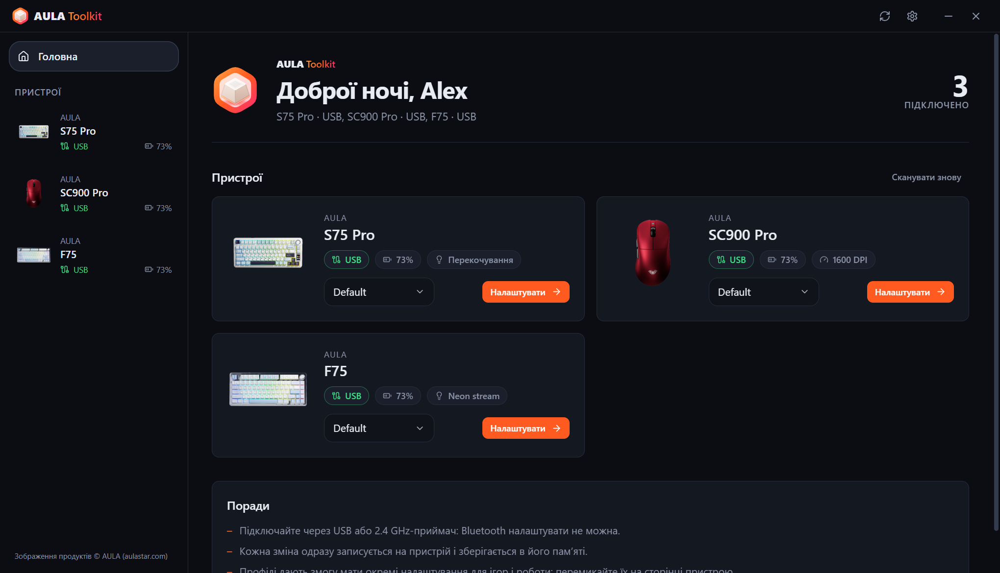 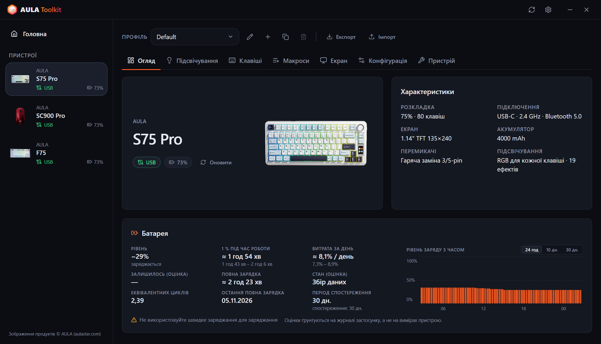

### Клавіатури
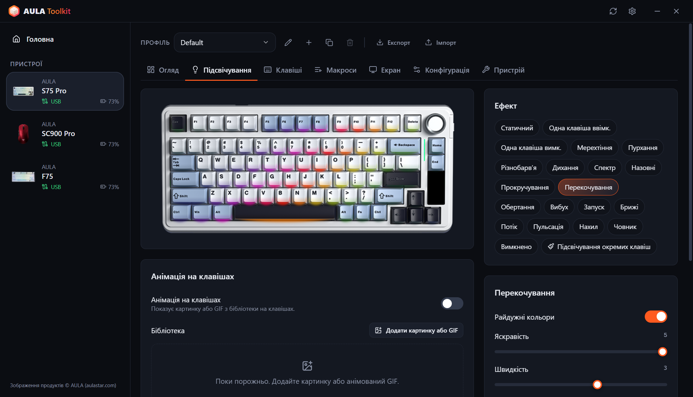 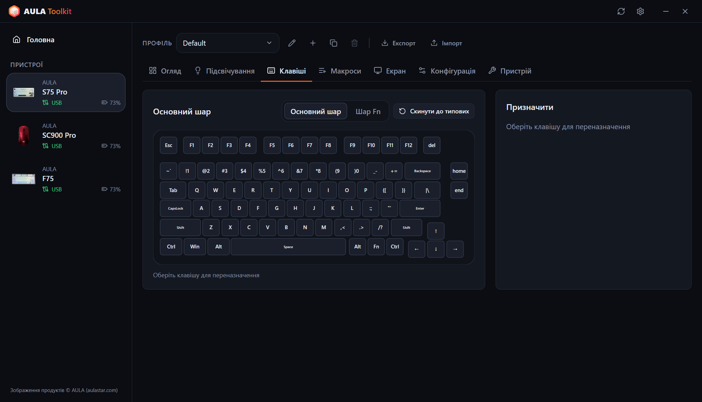
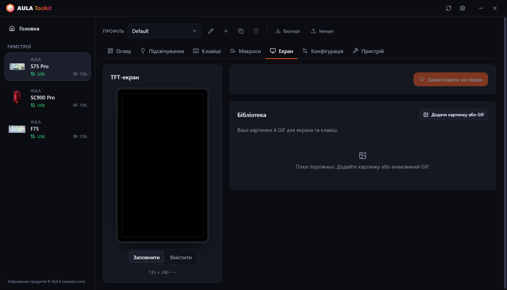 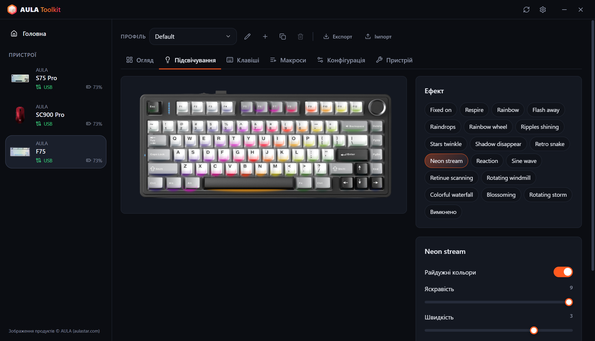

### Миші
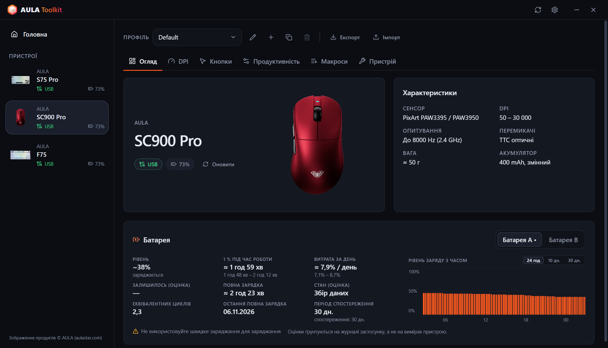 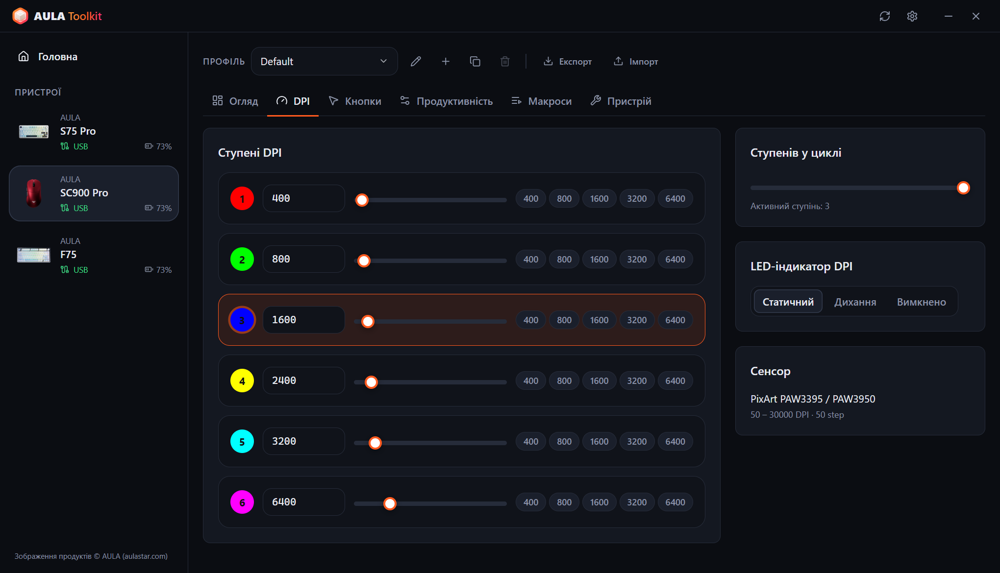
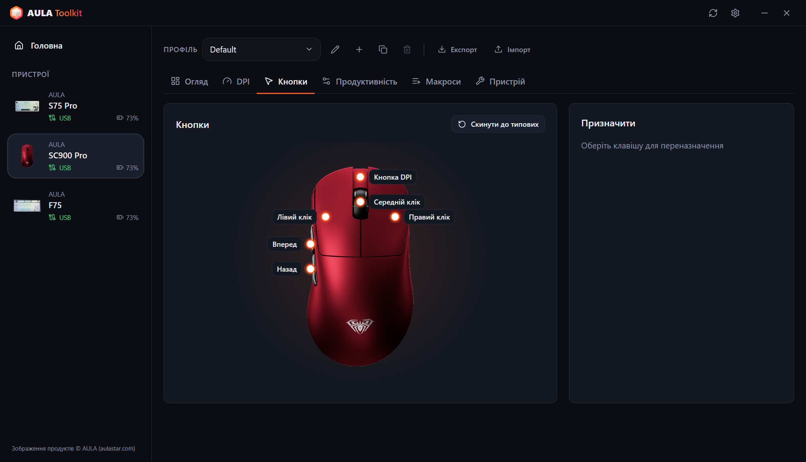 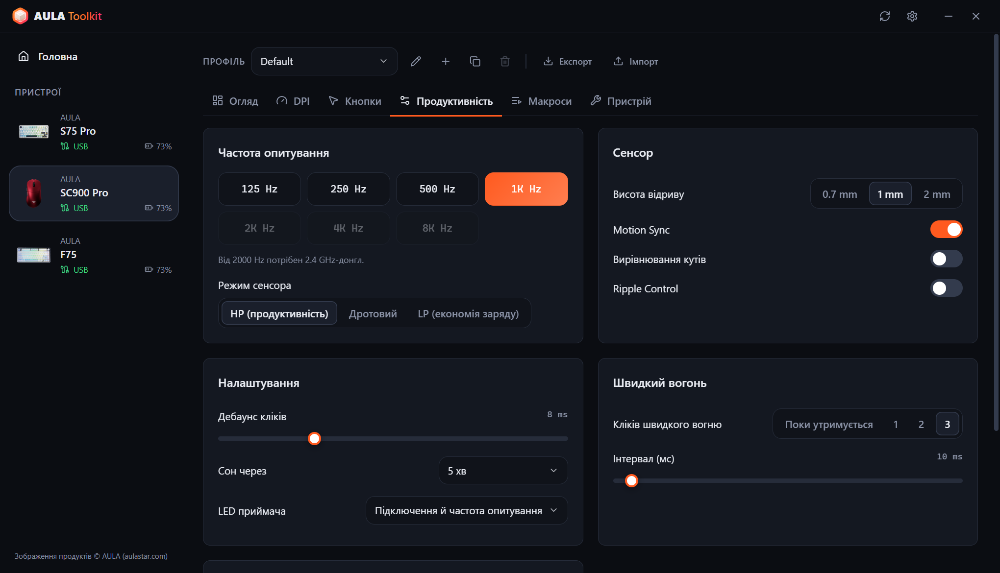

### Зведення в треї та екранний індикатор
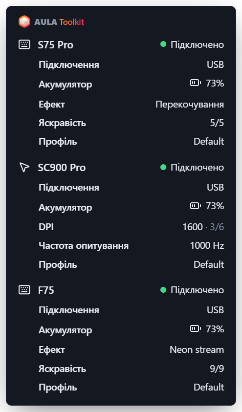 &nbsp; 

### Налаштування
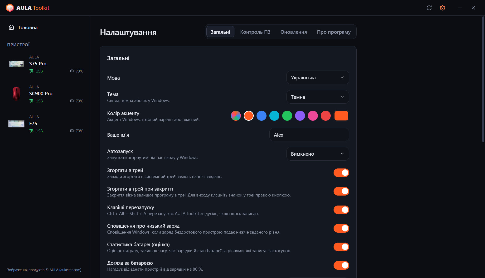 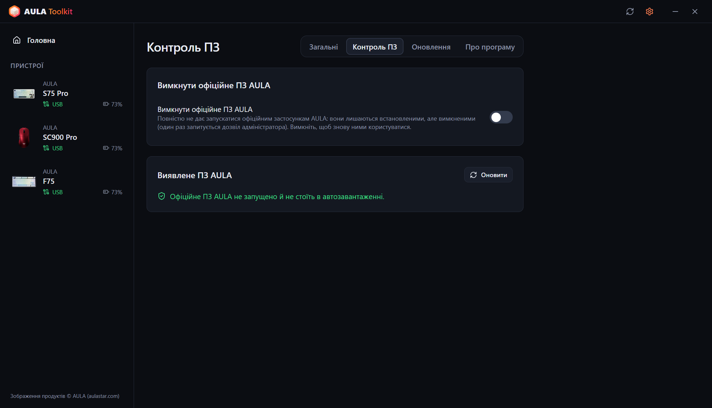
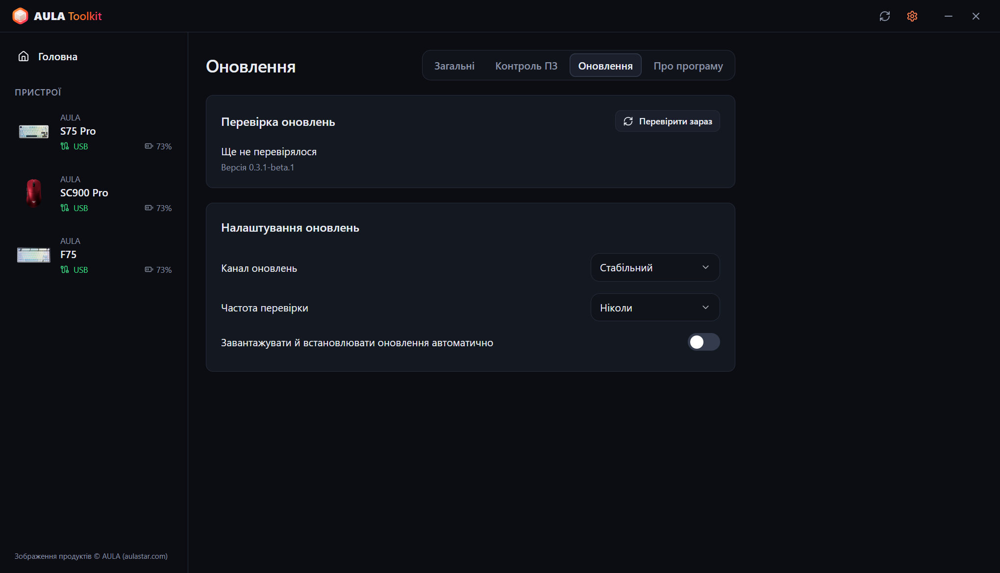 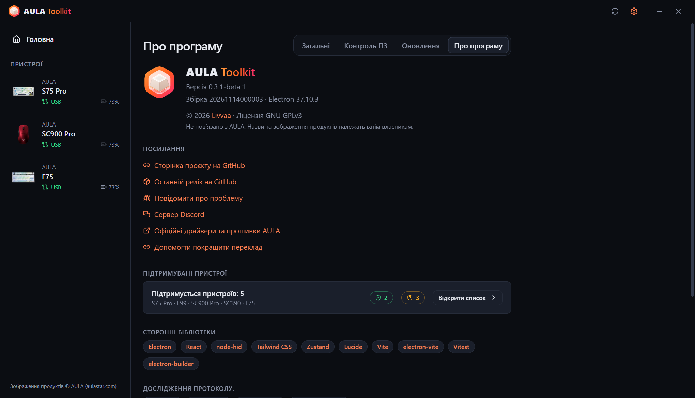
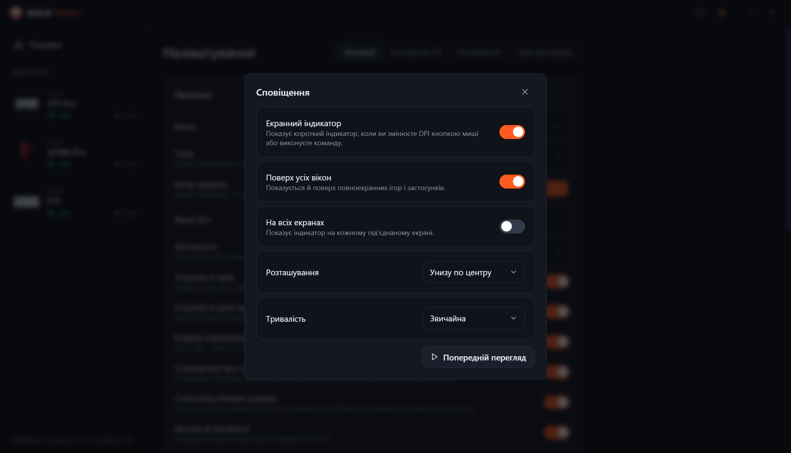 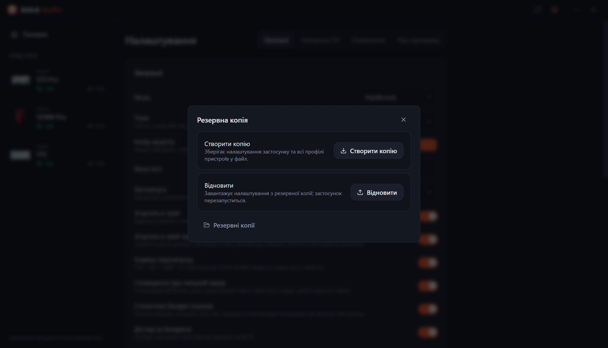

---

# Зміст
  - [Відмова від відповідальності](#відмова-від-відповідальності)
  - [Завантаження](#завантаження)
  - [Сумісність](#сумісність)
  - [Можливості](#можливості)
  - [Подяки](#подяки)
  - [Питання та відповіді](#питання-та-відповіді)
  - [Аргументи запуску](#аргументи-запуску)
  - [Як зібрати журнали?](#як-зібрати-журнали)
  - [Участь у розробці](#участь-у-розробці)
  - [Ліцензія](#ліцензія)

## Відмова від відповідальності

**Програма постачається без будь-яких гарантій. Використовуйте на власний ризик.**

AULA Toolkit спілкується з вашими пристроями за протоколами, відновленими методом зворотної розробки з офіційних драйверів. Будь ласка, прочитайте цей файл, перш ніж повідомляти про проблему: тут є відповіді на найпоширеніші запитання.

## Завантаження

У кожному випуску публікуються дві збірки:
* **Інсталятор** — встановлює програму лише для поточного користувача, тому права адміністратора не потрібні.
* **Портативна** — один `.exe`, який працює без встановлення.

#### Оновлення

AULA Toolkit уміє оновлюватися сам. Це налаштовується в **Налаштування → Оновлення**:
* **Канал оновлень** — випуски **Стабільний** або **Бета**.
* **Частота перевірки** — від щогодини до щомісяця, або ніколи.
* **Завантажувати й встановлювати оновлення автоматично** — оновлення завантажуються у фоні й тихо встановлюються, поки ви відійшли від комп'ютера (або коли ви закриваєте застосунок). Можна також встановити їх одразу.

Під час встановлення нової версії поверх старої ваші налаштування, профілі й макроси зберігаються.

#### Що далі

AULA Toolkit найкраще працює, коли він запущений у треї. У **Налаштування → Загальні**:
1. У пункті **Автозапуск** виберіть *Увімкнено* (або *Увімкнено (із затримкою)*, щоб запуск відбувався через 30 секунд після входу в систему). AULA Toolkit запускається через завдання планувальника Windows, тому він стартує і під час роботи від батареї; завдання перевіряється під час кожного запуску застосунку і створюється знову, якщо його видалили.
2. Увімкніть **Згортати в трей при закритті**.
3. У **Налаштування → Контроль ПЗ** увімкніть **Вимкнути офіційне ПЗ AULA**, щоб драйвери AULA не боролися з AULA Toolkit за той самий пристрій.

> [!WARNING]
> Якщо повністю закрити AULA Toolkit, перестануть працювати функції, яким потрібен запущений застосунок: екранний індикатор, сповіщення про батарею, зведення в треї, музичний ритм і анімації на клавішах, а також команда `aula`. Налаштування, уже записані в пристрої, продовжать працювати.

## Сумісність

| Пристрій | Підключення | Статус |
|---|---|---|
| **AULA S75 Pro** | USB, приймач 2,4 ГГц, Bluetooth (статус і батарея) | ✅ Перевірено на обладнанні |
| **AULA L99** | USB, приймач 2,4 ГГц, Bluetooth (статус і батарея) | 🧪 Бета, тестується користувачами |
| **AULA SC900 Pro** | USB, приймач 2,4 ГГц, Bluetooth (статус і батарея) | ✅ Перевірено на обладнанні |
| **AULA SC900** (інші версії, що використовують драйвер SC900 Pro) | USB, приймач 2,4 ГГц | ⚠️ Розпізнається, ще не перевірено на обладнанні |
| **AULA SC390** | USB | 🧪 Бета, тестується користувачами |
| **AULA F75** | USB, приймач 2,4 ГГц | ⚠️ Розпізнається, ще не перевірено на обладнанні |

Бета-пристрої підтримуються за USB-дампами офіційного драйвера, які надіслали їхні власники. Деяких функцій поки немає; див. таблицю нижче.

AULA продає ту саму мишу в кількох кольорах під одним USB ID, тому AULA Toolkit не може їх розрізнити. Виберіть свій колір під час налаштування пристрою або на вкладці **Пристрій**.

Вашого пристрою AULA немає в списку? Можливо, він усе одно використовує один із протоколів вище — див. [Чи можна додати підтримку мого пристрою AULA?](#чи-можна-додати-підтримку-мого-пристрою-aula).

#### Що працює за якого підключення

**Клавіатури**

| Функція | S75 Pro · USB | S75 Pro · 2,4 ГГц | L99 · USB | L99 · 2,4 ГГц | F75 · USB / 2,4 ГГц |
|---|:---:|:---:|:---:|:---:|:---:|
| Ефекти підсвічування | ✅ | ✅ | ✅ | ✅ | ✅ |
| Підсвічування окремих клавіш | ✅ | ✅ | ✅ | ✅ | — |
| Музичний ритм і анімація на клавішах (передаються з ПК) | ✅ | — | ✅ | — | — |
| Підсвічування гасне, поки монітор вимкнений | ✅ | ✅ | — | — | — |
| Живий вигляд клавіатури, відстеження змін з ручки / Fn | ✅ | — | — | — | — |
| Перепризначення клавіш, шар Fn, макроси | ✅ | ✅ | ✅ | ✅ | ✅ |
| Налаштування клавіатури (блокування Win, сон, дебаунс) | ✅ | ✅ | ✅ | ✅ | ✅ |
| Екран | ✅ TFT | — | Незабаром | — | — |
| Годинник (синхронізується під час підключення) | ✅ | ✅ | ✅ | ✅ | — |
| Бічна світлова смуга | ✅ | ✅ | — | — | — |
| Рівень заряду | — | ✅ | — | ✅ | — |
| Зчитування налаштувань під час підключення | — | — | — | — | ✅ |

**Миші**

| Функція | SC900 Pro · USB / 2,4 ГГц | SC390 · USB |
|---|:---:|:---:|
| Рівні DPI та індикатор DPI | ✅ | Незабаром |
| Частота опитування | ✅ до 8000 Гц | ✅ до 1000 Гц (кабель і приймач) |
| Сенсор (висота відриву, Ripple Control та інше) | ✅ | ✅ |
| Кнопки й макроси | ✅ | Незабаром |
| Час до сну | ✅ | Незабаром |
| Рівень заряду | ✅ | — |
| Зчитування налаштувань під час підключення | ✅ | ✅ |
| Екранний індикатор для кнопки DPI | ✅ | — |

> [!NOTE]
> Налаштовувати пристрої можна лише через **USB** або **приймач 2,4 ГГц**. Через Bluetooth пристрій не відкриває інтерфейс налаштування — в офіційного ПЗ AULA таке саме обмеження. Збережені раніше налаштування продовжують працювати через Bluetooth, а AULA Toolkit і там показує пристрій як підключений, із рівнем заряду, який повідомляє Windows.

### ПЗ AULA

Якщо одночасно запустити офіційний драйвер AULA і AULA Toolkit, обидва спілкуватимуться з тим самим пристроєм, а це може скасовувати зміни або спричиняти помилки читання. Коли AULA Toolkit знаходить офіційну програму AULA, унизу вікна з'являється смуга з попередженням. **Налаштування → Контроль ПЗ → Вимкнути офіційне ПЗ AULA** не дає їм запускатися взагалі: вони залишаються встановленими, але їхні програми вимикаються (Windows один раз попросить підтвердження адміністратора), а записи автозапуску відкладаються вбік. Якщо вимкнути цей параметр, ними знову можна користуватися; видалення AULA Toolkit теж їх відновлює.

## Можливості

Застосунок дає змогу:

- Налаштовувати будь-який підтримуваний пристрій з одного вікна, зміни застосовуються одразу.
- Ніколи не перезаписувати самостійно те, що вже є на пристрої: налаштування миші зчитуються під час підключення, а на S75 Pro ефект, колір і яскравість, які ви змінюєте ручкою або клавішами Fn, підхоплюються на льоту й зберігаються в профіль.
- Тримати кілька **профілів** для кожного пристрою та експортувати чи імпортувати їх як файли.
- Бачити живий **екранний індикатор**, коли ви натискаєте кнопку DPI на миші або виконуєте команду.
- Запускати смуги **музичного ритму** та **анімації (GIF)** на клавішах S75 Pro, що передаються з ПК.
- **Вимикати підсвічування клавіатури, поки монітор вимкнений**, і знову вмикати, коли він прокидається.
- Перезапускати застосунок звідусіль сполученням **Ctrl + Alt + Shift + A**, якщо щось зависло.
- Отримувати докладне **зведення в треї** про кожен підключений пристрій, навівши курсор на значок у треї.
- Отримувати **сповіщення про низький заряд**, нагадування **догляду за батареєю** на 80 % під час заряджання і, за бажанням, переглядати **статистику батареї**.
- Вимикати офіційне ПЗ AULA, не видаляючи його.
- Керувати пристроями з **командного рядка** за допомогою `aula`.
- Користуватися ним **10 мовами**: English, Türkçe, Русский, 简体中文, Українська, Tiếng Việt, Português (Brasil), Español, Deutsch і Français.
- Вибирати **світлу, темну або системну тему** та колір акценту.

### Клавіатури

* **Підсвічування** — усі апаратні ефекти з кольором, яскравістю, швидкістю й напрямком, а також попередній перегляд на фотографії вашої клавіатури.
* **Живий вигляд** (S75 Pro, USB) — зображення клавіатури показує те, що зараз показують світлодіоди. Коли ви змінюєте ефект ручкою або клавішами Fn, застосунок розпізнає його за кілька секунд, вибирає та показує на екрані. Клавіатура не повідомляє свій ефект, тому це працює за кольорами світлодіодів: ефекти, що залишаються темними до натискання клавіші, у простої виглядають однаково, а під час дуже швидкого обертання проміжний ефект може бути пропущений.
* **Підсвічування окремих клавіш** (S75 Pro) — розфарбовуйте клавіші по одній або заливайте всю клавіатуру.
* **Під час музики** — смуги на клавішах стежать за звуком, що грає на ПК (12 колірних схем, амплітуда й фон, як в офіційному драйвері), або клавіатура перемикається на вибраний вами ефект. Для смуг потрібен USB-кабель; на приймачі використовується ефект.
* **Анімація на клавішах** (S75 Pro, USB) — відтворює картинку або GIF із вашої бібліотеки на клавішах, приблизно 20 кадрів на секунду.
* **Вимкнення разом з екраном** (S75 Pro) — клавіші й бічна смуга гаснуть, поки монітор вимкнений.
* **Перепризначення клавіш** — призначайте клавішам основного шару й шару Fn клавіші, кнопки миші, медіаклавіші, сполучення клавіш або макроси.
* **Макроси** — записуйте натискання з реальними затримками й редагуйте їх потім.
* **TFT-екран** (S75 Pro, USB) — завантажуйте картинку або анімований GIF із бібліотеки. Перетягніть попередній перегляд, щоб вибрати видиму частину; довгі GIF підганяються під 141 кадр екрана без зміни темпу. Годинник синхронізується під час кожного підключення клавіатури.
* **Конфігурація** — блокування клавіші Windows, Alt+F4 і Alt+Tab, час до сну й час відгуку клавіш.
* **Скидання** — відновлення типових налаштувань клавіатури або повне скидання до заводських налаштувань.

### Миші

* **DPI** — до шести рівнів, активний рівень, кількість рівнів у циклі та LED-індикатор DPI.
* **Частота опитування** — до 8000 Гц. Частоти понад 1000 Гц потребують приймача 2,4 ГГц. У SC390 кабель і приймач мають окремі частоти.
* **Сенсор** — висота відриву, Motion Sync, вирівнювання кутів, Ripple Control і режим сенсора. На SC390: висота відриву, Наднизька затримка, Наднизьке споживання, Контроль брижів і Пробудження рухом.
* **Кнопки** — перепризначення будь-якої кнопки, крім лівої, зокрема швидкий вогонь і макроси.
* **Таймінги** — дебаунс кліків і час до сну.
* **Акумулятор** — рівень заряду та стан заряджання. Дві батареї SC900 Pro (і будь-які додаткові, які ви додасте) враховуються окремо.

### Екранний індикатор

Коли ви змінюєте DPI власною кнопкою миші, на екрані з'являється невеликий індикатор із новим значенням і активним рівнем. На S75 Pro (USB) він також показує новий ефект, колір або яскравість, коли ви змінюєте їх на клавіатурі, і підтверджує зміни, зроблені командою `aula`. Там само з'являються завантаження на екран, нагадування про 80 % і перезапуски. У **Налаштування → Сповіщення** його можна вимкнути, вибрати положення й тривалість, тримати поверх повноекранних ігор або показувати на всіх дисплеях.

### Резервні копії

**Налаштування → Резервна копія** зберігає налаштування застосунку й усі профілі пристроїв в один файл і пізніше відновлює їх із нього, наприклад після перевстановлення Windows.

### Статистика батареї

**Налаштування → Загальні → Статистика батареї** (увімкнено за замовчуванням) показує картку батареї в огляді кожного пристрою:

* **Рівень** — поточний рівень або останній відомий із зазначенням, як давно його зчитано. На кабелі без показів — оцінка, а потім 99+.
* **1 % під час роботи** — скільки триває 1 %, поки пристрій використовується через приймач.
* **Витрата за день** і **Залишилось** — за календарним часом, включно з годинами, коли пристрій спить або застосунок закритий.
* **Повна зарядка** і **Стан** — за тим, як швидко батарея заряджається в середині діапазону.
* **Еквівалентних циклів**, **Остання повна зарядка** і графік із трьома виглядами: останні 24 години, витрата батареї за днями протягом 10 днів і рівень за 30 днів. Наведіть курсор на графік, щоб побачити точні значення; заряджання показано зеленим.

Показники виводяться з діапазоном, щойно накопичено достатньо даних. Рівні записуються через USB, приймач 2,4 ГГц і Bluetooth (зчитуються з Windows). **Догляд за батареєю**, увімкнений за замовчуванням разом зі статистикою, нагадує на 80 % під час заряджання від'єднати пристрій.

> [!NOTE]
> Пристрої AULA повідомляють лише відсоток заряду. Усі показники вище — це **оцінки**, розраховані за рівнями, які записує AULA Toolkit.

> [!WARNING]
> Не використовуйте швидку зарядку, на коробках про це теж написано.

### CLI

AULA Toolkit можна керувати з командного рядка. Команда називається `aula` і встановлюється в `resources\bin` усередині папки встановлення (за замовчуванням `%LOCALAPPDATA%\Programs\AULA Toolkit\resources\bin\aula.cmd`). Встановлений застосунок сам додає цю папку до користувацького `PATH`, тож `aula` працює в будь-якому новому терміналі; під час видалення вона прибирається. Портативна збірка `PATH` не змінює. **Налаштування → Загальні → Командний рядок** показує точний шлях із кнопкою копіювання.

Команда звертається до запущеного застосунку. Якщо AULA Toolkit не запущено, `aula` спочатку запускає його в треї. Права адміністратора не потрібні.

Команди

* `aula status` — список підключених пристроїв (додайте `--json` для машинозчитуваного виводу)
* `aula profile list` — список профілів пристрою
* `aula profile set <name>` — перемкнутися на профіль
* `aula dpi` — показати рівні DPI миші
* `aula dpi stage <n>` — увімкнути рівень DPI `<n>` (нумерація з 1)
* `aula dpi <value>` — встановити для активного рівня `<value>` DPI
* `aula polling <hz>` — встановити частоту опитування миші
* `aula light list` — список ефектів клавіатури
* `aula light <effect> [--color #rrggbb] [--brightness n] [--speed n]` — встановити ефект клавіатури
* `aula brightness <n>` — встановити яскравість підсвічування клавіатури
* `aula osd on|off` — увімкнути або вимкнути екранний індикатор
* `aula show` / `aula hide` — показати або приховати вікно
* `aula version` — вивести версію застосунку

Якщо підключено кілька пристроїв одного типу, виберіть потрібний за допомогою `-d <id>`, наприклад `aula profile list -d sc900`. Команда завершується з кодом `0` у разі успіху і `1` у разі помилки, тож її можна використовувати в скриптах.

## Подяки

AULA Toolkit створює та підтримує **Livvaa** ([GitHub](https://github.com/Livvaa)).

Окрема подяка проєктам, чия відкрита робота зі зворотної розробки зробила це можливим:
* [open-aula](https://github.com/paulcoding810/open-aula) — протоколи клавіатур AULA.
* [AulaSofwareLinux](https://github.com/thought-train/AulaSofwareLinux) — протокол сімейства AULA F75.
* [IncottHIDApp](https://github.com/romkazor/IncottHIDApp) і [OpenMouse](https://github.com/OpenMouse-Project/mouse-protocol) — протокол мишей PixArt 8K.

Усі деталі протоколів звірено з офіційними драйверами AULA. Зображення продуктів © AULA ([aulastar.com](https://www.aulastar.com)).

### Сторонні бібліотеки

* **Electron** ([electron/electron](https://github.com/electron/electron))
* **React** ([facebook/react](https://github.com/facebook/react))
* **node-hid** ([node-hid/node-hid](https://github.com/node-hid/node-hid))
* **Tailwind CSS** ([tailwindlabs/tailwindcss](https://github.com/tailwindlabs/tailwindcss))
* **Zustand** ([pmndrs/zustand](https://github.com/pmndrs/zustand))
* **Lucide** ([lucide-icons/lucide](https://github.com/lucide-icons/lucide))
* **electron-vite** ([alex8088/electron-vite](https://github.com/alex8088/electron-vite)), **Vite** ([vitejs/vite](https://github.com/vitejs/vite)) і **Vitest** ([vitest-dev/vitest](https://github.com/vitest-dev/vitest))
* **electron-builder** і **electron-updater** ([electron-userland/electron-builder](https://github.com/electron-userland/electron-builder))

### Переклади

Інтерфейс доступний 10 мовами. Не всі переклади поки перевірені носіями мови. Якщо ви помітили помилку, будь ласка, відкрийте pull request — кожна мова міститься в одному файлі в [`src/shared/locales`](src/shared/locales).

## Питання та відповіді

#### Чи може AULA Toolkit пошкодити мій пристрій?

AULA Toolkit ніколи не торкається прошивки. Він надсилає лише ті самі команди налаштування, що й офіційний драйвер (підсвічування, клавіші, макроси, DPI тощо), звірені з USB-дампами цього драйвера. Якщо щось виглядає неправильно, скидання на вкладці **Пристрій** або офіційне ПЗ повернуть типові налаштування.

#### Чому не можна змінювати налаштування через Bluetooth?

Через Bluetooth клавіатура й миша видимі для Windows лише як стандартні клавіатура й миша. Інтерфейсу налаштування, який є під час підключення через USB і приймач 2,4 ГГц, там немає, тому ні AULA Toolkit, ні офіційне ПЗ не можуть змінювати налаштування. Підключіться кабелем або через приймач, внесіть зміни й поверніться на Bluetooth — налаштування залишаться на пристрої. Через Bluetooth AULA Toolkit показує підключення й рівень заряду, який повідомляє Windows.

#### Чому клавіатура не показує рівень заряду?

S75 Pro повідомляє рівень заряду через приймач 2,4 ГГц, а через Bluetooth його повідомляє Windows. Через USB клавіатура заряджається, і прошивка рівень не повідомляє: AULA Toolkit показує оцінку за виміряною швидкістю заряджання, а потім 99+.

#### Чому цикли та стан батареї — лише оцінки?

У пристроях AULA немає чипа батареї, який рахував би цикли або вимірював знос. Вони повідомляють лише відсоток, тому все інше AULA Toolkit оцінює за тим, коли цей відсоток змінюється. Стан обчислюється за швидкістю заряджання, тому для нього потрібно кілька заряджань упродовж місяця або довше.

#### Чи може AULA Toolkit прочитати картинку на екрані S75 Pro або версію прошивки?

Ні. Прошивка клавіатури може прийняти картинку, але не має команди, щоб надіслати її назад, і жоден із підтримуваних пристроїв не повідомляє версію прошивки. Офіційне ПЗ цього теж не вміє.

#### Чому Windows попереджає мене під час запуску інсталятора?

Інсталятори поки не підписані цифровим підписом, тому Windows SmartScreen показує попередження про невідомого видавця. AULA Toolkit — проєкт із відкритим кодом, і ви можете зібрати його самі з цього репозиторію. Щоб продовжити, виберіть **Докладніше → Усе одно запустити**.

#### Моя миша іншого кольору, ніж на картинці.

AULA використовує той самий USB ID для всіх кольорів моделі. Виберіть свій колір на вкладці **Пристрій**.

#### Чи можна додати підтримку мого пристрою AULA?

Можливо. Більшість клавіатур і мишей AULA використовують одне із сімейств протоколів, які AULA Toolkit уже підтримує. Що вказати в запиті, див. у розділі [Участь у розробці](#участь-у-розробці).

## Аргументи запуску

* `--hidden` — запуск згорнутим у трей. Його використовує *Автозапуск*.
* `--delayed` — зачекати 30 секунд перед підключенням до пристроїв. *Автозапуск → Увімкнено (із затримкою)* тепер натомість чекає в завданні планувальника.

## Як зібрати журнали?

Журнали дуже допомагають у разі будь-якої проблеми. **Завжди** додавайте їх до своїх issue.

#### Спосіб 1: пакет діагностики (рекомендовано)
1. Відкрийте **AULA Toolkit**.
2. Перейдіть до **Налаштування → Про програму**.
3. Натисніть **Зберегти пакет діагностики**. Стан пристроїв і журнал обміну збережуться в один файл, який можна додати до issue.

#### Спосіб 2: файли журналів
1. Відтворіть проблему.
2. Відкрийте вікно `Виконати` (Win+R), введіть `"%APPDATA%\AULA Toolkit\logs"` і натисніть OK.
3. Додайте найновіший файл `hid-<date>.log`.

Журнал також можна переглядати в реальному часі в **Налаштування → Загальні → Додатково**.

## Участь у розробці

Відгуки дуже вітаються, тож не соромтеся повідомляти про проблеми. Pull request'и теж вітаються. Будь ласка, спочатку прочитайте [посібник для учасників](CONTRIBUTING.md).

Маєте запитання, ідеї чи просто хочете поспілкуватися? Приєднуйтеся до [сервера Discord](https://discord.gg/u9FbaJGtCe).

#### Підтримка пристроїв

Для підтримки нових пристроїв AULA потрібні тестувальники. Відкриваючи запит, будь ласка, вкажіть:

1. Повну назву моделі (наприклад, *AULA F87 Pro*).
2. USB ID, які можна знайти в **Диспетчер пристроїв → ваш пристрій → Відомості → Ідентифікатори обладнання** (наприклад, `VID_0C45&PID_800A`).
3. Яке підключення ви використовували (USB або 2,4 ГГц).
4. Пакет діагностики (див. [Як зібрати журнали?](#як-зібрати-журнали)).
5. Якщо можете: USB-дамп офіційного драйвера. Встановіть [Wireshark](https://www.wireshark.org/download.html) з USBPcap, закрийте AULA Toolkit, почніть запис, змінюйте в офіційному драйвері по одному налаштуванню за раз і записуйте порядок. Додайте файл `.pcapng` у zip-архіві. Саме так було додано L99 і SC390.

## Ліцензія

Copyright (C) 2026 Livvaa

AULA Toolkit — вільне програмне забезпечення: ви можете поширювати та/або змінювати його на умовах
GNU General Public License у тому вигляді, в якому її опубліковано Free Software Foundation, — версії 3
ліцензії або (на ваш вибір) будь-якої пізнішої версії. Повний текст див. у [LICENSE](LICENSE).

Ця програма поширюється з надією, що вона буде корисною, але БЕЗ БУДЬ-ЯКИХ ГАРАНТІЙ; навіть без
неявної гарантії ТОВАРНОЇ ПРИДАТНОСТІ або ПРИДАТНОСТІ ДЛЯ ПЕВНОЇ МЕТИ.

AULA Toolkit не пов'язаний з AULA. Назви продуктів і зображення належать їхнім власникам.
