

  <picture>
    <source media="(prefers-color-scheme: dark)" srcset="docs/brand/wordmark-dark.png">
    
  </picture>

  
  
  
   
  
  
  
  
   
  
  
  

## 🚨 Thông báo về trạng thái dự án

> [!IMPORTANT]
> - AULA Toolkit đang trong **giai đoạn phát triển ban đầu** (phiên bản 0.x). Có thể vẫn còn lỗi vặt.
> - Đây là dự án **không chính thức** và **không liên kết với AULA**. Tên sản phẩm và hình ảnh thuộc về chủ sở hữu của chúng.
> - Mới chỉ một số thiết bị được thử trên phần cứng thật; xem [Tương thích](#tương-thích).

#### README này bằng các ngôn ngữ khác:
[English](README.md) · [Türkçe](README_tr-TR.md) · [Русский](README_ru-RU.md) · [简体中文](README_zh-CN.md) · [Українська](README_uk-UA.md) · [Português (Brasil)](README_pt-BR.md) · [Español](README_es-ES.md) · [Deutsch](README_de-DE.md) · [Français](README_fr-FR.md)

---

AULA Toolkit là ứng dụng máy tính cho Windows, giúp bạn điều khiển bàn phím và chuột AULA ở cùng một nơi, theo tinh thần của Logitech G HUB. Ứng dụng thay thế các driver riêng mà AULA phát hành cho từng mẫu.

Ứng dụng không chạy dịch vụ nền, không thu thập dữ liệu sử dụng (telemetry) và chỉ kết nối Internet để kiểm tra bản cập nhật trên GitHub. Mọi thay đổi được ghi vào thiết bị ngay khi bạn thực hiện và lưu trong bộ nhớ của chính thiết bị, nên vẫn hoạt động trên máy tính khác và qua Bluetooth.

# Ảnh chụp màn hình

### Trang chủ và tổng quan thiết bị
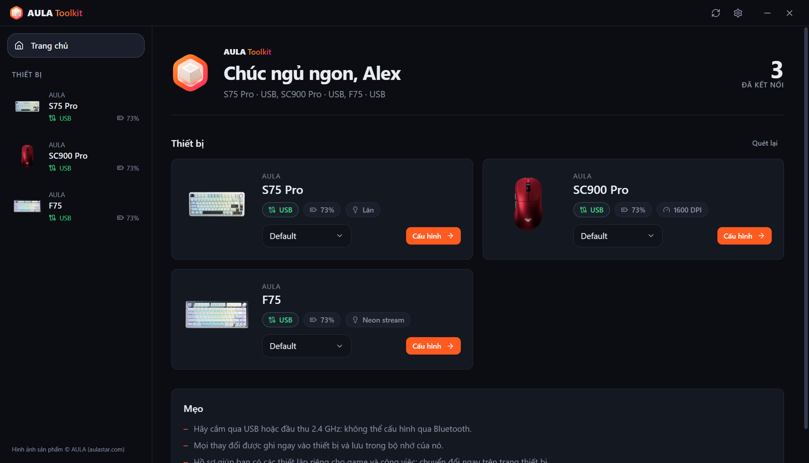 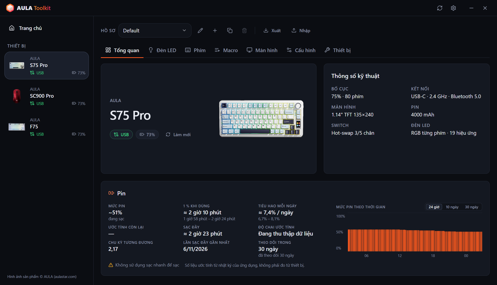

### Bàn phím
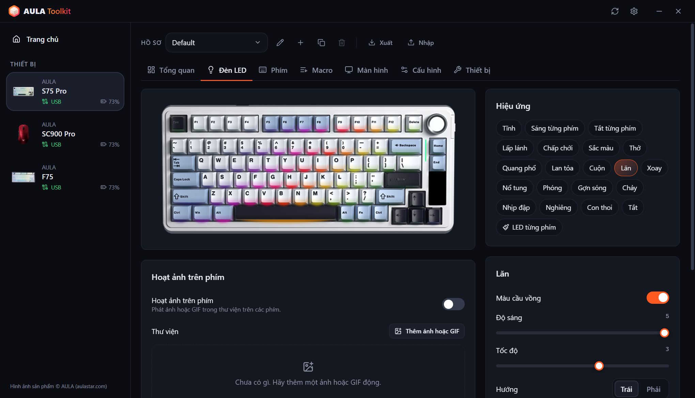 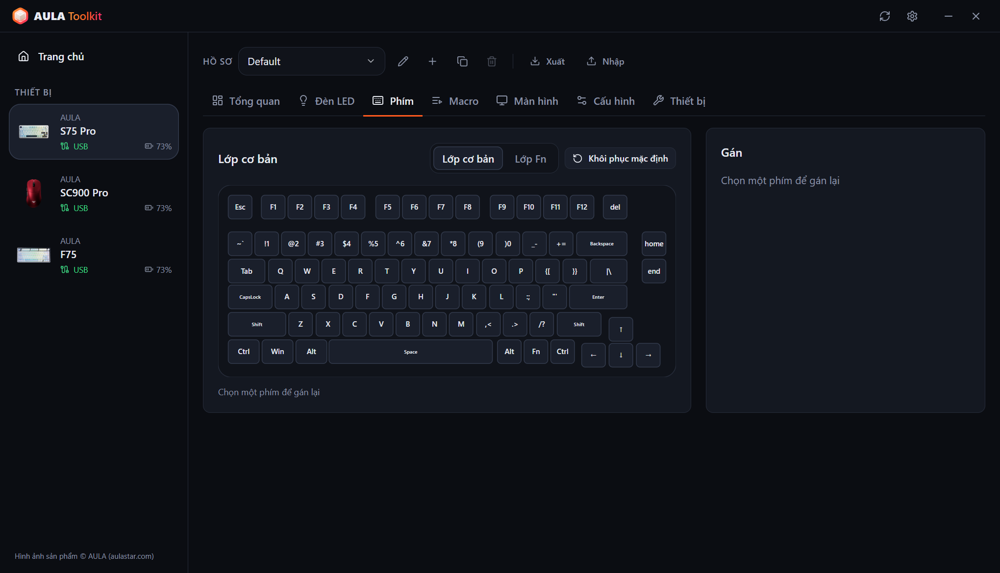
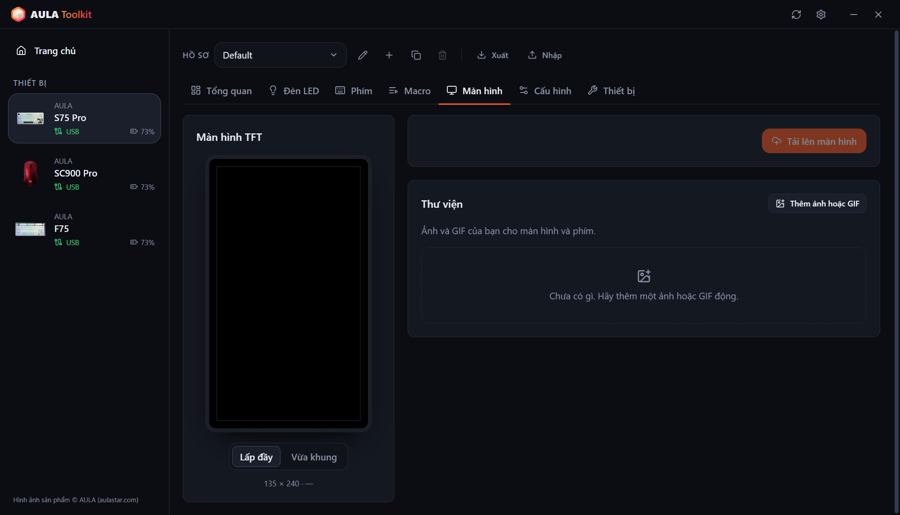 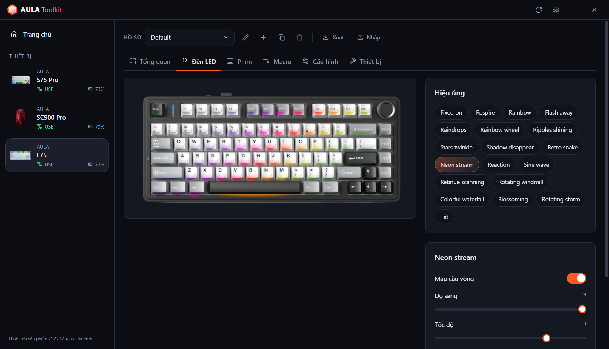

### Chuột
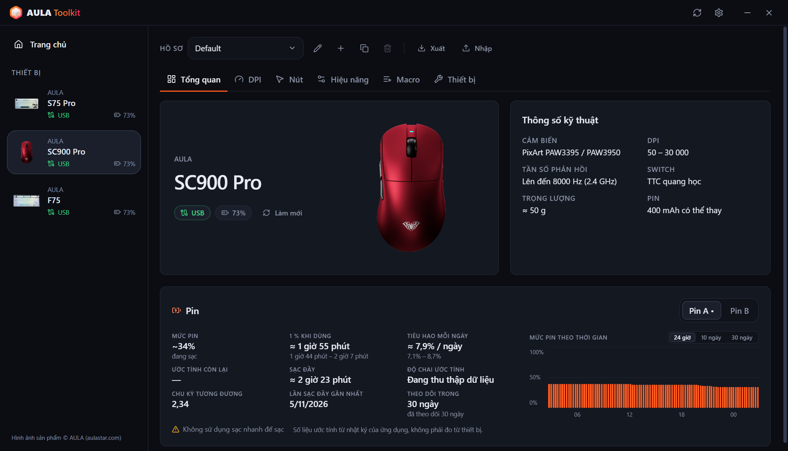 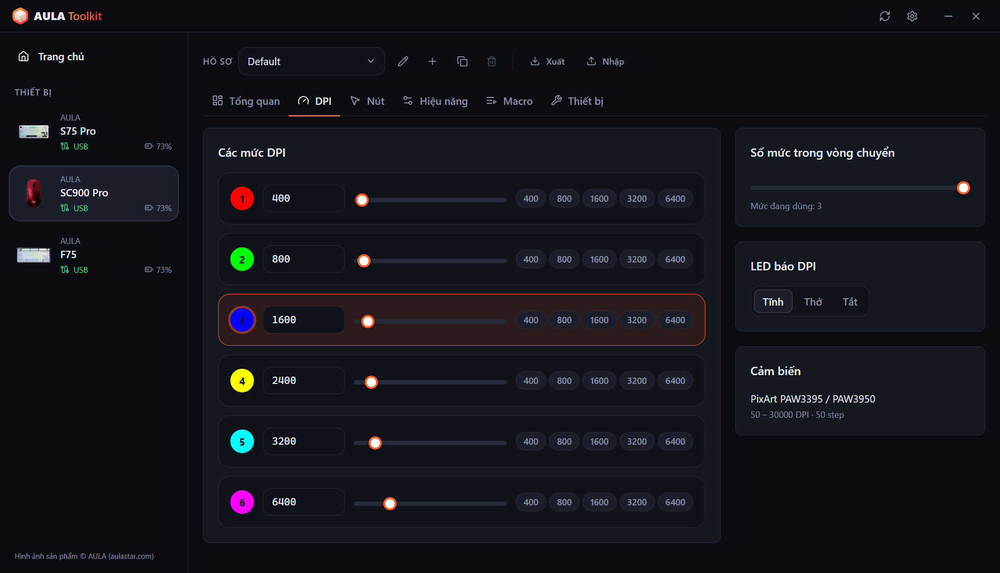
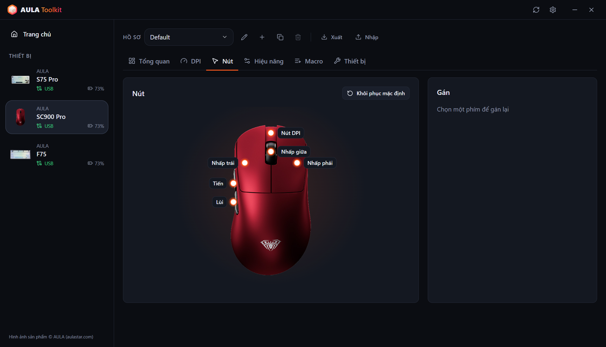 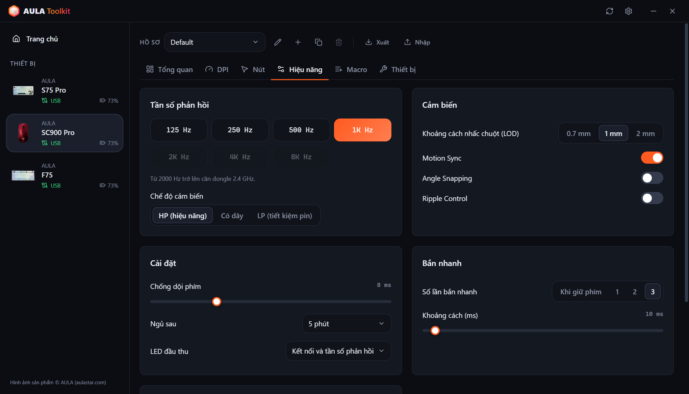

### Tóm tắt ở khay hệ thống và hiển thị trên màn hình
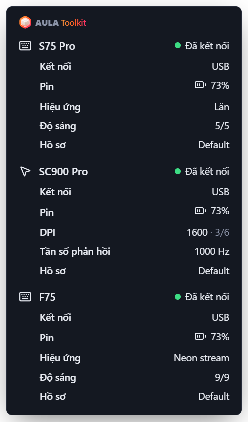 &nbsp; 

### Cài đặt
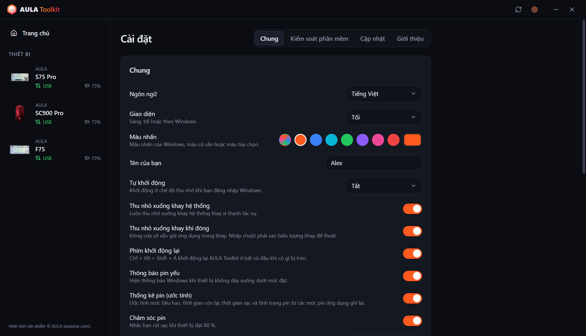 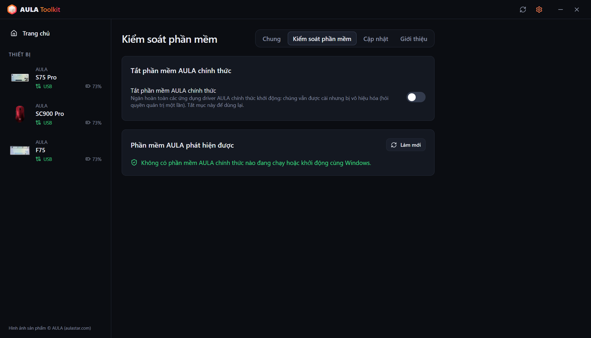
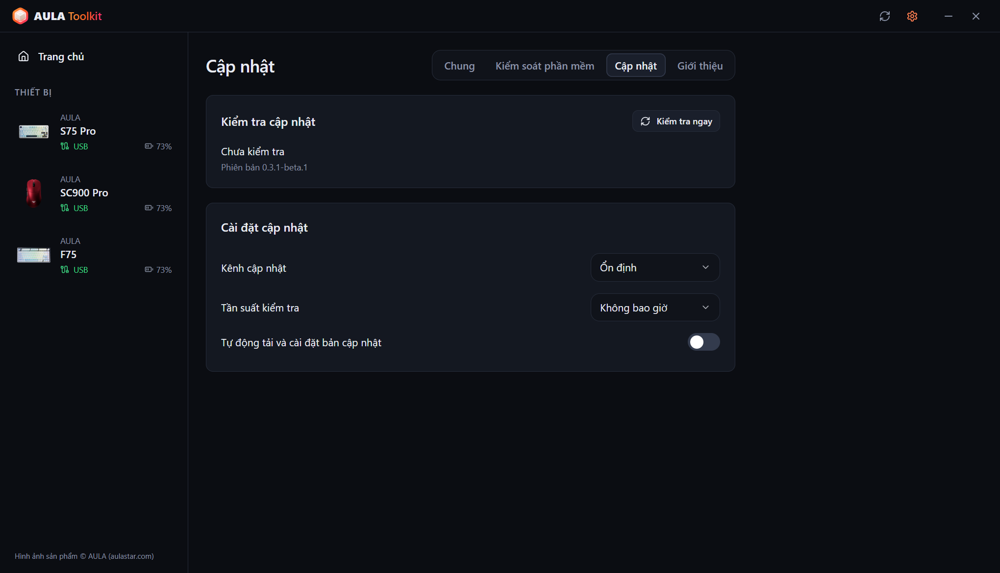 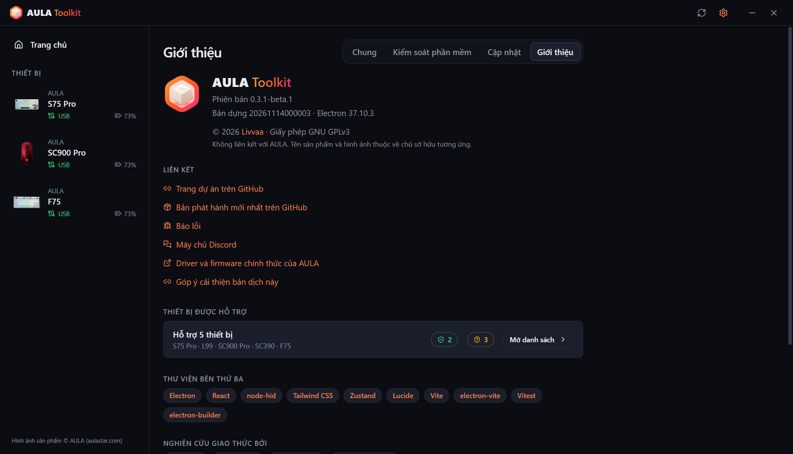
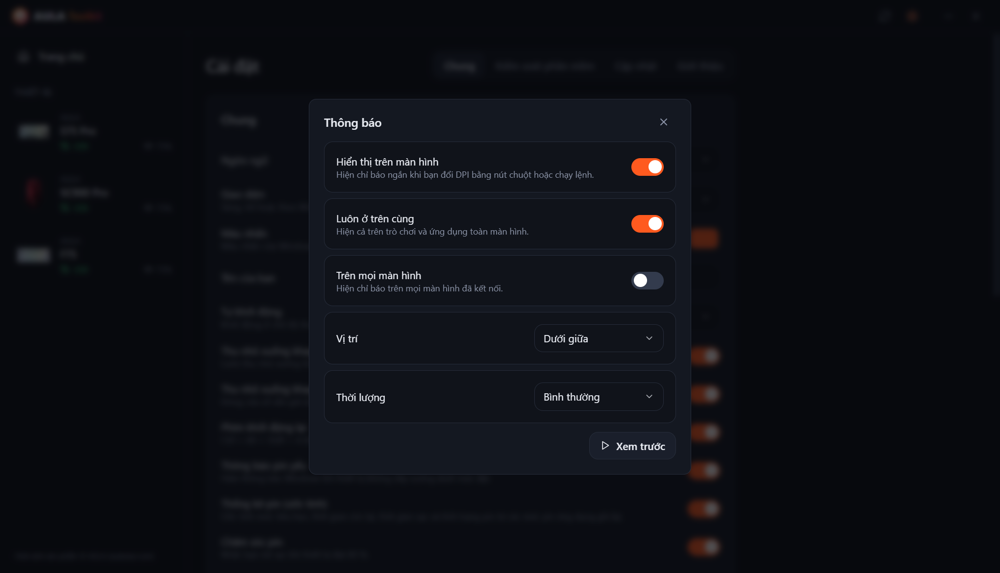 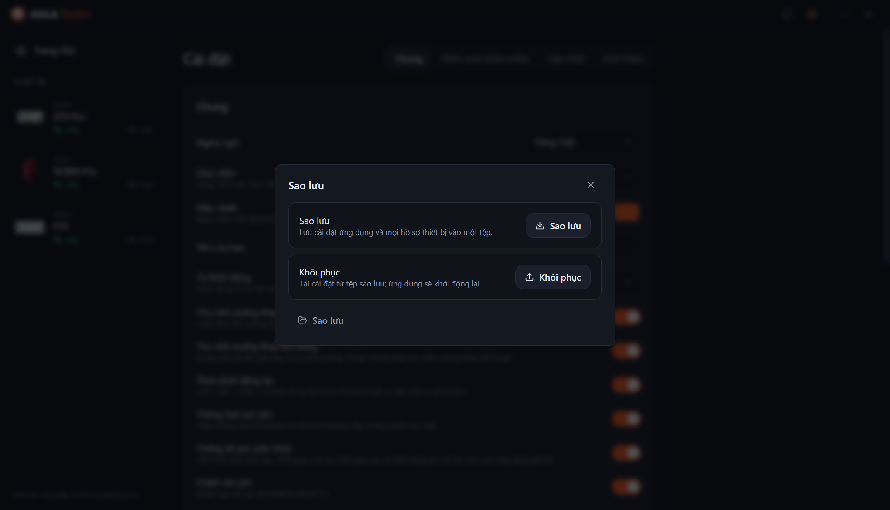

---

# Mục lục
  - [Miễn trừ trách nhiệm](#miễn-trừ-trách-nhiệm)
  - [Tải về](#tải-về)
  - [Tương thích](#tương-thích)
  - [Tính năng](#tính-năng)
  - [Ghi nhận](#ghi-nhận)
  - [Câu hỏi thường gặp](#câu-hỏi-thường-gặp)
  - [Tham số dòng lệnh](#tham-số-dòng-lệnh)
  - [Cách thu thập nhật ký?](#cách-thu-thập-nhật-ký)
  - [Đóng góp](#đóng-góp)
  - [Giấy phép](#giấy-phép)

## Miễn trừ trách nhiệm

**Công cụ này không đi kèm bất kỳ bảo hành nào. Bạn tự chịu rủi ro khi sử dụng.**

AULA Toolkit giao tiếp với thiết bị của bạn bằng các giao thức được dịch ngược từ driver chính thức. Hãy đọc tệp này trước khi báo lỗi — nó trả lời những câu hỏi thường gặp nhất.

## Tải về

Mỗi lần phát hành có hai bản:
* **Bản cài đặt** — chỉ cài cho người dùng hiện tại, nên không cần quyền quản trị.
* **Bản portable** — một tệp `.exe` duy nhất, chạy không cần cài đặt.

#### Cập nhật

AULA Toolkit có thể tự cập nhật. Thiết lập trong **Cài đặt → Cập nhật**:
* **Kênh cập nhật** — bản **Ổn định** hoặc **Beta**.
* **Tần suất kiểm tra** — từ mỗi giờ đến hằng tháng, hoặc không bao giờ.
* **Tự động tải và cài đặt bản cập nhật** — bản cập nhật được tải trong nền và cài lặng lẽ khi bạn không dùng máy (hoặc khi bạn đóng ứng dụng). Bạn cũng có thể cài ngay.

Cài phiên bản mới đè lên phiên bản cũ vẫn giữ nguyên cài đặt, hồ sơ và macro của bạn.

#### Bước tiếp theo

AULA Toolkit hoạt động tốt nhất khi chạy ở khay hệ thống. Trong **Cài đặt → Chung**:
1. Đặt **Tự khởi động** thành *Bật* (hoặc *Bật (trễ)* để khởi động 30 giây sau khi đăng nhập). AULA Toolkit khởi động qua một tác vụ theo lịch của Windows, nên vẫn khởi động khi máy chạy bằng pin; tác vụ này được kiểm tra mỗi lần ứng dụng khởi động và được tạo lại nếu đã bị xóa.
2. Bật **Thu nhỏ xuống khay khi đóng**.
3. Trong **Cài đặt → Kiểm soát phần mềm**, bật **Tắt phần mềm AULA chính thức** để driver AULA và AULA Toolkit không tranh nhau cùng một thiết bị.

> [!WARNING]
> Nếu bạn thoát hẳn AULA Toolkit, các tính năng cần ứng dụng đang chạy sẽ ngừng: hiển thị trên màn hình, thông báo pin, tóm tắt ở khay, nhịp nhạc và hoạt ảnh trên phím, và lệnh `aula`. Các cài đặt đã ghi vào thiết bị vẫn tiếp tục hoạt động.

## Tương thích

| Thiết bị | Kết nối | Trạng thái |
|---|---|---|
| **AULA S75 Pro** | USB, receiver 2.4 GHz, Bluetooth (trạng thái và pin) | ✅ Đã thử trên phần cứng |
| **AULA L99** | USB, receiver 2.4 GHz, Bluetooth (trạng thái và pin) | 🧪 Beta, đang được người dùng thử |
| **AULA SC900 Pro** | USB, receiver 2.4 GHz, Bluetooth (trạng thái và pin) | ✅ Đã thử trên phần cứng |
| **AULA SC900** (các phiên bản khác dùng driver của SC900 Pro) | USB, receiver 2.4 GHz | ⚠️ Đã nhận diện, chưa thử trên phần cứng |
| **AULA SC390** | USB | 🧪 Beta, đang được người dùng thử |
| **AULA F75** | USB, receiver 2.4 GHz | ⚠️ Đã nhận diện, chưa thử trên phần cứng |

Thiết bị beta được hỗ trợ dựa trên bản ghi USB của driver chính thức do chủ thiết bị gửi. Một số tính năng vẫn còn thiếu; xem bảng bên dưới.

AULA bán cùng một mẫu chuột với nhiều màu dưới cùng một USB ID, nên AULA Toolkit không thể phân biệt chúng. Hãy chọn màu của bạn khi thiết lập thiết bị hoặc trong tab **Thiết bị** của thiết bị.

Thiết bị AULA của bạn không có trong danh sách? Có thể nó vẫn dùng một trong các giao thức trên — xem [Có thể thêm hỗ trợ cho thiết bị AULA của tôi không?](#có-thể-thêm-hỗ-trợ-cho-thiết-bị-aula-của-tôi-không).

#### Tính năng nào hoạt động qua kết nối nào

**Bàn phím**

| Tính năng | S75 Pro · USB | S75 Pro · 2.4 GHz | L99 · USB | L99 · 2.4 GHz | F75 · USB / 2.4 GHz |
|---|:---:|:---:|:---:|:---:|:---:|
| Hiệu ứng đèn | ✅ | ✅ | ✅ | ✅ | ✅ |
| LED từng phím | ✅ | ✅ | ✅ | ✅ | — |
| Nhịp nhạc và hoạt ảnh trên phím (truyền từ PC) | ✅ | — | ✅ | — | — |
| Tắt đèn khi màn hình tắt | ✅ | ✅ | — | — | — |
| Xem bàn phím trực tiếp, theo dõi thay đổi từ núm xoay / Fn | ✅ | — | — | — | — |
| Gán phím, lớp Fn, macro | ✅ | ✅ | ✅ | ✅ | ✅ |
| Cài đặt bàn phím (khóa Win, ngủ, chống dội) | ✅ | ✅ | ✅ | ✅ | ✅ |
| Màn hình | ✅ TFT | — | Sắp có | — | — |
| Đồng hồ (đồng bộ khi kết nối) | ✅ | ✅ | ✅ | ✅ | — |
| Thanh LED bên hông | ✅ | ✅ | — | — | — |
| Mức pin | — | ✅ | — | ✅ | — |
| Đọc lại cài đặt khi kết nối | — | — | — | — | ✅ |

**Chuột**

| Tính năng | SC900 Pro · USB / 2.4 GHz | SC390 · USB |
|---|:---:|:---:|
| Các mức DPI và đèn báo DPI | ✅ | Sắp có |
| Tần số phản hồi | ✅ tối đa 8000 Hz | ✅ tối đa 1000 Hz (cáp và receiver) |
| Cảm biến (khoảng cách nhấc chuột, Ripple Control và hơn nữa) | ✅ | ✅ |
| Nút và macro | ✅ | Sắp có |
| Thời gian ngủ | ✅ | Sắp có |
| Mức pin | ✅ | — |
| Đọc lại cài đặt khi kết nối | ✅ | ✅ |
| Hiển thị trên màn hình cho nút DPI | ✅ | — |

> [!NOTE]
> Chỉ có thể cấu hình thiết bị qua **USB** hoặc **receiver 2.4 GHz**. Qua Bluetooth, thiết bị không mở giao diện cấu hình — phần mềm AULA chính thức cũng có giới hạn này. Các cài đặt bạn đã lưu trước đó vẫn hoạt động qua Bluetooth, và AULA Toolkit vẫn hiển thị thiết bị là đã kết nối, kèm mức pin do Windows báo.

### Phần mềm của AULA

Chạy driver AULA chính thức và AULA Toolkit cùng lúc khiến cả hai cùng giao tiếp với một thiết bị, có thể làm mất thay đổi hoặc gây lỗi đọc. AULA Toolkit hiện một dải cảnh báo ở cuối cửa sổ khi phát hiện chương trình AULA chính thức. **Cài đặt → Kiểm soát phần mềm → Tắt phần mềm AULA chính thức** ngăn chúng khởi động: chúng vẫn được cài, nhưng chương trình bị vô hiệu hóa (Windows hỏi quyền quản trị một lần) và các mục tự khởi động của chúng được tạm cất đi. Tắt tùy chọn này thì chúng dùng lại được, và gỡ cài đặt AULA Toolkit cũng khôi phục chúng.

## Tính năng

Ứng dụng cho phép bạn:

- Cấu hình mọi thiết bị được hỗ trợ trong một cửa sổ, thay đổi được áp dụng ngay.
- Không bao giờ tự ghi đè những gì đã có trên thiết bị: cài đặt của chuột được đọc lại khi kết nối, và trên S75 Pro, hiệu ứng, màu và độ sáng bạn đổi bằng núm xoay hoặc phím Fn được nhận diện trực tiếp và lưu vào hồ sơ của bạn.
- Giữ nhiều **hồ sơ** cho mỗi thiết bị và xuất hoặc nhập chúng dưới dạng tệp.
- Xem **hiển thị trên màn hình** trực tiếp khi bạn bấm nút DPI trên chuột hoặc chạy một lệnh.
- Phát các thanh **nhịp nhạc** và **hoạt ảnh (GIF)** trên phím của S75 Pro, truyền từ PC.
- **Tắt** đèn bàn phím **khi màn hình tắt**, và bật lại khi màn hình sáng.
- Khởi động lại ứng dụng từ bất cứ đâu bằng **Ctrl + Alt + Shift + A** khi có gì đó bị treo.
- Xem **tóm tắt ở khay** chi tiết về mọi thiết bị đang kết nối khi di chuột lên biểu tượng khay.
- Nhận **thông báo pin yếu**, lời nhắc **chăm sóc pin** ở mức 80 % khi đang sạc và, nếu muốn, xem **thống kê pin**.
- Tắt phần mềm AULA chính thức mà không cần gỡ cài đặt.
- Điều khiển thiết bị từ **dòng lệnh** bằng `aula`.
- Dùng ứng dụng bằng **10 ngôn ngữ**: English, Türkçe, Русский, 简体中文, Українська, Tiếng Việt, Português (Brasil), Español, Deutsch và Français.
- Chọn **giao diện sáng, tối hoặc theo hệ thống** và một màu nhấn.

### Bàn phím

* **Đèn LED** — mọi hiệu ứng phần cứng với màu, độ sáng, tốc độ và hướng, cùng bản xem trước vẽ trên ảnh chụp bàn phím của bạn.
* **Xem trực tiếp** (S75 Pro, USB) — hình bàn phím hiển thị đúng những gì đèn LED đang hiển thị. Khi bạn đổi hiệu ứng bằng núm xoay hoặc phím Fn, ứng dụng nhận ra trong vài giây, chọn hiệu ứng đó và hiển thị trên màn hình. Bàn phím không báo hiệu ứng của nó, nên tính năng này dựa vào màu LED: các hiệu ứng tối cho đến khi bạn bấm phím trông giống nhau khi không dùng, và xoay núm quá nhanh có thể bỏ qua một hiệu ứng ở giữa.
* **LED từng phím** (S75 Pro) — tô màu từng phím một hoặc tô cả bàn phím.
* **Khi phát nhạc** — các thanh trên phím chạy theo âm thanh đang phát trên PC (12 bảng màu, biên độ và nền, như trong driver chính thức), hoặc bàn phím chuyển sang một hiệu ứng bạn chọn. Các thanh cần cáp USB; khi dùng receiver thì hiệu ứng được dùng.
* **Hoạt ảnh trên phím** (S75 Pro, USB) — phát ảnh hoặc GIF từ thư viện của bạn trên các phím, khoảng 20 khung hình mỗi giây.
* **Tắt theo màn hình** (S75 Pro) — đèn phím và thanh đèn bên tắt khi màn hình tắt.
* **Gán phím** — gán lại phím trên lớp cơ bản và lớp Fn thành phím, nút chuột, phím đa phương tiện, phím tắt hoặc macro.
* **Macro** — ghi lại thao tác phím với thời gian thực và chỉnh sửa sau.
* **Màn hình TFT** (S75 Pro, USB) — tải lên ảnh hoặc GIF động từ thư viện của bạn. Kéo bản xem trước để chọn phần hiển thị; GIF dài được khớp vào 141 khung hình của màn hình mà không đổi nhịp độ. Đồng hồ được đồng bộ mỗi khi bàn phím kết nối.
* **Cấu hình** — khóa phím Windows, Alt+F4 và Alt+Tab, đặt thời gian ngủ và thời gian phản hồi phím.
* **Đặt lại** — khôi phục mặc định của bàn phím hoặc khôi phục cài đặt gốc hoàn toàn.

### Chuột

* **DPI** — tối đa sáu mức, mức đang dùng, số mức trong vòng chuyển và đèn LED báo DPI.
* **Tần số phản hồi** — tối đa 8000 Hz. Tần số trên 1000 Hz cần receiver 2.4 GHz. Trên SC390, cáp và receiver có tần số riêng.
* **Cảm biến** — khoảng cách nhấc chuột (LOD), Motion Sync, Angle Snapping, Ripple Control và chế độ cảm biến. Trên SC390: khoảng cách nhấc chuột, Độ trễ siêu thấp, Tiêu thụ siêu thấp, Kiểm soát gợn và Đánh thức khi di chuyển.
* **Nút** — gán lại mọi nút trừ chuột trái, kể cả bắn nhanh và macro.
* **Thời gian** — chống dội phím và thời gian ngủ.
* **Pin** — mức pin và trạng thái sạc. Hai viên pin của SC900 Pro (và các viên bạn thêm vào) được theo dõi riêng.

### Hiển thị trên màn hình

Khi bạn đổi DPI bằng nút trên chuột, một chỉ báo nhỏ hiện trên màn hình với giá trị mới và mức đang dùng. Trên S75 Pro (USB), chỉ báo cũng hiện hiệu ứng, màu hoặc độ sáng mới khi bạn đổi chúng trên bàn phím, và xác nhận các thay đổi làm bằng lệnh `aula`. Việc tải lên màn hình, lời nhắc 80 % và khởi động lại cũng hiện ở đó. Trong **Cài đặt → Thông báo**, bạn có thể tắt nó, chọn vị trí và thời lượng, giữ nó hiện trên trò chơi toàn màn hình, hoặc hiện trên mọi màn hình.

### Sao lưu

**Cài đặt → Sao lưu** lưu cài đặt ứng dụng và mọi hồ sơ thiết bị vào một tệp duy nhất, và khôi phục từ tệp đó sau này, ví dụ sau khi cài lại Windows.

### Thống kê pin

**Cài đặt → Chung → Thống kê pin** (bật mặc định) hiện thẻ pin trong phần tổng quan của mỗi thiết bị:

* **Mức pin** — mức hiện tại, hoặc mức gần nhất kèm thời điểm đọc. Khi cắm cáp mà chưa có số đọc, hiện một ước tính rồi 99+.
* **1 % khi dùng** — 1 % kéo dài bao lâu khi thiết bị đang dùng qua receiver.
* **Tiêu hao mỗi ngày** và **Ước tính còn lại** — tính theo thời gian thực tế, kể cả những giờ thiết bị ngủ hoặc ứng dụng đóng.
* **Sạc đầy** và **Độ chai ước tính** — dựa trên tốc độ sạc của pin ở khoảng giữa.
* **Chu kỳ tương đương**, **Lần sạc đầy gần nhất** và biểu đồ với ba chế độ xem: 24 giờ qua, lượng pin dùng mỗi ngày trong 10 ngày, và mức pin trong 30 ngày. Di chuột lên biểu đồ để xem giá trị chính xác; thời gian sạc hiện màu xanh lá.

Số liệu được hiện kèm một khoảng, khi đã ghi đủ dữ liệu. Mức pin được ghi qua USB, receiver 2.4 GHz và Bluetooth (đọc từ Windows). **Chăm sóc pin**, bật mặc định cùng thống kê, nhắc bạn rút thiết bị ra khi sạc đến 80 %.

> [!NOTE]
> Thiết bị AULA chỉ báo phần trăm pin. Mọi số liệu trên đều là **ước tính** được tính từ các mức pin mà AULA Toolkit ghi lại.

> [!WARNING]
> Đừng dùng sạc nhanh, trên hộp cũng ghi như vậy.

### CLI

Bạn có thể điều khiển AULA Toolkit từ dòng lệnh. Lệnh có tên `aula` và được cài trong `resources\bin` bên trong thư mục cài đặt (mặc định là `%LOCALAPPDATA%\Programs\AULA Toolkit\resources\bin\aula.cmd`). Bản cài đặt tự thêm thư mục đó vào `PATH` của người dùng, nên `aula` hoạt động trong mọi terminal mới mở; gỡ cài đặt sẽ xóa nó đi. Bản portable không thay đổi `PATH`. **Cài đặt → Chung → Dòng lệnh** hiện đường dẫn chính xác kèm nút sao chép.

Lệnh giao tiếp với ứng dụng đang chạy. Nếu AULA Toolkit chưa chạy, `aula` sẽ khởi động nó ở khay trước. Lệnh không cần quyền quản trị.

Các lệnh

* `aula status` — liệt kê thiết bị đang kết nối (thêm `--json` để có đầu ra cho máy đọc)
* `aula profile list` — liệt kê hồ sơ của một thiết bị
* `aula profile set <name>` — chuyển sang một hồ sơ
* `aula dpi` — hiện các mức DPI của chuột
* `aula dpi stage <n>` — kích hoạt mức DPI `<n>` (bắt đầu từ 1)
* `aula dpi <value>` — đặt mức đang dùng thành `<value>` DPI
* `aula polling <hz>` — đặt tần số phản hồi của chuột
* `aula light list` — liệt kê các hiệu ứng của bàn phím
* `aula light <effect> [--color #rrggbb] [--brightness n] [--speed n]` — đặt hiệu ứng bàn phím
* `aula brightness <n>` — đặt độ sáng đèn bàn phím
* `aula osd on|off` — bật hoặc tắt hiển thị trên màn hình
* `aula show` / `aula hide` — hiện hoặc ẩn cửa sổ
* `aula version` — in phiên bản ứng dụng

Khi có nhiều thiết bị cùng loại đang kết nối, chọn một thiết bị bằng `-d <id>`, ví dụ `aula profile list -d sc900`. Lệnh thoát với mã `0` khi thành công và `1` khi thất bại, nên có thể dùng trong script.

## Ghi nhận

AULA Toolkit được tạo và duy trì bởi **Livvaa** ([GitHub](https://github.com/Livvaa)).

Đặc biệt cảm ơn các dự án có công trình dịch ngược công khai đã giúp việc này thành hiện thực:
* [open-aula](https://github.com/paulcoding810/open-aula) — giao thức bàn phím AULA.
* [AulaSofwareLinux](https://github.com/thought-train/AulaSofwareLinux) — giao thức dùng cho dòng AULA F75.
* [IncottHIDApp](https://github.com/romkazor/IncottHIDApp) và [OpenMouse](https://github.com/OpenMouse-Project/mouse-protocol) — giao thức chuột PixArt 8K.

Mọi chi tiết giao thức đều được đối chiếu với driver AULA chính thức. Hình ảnh sản phẩm © AULA ([aulastar.com](https://www.aulastar.com)).

### Thư viện bên thứ ba

* **Electron** ([electron/electron](https://github.com/electron/electron))
* **React** ([facebook/react](https://github.com/facebook/react))
* **node-hid** ([node-hid/node-hid](https://github.com/node-hid/node-hid))
* **Tailwind CSS** ([tailwindlabs/tailwindcss](https://github.com/tailwindlabs/tailwindcss))
* **Zustand** ([pmndrs/zustand](https://github.com/pmndrs/zustand))
* **Lucide** ([lucide-icons/lucide](https://github.com/lucide-icons/lucide))
* **electron-vite** ([alex8088/electron-vite](https://github.com/alex8088/electron-vite)), **Vite** ([vitejs/vite](https://github.com/vitejs/vite)) và **Vitest** ([vitest-dev/vitest](https://github.com/vitest-dev/vitest))
* **electron-builder** và **electron-updater** ([electron-userland/electron-builder](https://github.com/electron-userland/electron-builder))

### Bản dịch

Giao diện có sẵn bằng 10 ngôn ngữ. Chưa phải bản dịch nào cũng được người bản ngữ xem lại. Nếu bạn thấy lỗi, hãy mở một pull request — mỗi ngôn ngữ là một tệp duy nhất trong [`src/shared/locales`](src/shared/locales).

## Câu hỏi thường gặp

#### AULA Toolkit có thể làm hỏng thiết bị của tôi không?

AULA Toolkit không bao giờ động vào firmware. Ứng dụng chỉ gửi các lệnh cấu hình giống driver chính thức (đèn, phím, macro, DPI, v.v.), đã được đối chiếu với bản ghi USB của driver đó. Nếu có gì bất thường, chức năng đặt lại trong tab **Thiết bị** hoặc phần mềm chính thức sẽ đưa thiết bị về mặc định.

#### Tại sao tôi không thể đổi cài đặt qua Bluetooth?

Qua Bluetooth, bàn phím và chuột chỉ hiện với Windows như bàn phím và chuột thông thường. Giao diện cấu hình mà USB và receiver 2.4 GHz cung cấp không có ở đó, nên cả AULA Toolkit lẫn phần mềm chính thức đều không đổi được cài đặt. Hãy kết nối bằng cáp hoặc receiver, thực hiện thay đổi, rồi chuyển lại sang Bluetooth — cài đặt vẫn nằm trên thiết bị. Qua Bluetooth, AULA Toolkit hiện kết nối và mức pin do Windows báo.

#### Tại sao bàn phím của tôi không hiện mức pin?

S75 Pro báo mức pin qua receiver 2.4 GHz, còn qua Bluetooth thì Windows báo. Qua USB, bàn phím đang sạc và firmware không báo mức pin: AULA Toolkit hiện một ước tính từ tốc độ sạc đo được, rồi 99+.

#### Tại sao chu kỳ và độ chai pin chỉ là ước tính?

Thiết bị AULA không có chip pin để đếm chu kỳ hay đo độ hao mòn. Chúng chỉ báo phần trăm, nên AULA Toolkit ước tính mọi thứ còn lại dựa trên thời điểm phần trăm đó thay đổi. Độ chai được tính từ tốc độ sạc của pin, nên cần vài lần sạc trong một tháng trở lên.

#### AULA Toolkit có đọc được hình trên màn hình S75 Pro hoặc phiên bản firmware không?

Không. Firmware bàn phím có thể nhận hình nhưng không có lệnh để gửi lại, và không thiết bị nào được hỗ trợ báo phiên bản firmware. Phần mềm chính thức cũng không làm được điều này.

#### Tại sao Windows cảnh báo khi tôi chạy trình cài đặt?

Trình cài đặt chưa được ký mã, nên Windows SmartScreen hiện cảnh báo về nhà phát hành không xác định. AULA Toolkit là mã nguồn mở và bạn có thể tự build từ kho mã này. Chọn **Thông tin thêm → Vẫn chạy** để tiếp tục.

#### Chuột của tôi có màu khác với hình.

AULA dùng cùng một USB ID cho mọi màu của một mẫu. Hãy chọn màu của bạn trong tab **Thiết bị** của thiết bị.

#### Có thể thêm hỗ trợ cho thiết bị AULA của tôi không?

Có thể. Phần lớn bàn phím và chuột AULA dùng lại một trong các họ giao thức mà AULA Toolkit đã hỗ trợ. Xem [Đóng góp](#đóng-góp) để biết cần ghi gì trong yêu cầu.

## Tham số dòng lệnh

* `--hidden` — khởi động thu nhỏ xuống khay. Được *Tự khởi động* sử dụng.
* `--delayed` — chờ 30 giây trước khi kết nối với thiết bị. *Tự khởi động → Bật (trễ)* giờ chờ trong tác vụ theo lịch thay vì dùng tham số này.

## Cách thu thập nhật ký?

Nhật ký giúp ích rất nhiều cho mọi vấn đề. **Luôn** đính kèm chúng vào issue của bạn.

#### Cách 1: Gói chẩn đoán (khuyên dùng)
1. Mở **AULA Toolkit**.
2. Vào **Cài đặt → Giới thiệu**.
3. Nhấn **Lưu gói chẩn đoán**. Gói này lưu trạng thái thiết bị và nhật ký giao tiếp vào một tệp mà bạn có thể đính kèm vào issue.

#### Cách 2: Tệp nhật ký
1. Tái hiện sự cố.
2. Mở `Chạy` (Win+R), gõ `"%APPDATA%\AULA Toolkit\logs"` và nhấn OK.
3. Đính kèm tệp `hid-<date>.log` mới nhất.

Bạn cũng có thể xem nhật ký trực tiếp trong **Cài đặt → Chung → Nâng cao**.

## Đóng góp

Mọi phản hồi đều rất được hoan nghênh, nên đừng ngần ngại báo lỗi. Pull request cũng được hoan nghênh. Hãy đọc [hướng dẫn đóng góp](CONTRIBUTING.md) trước.

Có câu hỏi, ý tưởng hay chỉ muốn trò chuyện? Hãy tham gia [máy chủ Discord](https://discord.gg/u9FbaJGtCe).

#### Hỗ trợ thiết bị

Để hỗ trợ thêm thiết bị AULA, cần có người thử. Khi mở yêu cầu, hãy ghi kèm:

1. Tên mẫu đầy đủ (ví dụ *AULA F87 Pro*).
2. USB ID, xem trong **Trình quản lý Thiết bị → thiết bị của bạn → Chi tiết → ID Phần cứng** (ví dụ `VID_0C45&PID_800A`).
3. Kết nối bạn đã dùng (USB hay 2.4 GHz).
4. Một gói chẩn đoán (xem [Cách thu thập nhật ký?](#cách-thu-thập-nhật-ký)).
5. Nếu được: một bản ghi USB của driver chính thức. Cài [Wireshark](https://www.wireshark.org/download.html) cùng USBPcap, thoát AULA Toolkit, bắt đầu ghi, đổi lần lượt từng cài đặt một trong driver chính thức và ghi lại thứ tự. Nén tệp `.pcapng` thành zip rồi đính kèm. L99 và SC390 đã được thêm theo cách này.

## Giấy phép

Copyright (C) 2026 Livvaa

AULA Toolkit là phần mềm tự do: bạn có thể phân phối lại và/hoặc sửa đổi nó theo các điều khoản của
GNU General Public License do Free Software Foundation công bố, theo phiên bản 3 của Giấy phép hoặc
(tùy bạn chọn) bất kỳ phiên bản nào mới hơn. Xem [LICENSE](LICENSE) để đọc toàn văn.

Chương trình này được phân phối với hy vọng sẽ hữu ích, nhưng KHÔNG CÓ BẤT KỲ BẢO HÀNH NÀO; thậm chí không
có bảo hành ngụ ý về KHẢ NĂNG THƯƠNG MẠI hay SỰ PHÙ HỢP CHO MỘT MỤC ĐÍCH CỤ THỂ.

AULA Toolkit không liên kết với AULA. Tên sản phẩm và hình ảnh thuộc về chủ sở hữu của chúng.
