

  <picture>
    <source media="(prefers-color-scheme: dark)" srcset="docs/brand/wordmark-dark.png">
    
  </picture>

  
  
  
   
  
  
  
  
   
  
  
  

## 🚨 项目状态说明

> [!IMPORTANT]
> - AULA Toolkit 处于**早期开发阶段**（0.x 版本），难免有不完善之处。
> - 这是一个**非官方**项目，**与 AULA 没有任何关联**。产品名称和图片归其各自所有者所有。
> - 只有部分设备在真实硬件上测试过，详见[兼容性](#兼容性)。

#### 本 README 的其他语言版本：
[English](README.md) · [Türkçe](README_tr-TR.md) · [Русский](README_ru-RU.md) · [Українська](README_uk-UA.md) · [Tiếng Việt](README_vi-VN.md) · [Português (Brasil)](README_pt-BR.md) · [Español](README_es-ES.md) · [Deutsch](README_de-DE.md) · [Français](README_fr-FR.md)

---

AULA Toolkit 是一款 Windows 桌面应用，可以在一个地方管理 AULA 键盘和鼠标，思路类似 Logitech G HUB。它可以取代 AULA 为每个型号单独提供的驱动。

它不运行任何后台服务，不收集遥测数据，只会联网到 GitHub 检查更新。你做的修改会立即写入设备，并保存在设备自己的存储中，所以换到其他电脑或通过蓝牙连接时依然有效。

# 截图

### 主页和设备概览
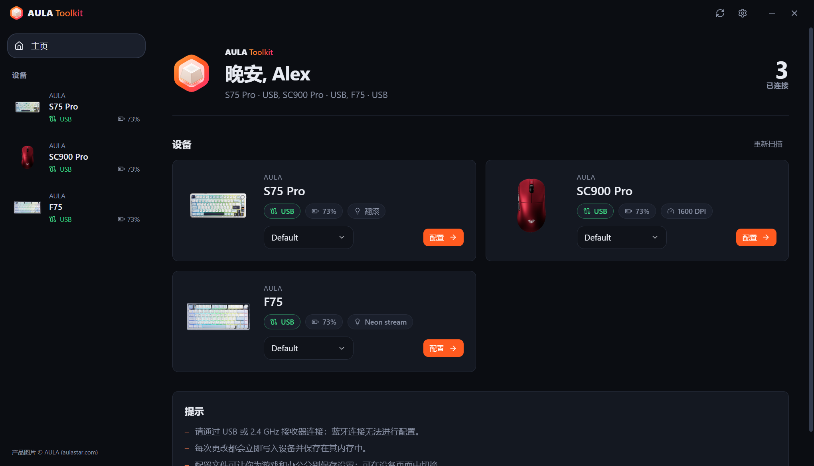 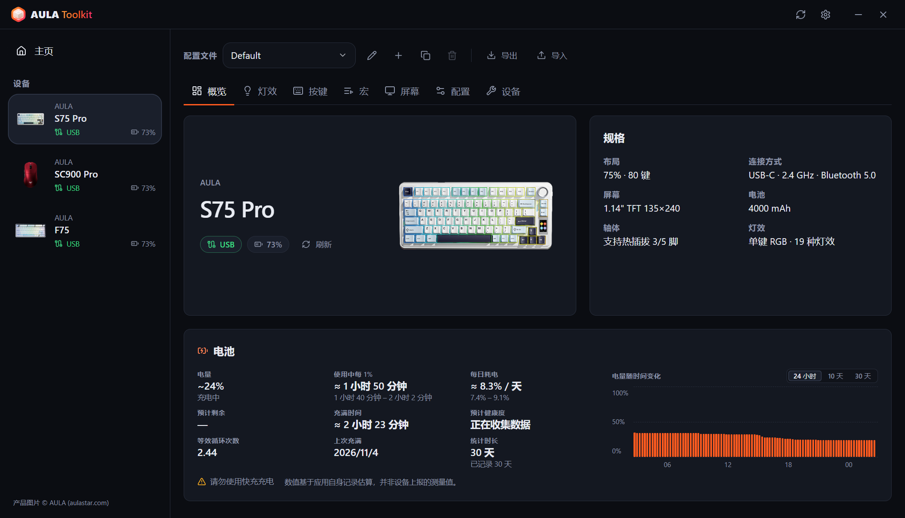

### 键盘
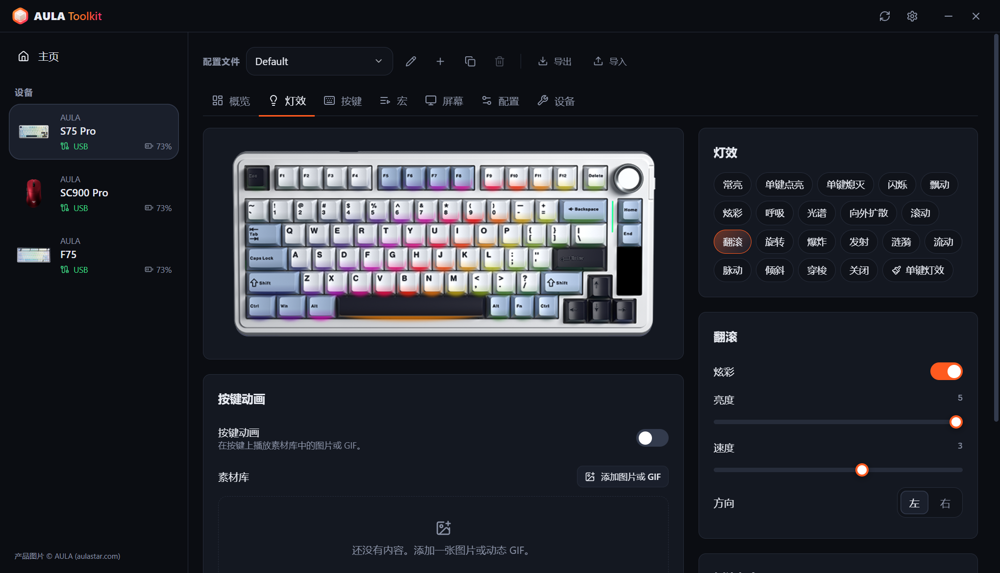 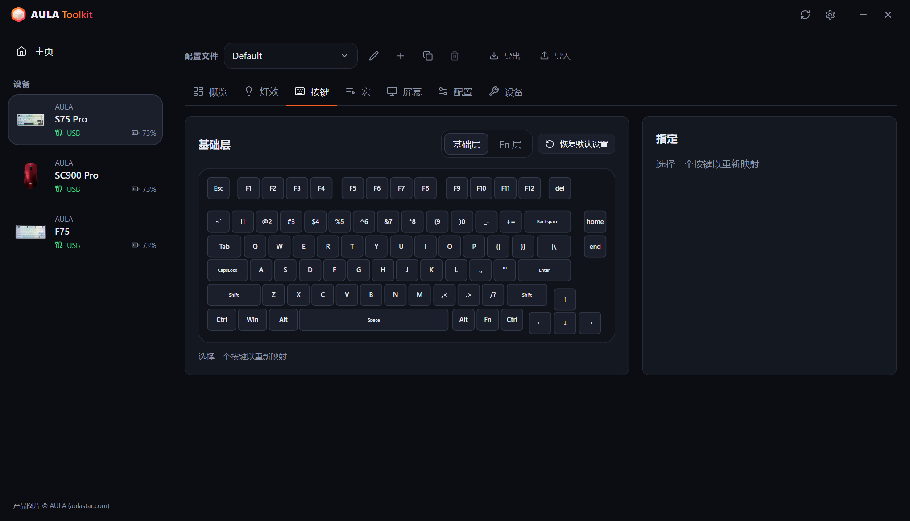
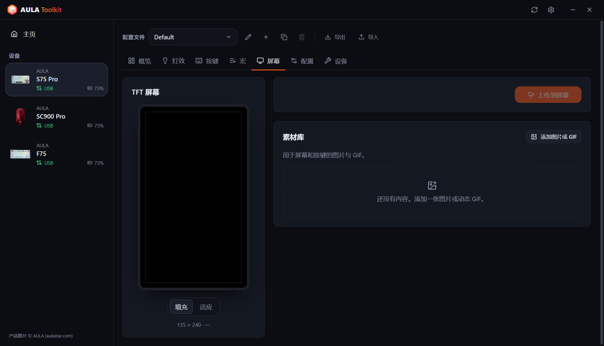 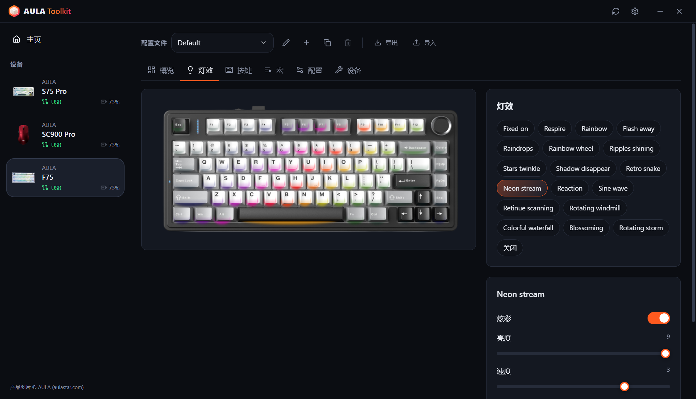

### 鼠标
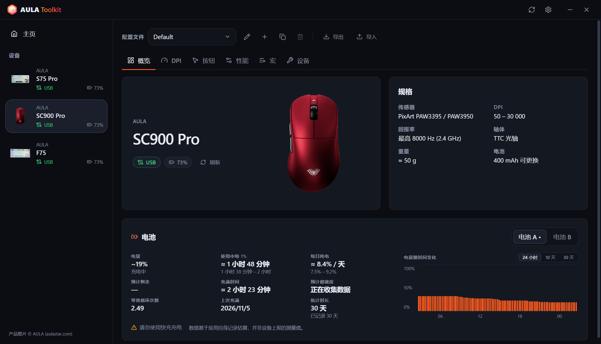 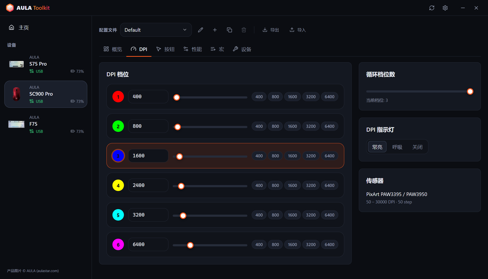
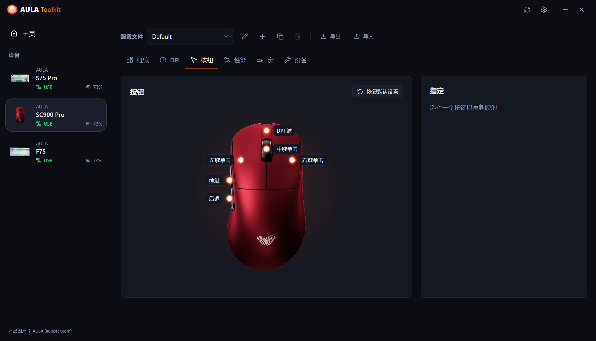 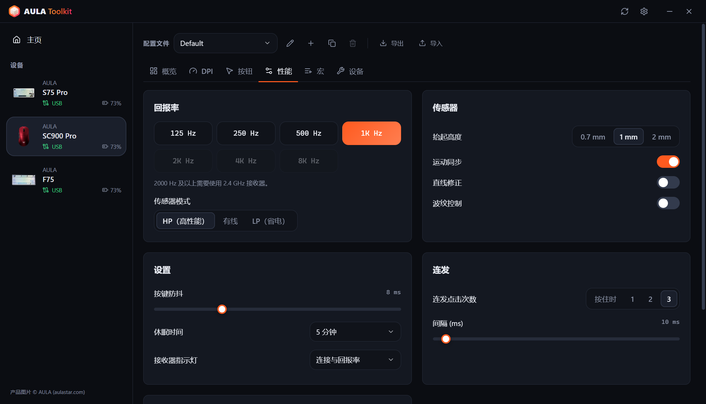

### 托盘概要和屏幕显示
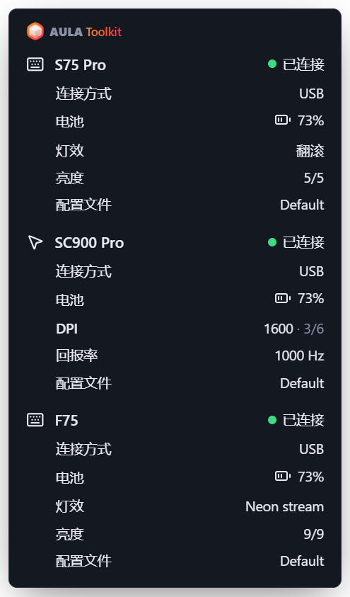 &nbsp; 

### 设置
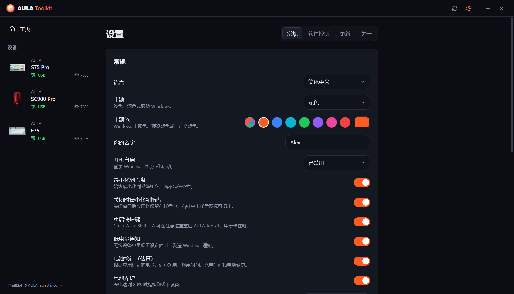 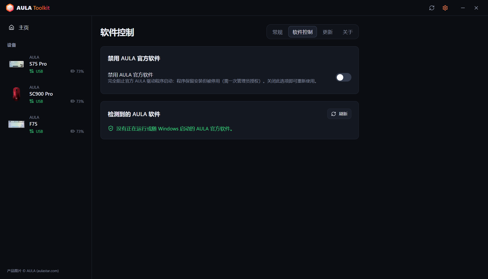
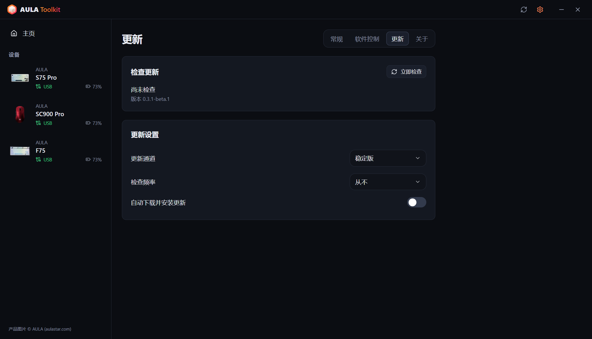 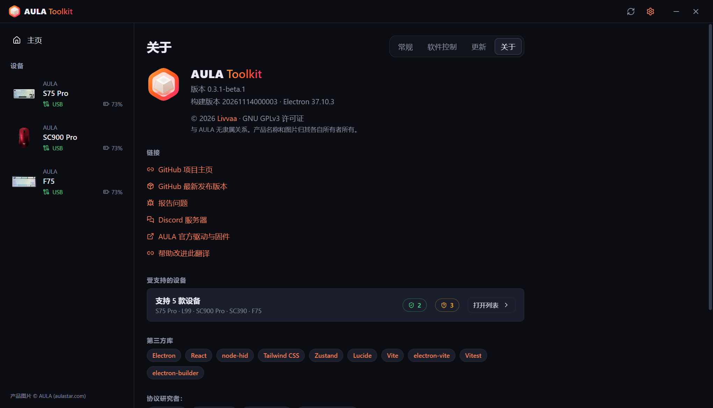
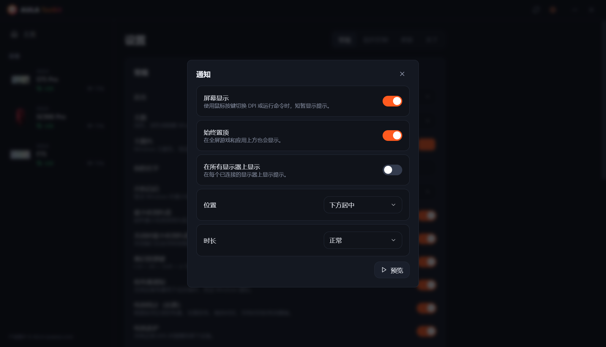 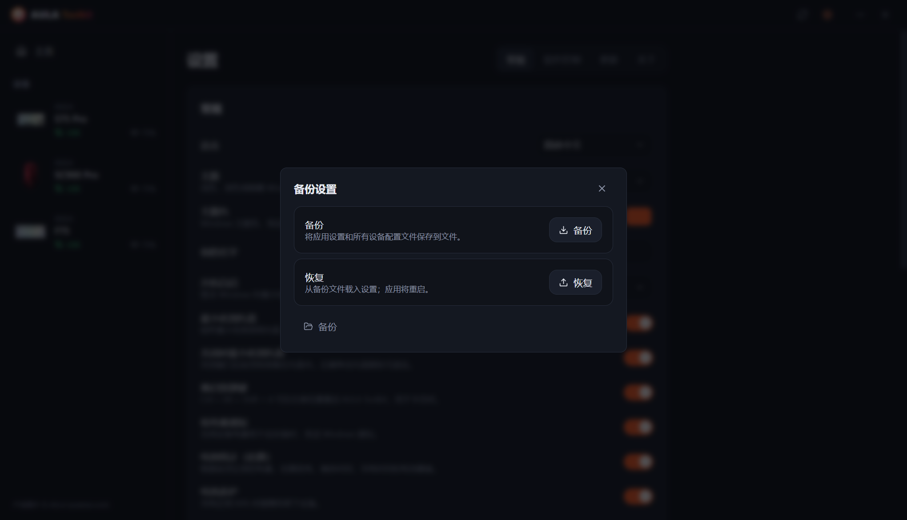

---

# 目录
  - [免责声明](#免责声明)
  - [下载](#下载)
  - [兼容性](#兼容性)
  - [功能](#功能)
  - [致谢](#致谢)
  - [常见问题](#常见问题)
  - [启动参数](#启动参数)
  - [如何收集日志？](#如何收集日志)
  - [参与贡献](#参与贡献)
  - [许可证](#许可证)

## 免责声明

**本工具不提供任何担保，使用风险由你自行承担。**

AULA Toolkit 使用从官方驱动逆向分析得到的协议与设备通信。报告问题前请先阅读本文件，这里已经解答了最常见的问题。

## 下载

每个版本都会发布两种构建：
* **安装版**：只为当前用户安装，因此不需要管理员权限。
* **便携版**：单个 `.exe` 文件，无需安装即可运行。

#### 更新

AULA Toolkit 可以自动更新。在 **设置 → 更新** 中配置：
* **更新通道**：**稳定版** 或 **Beta** 版本。
* **检查频率**：从每小时到每月，或从不检查。
* **自动下载并安装更新**：更新会在后台下载，并在你离开电脑时（或关闭应用时）静默安装。你也可以立即安装。

在旧版本上直接安装新版本，会保留你的设置、配置文件和宏。

#### 后续步骤

AULA Toolkit 在托盘中运行时效果最好。在 **设置 → 常规** 中：
1. 将 **开机自启** 设为 *已启用*（或 *已启用（延迟）*，在登录 30 秒后启动）。AULA Toolkit 通过 Windows 计划任务启动，所以使用电池供电时也会启动；每次应用启动时都会检查该任务，如果任务被删除会重新创建。
2. 打开 **关闭时最小化到托盘**。
3. 在 **设置 → 软件控制** 中打开 **禁用 AULA 官方软件**，避免 AULA 驱动和 AULA Toolkit 争抢同一台设备。

> [!WARNING]
> 如果你完全退出 AULA Toolkit，需要它保持运行的功能会停止：屏幕显示、电池通知、托盘概要、按键上的音乐律动和动画，以及 `aula` 命令。已经写入设备的设置会继续生效。

## 兼容性

| 设备 | 连接方式 | 状态 |
|---|---|---|
| **AULA S75 Pro** | USB、2.4 GHz 接收器、蓝牙（状态和电量） | ✅ 已在硬件上测试 |
| **AULA L99** | USB、2.4 GHz 接收器、蓝牙（状态和电量） | 🧪 Beta，用户测试中 |
| **AULA SC900 Pro** | USB、2.4 GHz 接收器、蓝牙（状态和电量） | ✅ 已在硬件上测试 |
| **AULA SC900**（使用 SC900 Pro 驱动的其他版本） | USB、2.4 GHz 接收器 | ⚠️ 可识别，尚未在硬件上测试 |
| **AULA SC390** | USB | 🧪 Beta，用户测试中 |
| **AULA F75** | USB、2.4 GHz 接收器 | ⚠️ 可识别，尚未在硬件上测试 |

Beta 设备的支持基于设备用户提交的官方驱动 USB 抓包。部分功能仍未实现，见下表。

AULA 以同一个 USB ID 销售同款鼠标的多种颜色，所以 AULA Toolkit 无法区分它们。请在设置设备时，或在设备的 **设备** 选项卡中选择你的颜色。

你的 AULA 设备不在列表中？它可能仍在使用上面某种协议，详见[能为我的 AULA 设备添加支持吗？](#能为我的-aula-设备添加支持吗)。

#### 各连接方式支持的功能

**键盘**

| 功能 | S75 Pro · USB | S75 Pro · 2.4 GHz | L99 · USB | L99 · 2.4 GHz | F75 · USB / 2.4 GHz |
|---|:---:|:---:|:---:|:---:|:---:|
| 灯光效果 | ✅ | ✅ | ✅ | ✅ | ✅ |
| 单键灯效 | ✅ | ✅ | ✅ | ✅ | — |
| 按键上的音乐律动和动画（由电脑实时传输） | ✅ | — | ✅ | — | — |
| 显示器关闭时熄灯 | ✅ | ✅ | — | — | — |
| 实时键盘视图，跟随旋钮 / Fn 的更改 | ✅ | — | — | — | — |
| 按键映射、Fn 层、宏 | ✅ | ✅ | ✅ | ✅ | ✅ |
| 键盘设置（Win 锁、休眠、防抖） | ✅ | ✅ | ✅ | ✅ | ✅ |
| 屏幕 | ✅ TFT | — | 即将支持 | — | — |
| 时钟（连接时同步） | ✅ | ✅ | ✅ | ✅ | — |
| 侧边灯条 | ✅ | ✅ | — | — | — |
| 电量 | — | ✅ | — | ✅ | — |
| 连接时读取设备上的设置 | — | — | — | — | ✅ |

**鼠标**

| 功能 | SC900 Pro · USB / 2.4 GHz | SC390 · USB |
|---|:---:|:---:|
| DPI 档位和 DPI 指示灯 | ✅ | 即将支持 |
| 回报率 | ✅ 最高 8000 Hz | ✅ 最高 1000 Hz（有线和接收器） |
| 传感器（抬起高度、波纹控制等） | ✅ | ✅ |
| 按钮和宏 | ✅ | 即将支持 |
| 休眠时间 | ✅ | 即将支持 |
| 电量 | ✅ | — |
| 连接时读取设备上的设置 | ✅ | ✅ |
| DPI 按键的屏幕显示 | ✅ | — |

> [!NOTE]
> 设备只能通过 **USB** 或 **2.4 GHz 接收器** 进行配置。通过蓝牙连接时，设备不提供配置接口，AULA 官方软件也有同样的限制。之前保存的设置在蓝牙下仍然有效，AULA Toolkit 也会显示设备已连接，并显示 Windows 报告的电量。

### AULA 的软件

同时运行 AULA 官方驱动和 AULA Toolkit，会让两者同时与同一台设备通信，可能撤销你的修改或导致读取错误。AULA Toolkit 检测到 AULA 官方程序时，会在窗口底部显示警告栏。**设置 → 软件控制 → 禁用 AULA 官方软件** 可以让它们完全无法启动：它们仍保持安装，但程序会被禁用（Windows 会请求一次管理员授权），开机启动项也会被暂时移走。关闭此选项后它们就能恢复使用，卸载 AULA Toolkit 时也会自动恢复。

## 功能

这个应用可以让你：

- 在一个窗口中配置所有受支持的设备，修改立即生效。
- 绝不擅自覆盖设备上已有的设置：鼠标连接时会读取其设置；在 S75 Pro 上，你用旋钮或 Fn 键更改的灯效、颜色和亮度会被实时识别并保存到你的配置文件中。
- 为每台设备保存多个**配置文件**，并以文件形式导出或导入。
- 按下鼠标上的 DPI 键或运行命令时，看到实时的**屏幕显示**。
- 在 S75 Pro 的按键上播放由电脑实时传输的**音乐律动**光柱和**动画（GIF）**。
- **在显示器关闭时关闭**键盘灯光，显示器唤醒后再重新打开。
- 遇到卡住的情况时，随时按 **Ctrl + Alt + Shift + A** 重启应用。
- 将鼠标悬停在托盘图标上，查看所有已连接设备的详细**托盘概要**。
- 接收**低电量通知**、充电时在 80% 发出的**电池养护**提醒，还可以按需查看**电池统计**。
- 无需卸载即可禁用 AULA 官方软件。
- 通过**命令行**使用 `aula` 控制设备。
- 支持 **10 种语言**：English、Türkçe、Русский、简体中文、Українська、Tiếng Việt、Português (Brasil)、Español、Deutsch 和 Français。
- 选择**浅色、深色或跟随系统的主题**以及主题色。

### 键盘

* **灯效**：所有硬件灯效，可调颜色、亮度、速度和方向，并在你的键盘照片上实时预览。
* **实时视图**（S75 Pro，USB）：键盘图片会显示 LED 当前的样子。你用旋钮或 Fn 键切换灯效后，应用会在几秒内识别出来，自动选中并显示在界面上。键盘本身不会报告当前灯效，所以这项功能是根据 LED 颜色判断的：按下按键前一直不亮的灯效在空闲时看起来一样，旋钮转得很快时也可能跳过中间的某个灯效。
* **单键灯效**（S75 Pro）：逐个给按键上色，或者一次填满整个键盘。
* **播放音乐时**：按键上的光柱跟随电脑播放的声音变化（12 种配色方案，可调振幅和背景，与官方驱动一致），或者让键盘切换到你选择的灯效。光柱需要使用 USB 线连接；使用接收器时会改用灯效。
* **按键动画**（S75 Pro，USB）：在按键上播放素材库中的图片或 GIF，约每秒 20 帧。
* **息屏熄灯**（S75 Pro）：显示器关闭时，按键灯和侧边灯条熄灭。
* **按键映射**：将基础层和 Fn 层的按键重新映射为按键、鼠标按钮、媒体键、快捷键或宏。
* **宏**：按真实时间间隔录制按键操作，之后还可以编辑。
* **TFT 屏幕**（S75 Pro，USB）：从素材库上传图片或动态 GIF。拖动预览可以选择显示区域；较长的 GIF 会适配到屏幕的 141 帧，而不改变播放节奏。每次键盘连接时都会同步时钟。
* **配置**：锁定 Windows 键、Alt+F4 和 Alt+Tab，设置休眠时间和按键响应时间。
* **重置**：恢复键盘默认设置，或执行完整的恢复出厂设置。

### 鼠标

* **DPI**：最多六个档位，可设置当前档位、循环中的档位数量和 DPI 指示灯。
* **回报率**：最高 8000 Hz。高于 1000 Hz 需要使用 2.4 GHz 接收器。SC390 的有线和接收器分别设置回报率。
* **传感器**：抬起高度、运动同步、直线修正、波纹控制和传感器模式。SC390 上为：抬起高度、超低延迟、超低功耗、波纹控制和移动唤醒。
* **按钮**：除左键外的所有按钮都可以重新映射，包括连发和宏。
* **时间**：按键防抖和休眠时间。
* **电池**：电量和充电状态。SC900 Pro 的两块电池（以及你添加的其他电池）会分别记录。

### 屏幕显示

用鼠标自带的按键切换 DPI 时，屏幕上会出现一个小提示，显示新的数值和当前档位。在 S75 Pro（USB）上，你在键盘上更改灯效、颜色或亮度时它也会显示新的值，并会确认通过 `aula` 命令做出的更改。屏幕上传、80% 提醒和重启也会在这里显示。在 **设置 → 通知** 中，你可以关闭它、选择位置和时长、让它显示在全屏游戏上方，或者在所有显示器上显示。

### 备份

**设置 → 备份设置** 会把应用设置和所有设备配置文件保存到一个文件中，之后可以从该文件恢复，例如在重装 Windows 之后。

### 电池统计

**设置 → 常规 → 电池统计**（默认开启）会在每台设备的概览中显示一张电池卡片：

* **电量**：当前电量，或最近一次读取的电量及其读取时间。使用有线连接且没有读数时，先显示估算值，然后显示 99+。
* **使用中每 1%**：设备通过接收器使用时，每 1% 电量能用多久。
* **每日耗电** 和 **预计剩余**：按日历时间计算，包括设备休眠或应用关闭的时间。
* **充满时间** 和 **预计健康度**：根据电池在中段电量区间的充电速度计算。
* **等效循环次数**、**上次充满** 以及一张有三种视图的图表：最近 24 小时、近 10 天每天的耗电量，以及近 30 天的电量变化。将鼠标悬停在图表上可查看精确数值；充电过程以绿色显示。

记录足够的数据后，各项数值会以范围的形式显示。通过 USB、2.4 GHz 接收器和蓝牙（从 Windows 读取）都会记录电量。**电池养护** 默认随统计功能一起开启，充电到 80% 时会提醒你拔掉设备。

> [!NOTE]
> AULA 设备只报告电量百分比。以上所有数值都是根据 AULA Toolkit 记录的电量计算出的**估算值**。

> [!WARNING]
> 不要使用快充充电器，包装盒上也是这么写的。

### CLI

你可以通过命令行控制 AULA Toolkit。命令名为 `aula`，安装在安装目录下的 `resources\bin` 中（默认为 `%LOCALAPPDATA%\Programs\AULA Toolkit\resources\bin\aula.cmd`）。安装版会自动把该目录添加到你的用户 `PATH`，因此在任何新打开的终端中都能使用 `aula`；卸载时会再将其移除。便携版不会修改 `PATH`。**设置 → 常规 → 命令行** 会显示确切路径，并提供复制按钮。

该命令与正在运行的应用通信。如果 AULA Toolkit 没有运行，`aula` 会先在托盘中启动它。不需要管理员权限。

命令

* `aula status`：列出已连接的设备（加上 `--json` 可输出机器可读格式）
* `aula profile list`：列出某台设备的配置文件
* `aula profile set <name>`：切换到某个配置文件
* `aula dpi`：显示鼠标的 DPI 档位
* `aula dpi stage <n>`：激活第 `<n>` 个 DPI 档位（从 1 开始）
* `aula dpi <value>`：将当前档位设为 `<value>` DPI
* `aula polling <hz>`：设置鼠标回报率
* `aula light list`：列出键盘的灯效
* `aula light <effect> [--color #rrggbb] [--brightness n] [--speed n]`：设置键盘灯效
* `aula brightness <n>`：设置键盘灯光亮度
* `aula osd on|off`：打开或关闭屏幕显示
* `aula show` / `aula hide`：显示或隐藏窗口
* `aula version`：输出应用版本

连接了多台同类设备时，可以用 `-d <id>` 选择其中一台，例如 `aula profile list -d sc900`。命令成功时退出码为 `0`，失败时为 `1`，因此可以在脚本中使用。

## 致谢

AULA Toolkit 由 **Livvaa**（[GitHub](https://github.com/Livvaa)）创建和维护。

特别感谢以下项目，它们公开的逆向工程成果让本项目成为可能：
* [open-aula](https://github.com/paulcoding810/open-aula)：AULA 键盘协议。
* [AulaSofwareLinux](https://github.com/thought-train/AulaSofwareLinux)：AULA F75 系列使用的协议。
* [IncottHIDApp](https://github.com/romkazor/IncottHIDApp) 和 [OpenMouse](https://github.com/OpenMouse-Project/mouse-protocol)：PixArt 8K 鼠标协议。

所有协议细节都已与 AULA 官方驱动交叉核对。产品图片 © AULA（[aulastar.com](https://www.aulastar.com)）。

### 第三方库

* **Electron**（[electron/electron](https://github.com/electron/electron)）
* **React**（[facebook/react](https://github.com/facebook/react)）
* **node-hid**（[node-hid/node-hid](https://github.com/node-hid/node-hid)）
* **Tailwind CSS**（[tailwindlabs/tailwindcss](https://github.com/tailwindlabs/tailwindcss)）
* **Zustand**（[pmndrs/zustand](https://github.com/pmndrs/zustand)）
* **Lucide**（[lucide-icons/lucide](https://github.com/lucide-icons/lucide)）
* **electron-vite**（[alex8088/electron-vite](https://github.com/alex8088/electron-vite)）、**Vite**（[vitejs/vite](https://github.com/vitejs/vite)）和 **Vitest**（[vitest-dev/vitest](https://github.com/vitest-dev/vitest)）
* **electron-builder** 和 **electron-updater**（[electron-userland/electron-builder](https://github.com/electron-userland/electron-builder)）

### 翻译

界面支持 10 种语言。并非所有翻译都已经过母语者审校。如果你发现错误，欢迎提交 pull request，每种语言都是 [`src/shared/locales`](src/shared/locales) 中的一个文件。

## 常见问题

#### AULA Toolkit 会损坏我的设备吗？

AULA Toolkit 从不触碰固件。它只发送与官方驱动相同的配置命令（灯光、按键、宏、DPI 等），并已对照该驱动的 USB 抓包进行核对。如果出现异常，可以用设备 **设备** 选项卡中的重置功能或官方软件恢复默认设置。

#### 为什么无法通过蓝牙更改设置？

通过蓝牙连接时，键盘和鼠标在 Windows 中只显示为标准键盘和鼠标。USB 和 2.4 GHz 接收器提供的配置接口在蓝牙下并不存在，所以 AULA Toolkit 和官方软件都无法更改设置。请用数据线或接收器连接，完成修改后再切回蓝牙，设置会保留在设备上。通过蓝牙连接时，AULA Toolkit 会显示连接状态和 Windows 报告的电量。

#### 为什么我的键盘不显示电量？

S75 Pro 通过 2.4 GHz 接收器报告电量，通过蓝牙连接时由 Windows 报告。通过 USB 连接时它处于充电状态，固件不报告电量：AULA Toolkit 会根据测得的充电速度显示估算值，然后显示 99+。

#### 为什么电池循环次数和健康度只是估算值？

AULA 设备没有用于统计循环次数或测量损耗的电池芯片。它们只报告一个百分比，所以 AULA Toolkit 根据该百分比的变化时间来估算其他所有数据。健康度来自电池的充电速度，因此需要一个月或更长时间内的多次充电记录。

#### AULA Toolkit 能读取 S75 Pro 屏幕上的图片或固件版本吗？

不能。键盘固件可以接收图片，但没有把图片发回来的命令，而且所有受支持的设备都不会报告固件版本。官方软件也做不到。

#### 为什么运行安装程序时 Windows 会发出警告？

安装程序目前还没有代码签名，所以 Windows SmartScreen 会显示未知发布者的警告。AULA Toolkit 是开源的，你也可以从本仓库自行构建。选择 **更多信息 → 仍要运行** 即可继续。

#### 我的鼠标颜色和图片不一样。

AULA 对同一型号的所有颜色使用相同的 USB ID。请在设备的 **设备** 选项卡中选择你的颜色。

#### 能为我的 AULA 设备添加支持吗？

有可能。大多数 AULA 键盘和鼠标都沿用了 AULA Toolkit 已经支持的某个协议系列。请求中需要包含哪些信息，请参阅[参与贡献](#参与贡献)。

## 启动参数

* `--hidden`：启动时最小化到托盘。由 *开机自启* 使用。
* `--delayed`：等待 30 秒后再连接设备。*开机自启 → 已启用（延迟）* 现在改为在计划任务中等待。

## 如何收集日志？

日志对排查任何问题都很有帮助。提交 issue 时请**务必**附上日志。

#### 方法 1：诊断包（推荐）
1. 打开 **AULA Toolkit**。
2. 进入 **设置 → 关于**。
3. 点击 **保存诊断包**。它会把设备状态和通信日志保存到一个文件中，你可以把它附加到 issue 里。

#### 方法 2：日志文件
1. 重现问题。
2. 打开 `运行`（Win+R），输入 `"%APPDATA%\AULA Toolkit\logs"` 并按确定。
3. 附上最新的 `hid-<date>.log` 文件。

你也可以在 **设置 → 常规 → 高级** 中实时查看日志。

## 参与贡献

非常欢迎反馈，有问题请随时报告。也欢迎提交 pull request。请先阅读[贡献指南](CONTRIBUTING.md)。

有问题、想法，或者只是想聊聊？欢迎加入 [Discord 服务器](https://discord.gg/u9FbaJGtCe)。

#### 设备支持

支持更多 AULA 设备需要测试者。提交请求时，请附上：

1. 完整的型号名称（例如 *AULA F87 Pro*）。
2. USB ID，可在 **设备管理器 → 你的设备 → 详细信息 → 硬件 Id** 中找到（例如 `VID_0C45&PID_800A`）。
3. 你使用的连接方式（USB 或 2.4 GHz）。
4. 一个诊断包（参见[如何收集日志？](#如何收集日志)）。
5. 如果可以：官方驱动的 USB 抓包。安装 [Wireshark](https://www.wireshark.org/download.html) 和 USBPcap，关闭 AULA Toolkit，开始抓包，然后在官方驱动中一次只更改一项设置，并记下操作顺序。将 `.pcapng` 文件压缩为 zip 后附上。L99 和 SC390 就是这样加入支持的。

## 许可证

Copyright (C) 2026 Livvaa

AULA Toolkit 是自由软件：你可以依据自由软件基金会发布的 GNU General Public License 条款
重新分发和/或修改它，可以使用该许可证的第 3 版，或者（由你选择）任何更新的版本。
完整文本请参阅 [LICENSE](LICENSE)。

发布本程序是希望它能有所帮助，但不提供任何担保；甚至不包括对适销性或特定用途适用性的
默示担保。

AULA Toolkit 与 AULA 没有任何关联。产品名称和图片归其各自所有者所有。
